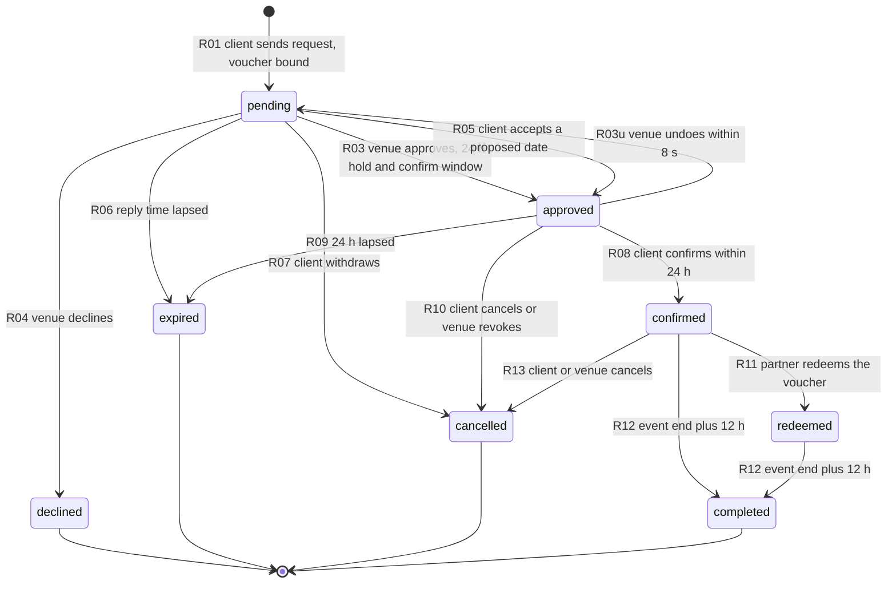
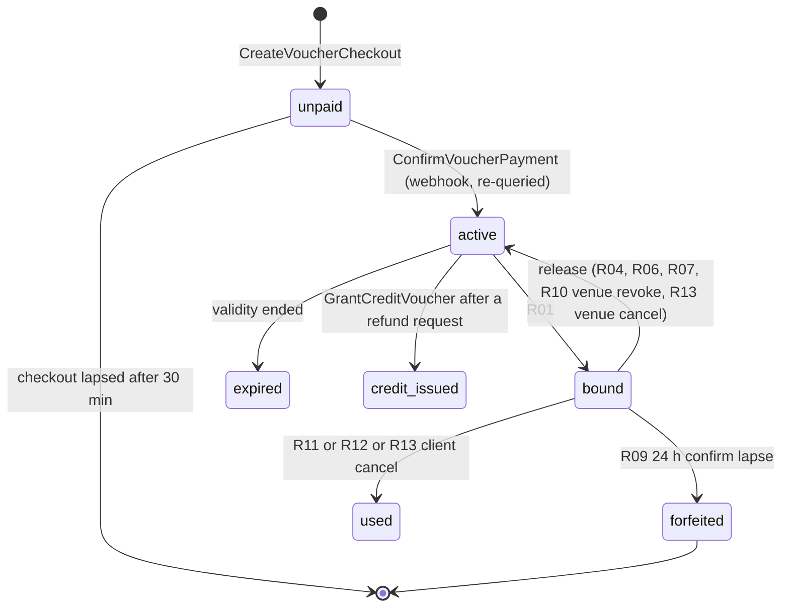

# Request state machine (voucher model)

> Status: binding for the prototype, the API and both apps from ADR 0033 (2026-10-14). It replaces the earlier nine-status payment machine of ADR 0003 and the pay-window rules of ADR 0001. Still binding from the earlier ADRs: request-then-approve with no calendar claim while pending (ADR 0001 D5), reply SLA and escalation (D6), counter-offers, absolute client times, halls x sessions x sections (ADR 0002). Business rules: [voucher-model](../product/voucher-model.md). Money: [pricing-and-payments](pricing-and-payments.md). Tables: [data-model](data-model.md). The object is still called a **booking** in the database and API (`bookings`, reference `GZ-YYMM-XXXX`); in product copy it is a **request** until it is confirmed.

## 1. Principles

1. **A request is a request for a price.** Sending one binds a paid voucher; approval holds the date for 24 hours; the client confirms; the partner redeems the voucher. No money moves inside this machine. The voucher has its own machine (section 5).
2. **Nothing is held while pending.** A pending request holds no date (ADR 0001 D5). Approval creates a hold of exactly 24 hours; confirmation converts it to a booking claim.
3. **The client must confirm within 24 hours of approval.** If not, the approval lapses (`expired`, reason `client_no_confirmation`), the hold is released and the voucher is **forfeited** (`forfeited`: not valid, never returns; ADR 0035 D4). The client confirms by going to the hotel or service and paying the reservation there.
4. **Statuses are few; changes are objects.** Counter-offers (date proposals) are child objects. There is no in-app reschedule after confirmation in the MVP (OQ-V-05).
5. **One screen per app, many variants.** `CL-BKNG-02` (client) and `HL-BOOK-03` (partner) render every status.
6. **Every transition is a guarded compare-and-swap** on `(status, version)` and appends an immutable `booking_events` row. The loser of a race sees an "already updated" sheet (`409 BOOKING_STATE_CONFLICT`).
7. **The database arbitrates slots.** `slot_claims` has an exclusion constraint on `(hall_id, during)`. Service-provider requests have no slot claims (see section 8).
8. **Absolute time to the client.** Deadlines are stored UTC and shown as Kuwait time. A live countdown appears only in the last 60 minutes of the 24 h confirm window.

## 2. Diagram

`R14` (Super Admin or support override, audited, reason required) can move any status to any other and is not drawn. `draft` exists only on the client device.

## 3. Status vocabulary

| Status | PRD family (filters, reports) | Client chip EN / AR | Partner label | Chip style (icon plus label) | Voucher position |
|---|---|---|---|---|---|
| `pending` | Pending | Pending / بانتظار الرد | Pending | Gold tint, clock | `bound` |
| `approved` | Approved | Approved, confirm within 24 h / تمت الموافقة · أكدوا خلال 24 ساعة | Awaiting client | Gold outline, hourglass | `bound` |
| `confirmed` | Approved | Confirmed / مؤكد (headline حجز مؤكد) | Confirmed | Functional success, check | `bound` |
| `redeemed` | Approved | Voucher redeemed / تم استخدام الكوبون | Redeemed | Ink tint, ticket-check | `used` |
| `declined` | Rejected | Not accepted / لم يُقبل الطلب | Declined | Functional danger, x | released |
| `expired` | Cancelled (reason shown) | Expired / انتهت المهلة | Missed (no reply) or Lapsed (client did not confirm) | Neutral, clock-off | released |
| `cancelled` | Cancelled | Cancelled / ملغي (+ by me, by venue, by Ghazal) | Cancelled | Neutral ink, x | per voucher rules |
| `completed` | Completed | Completed / مكتمل | Completed | Ink tint, double check | `used` |

Removed from the old vocabulary: `awaiting_deposit` (now `approved`), `rejected` (now `declined`), `refunded` (refunds belong to the voucher), `no_show` (belongs to visits). Chip words for Pending and Not accepted stay as ADR 0013 D4 fixed them; `Expired`, `Confirmed`, `Voucher redeemed` need owner acknowledgement (OQ-B-21 continues).

## 4. Transitions

`event end` is the end of the last section's session (may fall after midnight). One handler per row in the `bookings` module.

| ID | Transition | Command and actor | Guards | Effects | Notifications (push unless stated) |
|---|---|---|---|---|---|
| R01 | none to `pending` | `SendRequest`, client | signed in; verified phone (`PHONE_VERIFICATION_REQUIRED`); an `active` voucher bound to this target and a quote that still matches (`VOUCHER_QUOTE_MISMATCH`); fewer than 3 open requests across the wedding file (`OPEN_REQUEST_LIMIT`); guests inside package and hall limits; lead time valid; slot not booked or blocked (held is allowed); consent to terms stored; target allows vouchers | booking, sections, lines, price snapshot (standard and voucher totals); voucher `active` to `bound`; `respond_by` set (forced 4 h and Urgent when the event is 14 days or less away); **no claim** | Partner: push plus badge (WhatsApp at 80% of SLA). Client: in-app receipt, email summary |
| R03 | `pending` to `approved` | `Approve`, partner (`booking:approve`: Admin, Manager, Reception) | target `status = active`; hold insertable (else `409 SLOT_UNAVAILABLE`, Accept disabled with "Date held for another couple"); optional lower price only (never higher) | `hold` per section until `confirm_by = now + 24 h`; `undo_until = now + 8 s`; competing requests flagged `blocked_by_hold` | Client push plus WhatsApp with the exact confirm-by time, **deferred to `undo_until`** |
| R03u | `approved` to `pending` | `UndoApprove`, partner | before `undo_until` only | hold released; pending notifications deleted; `respond_by` unchanged | none; the client never saw the approval |
| R04 | `pending` to `declined` | `Decline`, partner | reason required: `date_unavailable`, `capacity_mismatch`, `package_not_offered`, `other` (note required and shown) | voucher released (reusable, refundable) | Client: gentle reason, "Your voucher is still yours: use it again or refund it", three alternatives free on the date |
| R05 | `pending` to `approved` | `ProposeDates` (partner, `booking:propose_date`) then `AcceptProposal` (client) | 1-3 dates, same hall and session, re-quoted per date (voucher price held); valid 48 h; new slot holdable. Booking stays `pending` while a proposal is open. Decline: to `cancelled` (`counter_offer_declined`). Lapse: to `expired` (`client_no_response`) | on accept: hold on the new slot, `event_date` updated, the 24 h confirm window starts | Client push when proposed; partner push when answered |
| R06 | `pending` to `expired` | `ExpireRequest`, system | `respond_by` passed | voucher released (reusable at the same venue; a refund request to support is allowed); response-rate hit | Client: "No reply. Your voucher is still yours" plus similar venues; partner: "Missed" |
| R07 | `pending` to `cancelled` | `Withdraw`, client | none (free) | voucher released (reusable, not refundable) | Partner: silent removal plus timeline entry |
| R08 | `approved` to `confirmed` | `Confirm`, client | before `confirm_by`; claim still active; not undone | `hold` becomes `booking`; competing requests become `expired(slot_taken)`; voucher code and QR emphasised; completion and review jobs scheduled | Client: confirmation, calendar file. Partner: "Client confirmed" |
| R09 | `approved` to `expired` | `ExpireApproval`, system | `confirm_by` passed | claim `expired`; voucher `forfeited` (not valid, no refund request offered); partner nudged to approve the next competing request | Client reminders at -12 h, -3 h (WhatsApp) and -1 h, then "The hold was released". Partner: "Date reopened" |
| R10 | `approved` to `cancelled` | `CancelApproved` (client) or `Revoke` (partner Admin or Manager, reason required, reliability strike) | none for the client | claim released; voucher released (client cancel: not refundable; revoke: refundable) | the other party |
| R11 | `confirmed` to `redeemed` | `RedeemVoucher`, partner (`voucher:redeem`: Admin, Manager, Reception) | code belongs to this partner; request `confirmed`; voucher `bound`, not used | `redeemed_by`, `redeemed_at`; voucher `bound` to `used` | Client: "Voucher redeemed"; partner: confirmation |
| R12 | `confirmed` or `redeemed` to `completed` | `Complete`, system at event end plus 12 h, or partner manual | event passed | voucher `used` if not already; review prompt scheduled | Client: review prompt next morning |
| R13 | `confirmed` to `cancelled` | `ClientCancel` or `VenueCancel` (Admin or Manager only) | reason chips for client: `plans_changed`, `found_other_venue`, `date_changed`, `budget`, `other`; venue: `hall_unavailable`, `safety_or_maintenance`, `other` | claim released; client cancel: voucher consumed (`used`, `cancelled_after_confirm`), no refund; venue cancel: voucher released (reusable, refundable), reliability strike | the other party; support follow-up on venue cancel |
| R14 | any to any | `AdminOverride`, Super Admin or support | audit reason required | voucher adjusted as needed | Both |

A redeemed request can be cancelled only through support (the client and venue already agreed the deal off-app); the voucher stays `used`.

## 5. The voucher machine (child object)

| Command | Actor | Guards | Effect |
|---|---|---|---|
| `CreateVoucherCheckout` | client | signed in; target active and voucher-enabled; saving test passes; no other `active` voucher for the same target and quote (one is reused) | `unpaid` voucher, gateway session, 30 min |
| `ConfirmVoucherPayment` | system (webhook) | signature valid; **re-queried** status SUCCESS; amount equals `voucher_fee_fils` | `active`, code and QR issued, receipt |
| `RequestVoucherRefund` | client (eligible cases) | eligibility per [voucher-model](../product/voucher-model.md) section 4.4 | `refund_requests` row `open`, opens the support chat entry; no money moves |
| `GrantCreditVoucher` | support (Super Admin) | open `refund_requests` row; audit reason | request `granted`, original voucher `credit_issued`, new voucher of kind `credit` (unbound, 60 days) |
| `ForfeitVoucher` | system (R09) | `confirm_by` passed on a `bound` voucher | `forfeited` |
| `ExpireVoucher` | system sweeper | validity passed, state `active` | `expired` |

Validity and reuse numbers are configuration (section 7).

## 6. Overlays and sub-machines

| Object | Lives on | Values | Rule |
|---|---|---|---|
| `blocked_by_hold` | `pending` | bool | Second request on a held date shows "Date held by another couple". Counts are never shown. If the holder confirms, the others become `expired(slot_taken)` with an alternatives push and their vouchers released. If the hold lapses, the partner is nudged to approve the next |
| `date_proposals` | `pending` | `proposed`, `accepted`, `declined`, `expired`, `withdrawn` | One client card "Venue proposed another date" with "No penalty if you decline: your voucher stays yours" |
| `confirm_countdown` | `approved` | derived | Live mm:ss only in the last 60 minutes of the 24 h; absolute time otherwise |
| `urgent` | `pending` | bool | Event within 14 days drives the Urgent tag and the 4 h reply window |
| `issue_report` | `completed` | bool | 72 h "Report an issue" (venue would not honour the voucher price, voucher not redeemed). Opens a support case |
| `slot_claim` | per hall x range | `hold` to `booking` or `released` or `expired`; `block` to `released` | Holds expire by a 30 s sweeper plus lazy release inside the claiming transaction |

## 7. Timers (single source for every countdown and job)

All stored UTC, shown Asia/Kuwait. Values are configuration with bounds.

| Timer | Default | Bounds | Set by |
|---|---|---|---|
| Partner reply time | 24 h | 12 / 24 / 48 h; forced 4 h and Urgent when the event is 14 days or less away | Partner within bounds |
| Escalation | push to staff at 50% elapsed; WhatsApp to manager and reception at 80%; expire at 100% | fixed | Platform |
| **Client confirm window after approval** | **24 h** | **fixed (owner rule)** | Platform |
| Approval undo | 8 s | fixed | Platform |
| Counter-offer validity | 48 h | fixed | Platform |
| Client confirm reminders | -12 h, -3 h (WhatsApp), -1 h | fixed | Platform |
| Max open requests | 3 (`pending` plus `approved`) | fixed | Platform |
| Voucher checkout | 30 min | fixed | Platform |
| Voucher validity / reuse window | 60 days / 60 days | 30-180 | Super Admin |
| Credit voucher validity | 60 days from the grant | `credit_validity_days` | Super Admin |
| Auto-complete | event end + 12 h | fixed | Platform |
| Issue report | 72 h after completion | fixed | Platform |
| Review window | opens event end + 24 h (prompt next morning), closes +60 days, editable 14 days | fixed | Platform |
| Visit group chat | read-only 24 h after the slot, archived 30 days | fixed | Platform |
| Listing plan reminders | -7 d and -1 d before expiry; rejected listing keeps its paid plan 14 days | fixed | Platform |

Jobs (BullMQ repeatable, idempotent, each moving state only through the same compare-and-swap): `sla-sweeper` (R06, escalations), `hold-sweeper` (R09, claim expiry, every 30 s), `proposal-sweeper`, `reminder-scheduler`, `completion-sweeper` (R12), `voucher-expiry-sweeper`, `outbox-dispatcher` (honours `undo_until`), `refund-submitter` (within 1 business day), `review-prompt`, `listing-expiry-sweeper`, `visit-chat-closer`.

## 8. Targets: halls, providers, governmental facilities

| Target | Request allowed | Slot claim | Visits | Voucher |
|---|---|---|---|---|
| Hotel or private hall (hall x date x session) | yes | yes (hold, booking) | yes | yes |
| Service-provider listing (catering, buffet, floral, decor, planning, secondary categories) | yes (a service date and quantity, no calendar claim in the MVP) | none | no (OQ-V-11) | yes |
| Governmental facility | no (information, official-channel hand-off) | none | no | no |

For a provider the transitions are the same, except R03 has no hold insertion (the 24 h confirm window still applies) and the "date held by another couple" overlay does not exist.

## 9. What each side sees and can do

| Status | Client (`CL-BKNG-02` variant) | Partner (`HL-BOOK-03`) |
|---|---|---|
| `pending` | "Request sent. Your voucher is attached. Nothing is held yet." Expected reply time, timeline, price breakdown (standard struck through, voucher price), Edit, Withdraw, Message, Call | SLA bar, Urgent tag, "+N other requests for this date" (count only), voucher chip with the code last four, sticky Accept, Propose another date, Decline |
| `approved` | "Approved. Confirm by Fri 13 Nov, 4:00 PM." 24 h countdown (live in the last hour), primary **Confirm booking**, secondary Cancel | Hatched Held cell with timer, "Waiting for the client to confirm", Call, Chat, Revoke |
| `confirmed` | Voucher card with code and QR, price locked at the voucher price, "Pay {venue} directly, then show this code", Add to calendar, Book a visit, Message, Cancel | Booked cell, voucher chip, **Redeem voucher** action (code or QR), Cancel (Admin, Manager) |
| `redeemed` | "Voucher redeemed on {date}" | Redeemed on {date} by {staff} |
| `completed` | Review prompt next morning; Report an issue for 72 h | Reply to review |
| `declined` | Gentle reason, "Your voucher is still yours", three halls free on the date | Archived in Past > Declined |
| `expired` | Reason (no reply, confirm window passed, date taken), voucher outcome, Send to similar venues | "Missed" or "Lapsed" in Past |
| `cancelled` | By whom, voucher outcome | Archived with reason |

Partner lists use three segments: Pending, Upcoming (sectioned Awaiting client, then Confirmed, then Redeemed), Past (chips All, Completed, Cancelled, Declined, Expired).

## 10. The Booking Thread

One component on both apps, also the flow progress line. Nodes: **Request, Approval, Confirmation, Redemption, Day** (plus Completed). A node knots gold when done and carries an absolute timestamp; at most two faint future nodes show. Completion rules: Request at R01; Approval at R03 or R05; Confirmation at R08; Redemption at R11; Day at R12. The thread draws on over 320 ms and fills in reading direction (from the right in Arabic).

## 11. Races and edge cases

| Case | Outcome |
|---|---|
| Voucher payment SUCCESS after the checkout lapsed | Webhook re-queried; if SUCCESS and the quote is still valid the voucher becomes `active` anyway (the client paid); otherwise automatic refund and a message |
| Duplicate or retried webhook | `webhook_inbox` unique key; handler idempotent; activate only after the status re-query |
| Approval and withdrawal at the same instant | Whichever commits first wins; the loser sees "already updated" |
| Two requests for one held date | Both `pending`; the second carries `blocked_by_hold`; outcome as in section 6 |
| Partner blocks a date that has pending requests | Warn; pending requests flagged unavailable. A confirmed booking cannot be blocked over (cancel first) |
| Client edits a request | Allowed only in `pending`; new `quote_version`, re-snapshot, partner notified, SLA unchanged; the voucher stays bound only if the saving test still passes |
| Two redemptions of one code | Second attempt answers "Already used on {date}" (`409 VOUCHER_ALREADY_USED`) |
| Wrong partner scans a code | "This voucher belongs to another venue" (`403 VOUCHER_TARGET_MISMATCH`); no information about the other party |
| Partner suspended by admin | Requests preserved; vouchers released as venue-fault (refundable); clients notified |
| Client deletes account | Blocked while `approved` or a future `confirmed` request exists; vouchers `active` are refunded on request before deletion |
| Authority order (Super Admin date-range flag) | Affected confirmed requests are cancelled with `authority_order`; vouchers released as venue-fault |

## 12. Reason codes (one registry in `packages/contracts`)

| Where | Values |
|---|---|
| `declined` | `date_unavailable`, `capacity_mismatch`, `package_not_offered`, `other` |
| `cancelled` by client | `withdrawn` (R07), `counter_offer_declined`, `plans_changed`, `found_other_venue`, `date_changed`, `budget`, `other` |
| `cancelled` by partner | `approval_revoked` (R10), `hall_unavailable`, `safety_or_maintenance`, `other` |
| `cancelled` by system or admin | `authority_order`, `system_error`, `admin_override` |
| `expired_reason` | `venue_no_response`, `client_no_confirmation`, `slot_taken`, `client_no_response` |
| `voucher.release_reason` | `declined`, `venue_no_response`, `withdrawn`, `client_no_confirmation`, `slot_taken`, `approval_revoked`, `venue_cancelled`, `partner_suspended` |
| `voucher.refund_reason` | `venue_fault_release`, `system_error`, `admin_override`, `duplicate_payment` |

Analytics (ADR 0019) maps `declined` to `declined_by_venue`, `expired` with `venue_no_response` or `slot_taken` to `expired`, `expired` with `client_no_confirmation` to `confirm_window_lapsed`, client cancel to `cancelled_by_client`, venue cancel to `cancelled_by_venue`, R12 to `completed_auto` or `completed_manual`. New events: `voucher_purchased`, `voucher_released`, `voucher_redeemed`, `voucher_refunded`, `visit_requested`, `visit_arrived`, `listing_submitted`, `listing_approved`, `listing_rejected` (ADR 0019 stays `proposed-needs-owner`).

## 13. PRD text this model changes

| Requirement | Change |
|---|---|
| CA-BOOK-09 review shows deposit due now and balance | Review shows standard price, voucher price, savings and the voucher; no deposit |
| CA-BOOK-10 confirm submits a request or books instantly | Confirm sends a voucher-bound request; no instant booking |
| CA-BOOK-11 deposit payment follows Confirm | The KD 2 voucher is paid before the request |
| CA-STAT-04 "Approved: the date is secured" | The date is secured only when the client has confirmed (`confirmed`); `approved` says "held for you until {time}, confirm now" |
| CA-STAT-05 rejection outcome | "Your voucher is still yours" replaces "Nothing was charged" |
| CA-STAT-08 Refunded status | A voucher outcome, not a request status |
| CA-STAT-09 cancel with refund preview | Cancel shows the voucher outcome (reusable, consumed, refundable) |
| PL-BOOK-01 six statuses | The eight statuses of section 3 replace the nine of ADR 0003 |
| PL-BOOK-03 expiry releases the hold and deposit | Expiry releases the hold and the voucher |
| HA-BOOK-01 status tabs | Pending / Upcoming / Past with a chip row |
| HA-DASH-03 inline accept and reject | Accept in two taps with 8 s Undo; Decline in three taps via a reason sheet (unchanged) |
| HA-BOOK-05 reschedule | Counter-offer only (R05); no reschedule of a confirmed request in the MVP |
| HA-BOOK-09 payment status | Voucher status |
| HA-BOOK-10 cancel with refund consequence | Cancel shows the voucher consequence for the client and the reliability strike for the partner |

## 14. Implementation notes

- The state machine is a pure function table in `packages/contracts` (`from`, `command`, `guards`, `to`) used by the API, contract tests and the prototype mock store.
- Mandatory tests (ADR 0025): 50 parallel claims on one hall and slot produce exactly one active claim and 49 `SLOT_UNAVAILABLE`; a property test walks every row of sections 4 and 5; webhook scenarios (duplicate, out of order, forged signature, late SUCCESS, KNET pending); two simultaneous redemptions of one code produce exactly one success; tenant isolation generated from the route list.
- Deferred notifications use an outbox (`not_before`) so killing the partner app inside the undo window loses nothing. While `now < undo_until` the client-facing representation is still `pending`.

Next: [pricing-and-payments](pricing-and-payments.md).
