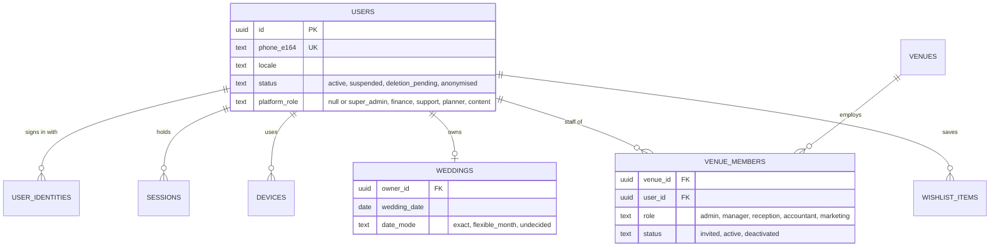
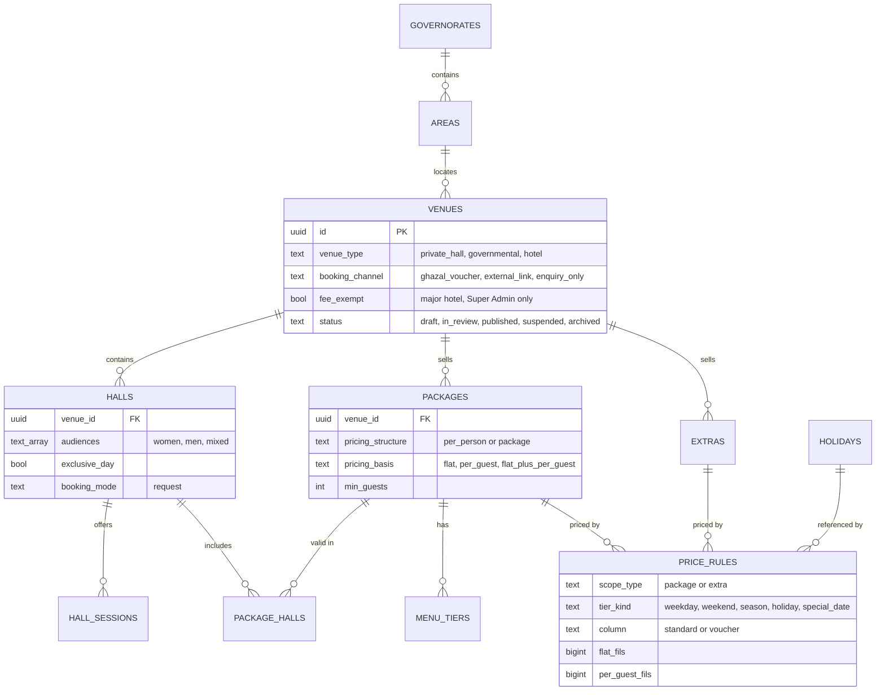
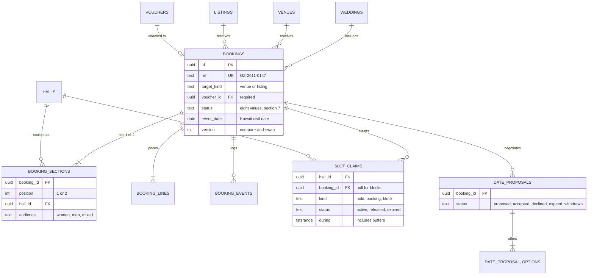
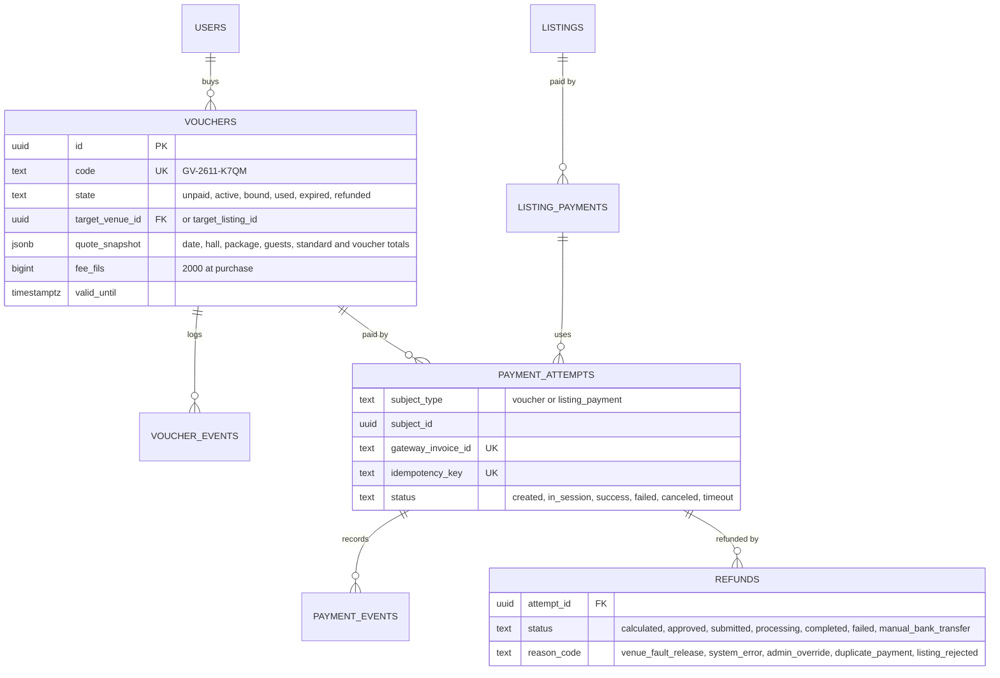
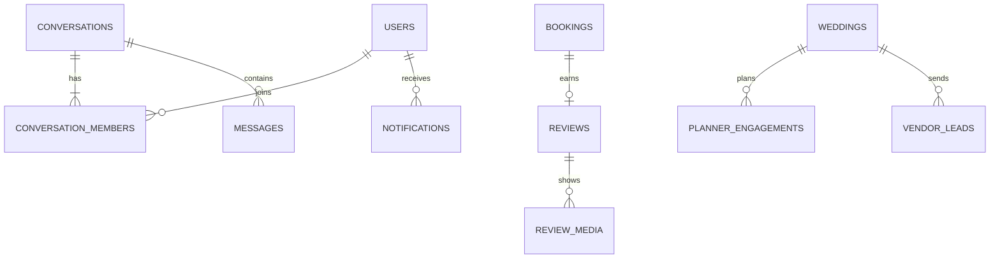
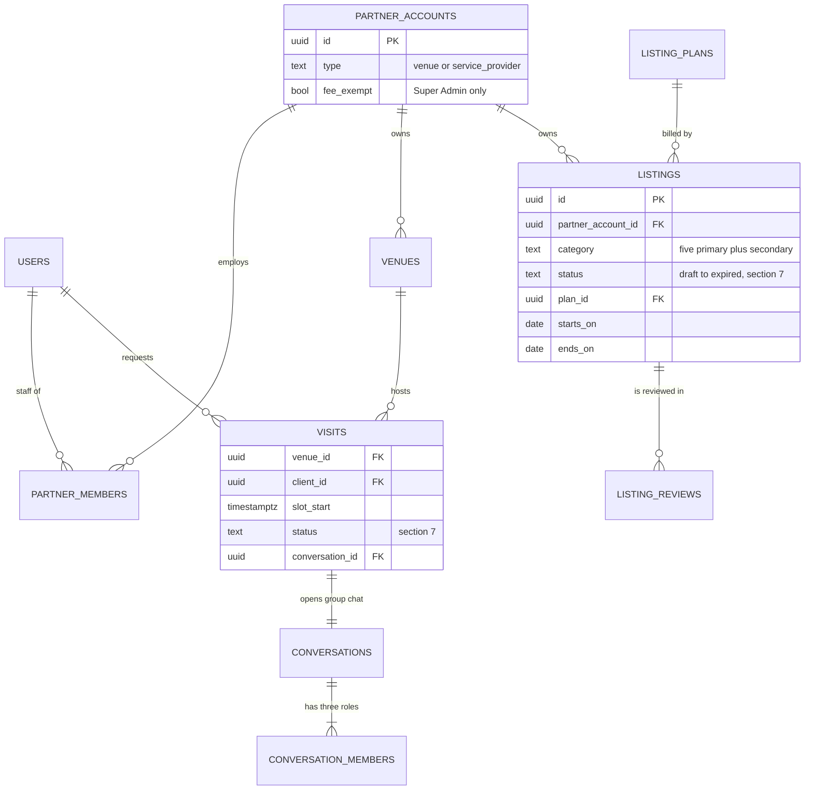

# Data model

> **Voucher model (ADR 0033, 2026-10-14):** sections 3, 4, 5 and 7 are rewritten for the KD 2 voucher marketplace. Retired from the MVP schema: `payment_milestones`, `payouts`, `payout_items`, `commission_rules`, event `ledger_*`, `cancellation_policies` and `_tiers`, `offers`, supplier and bank columns, `loyalty_ledger`, `coupons`. Added: `vouchers`, `voucher_events`, `refunds` (voucher), `visits`, `partner_accounts`, `listings`, `listing_plans`, `listing_payments`, `listing_reviews`, conversation kind `visit_group`. Section 9 lists them.
>
> Status: logical model for PostgreSQL 17 (+ PostGIS, `pg_trgm`, `btree_gist`). It merges the booking-payment research model with ADRs 0002 (sections), 0003 (nine statuses), 0004 (pricing), 0005/0006 (money), 0028 (identity). Diagrams show relationships and the columns that identify rows or drive state; the column tables below each diagram carry the rest. Physical DDL is written by hand in `apps/api/drizzle/` (single-writer); this file is what it is written from. Behaviour lives in [booking-state-machine](booking-state-machine.md) and [pricing-and-payments](pricing-and-payments.md).

## 1. Conventions (every table)

| Topic | Rule |
|---|---|
| Keys | `id uuid` (v7, time-ordered). Human codes are separate unique columns (`bookings.ref`, format `GZ-YYMM-XXXX`, Kuwait month, 4 Crockford base32 characters, retried on collision) |
| Money | `*_fils BIGINT CHECK (>= 0)` unless a signed delta; `currency char(3) DEFAULT 'KWD'` on money rows (GCC later); percentages in basis points (`*_bps INT`); no floats |
| Time | `timestamptz` UTC. `event_date DATE` is a Kuwait civil date and is never converted. Session times are venue-local `TIME`; a claim's `during` is a `tstzrange` built from them |
| Language | Venue and vendor text is `*_i18n jsonb` = `{"ar": "...", "en": "..."}`, both keys required before `status = published` (PL-CORE-08). A generated `*_norm text` column (Arabic search normalisation, see [i18n-rtl](i18n-rtl.md)) carries the trigram GIN index. User text (names, special requests) is stored as typed |
| Enums | `text` + `CHECK (... IN (...))`, not Postgres enums (cheap to extend with expand/contract). Canonical lists live in `packages/contracts`; section 7 mirrors them |
| Tenancy | `venue_id` on every venue-scoped table. Row-level security as a second layer on `bookings`, `slot_claims`, `conversations`, `offers` after the first two API weeks (ADR 0020) |
| Append-only | `booking_events`, `payment_events`, `ledger_entries`, `audit.log`: `UPDATE` and `DELETE` revoked from the application role |
| Deletion | Accounts are anonymised, never deleted (financial rows are retained). Catalogue rows are archived once a booking references them |
| Search | `name_norm` + trigram for names and aliases; PostGIS `geography(Point)` + GiST for nearby |

## 2. Identity, tenancy and the wedding file



| Table | Columns beyond the diagram |
|---|---|
| `users` | `phone_verified_at`, `email`, `full_name` (one field, `dir=auto`), `digit_style` (western, eastern), `deleted_at` |
| `user_identities` | `provider` (phone, password, apple, google), `subject`, `password_hash` (argon2id; password provider only); `UNIQUE (provider, subject)`. Accounts are never merged by email; identities link only through a verified phone (ADR 0028 D1) |
| `sessions` | `device_id`, `family_id` (refresh rotation family; reuse of an old token revokes the family), `refresh_hash`, `expires_at` (sliding), `absolute_expires_at`, `revoked_at`, `acr` (`step_up` only for 5 minutes) |
| `devices` | `platform` (ios, android), `push_token`, `locale`, `trusted_until` (hotel app: 30 days after the new-device OTP) |
| `otp_challenges` | `phone_e164`, `purpose`, `code_hmac`, `attempts` (max 5), `expires_at` (5 minutes), `consumed_at` |
| `venue_members` | `invited_at`, `overrides jsonb` (for example `{"reception_can_decide": false}` for the Admin switch in ADR 0008 D12) |
| `weddings` | `budget_band_id`, `guests_ladies`, `guests_men`, `area_ids uuid[]`, `role` (bride, groom, family, planner). The wedding file; the open-unpaid cap of 3 counts across its bookings. Checklist, budget and countdown rows hang off it |
| `wishlist_items` | `item_type` (venue, service, package), `item_id`. The Compare set is client-local until sign-in, then merged; it is not stored server-side |

A user with several `venue_members` rows (`partner_members` from ADR 0033, section 9) switches partner or venue in the Partner app; the API validates membership against `X-Partner-Id` and `X-Venue-Id` on every call.

## 3. Catalogue, pricing and policy



| Table | Columns beyond the diagram |
|---|---|
| `venues` | `slug UK`, `name_i18n`, `partner_account_id`, `type` (hotel, hall, resort, villa, outdoor, convention, government; display detail), `venue_type` (private_hall, governmental, hotel; the filter value), `luxury_level` (prestige, signature, classic, government), `area_id`, `address jsonb`, `geo`, `external_url`, `official_fees jsonb` (governmental: label, `amount_fils`, refundable), `fee_exempt` (major hotel; Super Admin only), `voucher_enabled` (derived: any package with a voucher column; false for governmental), `response_sla_hours` (12, 24, 48), `visit_enabled`, `visit_slots jsonb` (weekday windows and slot length, default 30 min), `service_charge_bps`, `calendar_confirmed_at`, `trust_level`. Removed: supplier, bank, deposit, balance, guest-lock, cash, instant and payout columns |
| `halls` | `name_i18n`, `capacity_min`, `capacity_max`, `setting` (indoor, outdoor, mixed), `policy_facts jsonb` (per audience: photography, music, dress code, cloakroom, prayer room, separate entrance, bukhoor, outside catering and decor, cut-off; ADR 0015 D6), `season_months smallint[]` (null = year-round; beach and outdoor Nov-Mar) |
| `hall_sessions` | `name_i18n`, `start_time`, `end_time`, `buffer_before_min`, `buffer_after_min`, `weekday_mask`. Platform presets: Afternoon 12:00-16:00, Evening 19:00-01:00, Full day |
| `packages` | `name_i18n`, `audiences`, `pricing_structure` (per_person, package), `max_guests`, `guest_step`, `complimentary_bps`, `inclusions_i18n`, `active`. Names never reuse Silver, Gold or Royal (planner tiers). Removed: `policy_id` |
| `price_rules` | `scope_id`, `column` (`standard`, `voucher`), `weekday_mask`, `valid_range daterange`, `holiday_id`, `special_date`, `priority`. Each rule stores absolute fils per column; a package is voucher-eligible when it has voucher rules whose total beats the standard total by more than `voucher_fee_fils` for the quote; editor shortcuts such as "+20%" write absolutes |
| `extras` | `category` (kosha, florals, photographer, lighting, sound, valet, cake, bridal_suite, companion_hall), `pricing_unit` (flat, per_guest, per_unit), `max_qty`, `companion_hall_id` |
| `offers` | **Retired.** Venue offers, flash sales and coupon codes are replaced by a time-boxed voucher column (`price_rules.valid_range`). Existing rows, if migrated, become voucher rules |
| `holidays` | `name_i18n`, `kind` (ramadan, eid, national, isra_miraj, new_year, authority_order), `span daterange`, `status` (approximate, announced), `hijri jsonb` (label pair, Arabic UI only). Super Admin maintained |
| `cancellation_policies` / `_tiers` | **Retired** from the event flow (no event refunds). Free-text venue terms stay as `venues.terms_i18n` shown on the venue detail |
| `areas` | `governorate_id`, `name_i18n`, `aliases text[]` (search only), centroid. `governorates(id, name_i18n)`: Capital, Hawalli, Farwaniya, Ahmadi, Jahra, Mubarak Al-Kabeer; the region search and the governorate filter read these |
| `media` | `owner_type`, `owner_id`, `zone` (hall, stage_kosha, bridal_suite, buffet, outdoors, entrance_valet, layout), `kind`, `blurhash`, `aspect`, `base_url`, `alt_i18n`, `moderation_status` |

Rules: Venue (brand, terms) > Hall (the bookable unit) > Package (bound to halls through `package_halls`), ADR 0002. The men's and ladies' rooms of one venue are separate halls; a hall declares the audiences it allows and each booking section picks one. `exclusive_day = true` removes the session picker. Tier precedence is fixed by `tier_kind` (special_date > holiday > season > weekend > weekday); `priority` only breaks ties between overlapping seasons (ADR 0004 D2). Government halls (`external_link`) have no packages, price rules, claims or reviews. Reply time, visit slots and the voucher columns are partner configuration inside platform bounds, enforced by `CHECK` and the settings API.

## 4. Requests (bookings) and availability



| Table | Columns beyond the diagram |
|---|---|
| `bookings` | `wedding_id`, `client_id`, `venue_id` or `listing_id` (one of, per `target_kind`), `standard_total_fils`, `voucher_total_fils`, `savings_fils`, `price_snapshot jsonb`, `quote_version`, `respond_by`, `confirm_by` (approval plus 24 h), `confirmed_at`, `redeemed_at`, `redeemed_by`, `undo_until` (8 s), `cancelled_by`, `reason_code`, `expired_reason`, `contact_name`, `contact_phone_e164`, `contact_relation`, `special_requests`, overlays `blocked_by_hold`, `urgent`, `issue_open`. Removed: deposit, balance, commission, platform credit, policy snapshot, `mode` (always request) |
| `booking_sections` | `session_id`, `guests_est`, `guests_final`, `package_id`, `menu_tier_id`. `UNIQUE (booking_id, position)`; both sections share the booking's `event_date` |
| `booking_lines` | `section_id`, `column` (standard, voucher), `kind` (package, menu, extra, service_charge, tax, adjustment), `name_i18n`, `qty`, `unit_fils`, `amount_fils` (signed), `quote_version`; re-priced rows are new versions, never mutated after approval |
| `booking_events` | `at`, `actor_type`, `actor_id`, `from_status`, `to_status`, `kind` (transition, overlay, undo, note), `reason_code`, `payload`. Feeds the Booking Thread, the audit trail and analytics |
| `slot_claims` | `section_id`, `expires_at` (holds only; approval plus 24 h), `block_reason`, `block_note`, `block_batch_id`, `created_by` |
| `date_proposals` | `proposed_by`, `expires_at` (48 h), `price_note`; `date_proposal_options`: `hall_id`, `session_id`, `event_date`, `quoted_voucher_total_fils` |

Rules:
- **Sections (ADR 0002):** a section is hall x session x audience x guests x package; at most two per booking, same date. Approval and confirmation are atomic over the whole booking.
- **Claims, not flags:** a pending request creates no claim. Approval inserts a `hold` per section (all-or-nothing) until `confirm_by`; confirmation converts holds to `booking`; venue blocks are `block` rows. Listings (providers) have no claims.
- **A booking always has a voucher** (`voucher_id NOT NULL` from `pending`); a voucher is attached to at most one live booking (partial unique index on `vouchers.booking_id WHERE state = 'bound'`).
- **Snapshots:** `price_snapshot` holds the whole quote (lines, rule ids, both totals, savings, voucher fee). It is replaced only while `pending` (client edit, `quote_version + 1`) and at approval when the partner lowers the price; from `approved` it is immutable (trigger).
- `contact_*` is the family contact the client chose to share; the partner sees it from the moment of sending, with disclosure in the UI (OQ-B-19).
## 5. Money (vouchers and listing plans only)



| Table | Columns beyond the diagram |
|---|---|
| `vouchers` | `user_id`, `wedding_id`, `booking_id` (while bound), `release_reason`, `refund_eligible` (derived at release), `refund_until`, `paid_at`, `redeemed_at`, `qr_payload` (signed, short-lived rendering of the code), `reuse_until`. Code shown as an LTR isolate |
| `voucher_events` | append-only: `at`, `actor`, `from_state`, `to_state`, `reason_code`, `booking_id` |
| `payment_attempts` | `gateway_payment_id`, `method` (knet, visa, mastercard, apple_pay, google_pay), `amount_fils`, `gateway_fee_fils` (from the webhook, never a constant), `expires_at` |
| `payment_events` | `source` (webhook, requery, api), `status`, `raw jsonb`; append-only record of every gateway fact |
| `webhook_inbox` | `gateway`, `event_code`, `external_id`, `received_at`, `processed_at`, `payload`; `UNIQUE (gateway, event_code, external_id)` |
| `refunds` | `amount_fils`, `initiated_by`, `gateway_refund_id`, `expected_by`; iban columns only for `manual_bank_transfer`, encrypted, purged after payout |
| `invoices` | `number UK` (gapless 7-digit sequence per issuer and kind), `kind` (receipt, plan_invoice, credit_note), `total_fils`, `pdf_key`, `issuer` (pending OQ-B-06, OQ-T-12). No event invoices |
| `ledger_txns` / `ledger_entries` | Kept only for Ghazal's own revenue and refunds: accounts `voucher_revenue`, `listing_revenue`, `gateway_fee_expense`, `refund_payable`, `client_cash_in`; double entry, `SUM(debit) = SUM(credit)` per `txn_id` |

No money for an event is stored anywhere: not as milestones, not as cash, not as payouts. The partner never has bank information in the system.
## 6. Engagement, planning and platform tables



| Group | Tables and key columns |
|---|---|
| Chat (PL-CORE-01, MVP-P2) | `conversations(kind venue/planner/vendor/support/visit_group, booking_id, visit_id, venue_id)` (a visit group has exactly three members: client, venue rep, support); `messages(conversation_id, seq, client_msg_id UK, sender_id, kind text/photo/video/document/voice/quote_card/system, body, delivered_at, read_at)`: idempotent send, server `seq`, resume from `lastSeq` |
| Reviews (CA-REV-*) | `reviews(booking_id UK, rating_venue/food/service/value, body, status, venue_reply)`; `review_media(moderation_status under_review/published/rejected)`. Only the booking owner, only `completed`, one per booking |
| Planner (PL-CORE-12) | `planner_packages(tier UK, price_fils, inclusions_i18n)`; `planner_engagements(wedding_id, booking_id, tier, planner_id, status consultation_requested/assigned/consultation_scheduled/proposal_sent/engaged/completed/cancelled, consultation_at, quote_fils)` |
| Vendors (PL-CORE-13) | `vendors`, `vendor_leads(wedding_id, vendor_id, brief jsonb, status sent/quoted/accepted/declined/expired, quote_fils)`; directory plus request-a-quote only, no payments |
| Planning tools (CA-TOOL-*) | `checklist_items`, `budget_items`, `external_bookings` (the optional "I booked this hall" self-report for government halls: venue, date, fee; feeds Budget, Checklist, Countdown only) |
| Rewards (CA-LOY-*) | **Retired** (superseded by the voucher, ADR 0033): `loyalty_ledger`, `coupons`, `referrals` are not built |
| Notifications | `notifications(user_id, type, channel push/whatsapp/email/in_app, payload, link, locale, read_at)`; `notification_prefs(user_id, category, channel, enabled)`; transactional cannot be switched off |
| Platform | `audit.log(actor_id, venue_id, table, row_id, op, diff, at, ip, ua)` written by trigger; `support_cases`; `cms_banners`, `cms_pages`; `feature_flags` |
| Analytics | `analytics_events` (raw, kept 13 months), `analytics_daily`; event shapes in `packages/contracts/analytics/events.json` (ADR 0019) |

## 7. Enumerations and constraints

| Enum | Values |
|---|---|
| `bookings.status` | `pending`, `approved`, `confirmed`, `redeemed`, `declined`, `expired`, `cancelled`, `completed` (ADR 0033 D3) |
| `bookings.target_kind` | `venue`, `listing` |
| `bookings.cancelled_by` | `client`, `venue`, `system`, `admin` |
| `bookings.expired_reason` | `venue_no_response`, `client_no_confirmation`, `slot_taken`, `client_no_response` |
| `vouchers.state` | `unpaid`, `active`, `bound`, `used`, `expired`, `refunded` |
| `venues.venue_type` | `private_hall`, `governmental`, `hotel` |
| `venues.booking_channel` | `ghazal_voucher`, `external_link`, `enquiry_only` (reserved) |
| `packages.pricing_structure` | `per_person`, `package` |
| `partner_accounts.type` | `venue`, `service_provider` |
| `listings.status` | `draft`, `payment_pending`, `pending_review`, `approved`, `rejected`, `active`, `expired`, `paused` |
| `visits.status` | `requested`, `confirmed`, `reschedule_proposed`, `arrived`, `completed`, `declined`, `cancelled`, `missed` |
| `conversations.kind` | `venue`, `planner`, `vendor`, `support`, `visit_group` |
| Roles | Partner `admin`, `manager`, `reception`, `accountant`, `marketing` (redemption: admin, manager, reception); platform `super_admin`, `finance`, `support`, `planner`, `content`, `moderator` |

```sql
-- No double booking: the only place exclusivity is enforced (ADR 0001, 0020)
ALTER TABLE slot_claims ADD CONSTRAINT no_overlap
  EXCLUDE USING gist (hall_id WITH =, during WITH &&) WHERE (status = 'active');

-- One live booking per voucher
CREATE UNIQUE INDEX one_booking_per_voucher ON vouchers (booking_id) WHERE state = 'bound';

-- Every state change is compare-and-swap; zero rows updated = 409 BOOKING_STATE_CONFLICT
UPDATE bookings SET status = :to, version = version + 1
 WHERE id = :id AND status = :from AND version = :v;
```

| Index or trigger | Purpose |
|---|---|
| `bookings (venue_id, status, respond_by) WHERE status = 'pending'` | Partner inbox and SLA sweeper |
| `bookings (status, confirm_by) WHERE status = 'approved'` | 24 h confirm-window sweeper |
| `bookings (client_id, status, event_date)`, `(venue_id, event_date)`, `UNIQUE (ref)` | Client list, partner calendar |
| `vouchers (code)` unique; `vouchers (user_id, state)`; `vouchers (valid_until) WHERE state = 'active'` | Redemption lookup, wallet, expiry sweeper |
| `slot_claims (expires_at) WHERE kind = 'hold' AND status = 'active'` | 30 s hold sweeper (lazy release also runs inside the claiming transaction) |
| `price_rules (scope_type, scope_id, column, tier_kind, priority)` + GiST on `valid_range` | Per-day quote per column |
| `listings (status, category_id) WHERE status = 'pending_review'` | Moderator queue |
| `payment_attempts UNIQUE (gateway_invoice_id)`, `UNIQUE (idempotency_key)`; `reviews UNIQUE (booking_id)`; `messages UNIQUE (client_msg_id)` | Retry safety, one review, idempotent chat send |
| Triggers | Append-only tables; `price_snapshot` immutable from `approved`; voucher state transitions only through the commands; ledger balance per `txn_id`; audit on every audited table |
## 8. Worked row: the shared prototype request

The request both apps and every prototype screen must show identically (owned by the fixtures author, `packages/contracts/fixtures`). Clock: Thu 12 Nov 2026, 16:00 Asia/Kuwait. The voucher prices below are **illustrative seed values** to be set by the fixtures owner (see `docs/engineering/requests.md`), not product pricing.

| Table | Values |
|---|---|
| `vouchers` | `code GV-2611-K7QM`, client Reem Al-Dosari, target V01 Aurelia Gulf Hotel, `state bound`, `fee_fils 2000`, paid Thu 12 Nov 12:31 PM by KNET, `valid_until` 60 days later |
| `bookings` | `ref GZ-2611-0147`, `status pending`, `event_date 2027-01-14` (63 days), `standard_total_fils 18200000`, `voucher_total_fils 15400000`, `savings_fils 2800000`, `respond_by 2026-11-13T09:40:00Z` (Fri 13 Nov, 12:40 PM Kuwait) |
| `booking_sections` | one row: Danah Ballroom, Evening, `women`, `guests_est 350`, package "الحفل النسائي · نهاية الأسبوع" |
| `booking_lines` | standard: package qty 350 x 52,000 = 18,200,000; voucher: package qty 350 x 44,000 = 15,400,000; no extras or service charge |
| `slot_claims` | none (a pending request claims nothing); approval inserts one `hold` with `expires_at = approval + 24 h` |
| `booking_events` | one row: none to `pending`, actor client |

The other four pending requests on the partner Today (فيصل الرشيدي, مريم الكندري, عبدالله الهاجري, دانة الشمري) follow the same shape with their own vouchers; the full-night request is the fixture for two `booking_sections` rows.

## 9. Voucher-model entities (added) and retired tables



| Table | Columns and rules |
|---|---|
| `partner_accounts` | `type`, `name_i18n`, `fee_exempt`, `status` (invited, active, suspended). One user may hold memberships in both types (A-06). The old `venue_members` becomes `partner_members(partner_account_id, user_id, role, status)`; `X-Venue-Id` becomes `X-Partner-Id` |
| `listings` | `title_i18n`, `description_i18n`, `category_id` (renders from `service_categories`: five primary flagged `primary`, the rest secondary), `media`, `packages` (same `packages` and `price_rules` shape as venues, two columns), `plan_id`, `starts_on`, `ends_on`, `status`, `rejection_codes text[]`, `rejection_note`, `live_version_id` (the approved version stays live during re-review, A-09) |
| `listing_plans` | `cycle` (weekly, monthly, annual), `rate_fils` **nullable** (null = announced soon), `currency`, `active`. Super Admin only |
| `listing_payments` | `listing_id`, `plan_id`, `amount_fils` (copied from the plan at checkout), `status`, attempts via `payment_attempts`; none for `fee_exempt` partners |
| `listing_reviews` | append-only moderator decisions: `reviewer_id`, `decision` (approved, rejected, changes_requested), `codes`, `note`, `at`; **a listing can reach `approved` only through a `listing_reviews` row**, never by payment |
| `visits` | `slot_start`, `slot_end`, `visitors`, `note`, `status`, `conversation_id`, `assigned_member_id` (hotel representative), `arrived_at`, `closed_at` |
| `conversation_members` for a visit | exactly three rows with `role` in (`client`, `venue_rep`, `support`); the venue rep is the assigned member, Admin and Manager can read; `support` is a platform user with role `support` |
| `service_categories` | `key`, `name_i18n`, `icon`, `primary bool`, `sort`; Super Admin maintained (SA-VNDR-04) |

**Retired from the MVP schema (kept in migrations history, not built):** `payment_milestones`, `payouts`, `payout_items`, `commission_rules`, event `ledger_*` accounts (`venue_payable`, `platform_commission_revenue`, `platform_credit_expense`), `cancellation_policies`, `cancellation_tiers`, `offers`, `loyalty_ledger`, `coupons`, `subscription_plans` and `venue_subscriptions` (replaced by `listing_plans`), the bank, supplier and deposit columns of `venues`, `bookings.mode`.

Next: [booking-state-machine](booking-state-machine.md).
