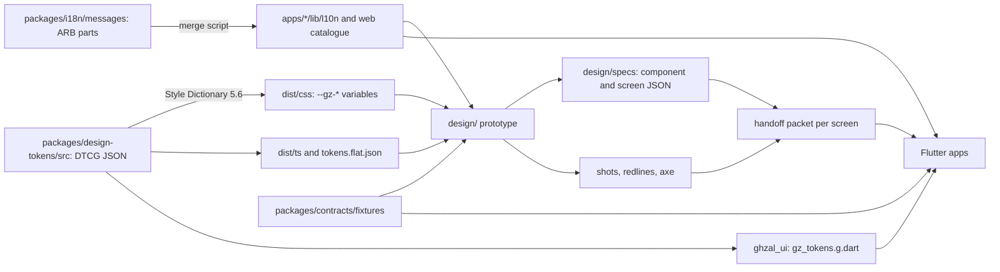

# Design to code: tokens, specs and the Flutter handoff

> Status: binding for the design prototype (`design/`) and the Flutter apps that follow it. Source: ADR 0021 (repo, ports), 0022 (Flutter), 0023 (tokens), 0024 (handoff contract), 0025 (testing), 0029 (agent setup) and `docs/research/flutter-tech-handoff.md`. The workspace members named here are created in the pull request where their first consumer lands (ADR 0021 D7); until then this file is the contract they are built against.

## 1. Principle

The prototype is a specification that happens to run. Anything with a Flutter meaning is expressed in tokens, a constrained CSS subset and machine-readable specs; anything that cannot be expressed that way does not ship in the prototype. Geometry and tokens are gated; pixel equality between web and Flutter never is (font rasterisation differs).



## 2. One source of truth per thing

| Thing | Source | Generated into | Consumers |
|---|---|---|---|
| Colour, space, radius, size, border, elevation, motion, layout, type | `packages/design-tokens/src/*.tokens.json` (no `design/tokens/` directory may exist) | `dist/css`, `dist/ts`, `dist/tokens.flat.json`, `ghzal_ui/lib/src/tokens/generated/` | prototype, redline and spec tools, Flutter |
| Copy | `packages/i18n/messages/{common,client,hotel,server}/<feature>.<locale>.json` | `apps/*/lib/l10n/app_{en,ar}.arb`, web catalogue | prototype (intl-messageformat 12), Flutter (gen-l10n) |
| API contract and fixtures | `packages/contracts` | `openapi.json`, `api-client-ts`, `ghazal_api_client` | prototype mocks, Flutter tests, Prism |
| Fonts and icon font | `packages/ghazal_ui/assets` | `GzIcons`, CSS classes | prototype `@font-face`, Flutter |
| Formatter cases | `packages/contracts/fixtures/format-cases.json` | none | TS and Dart tests |

Generated and committed, never hand-edited, marked `linguist-generated`, regenerated by CI and failing on diff: token outputs, ARB files and `generated/**`, `openapi.json`, API clients, icon font, lockfiles (list in `docs/engineering/generated-files.md`). Dependency direction: `apps/*` import `packages/*`, never the reverse; `design/` imports tokens, i18n and contracts (types and fixtures only), never `apps/*`; `ghazal_ui` knows nothing about the API or auth; a Flutter feature never imports another feature's `presentation/` or `data/` (grep gate).

## 3. Tokens

**Files** (DTCG 2025.10): `color.ref`, `color.sys`, `space`, `radius`, `size`, `border`, `elevation`, `motion`, `layout` (frame 390 x 844, safe areas, gutter), `typography.en`, `typography.ar` (identical key sets). Allowed `$type`s: color, dimension, duration, cubicBezier, fontFamily, fontWeight, number, shadow, typography. Value shapes: colour `{ colorSpace: "srgb", components: [r, g, b], hex }` (authors write only `hex`; `pnpm -F @ghazal/design-tokens fmt` fills `components`), dimension `{ value, unit: "px" }` (1 px = 1 dp), duration `{ value, unit: "ms" }`, cubicBezier `[x1, y1, x2, y2]`. Not used until the generator tests prove them: `$extends`, `$ref`, `$root`, gradient and transition composites. Notes go in `$extensions.ghazal` (reason, owner) and are never consumed by generators.

**Tiers.** `ref` (raw ramps, the only place hex lives, components never use them), `sys` (semantic roles: text, surface, border, action, status, scrim), `comp` (rare overrides). Alpha is always an explicit token (`color.sys.scrim.photo-bottom`), never parent opacity. Light theme only for the MVP; `sys` is the only layer a dark mode would branch.

```json
{ "color": { "$type": "color",
  "ref": { "ink": { "700": { "$value": { "colorSpace": "srgb", "components": [0.3529, 0.2941, 0.3098], "hex": "#5a4b4f" } } } },
  "sys": { "text": { "primary": { "$value": "{color.ref.ink.700}" } } } } }
```

becomes `--gz-color-sys-text-primary: var(--gz-color-ref-ink-700);` in CSS and `GzColors.textPrimary` (`const Color(0xFF5A4B4F)`) in Dart.

| Token path | CSS variable | Dart |
|---|---|---|
| `color.sys.action.primary.bg` | `--gz-color-sys-action-primary-bg` | `GzColors.actionPrimaryBg` |
| `space.4` (4 x N px) | `--gz-space-4` | `GzSpace.s4` |
| `radius.lg` | `--gz-radius-lg` | `GzRadius.lg` |
| `motion.duration.base` | `--gz-motion-duration-base` | `GzMotion.durationBase` |
| `type.title.md` (per script) | per `:lang()` | `GzType.forLocale(locale).titleMd` |

**Pinned values.** Ink `#5A4B4F`, Gold `#D8B26E`, Rose `#F8E7EC`, canvas `#FFF9F5` (NF-DSN-06); three core colours plus warm neutrals derived from Ink; only a tiny desaturated functional success and danger set, always with icon and label. Spacing multiples of 4 (`space.N`, N in 1, 2, 3, 4, 5, 6, 8, 10, 12, 16 = 4 to 64 px, plus `space.gutter`, `space.section`). Radius `xs, sm, md, lg, pill` = 4, 8, 12, 20, 9999. `size.touch-min` 44; `size.control.{sm,md,lg}`; `border.hairline` 1 (not 0.5). Weights 400, 500, 600, 700. Motion: durations `fast` 120, `base` 200, `slow` 320, `expressive` 480 and `success` 640 ms (the single value above 500, from ADR 0017; ADR 0023's list omits it, so the token file must include it); `ease.standard` `cubic-bezier(0.2, 0, 0, 1)`, `ease.emphasized` `cubic-bezier(0.05, 0.7, 0.1, 1)`; spring `motion.spring.settle` mass 1, stiffness 400, damping 40; push distance 24 px; `motion.reduced.*`. Type scales and the Cairo figures role are in [i18n-rtl](i18n-rtl.md) section 7; line height is a unitless multiplier and a check asserts `round(fontSize x lineHeight)` lands on the 2/4-pt grid; Arabic styles set `letterSpacing: 0` and are never italic.

**Open for the tokens-owner, inside the gates:** Gold-ink (start from `#845F20`), the label ink on Gold fills (start from `#4A3C40`), ramps, spring values, control heights.

**Contrast gate** (WCAG relative luminance, recomputed for this document): Ink on canvas 7.88, Ink on Rose 6.90; Gold on canvas 1.91 and on Rose 1.68 (fills, hairlines and large marks only, never text); **Ink on Gold 4.12 fails 4.5:1**, so labels on Gold fills use `#4A3C40` (5.23); candidate Gold-ink `#845F20` is 5.53 on canvas and 4.85 on Rose; white on Gold is 2.00. `packages/design-tokens/a11y-pairs.json` lists every allowed foreground and background pair with a minimum (4.5 text, 3.0 large text and UI boundaries) and the build fails when one drops. Policy: gold is never the only boundary of an input or a selected state; gold text and icons use Gold-ink.

**Gates (`pnpm tokens:check`, also in the Stop hook and CI):** rebuild and `git diff --exit-code` on generated files; JSON schema; unused-token and duplicate-value reports; AR/EN key parity; line-height grid; snapshot tests of all three outputs; contrast pairs. After design freeze a token change needs an ADR and a STATUS broadcast; new tokens go through the `add-token` skill with a reason.

**Generator.** Style Dictionary 5.6.x pinned, three platforms: CSS (`outputReferences: true`, plus `tokens.en.css` and `tokens.ar.css` scoped by `:lang()`), TypeScript (`as const`, a `TokenPath` union, `tokens.flat.json` for the redline and spec checkers) and a custom `gz/dart-tokens` format that resolves references to literals (`Color(0xFFD8B26E)`, `Duration(milliseconds: 320)`, `Cubic(0.2, 0, 0, 1)`, `SpringDescription(...)`), `GzColors extends ThemeExtension<GzColors>` with `copyWith`, `lerp`, `static const light`, then `dart format`. If composite types misbehave the fallback is an in-house generator of about 150 lines; the JSON does not change.

## 4. Prototype rules (Flutter-subset CSS, enforced by Stylelint)

| Allowed | Forbidden (waiver needs `/* flutter-ok: reason */`) |
|---|---|
| `display: flex` and `gap`; `position: absolute` only for named overlay anchors with `inset-inline-*` and `inset-block-*`; global `box-sizing: border-box`; integer px on the 4-pt grid (hairline 1); `aspect-ratio` with named tokens; `object-fit: cover`; colour and font values only through `var(--gz-*)` | `grid`, `backdrop-filter`, `mix-blend-mode`, `filter`, `clip-path`, `mask*`, `position: sticky` and `fixed`, `%` (except flex), `vh vw dvh svh em rem ch`, `calc()`, sibling margins and negative margins, physical `left/right`, margin, padding and `text-align`, `italic`, letter-spacing on Arabic, `text-transform`, container `opacity` (use alpha tokens), inset shadows and more than two shadow layers, native `select`, `input[type=date]`, `dialog`, `:hover`, scroll-snap |

Screens never branch on `window.innerWidth`. Carousels and pagers use a formula shared by CSS and `PageController(viewportFraction)`: item width = viewport - 2 x gutter - peek, peek = `space.6`. Rail cards are 72% of the viewport snapped to 4 px (280, 260 and 308 at 390, 360 and 430).

**Measurement contract.** 1 px = 1 dp. Canvas 390 x 844, fluid verification at 360 and 430. Safe areas are named variables (`--gz-safe-top: 47px`, `--gz-safe-bottom: 34px`); Flutter uses real `MediaQuery` insets. Every container declares direction, alignment, gap token, logical padding `{ start, end, top, bottom }`, per-axis size mode `fixed(px) | fill | hug | flex(n)` with min and max, and overflow (`clip`, `scroll`, or `ellipsis` plus max lines). **Markers:** every component root carries `data-gz="<Component>"`, every measured node `data-gz-id="<anatomy.id>"`; Flutter mirrors them with `ValueKey('gz:<id>')`.

## 5. Specs

Three kinds of identifier meet here: requirement ids (`CA-BOOK-09`, from `docs/product/feature-matrix.json`), screen-inventory ids (`CL-BOOK-05`, `HL-BOOK-03`, from `docs/product/screens/`) and spec ids (`client.booking.review`). A screen without requirement ids fails review.

**Component spec** (`design/specs/components/<Name>.spec.json`, validated by `component.schema.json`): `component`, `reqs` (each must exist with `designScope: true`), `variants`, `frame`, `layout` (a tree of `{ id, dir, gap, pad, size, bg, border, radius, clip, text, image, overlays, children }`, every value a token path), `states` (pressed, loading as skeleton, disabled, unavailable), `motion` (`{ on, prop, to, dur, ease or spring, haptic }`), `a11y` (`role`, `labelKey`, `minTarget`), `rtl` (`mirror[]`, `noMirror[]`), `copy` (ARB keys), `flutter` (`widget: "Gz<Name>"`, `file`). Example, the venue card of ADR 0018:

```json
{ "component": "VenueCard", "reqs": ["CA-CARD-01", "CA-CARD-02", "CA-CARD-05", "CA-CARD-09", "CA-CARD-10", "CA-CARD-13"],
  "layout": { "id": "root", "dir": "column", "gap": "space.3", "radius": "radius.md",
    "children": [
      { "id": "media", "size": { "w": "fill", "aspect": "aspect.4x5" }, "radius": "radius.md", "image": { "fit": "cover" },
        "overlays": [
          { "id": "fav", "anchor": "top-end", "inset": "space.2", "size": 44 },
          { "id": "compare", "anchor": "top-start", "inset": "space.2", "size": 44 },
          { "id": "badge", "anchor": "bottom-start", "inset": "space.3" },
          { "id": "play", "anchor": "bottom-end", "inset": "space.3", "size": 44 } ] },
      { "id": "title", "text": "type.title.md", "lines": 2, "overflow": "ellipsis" },
      { "id": "price", "text": "type.numeric.md", "align": "start" } ] },
  "motion": [{ "on": "press", "prop": "scale", "to": 0.98, "dur": "motion.duration.fast", "ease": "motion.ease.standard", "haptic": "light" }],
  "rtl": { "mirror": ["media.fav", "media.compare", "media.badge", "media.play"], "noMirror": ["media.play.glyph"] },
  "flutter": { "widget": "GzVenueCard", "file": "packages/ghazal_ui/lib/src/components/venue_card.dart" } }
```

**Screen spec** (`design/specs/screens/<app>/<feature>/<screen>.spec.json`): `id`, `reqs`, `route`, `components`, `fixture` (a file under `packages/contracts/fixtures`), `states` (loading, empty, error, offline, plus the screen's own), `scroll` (pinned headers, collapse ranges in dp), `safeArea`, `copy` keys, `analytics` events (ADR 0019), `permission` key for hotel gating, `qa` (last shots run, status). Example: `client.booking.review` covers `CA-BOOK-09`, `-10`, `-11`, `-14`, `-15`, `-17`, `CA-PAY-07`, `CA-VDET-16`, `CA-LOY-05`, with states default, instant-mode, two-sections, coupon-applied, consent-unchecked, phone-unverified, open-requests-limit, loading, error, offline (these are the `CL-BOOK-05` states). The schema has no field for the inventory id; recommended addition: optional `inventory` (for example `CL-BOOK-05`) so `prd-tracer` can join the two (a request for the system-owner).

**Naming.** Component PascalCase, widget `Gz` + name (`VenueCard` to `GzVenueCard`); anatomy id lowerCamel path (`media.fav`); ARB key camelCase `<feature><Screen><Element>` (`bookingReviewConfirmCta`); hero tag `hero:<entity>:<id>:<part>` (`hero:venue:42:cover`); artefact `<screen>.<locale>.<width>.<ext>` (`client.home.ar.390.png`); Dart packages `ghazal_*`, TS scope `@ghazal/*`.

**Checks (`pnpm specs:check`):** schema validity; every `reqs` id exists in the matrix; every token path resolves in `tokens.flat.json`; every ARB key exists in both languages; every spec anchor exists in the rendered DOM. `pnpm specs:coverage` writes the requirement-to-screen coverage for the `prd-tracer` subagent.

## 6. Flutter mapping

| Prototype | Flutter |
|---|---|
| flex row or column, `gap` | `Row` or `Column(spacing:)`; `flex: 1` is `Expanded`; wrap is `Wrap` |
| logical padding, `inset-inline-*` anchors | `EdgeInsetsDirectional`, `PositionedDirectional`, `AlignmentDirectional` |
| `aspect-ratio` | `AspectRatio` |
| scroll-linked header, `sticky` | pinned `SliverPersistentHeader` specified as a function of scroll offset in dp |
| calendar | seven equal flex columns, custom `GzCalendar` (week start from config) |
| `cubic-bezier(a, b, c, d)`, `200ms` | `Cubic(a, b, c, d)`, `Duration(milliseconds: 200)` |
| spring `{mass, stiffness, damping}` | `SpringDescription` and `SpringSimulation`; never `bounce` or `visualDuration` parameters |
| stagger | `Interval`, capped at five items |
| shared element | `Hero` with `flightShuttleBuilder` (radius morph 12 to 0) |
| `prefers-reduced-motion` | `MediaQuery.disableAnimationsOf`, using `motion.reduced.*` |
| stroke-dashoffset thread draw-on | `PathMetric.extractPath(0, t * length)` |
| gesture sheet | custom with spring fling or `DraggableScrollableSheet` |
| Lottie | only without expressions, effects, blend modes, mattes |
| haptics (spec column) | `HapticFeedback.selectionClick`, `lightImpact`, `mediumImpact`; success notification once per flow; mobile only |
| icons | fantasticon icon font plus `GzIcons`; directional icons use `matchTextDirection` from the same registry |
| strings | `AppL10n` from ARB; never `Text('literal')` |

**Apps.** Layering per ADR 0022: `lib/{main,bootstrap}.dart`, `lib/app/{app.dart, router/app_router.dart, theme/}`, `lib/features/<feature>/{presentation, application, domain, data, <feature>_routes.dart}`, `lib/l10n/`. Data flow: widget, `Notifier` or `AsyncNotifier`, repository interface, repository implementation, generated DTO, mapper, hand-written immutable entity (`equatable`); generated types never reach the UI. Riverpod 3.4 without codegen; go_router 18 with `StatefulShellRoute.indexedStack` (client tabs Discover, Saved, My Wedding, Messages, Profile per ADR 0007; hotel tabs Today, Bookings, Calendar, Messages, More); one `<feature>_routes.dart` per feature composed by a frozen `app_router.dart`; guest gating through a `redirect` that stores a `GuestIntent`. `buildGhazalTheme(Locale)` builds an explicit `ColorScheme` from sys tokens (never `fromSeed`), `NoSplash` plus token-driven press feedback (scale 0.98, 120 ms), `GzColors` extensions; every `TextStyle` sets `leadingDistribution: even` and an explicit height. Ownership partition: client features auth, onboarding, home, search, venue, compare, booking, payment, bookings, planner, services, planning, chat, notifications, reviews, profile; hotel features today, bookings, calendar, venue_management, offers, analytics, notifications, settings, chat. Guardrail script `tools/check-dart-rules.sh` bans `package:flutter/material.dart`, `Color(0x` and `Colors.` outside generated tokens, physical-direction widgets, string literals in `Text(`, `letterSpacing` in Arabic-capable styles and cross-feature imports.

## 7. Verification and parity

| Layer | What runs | Gate |
|---|---|---|
| Static (every save, Stop hook) | Biome, Stylelint, `tsc`, `dart analyze --fatal-infos`, `check-dart-rules.sh`, `tokens:check`, `i18n:check`, `specs:check` | yes |
| Prototype (PR) | Vitest (formatters, mocks), `vite build` with a size budget, Playwright shots at {ar, en} x {360, 390, 430} with reduced motion and `document.fonts.ready`, axe per route and locale (serious and critical fail), redlines | yes |
| Flutter widget and golden (PR, Linux) | `ghazalGoldenTest(name, builder, { locales, widths, textScales })` with Alchemist Ahem goldens. Components: ar and en at 390, scales 1.0 and 2.0 per state. Hero screens: both locales at 360, 390, 430, scales 1.0 and 2.0. Other screens: 390 at 1.0 in both locales plus Arabic at 360 and 2.0. Budget at most 1,200 PNGs and 40 MB; stress fixtures on every screen | yes (geometry) |
| Layout parity (hero screens) | Load `design/.redlines/*.json`, pump at the same size, locale and fixture, find nodes by `ValueKey('gz:<id>')`, compare `tester.getRect` as start-based insets within 1.0 dp | yes (tag `parity`) |
| Real-font goldens | At most 24 generated on macOS (hero screens in both languages plus a shaping-and-bidi sheet) | human review only |
| Integration (nightly) | `integration_test` against Prism or a fake server for the core flows; Patrol only for native dialogs | nightly |
| Performance (nightly) | `home_ttfmc`, scroll jank: frame build and raster p90 under 8 ms on a mid device | nightly |

**Hero screens** (redline parity required) and their inventory ids:

| Spec id | Inventory | Requirement groups |
|---|---|---|
| `client.home` | `CL-DISC-01` | CA-HOME-* |
| `client.venue.details` | `CL-VENU-01` | CA-VDET-*, CA-CARD-* |
| `client.compare.table` | `CL-SAVD-04` | CA-CMP-* |
| `client.booking.review` | `CL-BOOK-05` | CA-BOOK-09..17 |
| `client.payment.outcome` | `CL-PAYM-03`, `-04`, `-05` (states of one spec) | CA-PAY-10 |
| `client.bookings.detail` | `CL-BKNG-02` | CA-STAT-* |
| `hotel.today.dashboard` | `HL-TODY-01` | HA-DASH-* |
| `hotel.bookings.detail` | `HL-BOOK-03` | HA-BOOK-02..11 |
| `hotel.calendar.month` (once frozen) | `HL-CALN-01` | HA-CAL-* |

Redlines export per `data-gz-id` node, locale and width: `insetStart`, `insetTop`, `w`, `h`, text-style token and line count (start-relative, so Arabic and English compare directly). Every other screen is covered by component parity plus goldens.

**Visual QA loop (definition of done for UI work).** (1) Implement; the Stop hook runs `pnpm verify design --fast`. (2) `pnpm shots --screen <id>` writes six PNGs and a contact sheet to `design/.shots/<run>/`. (3) The author **Reads** the contact sheet and every Arabic PNG at full size; Arabic is judged on its own, not as a mirror of English. (4) The read-only subagents `design-qa`, `rtl-reviewer` and `a11y-auditor` return findings tables (issue, `data-gz-id`, severity, fix). (5) Fix and rerun, at most three iterations, then escalate. (6) Record the run in the spec's `qa` field and paste the tail of `pnpm verify <area>` into the final message. Never run `--update-goldens` without Reading the diff PNGs; only the golden's owner updates it, in a commit that says why.

## 8. Handoff packet and definition of done

Per screen the `handoff-screen` skill produces a brief: spec JSON, six screenshots (Arabic and English at 360, 390, 430), redlines, tokens used, ARB keys, fixture, owned Flutter files and tests to add. A screen is done when: it is built from system components only; every value is a token; both languages exist with plurals; loading, empty, error and offline states exist; `data-gz-id` anchors match the spec; Arabic was looked at, not inferred; axe is clean; contrast pairs pass; the seeded booking `GZ-2611-0147` reads identically in both apps where it appears. The prototype logs its analytics events to an on-page inspector using the real registry so reviewers see the taxonomy fire.

## 9. Dev servers and ports

Ghazal never uses a tool's default port, and a URL is never typed by hand. Reserved block **4700-4799**: port = 4700 + 10 x slot + offset. Slot 0 is the main checkout; slots 1-9 are agent worktrees (ADR 0029).

| Offset | Service | Offset | Service |
|---|---|---|---|
| 0 | design studio (the prototype) | 5 | realtime |
| 1 | api | 6 | Flutter web or widget preview |
| 2 | venue dashboard | 7 | PDF renderer |
| 3 | admin dashboard | 8, 9 | spare |
| 4 | Prism mock | | |

Docker host ports avoid what the machine already runs (a local Postgres owns 5432, MongoDB 27017): Postgres `54320 + slot`, Redis `63790 + slot`, `COMPOSE_PROJECT_NAME=ghazal_slot<N>`.

- Every dev server starts with `strictPort` (Vite `server.strictPort: true`, Nest exits on `EADDRINUSE`): no auto-increment, no kill-port. **We never stop a process we did not start.**
- Dev servers bind `127.0.0.1`; a phone on the same Wi-Fi needs the explicit `pnpm dev:lan`.
- **Identity handshake:** every dev server answers `GET /__gz` with `{ app, slot, rootHash, startedAt }` (a 15-line Vite plugin in `design/`, a dev-only route in Nest), and the prototype also carries `<meta name="gz-app" content="design">`.
- `node tools/ports.mjs url|check|who <service> [--slot N]` is the only way to produce or verify a URL: it computes the port, fetches `/__gz` and, on mismatch, prints the PID and command line of whatever owns the port and exits non-zero. `snap.mjs`, `shots.mjs`, `redlines.mjs`, `a11y.mjs` and the Playwright MCP run the same check before navigating to a local http URL and abort on mismatch (`--no-identity` only for third-party pages). Docs and agents quote `node tools/ports.mjs url design`, and the SessionStart banner prints each URL and whether it is up and ours.
- `tools/ports.mjs` does not exist yet; it is part of the design-phase foundation pull request (ADR 0021 D7). Until then, nothing in this repository may claim a local URL is correct.

## 10. Ownership and shared files

The integrator (one agent) owns root configs, lockfiles, `.github`, `.claude`, `tools`, `AGENTS.md`, `docs/engineering`, `infra`, and is the only role that adds dependencies or runs shared generators. Single-writer files: token JSON, `design/src/system/**`, lockfiles, generated outputs, `openapi.json`, `apps/api/drizzle/**`, `AGENTS.md`, `.claude/**`, `.github/**`, `lib/app/router/app_router.dart`. Screen owners write only `design/src/screens/<app>/<feature>/**`, their spec folder and their ARB parts. Registries are split so additions never touch a shared file: the prototype discovers routes with `import.meta.glob('../screens/**/routes.ts')`. A role that needs a token, component or dependency appends one line to `docs/engineering/requests.md` with shell append (`>>`), never Write. Until the integrator updates it, `AGENTS.md` still names `design/tokens/` and `npm run` commands; ADR 0021 and 0029 supersede both (pnpm 12 workspace, `packages/design-tokens/src`).

Next: [README](README.md).
