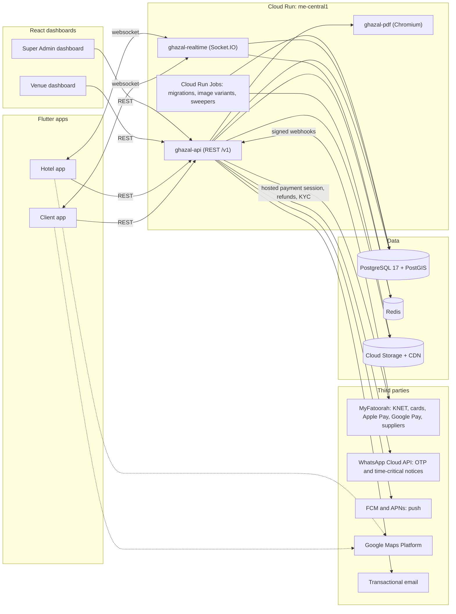
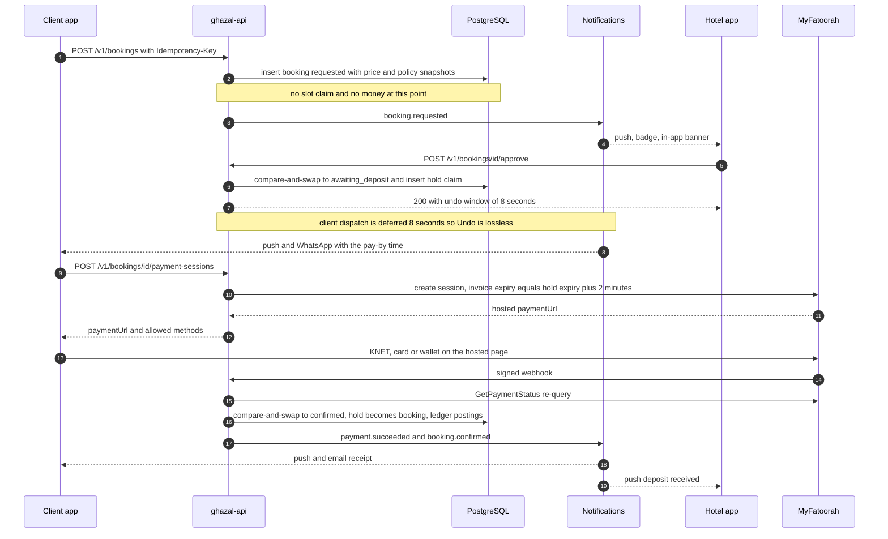

# Architecture overview

> **Business model changed on 2026-10-14 (ADR 0033, `docs/product/voucher-model.md`).** Ghazal now sells only a KD 2 voucher; venues and providers sell and collect everything else. Where this file mentions deposits, balances, commission, payouts, cash, instant booking, cancellation tiers, supplier split or the nine booking statuses, read the rewritten [booking-state-machine](booking-state-machine.md), [pricing-and-payments](pricing-and-payments.md) and [data-model](data-model.md) instead; this file is updated lazily.

> Status: baseline for the design phase and the first engineering weeks. Everything here is derived from the accepted ADRs (0001-0029) and the PRD digest. Where an ADR is still `proposed-needs-owner` (0005, 0006, 0015, 0019, 0020) the dependency is marked **[owner]**. Where this file and an ADR disagree, the ADR wins; report the difference in `docs/product/open-questions.md`.

## 1. What is being built

Ghazal (غزل) is a wedding-venue marketplace for Kuwait. A couple requests a hall for a date, the venue approves, the couple pays a deposit, and the same app then carries the planning tools and chat for the next 6-18 months. One backend serves four products. All four are bilingual (Arabic RTL, English LTR) and all money is Kuwaiti dinar (KWD, 3 decimals, stored as integer fils).

| # | Product | Platform | Users | State in the current phase |
|---|---|---|---|---|
| 1 | **Client app** | Flutter, iOS 15+ and Android 8+ (minSdk 26) | brides, grooms, families, planners | Designed now as a web prototype (`design/`) |
| 2 | **Hotel app** (venue app) | Flutter, same floors | venue Admin, Manager, Reception, Accountant, Marketing | Designed now as a web prototype |
| 3 | **Venue dashboard** | React, web | venue staff at a desk | Context only; the design system must extend to it |
| 4 | **Super Admin dashboard** | React, web | Ghazal owner, finance, support | Context only |

Not products, but required by the PRD and flagged as gaps (CF-17, CF-18): a **planner surface** (PL-CORE-12, MVP-P2: planners are Ghazal-assigned supply, working call is a `planner` role inside the Super Admin console) and a **vendor responder** (PL-CORE-13, MVP-P2: working call is Super Admin staff entering vendor data, plus a magic-link quote page). Neither is designed in this phase.

## 2. System context

Rules that follow from the picture:
- **Only the API talks to third parties.** The apps never hold the MyFatoorah token, the WhatsApp token or any service-account key (ADR 0027, 0026). Public identifiers (Maps key restricted by bundle ID, Firebase config) are the only values shipped in a binary.
- **One contract.** Apps and dashboards depend only on `packages/contracts/openapi.json` (through generated clients) and `packages/contracts/fixtures`. The backend framework can change without touching a Flutter file (ADR 0020).
- **The database is the arbiter.** Double booking is prevented by a Postgres exclusion constraint, not by Redis timers or UI state (ADR 0001, 0003). Redis serves sessions, caches, BullMQ queues and UI countdowns.

## 3. Stack

| Layer | Choice (starting pins as of 2026-10-10; re-check at scaffold) | Status |
|---|---|---|
| Mobile | Flutter 3.47.5 / Dart 3.13, `material_ui` + `cupertino_ui` (never `package:flutter/material.dart`), Riverpod 3.4 without codegen, go_router 18, dio 5 + `native_dio_adapter`, ARB localisation | ADR 0022 accepted. iOS floor 15.0 deviates from NF-COMP-01 (CF-35, **[owner]** OQ-T-02) |
| Web dashboards | React 19, Vite 8, TypeScript ~6.0 | PL-ARCH-03; built later |
| Design prototype | Vite + React + TS in `design/`, Style Dictionary 5.6 tokens, Vitest, Playwright + axe | ADR 0021, 0023-0025 |
| Backend | NestJS 12 on Node 24 LTS, Fastify, Zod 4 (native `schema` option), Drizzle 0.45 with hand-written SQL migrations, BullMQ, Socket.IO 4.8, `jose`, Pino, Vitest + Testcontainers | ADR 0020 **proposed [owner]**: flips to Laravel only if the owner will write most backend code personally (OQ-T-01) |
| Database | PostgreSQL 17 on Cloud SQL with PostGIS, `pg_trgm`, `btree_gist` | PL-ARCH-05 |
| Cache and queues | Redis (Memorystore Basic in prod only; container locally) | PL-ARCH-06 |
| Media | GCS + Cloud CDN; WebP variants 320/640/960/1440 generated by a job; blurhash per image | PL-ARCH-07, ADR 0022 G |
| Payments | MyFatoorah v3 (KNET, Visa, Mastercard, Apple Pay, Google Pay), hosted pages, supplier split | ADR 0027 |
| Identity | Backend JWT (ES256, 10 min) + rotating refresh tokens; Apple and Google verified with JWKS; WhatsApp OTP | ADR 0028 |
| Push and messaging | FCM (APNs through FCM); WhatsApp Cloud API; one transactional email provider (not chosen) | PL-ARCH-09, PL-CORE-04/05 |
| Monorepo | pnpm 12 workspace for TS + Dart pub workspace; no Melos/Nx/Turbo | ADR 0021 |

The PRD cost envelope (USD 20-100 per month, NF-CST-01) excludes WhatsApp fees, email and video egress; real fixed lines go to `docs/engineering/cost.md` before the owner relies on it (ADR 0026, OQ-T-05).

## 4. Deployables and environments

| Deployable | Scales | Notes |
|---|---|---|
| `ghazal-api` | min-instances 1 in prod, startup CPU boost, concurrency 40-80 | Protects the 2 s home budget (NF-PERF-01); staging scales to zero |
| `ghazal-realtime` | min 0 until chat ships (PL-CORE-01 is MVP-P2) | Timeout 3,600 s; session affinity is best-effort, so resume-from-`seq` and idempotent `clientMsgId` are mandatory |
| `ghazal-pdf` | scale to zero, concurrency 1-2 | Playwright Chromium renders bilingual invoices and receipts (PL-CORE-07); output cached by content hash in GCS; pdfmake and pdf-lib are banned for Arabic |
| Cloud Run Jobs | on demand / cron | Migrations (forward-only, expand/contract), image variants, the hold and SLA sweepers |

Three environments: local (`docker compose`: Postgres, Redis, a WhatsApp mock, Prism), `ghazal-staging`, `ghazal-prod` (separate GCP and Firebase projects; MyFatoorah sandbox, test and live; separate Maps keys). Region is me-central1 (Doha) pending a latency test from a Kuwait 4G SIM (OQ-T-05). Secrets live in Secret Manager only. Apps ship as `.dev`, `.stg` and store flavours. Detail: `docs/engineering/` (ADR 0026).

## 5. Backend modules

One modular monolith in `apps/api`. A Nest module is the unit of agent ownership (ADR 0020, 0029). The 14 modules from ADR 0020, plus three that the ADR's list omits and the integrator must confirm (marked +).

| Module | Owns | Main tables ([data-model](data-model.md)) |
|---|---|---|
| `auth` | identities, OTP, sessions, step-up, staff invites, account deletion | `users`, `user_identities`, `sessions`, `devices`, `otp_challenges` |
| `venues` | venue profile, policies, search and filters, wishlist | `venues`, `areas`, `cancellation_policies`, `wishlist_items` |
| `halls` | halls, session templates, section audiences | `halls`, `hall_sessions` |
| `pricing` | tier engine, quote per day, offers, price snapshot | `packages`, `price_rules`, `extras`, `offers`, `holidays` |
| `availability` | slot claims (holds, bookings and venue blocks are all claims), calendar read model, sweepers | `slot_claims` |
| `bookings` | state machine, proposals, amendments, SLA | `bookings`, `booking_sections`, `booking_lines`, `booking_events`, `date_proposals`, `amendments` |
| `payments` | gateway port, sessions, webhook inbox, refunds | `payment_milestones`, `payment_attempts`, `payment_events`, `webhook_inbox`, `refunds` |
| `ledger` | double-entry postings, commission, payouts, statements | `ledger_txns`, `ledger_entries`, `payouts`, `commission_rules` |
| `chat` | conversations, messages, attachments (MVP-P2) | `conversations`, `messages`, `attachments` |
| `notifications` | routing by event, preference, channel, locale | `notifications`, `notification_prefs`, `device_tokens` |
| `reviews` | eligibility, moderation, venue reply | `reviews`, `review_media` |
| `planner` | planner engagements; **+ vendor directory and quote leads** | `planner_engagements`, `vendor_leads` |
| `content` | CMS, FAQs, legal texts, banners, holidays admin | `cms_*` |
| `admin` | Super Admin console, roles, audit read, support | `audit.log`, `support_cases` |
| `media` + | signed uploads, moderation queue, variant jobs | `media` |
| `analytics` + | event ingestion, aggregates for HA-ANLY and SA-ANLY | `analytics_events`, `analytics_daily` |
| `weddings` + | the wedding file: date, budget, checklist, budget items, countdown | `weddings`, `checklist_items`, `budget_items` |

Module rules: a module exposes services, never repositories; cross-module calls go through the exported service; migrations are single-writer; every venue-scoped route carries `@Api({ permissions })` and passes through the tenant guard ([security-privacy](security-privacy.md)).

## 6. One booking, four lenses

The booking is the only object all four products touch. The apps do not hold their own copy of the rules: pricing, deadlines, refunds and permitted actions are computed by the API and returned with each booking, so the client and hotel apps cannot disagree (the seeded booking `GZ-2611-0147` must read identically in both).

| Moment | Client app | Hotel app | Venue dashboard | Super Admin |
|---|---|---|---|---|
| Publish | Reads venue, calendar, prices | "Preview as couples see it"; edits per-package weekday/weekend price, media, policies | Full catalogue: halls, sessions, tier grids, menus, holidays overrides (VD-PRC-*) | Approves venue, manages areas, CMS, holiday table |
| Request | Sends from step 5 (verified phone) | Needs-you inbox, badge, push | List, filters, export | Monitors |
| Decide | Pending, then Approved or "Venue proposed another date" | Accept (8 s Undo), Propose another date, Decline | Same actions, bulk later | Override (T19, audited) |
| Pay | Pay sheet, hosted gateway, receipt | "Deposit received" push, money panel, Record cash | Payments, invoices | Transactions, refunds, payouts, commission (SA-FIN-*, SA-COMM-*) |
| Change | Reschedule, amend, cancel with refund preview | Reschedule, amend, cancel (Admin and Manager only); no refund issuing | Policy tiers, reschedule rules, full or partial refund (VD-BOOK-05) | Authority-order flag, goodwill refunds (SA-FIN-03) |
| Day | Countdown, directions | Today events, Mark completed | Reports | Analytics |

Pricing rules, the state machine and money flows: [booking-state-machine](booking-state-machine.md), [pricing-and-payments](pricing-and-payments.md).

## 7. The central runtime flow

Instant halls (ADR 0001) skip steps 3-9: the review CTA creates the booking directly in `awaiting_deposit` with a 10-minute hold. Everything after the session is identical.

## 8. Cross-cutting rules (apply to every module and both apps)

| Concern | Rule | Source |
|---|---|---|
| Money | Integer fils, `*_fils BIGINT`, `{ fils, currency: "KWD" }` on the wire; percentages in basis points; half-up per line; the server never formats money, clients format through `GzFormat` only | ADR 0010, 0020 |
| Time | UTC `timestamptz` everywhere; `event_date` is a `DATE` read in Asia/Kuwait; the venue business day runs 06:00-06:00; a 19:30-01:00 wedding belongs to its start date | ADR 0002, 0011, PL-CORE-11 |
| Availability | Unit is hall x session; requests never claim; `slot_claims` with `EXCLUDE USING gist (hall_id WITH =, during WITH &&) WHERE status = 'active'` | ADR 0001, 0002, 0020 |
| Concurrency | Every state change is a compare-and-swap on `(status, version)`; the loser gets `409` and an "already updated" sheet | ADR 0003 |
| Idempotency | `Idempotency-Key` on every POST that moves money or slots; webhooks keyed by (gateway, event, transaction id) | ADR 0020, 0027 |
| Tenancy | `venue_id` on every venue-scoped table; `X-Venue-Id` is validated against membership on every call; generated tenant-isolation test | ADR 0020, 0028 |
| Language | Apps and dashboards render copy from ARB catalogues; the API returns error `code`s and `{ar, en}` content, never prose; push, WhatsApp, email and PDFs are rendered server-side in the user's saved locale | ADR 0013, 0020, NF-LOC-07 |
| Audit | Postgres trigger writes `audit.log` with the actor passed by `SET LOCAL app.actor_id`; INSERT-only role; every booking transition also appends `booking_events` | PL-CORE-03, ADR 0003 |
| Cultural content | Empty-room imagery only, monogram avatars, per-section policy facts | ADR 0015 |
| Analytics | One event registry validated by apps and API; server events are the truth for money and funnel | ADR 0019 |

## 9. Quality budgets

| Budget | Target | Where enforced |
|---|---|---|
| Home first meaningful content | <= 2.0 s p75, mid-range Android at 10 Mbps / 100 ms RTT; warm start <= 800 ms; one check at 1.6 Mbps / 150 ms. A skeleton does not count | `reportFullyDrawn()`, `home_ttfmc` event, nightly profile drive (ADR 0022 G, NF-PERF-01) |
| Search results | <= 2 s (NF-PERF-02) | same |
| Composed home payload | `GET /v1/home` <= 30 KB gzip, stale-while-revalidate | API test |
| Booking request | < 10 minutes from start to send (NF-MET-01) | funnel events |
| Calendar change visible to couples | within seconds (HA-CAL-08): claim writes invalidate the Redis availability keys; availability responses use ETag with `must-revalidate` | `availability` module |
| Accessibility | WCAG 2.2 AA, targets >= 44 px, 200% text scale without clipping | axe, goldens (ADR 0025) |
| Backups | Daily plus point-in-time recovery in prod (NF-AVL-02) | Cloud SQL |

## 10. Boundaries and non-goals

- No Ghazal checkout for government halls; they are listings with a hand-off to the official channel (ADR 0002 D10).
- No authorise-then-capture and no charge-then-refund anywhere (ADR 0001 D4). A refund can exist only after money was actually paid.
- No local database in the Flutter apps; no offline queue for approvals, declines, blocks or cancellations (ADR 0008 D10, 0022 C).
- No in-app vendor payments, installments, 360 tours, AI assistant, or GCC expansion in the MVP (digest section 8). Money exponent and country config are tables, so GCC is configuration later (ADR 0010).
- No venue-side approval of reviews (PRD 8.9 is overridden, OQ-B-25).

## 11. Decisions waiting for the owner

Design proceeds on the working assumption in each; only configuration changes if the answer differs, except where noted.

| Topic | Question IDs | If the answer is different |
|---|---|---|
| Pay at request instead of after approval | OQ-B-01 | Only the request path changes (charge at step 5, refund on decline, expiry and lost slot, KNET off on that path) |
| Gateway facts: refund windows, auto-refund, supplier split, KYC | OQ-B-02, OQ-T-04 | Refund-arrival copy, bank-transfer fallback, payout timing |
| Deposit, balance, cancellation numbers | OQ-B-03..05 | Configuration only |
| Backend framework | OQ-T-01 | About one extra week of contract tooling |
| iOS 15 floor | OQ-T-02 | None if accepted; otherwise a stale Flutter pin |
| Accounts, domain, bundle IDs, WhatsApp provider | OQ-T-03, OQ-T-06, OQ-T-08 | Critical path for store submission |

Next: [data-model](data-model.md).
