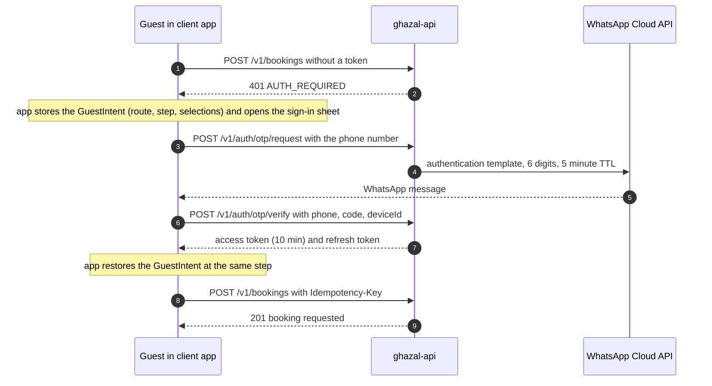
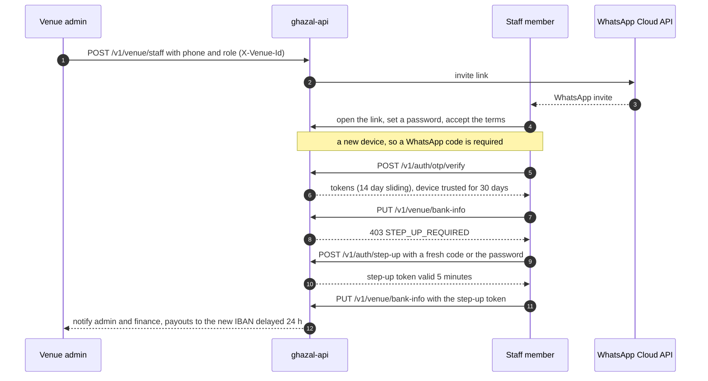
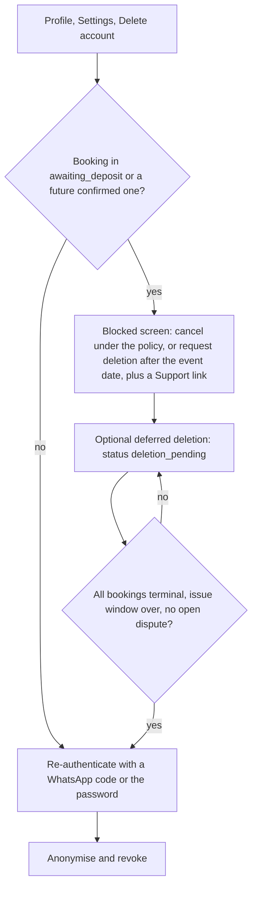

# Security and privacy

> Status: design baseline. Auth, sessions, step-up and deletion follow ADR 0028 (accepted); roles and triage follow ADR 0008; payment boundary follows ADR 0027; imagery and moderation follow ADR 0015 (proposed, needs owner); analytics privacy follows ADR 0019 (proposed). Values marked **initial** are starting numbers to tune from data. Legal questions are collected in section 12; none of this is legal advice and Kuwait's data-privacy rules (CITRA) must be confirmed by counsel before launch (OQ-L-11).

## 1. Assets, threats, controls

| Asset | Threat | Primary controls |
|---|---|---|
| Accounts (WhatsApp is the identity) | OTP abuse, SIM swap, enumeration | Rate limits, HMAC-hashed single-use codes, identical responses for known and unknown numbers, device-bound rotating refresh tokens (section 4) |
| Venue staff sessions | Stolen phone, ex-employee | 14-day sliding sessions, immediate revocation, biometric unlock in front of the session, new-device OTP (section 4) |
| Payouts and bank details | Payout fraud by account takeover | Step-up for bank, refund and staff actions; admin and finance notified; 24 h payout delay to a new IBAN (section 5) |
| Money | Forged or replayed webhook, double charge, refund abuse | Signature check plus status re-query, inbox idempotency, `Idempotency-Key`, ledger, one central refund service ([pricing-and-payments](pricing-and-payments.md)) |
| Calendar integrity | Date squatting, double booking | Max 3 open unpaid bookings, exclusion constraint, short holds ([booking-state-machine](booking-state-machine.md)) |
| Tenant data | Venue A reads venue B | Tenant guard, row-level security, generated isolation test (section 3) |
| Personal data | Leak through logs, analytics, backups | Data minimisation, no PII in events or logs, encrypted sensitive columns (section 8) |
| Brides and families | Photos of unveiled women, unwanted contact | Empty-room imagery only, moderation, contact-person model with disclosure (section 10) |
| Platform admin | Insider misuse | Role split, mandatory 2FA, IP restriction, immutable audit log (sections 2 and 9) |

## 2. Principals and roles

| Principal | Authenticates with | Can |
|---|---|---|
| **Guest** | none (`X-Device-Id` only) | Browse, search, compare, view venue and calendar, read reviews, share. Hearts, Compare and the Brief live on the device |
| **Client** | WhatsApp OTP, Apple, Google, email + password | Own wedding file, bookings, payments, chat, reviews, planner and vendor requests, profile. A **verified phone** is required before a request, a payment or a chat message |
| **Venue staff** | Phone + password after a WhatsApp invite; OTP on a new device (HA-AUTH-01) | Per role below, scoped to the venues they are a member of |
| **Platform staff** | Email or phone + password + TOTP (SA-SEC-05) | Per role below |
| **Planner, vendor** (MVP-P2) | Planner: platform account with the `planner` role. Vendor: magic link by WhatsApp or email, quote page only | Planner: consultation requests, chat, scheduling, read-only booking summary with client consent. Vendor: answer one quote request |
| **Service accounts** | Workload Identity, no JSON keys | The API, jobs and the PDF service only |

**Venue roles.** Admin is the owner and includes Manager (OQ-B-17); one person can hold several roles in a small venue. Content is role-aware, navigation is not: the five hotel tabs are identical, forbidden controls are hidden (no lock icons), and a deep link to a forbidden object shows "You do not have access. Ask your manager." with the API's `403 FORBIDDEN`.

| Permission key | Admin | Manager | Reception | Accountant | Marketing |
|---|---|---|---|---|---|
| `booking:read` | yes | yes | yes | yes | no |
| `booking:approve`, `booking:decline`, `booking:propose_date` | yes | yes | yes (Admin can switch off) | no | no |
| `booking:cancel`, `booking:reschedule`, `booking:revoke`, `booking:flag_no_show` | yes | yes | no | no | no |
| `payment:record_cash` | yes | yes | yes | yes | no |
| `calendar:read` / `calendar:block` | yes / yes | yes / yes | yes / yes | yes / no | yes / no |
| `chat:read` / `chat:write` | yes / yes | yes / yes | yes / yes | read only | no |
| `offer:write` | yes | yes | no | no | yes |
| `analytics:read` | yes | yes | no | no | yes |
| `revenue:read` | yes | yes | no | yes | no |
| `package:write`, `policy:write` | yes | yes | no | no | no |
| `media:write` | yes | yes | no | no | yes |
| `review:reply`, `review:report` | yes | yes | no | no | no |
| `staff:write` | yes | no | no | no | no |
| `bank:read` (masked) / `bank:write` (step-up) | yes / yes | no | no | read / no | no |
| `refund:create` | web only | web only | no | no | no |

Source: ADR 0008 D12. `booking:revoke`, `booking:flag_no_show`, `review:*` and Marketing's lack of `booking:read` are derived here because the ADR does not name them. Today variants for Reception, Accountant and Marketing are states of one screen.

**Platform roles** (the PRD says only "admin roles and permissions", SA-SEC-01/02; this split is proposed): `super_admin` (venue and vendor approval, users, commission, holidays and authority orders, CMS, areas, roles, IP rules); `finance` (transactions, invoices, refunds, payouts, reports; step-up on refunds and payouts); `support` (tickets, live chat, complaints, refunds per SA-SUP-04, read-only booking summaries); `planner`; `content` (CMS only). The permission matrix is defined once in `packages/contracts` and generated for the API guard, the hotel app and the dashboards.

## 3. Enforcement

- Every route declares `@Api({ auth, permissions })`; the guard resolves membership and permission keys **per request** from a Redis-cached lookup and checks `sid` against a revocation set, so an admin revoking a staff session (HA-AUTH-04) takes effect immediately. Permissions are never in the token.
- The hotel app sends `X-Venue-Id` on every call; the API validates membership each time and never trusts the header alone. A user with several venues switches venue in the app (HA-AUTH-03).
- `venue_id` is on every venue-scoped table; a tenant guard scopes queries; row-level security is a second layer on `bookings`, `slot_claims`, `conversations`, `offers`. A **tenant-isolation test is generated from the route list** (venue A staff cannot read or write venue B objects) and runs in CI.
- The apps hide what the role lacks from the permission list in `/v1/me`; the server stays the authority.
- Clients can only read their own bookings, payments and chats. The venue sees a client's contact person from the moment of sending (disclosed in the UI); a client's own number is not shared unless that is the contact.

## 4. Authentication

If the identity has no verified phone (Apple, Google, email), the API answers `403 PHONE_VERIFICATION_REQUIRED` and the Details step verifies a number inline by WhatsApp code; the intent resumes afterwards.

| Topic | Rule |
|---|---|
| Identity model | One `users` row; `user_identities(provider, subject)` for phone, password, apple, google. Accounts are never merged by email (Apple private relay, takeover risk); identities link only through a verified phone |
| Password | argon2id. Identifier is the Kuwait mobile number behind the fixed +965 chip (ADR 0012 D1; foreign numbers use Apple or Google in the MVP, OQ-L-14); email is optional and never an identifier. Forgot-password goes through a WhatsApp code to the verified number; email code only for users with a verified email (OQ-T-08) |
| WhatsApp OTP | Meta Cloud API authentication template in Arabic and English; 6 digits; 5-minute TTL; HMAC at rest; 5 attempts; rate limits per phone, device and IP (**initial**: 5 sends per phone per hour, 10 per device per day, 20 per IP per hour); 60 s resend. No SMS fallback: on delivery failure the screen offers resend, Apple or Google sign-in, and support. Responses never reveal whether a number has an account |
| Apple, Google | The app obtains the identity token; the API verifies it with the provider's JWKS (`jose`). Terms and Privacy acceptance on first account creation (CA-AUTH-11) |
| Access token | ES256 JWT, 10 minutes, claims `sub`, `sid`, `typ`, `ver`; keys in Secret Manager rotated by `kid` |
| Refresh token | Opaque, rotating, stored hashed, bound to `device_id`. **Reuse of an old token revokes the whole session family** (`family_id`). Lifetimes: client 90 days sliding with a 12-month absolute cap (planning spans 6-18 months); hotel staff 14 days sliding, 60 days absolute; web admins 8 h idle |
| Client storage | `flutter_secure_storage` holds the refresh token and device id only. Android Auto Backup is disabled for its preference file; on iOS the Keychain is cleared on first launch after install (ghost sessions). One single-flight refresh at a time; logout and refresh failure clear Riverpod caches, the HTTP cache and the FCM token registration |
| Biometrics (CA-AUTH-08) | `local_auth` only unlocks the stored session or gates high-risk screens; never a server credential. `NSFaceIDUsageDescription` is localised |
| Transport | `Authorization: Bearer` over TLS; Socket.IO sends the token in the handshake `auth`, never the query string |
| Store review | A reviewer demo account (fixed phone and OTP) is enabled only by a production secret flag, scoped to a sandbox user with fixtures; nothing is hardcoded in a binary or the repo |

### Hotel staff, new devices and step-up

Screens: `HL-ACCS-01..04` (sign in, verify with WhatsApp, set password, account status: invited, under review, suspended, deactivated). The hotel app's biometric prompt is a convenience in front of step-up, never a replacement.

## 5. Two-factor and step-up

- **TOTP (RFC 6238)** is mandatory for Super Admin and venue admins on the web and on first login from a new device in the hotel app (device then trusted 30 days); optional for other staff (CF-32, OQ-T-09). Super Admin may also be restricted by IP (SA-SEC-06).
- **Step-up** (server-enforced, `acr=step_up`, 5 minutes) for: changing bank information (HA-SET-03), issuing refunds, inviting or removing staff, changing roles. A fresh WhatsApp code or password re-entry satisfies it.
- **Bank-info change controls:** the venue admin and Ghazal finance are notified; payouts to the new IBAN are delayed 24 hours; the IBAN is shown masked except the last four; editing needs re-authentication.
- **Refunds** are never issued from the mobile apps; the central refund service rate-limits per user and booking and records the actor.

## 6. Account deletion (NF-PRIV-01, PL-CORE-10, CL-PROF-06)

Always initiated in-app (Apple 5.1.1(v)). Google Play also requires a public deletion URL: a minimal page on the owner's domain that verifies the account by WhatsApp code and calls the same endpoint.

| Data | On deletion |
|---|---|
| Identity (name, phone, email, identities, devices, push tokens) | Removed or replaced with a non-identifying placeholder; Sign in with Apple tokens revoked with the server-side client secret; all sessions revoked |
| Wedding file, wishlist, Brief, checklist, budget | Deleted |
| Bookings, payments, refunds, ledger, invoices | **Kept** (financial records), with the client reduced to an anonymous reference; PDFs already issued stay as issued |
| Booking contact person (name, phone, relation) | Kept with the booking until the event plus the issue window, then cleared (proposed, OQ-B-20) |
| Chat | Messages with a venue remain visible to the venue under "Deleted account"; attachments are deleted |
| Reviews | Author anonymised, text retained unless the user asks for removal (owner and legal call) |
| Analytics events | Events keyed to the user are deleted; `anon_id` unlinked |

## 7. Payments security

- **SAQ-A posture (NF-PAYS-01).** No card form exists in the apps. Cards, KNET and wallets use gateway-hosted pages launched through an authentication session with an HTTPS return link; no card data is stored or logged. The apps never hold the gateway token.
- **Webhook:** public endpoint, raw body, signature check (`myfatoorah-signature`), inbox idempotency, status re-query before any state change; the return URL is never trusted. Late, duplicate, out-of-order and forged cases are tested ([booking-state-machine](booking-state-machine.md) section 13).
- **Idempotency** on every payment and booking creation call; payment, OTP and booking creation are never auto-retried by the client retry policy.
- **Dispute events** set `payout_hold`. Supplier KYC gates paid bookings per venue.
- **Secrets** (gateway token and webhook secret, WhatsApp token, JWT keys, Apple key, store keys, DB passwords) live only in Secret Manager per environment; Cloud Run reads them with `--set-secrets`; GitHub reaches GCP through Workload Identity Federation; gitleaks runs in pre-commit and CI. Agents never hold production credentials and never deploy to prod.

## 8. Personal data inventory and retention

| Data | Class | Where | Retention |
|---|---|---|---|
| Name, phone, email, locale | PII | `users` | Life of the account; anonymised on deletion |
| Wedding date, budget band, guests, areas, role | PII (low) | `weddings` | Life of the account |
| Contact person for a booking | Third-party PII | `bookings.contact_*` | Until event + issue window (proposed) |
| Special requests | PII (free text) | `bookings` | With the booking record |
| Chat messages and media | PII | `messages`, GCS | Proposed 24 months after the booking ends, then deleted (counsel to confirm) |
| Refund IBAN and holder name | Sensitive financial | `refunds.iban_enc` | Encrypted; purged after payout |
| Venue bank info | Sensitive financial | `venues` (encrypted) | Life of the venue; masked in UI |
| Payment references | Financial | `payment_attempts` (ids only, no card data) | Statutory period set by the owner's accountant (OQ-B-20) |
| Ledger, invoices | Financial | `ledger_*`, `invoices` | Statutory period |
| Audit log | Security | `audit.log` | Statutory period; INSERT-only |
| Analytics events | Pseudonymous | `analytics_events` | Raw 13 months, then aggregates; `text_query` 90 days |
| Server logs | Operational | Cloud Logging | 30 days; phones masked, no bodies or tokens |
| Civil ID | not collected | | |

Sensitive columns use application-level encryption in addition to default encryption at rest. Backups: daily plus point-in-time recovery in prod (NF-AVL-02); deletion requests propagate to backups by aging out, not by editing them.

## 9. Audit log

`audit.log(actor_id, venue_id, table, row_id, op, diff, at, ip, ua)` is written by a Postgres trigger; the actor is passed through `SET LOCAL app.actor_id` inside the request transaction; the writing role has INSERT only (PL-CORE-03, SA-SEC-04). It records logins, step-ups, role and permission changes, session revocations, bank-info changes, every money movement, commission and holiday changes, authority-order flags, venue approvals and every Super Admin override (T19, reason required). Booking transitions are additionally in `booking_events` for the timeline. "Activity logs" (SA-SEC-03) are browsing and usage and are separate from the audit log.

## 10. Content safety and moderation (ADR 0015)

- **Imagery:** empty rooms and details only; never an identifiable face, hair or body, in any gallery, review, ad, onboarding or illustration, photographed, stock or generated. No alcohol, no mixed-gender dancing, no state or royal emblems, no mosque imagery as decoration. Avatars are monograms; there is no avatar upload and no photo field anywhere.
- **Hotel uploads (HA-VMGT-01):** the upload sheet says "empty-room photos only", requires a zone tag (Hall, Stage and Kosha, Bridal suite, Buffet, Outdoors, Entrance and valet, Layouts), warns when a face is detected, and moderation rejects with a stated reason.
- **Reviews (CA-REV-*):** text publishes after an automated check; photos and videos enter `under_review` (visible only to the author) and publish only after people detection plus a human queue pass; the composer states the rule up front. Reviewer names show first name plus initial or anonymous. Every review has a report control. The venue can reply once and report abuse but cannot approve or hide (OQ-B-25). Who staffs the queue is open (OQ-L-08); the fallback is text-only reviews plus venue media.
- **Chat media (CA-CHAT-07):** private between participants, with a report action and block (CA-CHAT-11).
- **Contact privacy (OQ-B-19):** the client names a contact person and sees an explicit disclosure that the venue receives it on send.

## 11. Abuse controls and privacy of analytics

| Surface | Control (**initial** values) |
|---|---|
| OTP | Section 4 limits; lockout after 5 wrong codes; identical responses |
| Public GETs | Rate limit per IP and `X-Device-Id`; ETag caching; `@nestjs/throttler` on Redis |
| Booking requests | 3 open unpaid bookings per wedding file; 10 new requests per client per day; phone verified |
| Payment sessions | Rate limit per user and booking; one live session per milestone |
| Chat | Report and block; per-user message rate limit |
| Analytics | No IDFA or GAID, so no tracking prompt. A Settings toggle "Share usage data" (default on) leaves only server-side transactional events when off. Never in an event: name, phone, email, Civil ID, IBAN, card data, chat, review or special-request text. `text_query` is scrubbed of emails and phone-like digit runs |
| Notifications | OS permission requested after the first save or first booking request, never at launch; transactional cannot be switched off; marketing is opt-in |

## 12. Open legal and owner items

| Item | ID |
|---|---|
| Merchant of record, invoice issuer, holding supplier funds in gateway balances, fronting venue-caused refunds | OQ-B-06, OQ-T-12 |
| Cooling-off legality and consumer-protection duties | OQ-B-05 |
| Account deletion with a future booking; which financial records must be retained and for how long | OQ-B-20 |
| Analytics consent, retention and Kuwait data-privacy requirements | OQ-L-11, OQ-T-14 |
| Hotel app login, 2FA scope for venue admins | OQ-B-17, OQ-T-09 |
| WhatsApp provider, Meta business verification, template approval; no-SMS failure path | OQ-T-08 |
| Data residency and region | OQ-T-05 |
| Review media moderation staffing | OQ-L-08 |

Next: [api-conventions](api-conventions.md).
