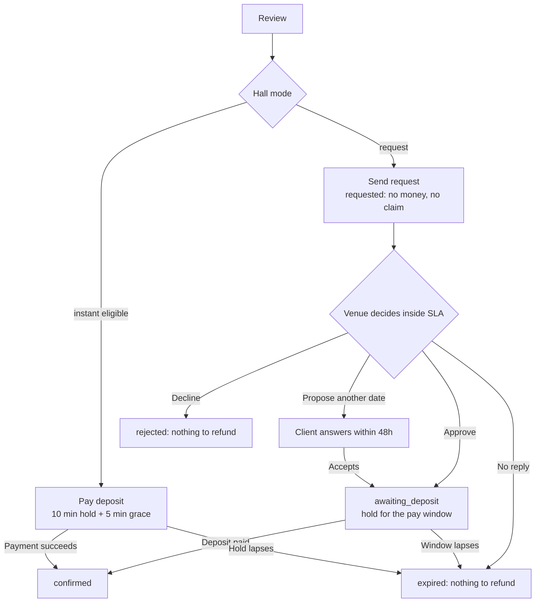

# ADR 0001: Booking model: request-then-pay by default, instant booking as an earned opt-in, no money held or charged before a human says yes

| Field | Value |
|---|---|
| Status | accepted; partially superseded: the in-app payment parts (D1 instant mode, D2 pay step, D3, D6 pay window, D11, D12, D13) by 0033 |
| Date | 2026-10-12 |
| Scope | Client app, Hotel app, API (bookings, payments, notifications) |
| Owner confirmation still needed | OQ-B-01 (default mode), OQ-B-02 (MyFatoorah facts), OQ-B-07 (response and payment windows), OQ-B-08 (instant eligibility) |
| Supersedes | The working resolution of conflicts-register entry CF-08 ("charge the deposit at Confirm; auto-refund on rejection") and the 'Held until {time}' pending state proposed in `docs/research/journeys-ia.md` |
| Related ADRs | 0002 (halls, sessions, sections), 0003 (state machine), 0004 (pricing), 0005 (deposit and balance), 0006 (cancellation and refunds), 0008 (hotel triage), 0027 (payment integration) |
| Screens | CL-BOOK-01..07, CL-PAYM-01..05, CL-BKNG-02, CL-BKNG-04, HL-BOOK-01, HL-BOOK-03, HL-DCSN-01..03 |

> Superseded by 0033 on 2026-10-14 (owner changed the business model to the KD 2 voucher marketplace): Request-then-approve, absolute times, no claim while pending, counter-offers and the 24 h reply window stand; the deposit, instant mode and pay window are replaced by the voucher and the 24 h confirm window. The body below is the historical record.

## Context

PRD gap 8 (digest section 9, conflict CF-08): both source documents end the booking flow with `Confirm > Deposit payment` while the booking status starts as `Pending` until the venue acts. Instant booking exists only as a filter (CA-SRCH-15); its behaviour is never defined (CA-BOOK-15). Three facts decide the model.

1. **KNET cannot hold money.** Through MyFatoorah, KNET is an immediate-debit sale with a full-page redirect and no documented authorise-then-capture. MyFatoorah authorise/capture allows exactly one capture or release per invoice and its documentation shows card examples only. Refunds are asynchronous, need available refund balance and are executed by MyFatoorah finance unless Auto Refund is enabled. Peer gateways quote about 1 working day for KNET and about 10 working days for cards (unverified for our account, OQ-B-02).
2. **The market is contested.** Several couples want the same Thursday. A pay-first model would create a slow refund for every rejection, expiry and lost contested date.
3. **The PRD wording survives.** "Online booking request backed by a deposit payment" and the order `Confirm > Deposit payment > Booking confirmation` are honoured; the deposit step simply arrives in a second session for request-mode venues. This also mirrors the existing Kuwaiti habit of a tentative hold followed by the arboon (deposit).

Mitigations for the weakness of this model (low commitment at request time) are part of the decision: verified phone, a cap of three open unpaid bookings, short windows and an immutable price snapshot.

## Decision

**D1. Two modes, set per hall: `request` (default) and `instant` (opt-in).** One set of screens serves both. Only the Review CTA, the pay step and the outcome screen differ.

**D2. Request mode.**
`Send request` (status `requested`; no money, no calendar claim) > venue approves inside its response SLA > approval creates a hold and a payment window > client pays the deposit > `confirmed`. The PRD order "Confirm > Deposit payment" is kept; the deposit step becomes a second session reached from push, WhatsApp or the Pay button on Booking detail.

**D3. Instant mode.**
The Review CTA reads `Pay deposit KD {amount}` (Arabic `دفع العربون {amount} د.ك`; ADR 0010 D7). Tapping creates a 10-minute hold (+5 minutes grace only while a gateway session is open), goes straight to payment, then `confirmed`. The venue cannot decline an instant booking; it may cancel under policy (ADR 0006). Eligibility is per hall and ALL of the following must hold:

- venue payout KYC approved;
- hall flag `instant`;
- event at least 30 days away (otherwise the CTA silently falls back to `Request to book` with one line of explanation);
- guests inside the package min/max;
- fixed-price package (no custom quote);
- trust: Super Admin `instant-verified` flag (the launch route, so the Instant filter and badge are not empty on day one) OR at least 5 completed bookings with at least 90% response rate.

Never available for government halls (ADR 0002).

**D4. No authorise-then-capture and no charge-then-refund anywhere in the MVP.** Corollary: a refund can only exist after money was actually paid. Rejection and expiry never refund anything (nothing was charged); a lost slot refunds only when a payment actually succeeded after the slot was lost (late payment, D11 and T08b).

**D5. Requests do NOT claim the calendar.** This deliberately overrides the research proposal of 'Held until {time}' on Pending. Only approval, instant checkout, confirmation and venue blocks claim a slot (hold > booking > released/expired). Pending copy: *"Request sent. Nothing is charged and nothing is held yet. If {venue} approves, we hold the date for you for 24 hours."* Why: if requests held dates, one couple could freeze a Thursday with three parallel requests, the venue could not compare competing requests, and a 'hold' that evaporates on decline is a broken promise.

**D6. Timers (single source for every countdown; stored UTC, shown Asia/Kuwait).**

| Timer | Value |
|---|---|
| Venue response SLA | default 24h; venue-selectable 12 / 24 / 48h; hard maximum 48h; forced to 4h and flagged `Urgent` when the event is 14 days away or less |
| Pay window after approval | default 24h; selectable 12 / 24 / 48 / 72h; forced to 6h when the event is 14 days away or less |
| Instant hold | 10 min (+5 min grace only while a gateway session is open) |
| Counter-offer validity | 48h |
| Venue-proposed reschedule validity | 72h |
| Late-payment rescue | 60 min |
| SLA escalation | push to staff at 50% elapsed, WhatsApp to manager and reception at 80%, expire at 100% |
| Client pay-window reminders | -12h, -3h (WhatsApp), -1h |
| Maximum open unpaid bookings per client | 3 (`requested` + `awaiting_deposit`, counted across the wedding file) |

**D7. Client-side time is absolute.** 'Expected reply by Fri 13 Nov, 6:00 PM', 'Pay by 7:30 PM today'. A live countdown appears only in the final 60 minutes of a pay window and during the 10-minute instant hold. Never a ticking timer during Pending (anxiety). Venue-side SLA countdowns are specified in ADR 0008.

**D8. Competing requests.** A second request on a held date stays `requested` and shows a calm chip 'Date held by another couple'. If the holder pays, the others become `expired` (`slot_taken`) with an alternatives push; if the hold lapses, the venue is nudged to approve the next one. The client is never told how many others are waiting. ('Notify me if this date opens' is flagged, OQ-B-13.)

**D9. Alternatives to Decline are first-class.** 'Propose another date' (1-3 dates, same hall and session, re-quoted per date, original price may be held, client has 48h) and approve-with-extra-venue-funded-discount (never a higher price).

**D10. Commitment safeguards.** Verified phone (WhatsApp OTP) required to send a request; price and policy frozen in an immutable snapshot at send; the client may edit only while `requested` (re-snapshot, the SLA clock keeps running); withdrawing is free until payment.

**D11. Late payment.** A gateway SUCCESS after the hold lapsed re-acquires the slot if still free within 60 minutes (`expired` > `confirmed`); otherwise auto-refund 100% (platform bears fees) and tell the client with alternatives. Gateway invoice expiry = hold expiry + 2 min. The webhook is truth; the app polls up to about 30 seconds, then says *'We are confirming. You can leave; we will notify you.'*

**D12. Booking flow shape (PRD steps merged; guest count moved to step 1).**

| Step | Content |
|---|---|
| 1 Your event | date, session*, 'What are you hosting?'*, hall*, guests, occasion chip** |
| 2 Package | package for each section |
| 3 Extras | extras (including 'Add a men's reception') |
| gate | guest sign-in gate (ADR 0007 D8) |
| 4 Your details | contact person, booking-for, special requests, inline phone verification |
| 5 Review | itemised price, schedule, consent, coupon, then `Send request` or `Pay deposit` |
| outcome | `Request sent` or `Confirmed` |

\* only when there is a real choice (ADR 0002). \*\* flagged, OQ-B-11. Guests move into step 1 because price and capacity validity depend on them. A 2px thread line shows 'Step 2 of 5'; Back is always safe; the draft autosaves.

**D13. Review must show:** itemised price, a schedule line 'Today / On approval / Balance due {date} / Free cancellation until {date}', consent to the cancellation policy and terms (CA-BOOK-17), and a coupon field. No fee may appear after Review.

## Consequences

**Client app**
- The CTA reads `Request to book` (never `Book now`) unless the hall is instant-eligible. The Instant tag appears only on eligible halls.
- The Pending screen (CL-BOOK-06) is the most important screen nobody screenshots: timeline, expected-reply time, Message venue, planner card shown once.
- A second session `Approved: pay by 7:30 PM` (CL-PAYM-01) is reached from push, WhatsApp or Booking detail.
- PRD wording to adjust: CA-STAT-04 'Approved: the date is secured' is only true at `confirmed`; `awaiting_deposit` says 'held for you until {time}'. CA-TOOL-16 (Venue checklist item) completes at `confirmed`, not at approval (approval shows it in progress).

**Hotel app**
- Needs-you inbox with SLA, Accept / Propose another date / Decline (ADR 0008); hatched Held calendar cells with a timer.
- Payout banner: until supplier KYC is approved the venue can receive requests but cannot approve into paid bookings or enable instant (effectively request-only), see ADR 0027 item 5.

**Backend**
- Slot claims, holds and sweepers as in ADR 0020; CAS-guarded transitions as in ADR 0003; deferred notification dispatch for the Accept-with-Undo window (ADR 0008 D6).

**Risks**
- Approval-to-payment drop-off. Mitigated by WhatsApp reminders, short windows and absolute-time copy.
- Venue calendar staleness (declines for dates already sold by phone). Mitigated by the weekly confirm-your-calendar nudge (ADR 0008 D4, OQ-B-22).
- Depends on written MyFatoorah confirmations (OQ-B-02).

**If the owner insists on pay-at-request:** only the request path changes (charge at step 5; refund on decline, expiry and lost slot; KNET disabled on that path or per-rejection refunds accepted). Instant mode, statuses and screens stay as designed.

## Alternatives considered

| Option | Money at request | Fit with KNET | Refund load | Verdict |
|---|---|---|---|---|
| A. Pay-then-approve (the CF-08 working call: charge at Confirm, auto-refund on rejection or after 24h) | Charged | Works as a debit but takes money for an unconfirmed thing | Every rejection, expiry and lost contested slot needs an async, finance-reviewed refund | Rejected as default: reputational and operational cost |
| **B. Approve-then-pay** | None | Perfect | Zero for rejection, expiry and lost slot | **Chosen default** |
| C. Authorise-then-capture (Airbnb outside India, Peerspace hold) | Hold | Not available for KNET; one capture or release per invoice; per-method support unclear | Low | Rejected; revisit for cards only later |
| **D. Instant booking** | Charged at checkout | Works | Low (slot is held before payment) | **Chosen as opt-in** |

Also rejected:
- **Soft-hold during Pending** ('Held until {time}', journeys-ia): freezes dates for parallel requests and breaks the promise on decline (D5).
- **Charge-then-refund as in Airbnb India:** refunds up to 15 days, the reputational cost the model avoids.
- **Venue 48h hard expiry with 24h target and nudges at 12h/4h/1h** (competitive-ux): replaced by the single SLA table in D6 (24h default, 48h hard maximum, escalation at 50% and 80%).
- **Cash deposit variant 'awaiting cash deposit'** (journeys-ia, localization): overridden by ADR 0005 D6, because the deposit funds commission and proves commitment.

## Related requirement IDs

| ID | Effect |
|---|---|
| CA-BOOK-09, CA-BOOK-10, CA-BOOK-11 | Review content (D13), Confirm = Send request or Pay deposit, deposit step becomes a second session in request mode |
| CA-BOOK-12, CA-BOOK-15, CA-BOOK-16, CA-BOOK-17 | Outcome screens, instant eligibility, date-taken recovery (D8, D11), policy consent |
| CA-PAY-07, CA-PAY-08, CA-PAY-10 | Deposit or full amount; outcome states incl. 'confirming with your bank' (D11) |
| CA-STAT-03, CA-STAT-04, CA-STAT-05, CA-STAT-06 | Pending copy (D5, D7), Approved wording change, Rejected and Cancelled paths |
| CA-SRCH-15, CA-CARD-13 | Instant filter and badge only on eligible halls (D3) |
| CA-TOOL-16 | Venue checklist item completes at `confirmed` |
| CA-AUTH-05, CA-AUTH-10 | Verified WhatsApp phone required to send a request (D10) |
| HA-BOOK-03, HA-BOOK-04, HA-BOOK-05, HA-DASH-03, HA-DASH-04, HA-NOTI-01 | Accept, decline and propose-another-date; SLA display; new-request notification |
| PL-BOOK-01, PL-BOOK-02, PL-BOOK-03, PL-PAY-02, PL-CORE-06 | State machine, claims and holds, expiry sweepers, idempotent webhooks, reminders |
| CF-08 | Register entry resolved here; its working resolution is superseded |

## Notes on conflicting inputs

- `docs/product/feature-matrix.md` and `.json` carried the old CF-08 resolution and the CA-BOOK-11 note ("charge deposit at Confirm, auto-refund"); they were rewritten on 2026-10-12 to "Resolved by ADR 0001" (CA-BOOK-11, CA-STAT-03/04/05, CA-TOOL-16/17, HA-BOOK-01, HA-BOOK-04, PL-BOOK-03, CF-08).
- `docs/research/flutter-tech-handoff.md` section 1.7 sketches instant mode with auto-refund on reject or expiry; D4 forbids that (instant bookings cannot be rejected).
- **Amendment 2026-10-12 (architecture README #20).** A venue without payout KYC can receive requests but cannot approve into paid bookings: Accept is blocked with `VENUE_KYC_REQUIRED`, which makes KYC a launch dependency (no booking can complete before it); the owner confirms with OQ-B-02.
