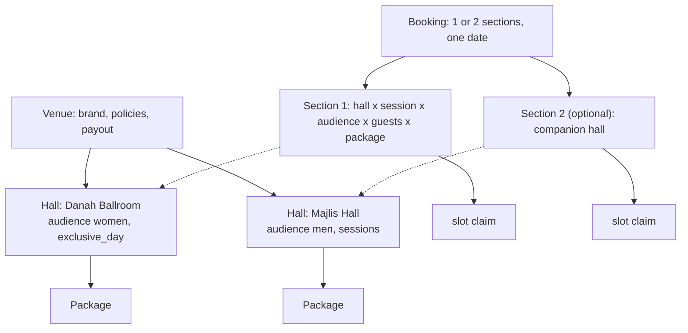

# ADR 0002: Booking granularity: hall x date x session, up to two event sections (ladies and men's), and booking channels including government halls

| Field | Value |
|---|---|
| Status | accepted |
| Date | 2026-10-12 |
| Scope | Client app (search, venue detail, calendar, booking), Hotel app (calendar, bookings), API (inventory and claims) |
| Owner confirmation still needed | OQ-B-09 (inventory reality: halls, sessions, exclusive day, two sections), OQ-B-10 (government halls), OQ-B-11 (Occasion chip) |
| Resolves | PRD gap 9 (granularity), PRD gap 10 (government halls), conflicts CF-09 and CF-10, matrix note on `CA-BOOK-03` |
| Related ADRs | 0001 (booking model), 0003 (state machine), 0004 (pricing), 0008 (hotel calendar), 0009 (compare), 0011 (calendar rules), 0015 (per-section policy facts), 0018 (card variants) |
| Screens | CL-BOOK-01, CL-BOOK-02, CL-BOOK-03, CL-VENU-03, CL-VENU-05, CL-VENU-06, CL-SAVD-04, HL-CALN-01..04, HL-VENU-04 |

## Context

The PRD says "Choose Date, Choose Time" and filters by women only, men only and mixed, but defines no unit of booking (CF-09). Research established how Kuwaiti venues actually sell:

- **A wedding is two events in two rooms.** A ladies' reception (الحفل النسائي: bride, kosha, zaffa, dinner, evening start) and a men's reception (الحفل الرجالي: shorter, often a lunch or after Isha, frequently in a separate hall or diwaniya). Hotels sell them as separate products with separate per-guest prices and minimums. Many families book both on the same night in adjacent halls with separate entrances.
- **A published 5-star example** (do not reuse the brand): ladies' weekday KWD 47 per guest, weekend 49, 200-650 guests; men-only KWD 30 per guest, 300-1,000 guests, separate minimums per ballroom.
- **Ballrooms with a kosha set-up typically run one wedding per hall per night** (a domain assumption to validate, OQ-B-09). Other halls may run an afternoon and an evening event where session ranges plus buffers do not overlap.
- **Mixed (مختلط)** exists but is a sensitive label for part of the core audience: present, neutral, last, never the default.
- **Government halls** (Ministry of Social Affairs) are already bookable through the ministry's own KNET-paid app: fixed small fees (reported about KWD 100 rent plus a refundable security deposit), empty hall (guests bring decor, catering and staff), dates cannot be changed, payment due within 3 days or the booking auto-cancels. Competing with that channel adds no value and creates compliance risk; the unmet need is discovery and vendors.
- Three analyst models existed and are merged here: the booking-payment model (`booking_halls` rows, companion hall as an extra), the localization model (event sections) and the journeys-ia model (progressive disclosure, spaces and sessions).

## Decision

**D1. Hierarchy.** Venue (container: brand, policies, payout account) > Hall (the bookable unit: capacity bounds, allowed audiences, setting, `exclusive_day`, session templates) > Package (bound to one or more halls). A booking has 1 or 2 event sections; a section = hall x session x audience x guest count x package. Maximum 2 sections, same date (ladies + men's).

**D2. A 'date' is the venue business day** (06:00 to 06:00 next day, Asia/Kuwait), so a 19:30-01:00 wedding belongs to its start date. The UI always shows weekday + date + session name + time; never 'night of' wording (in Arabic ليلة الجمعة means Thursday night).

**D3. Sessions are templates per hall** (name in AR/EN, start, end, buffers, weekdays); the UI surfaces at most 3. Platform presets for new halls: Afternoon 12:00-16:00, Evening 19:00-01:00 (default), Full day. The shared seed story's Danah Ballroom overrides the Evening preset to 21:00-02:00 (Majlis Hall keeps 20:30-01:00), so the fixtures in both apps read 9:00 PM - 2:00 AM for Danah; a venue edits its own times. `exclusive_day` defaults to true for ballrooms with kosha set-up (one wedding per hall per day), which removes the session picker entirely. Overlap is decided by time ranges, not by enumerated slots (a Full day naturally conflicts with both). Custom hours are not bookable in the MVP (chat or special requests).

**D4. Audience = women / men / mixed** (AR: الحفل النسائي / الحفل الرجالي / مختلط). A hall declares the audiences it allows (most allow one); each booking section picks one. 'Mixed' is last in every list and never the default. Filter semantics: 'Women only' matches venues with at least one hall allowing it; the card shows the matched hall's audience. Policies that differ by section (photography, music, phones, cloakroom) are stored per hall and shown per section (ADR 0015 item 6).

**D5. Progressive disclosure, strictly rule-based.**

| UI element | Appears only when |
|---|---|
| Hall switcher | more than one hall fits the Brief |
| Session chips | more than one session is free that day |
| 'What are you hosting? Ladies' reception / Men's reception / Both' chips | the venue sells more than one audience (default: the audience in the active filter, else Ladies' reception when offered) |
| Audience chip | the chosen hall allows more than one audience |

Single-hall, single-session, single-audience venues see none of it.

**D6. 'Both' = a second section** (companion hall) with its own hall, guest count and package; totals are summed; approval, payment and cancellation are atomic for the whole booking; partial approval is not supported (the venue approves, declines or counters the whole booking; the client can re-request one section). Two entry points, one state: the step-1 chip and an 'Add a men's reception' card in Extras. If the venue has no suitable second hall the option is hidden. The data model exists from day one; the UI may ship in v1.1 if the schedule demands, without breaking anything else.

**D7. Guest count means guests in that section** ('Guests in this hall', المعازيم), stepping by the package `guest_step` and validated against package and hall min/max (CA-BOOK-06).

**D8. Client calendar states.**

| State | Meaning | Encoding (never colour alone) |
|---|---|---|
| Available | at least one hall x session matches guests and audience | plain number |
| Held | approved for another couple; requests still allowed | corner mark |
| Unavailable | booked or blocked | struck-through number |
| Closed | past, inside minimum lead time, or outside venue season | no strike; past dates use 32% ink (ADR 0011 item 5) |

Other couples' pending requests are never visible to clients.

**D9. Venue calendar.** Lanes per hall, stacked dots in month view, per-session timeline in day view. Claim styles: booked = solid bar, held = hatched with timer, blocked = struck/hatched, requested = gold dot (informational, no claim). Blocks carry a reason (Booked offline, Maintenance, Private event, Other); an offline sale recorded as a block carries no payment and no commission. A confirmed booking cannot be blocked over (cancel flow first); blocking over pending requests warns and flags them unavailable.

**D10. Booking channels: `ghazal` | `external_link`.** Government halls are `external_link`: listing with photos, location, capacity, the official fee schedule (rent plus refundable security deposit, 'hall only: bring your own decor and catering'), the rules that matter (dates cannot be changed; payment due within 3 days or the booking auto-cancels; KNET), availability shown as informational ('check the official app'), and a 'Book via official channel' deep link to the ministry flow. No Ghazal checkout, deposit, commission, instant tag, availability claims or reviews; excluded from the Instant filter; Compare shows 'Official channel' instead of a Book button. Optional 'I booked this hall' self-report (date, fee) feeds Budget, Checklist and Countdown only. Secondary CTA 'Find catering and decor' links to Services. The enum value `enquiry_only` is reserved, not designed in the MVP.

**D11. Different-day events** (milka, henna night, next-day lunch) are separate bookings; an optional Occasion chip is flagged (OQ-B-11).

## Consequences

- Majority venues (one hall, one session) get zero extra UI while the data model supports halls, sessions and sections from day one.
- 'Both' adds a Ladies | Men tab pair to steps 2 and 5 and two section blocks on Review and Booking detail.
- The hotel calendar needs hall lanes and a session timeline (ADR 0008 D9).
- Government halls need a distinct card and detail variant (fee schedule instead of packages, ADR 0018 item 6) and are excluded from instant, reviews, claims and Compare booking (ADR 0009 D8).
- CA-BOOK-03's session picker collapses when there is a single session.
- **Data and API:** hall x session x audience is the overlap key; the exclusion constraint and claims live in ADR 0020. Men's and women's sections and multiple halls are separate halls, not flags on a venue.
- **Risks:** the two-section model, the `exclusive_day` default and the session presets are domain assumptions to validate with 5-8 venue managers before inventory UI is locked (OQ-B-09). Government-hall rules (eligibility, fees) are reported, not verified (OQ-B-10).

## Alternatives considered

| Alternative | Why rejected |
|---|---|
| Book per venue and date only | Cannot express ladies and men's receptions, afternoon plus evening events or several halls; creates phantom availability |
| Venue has 1-3 'spaces' and a second space is an Extra only (journeys-ia) | Hides the dual-section case inside Extras; D6 keeps that entry point but makes the section a first-class object |
| Audience as a venue-wide flag | Wrong for hotels that run a ladies' ballroom and a men's hall with different prices, minimums and policies |
| Start the flow with 'What are you hosting?' before the date (localization) | Asked first, it would show for every venue; D5 shows it only when the venue sells more than one audience and moves it into step 1 beside the date |
| Two separate bookings for ladies and men's | Splits approval, payment and cancellation; couples would lose the atomic guarantee that both rooms are secured |
| Enumerated slot lists per session | Fragile for Full day vs Afternoon; time-range overlap handles it naturally |
| Ghazal takes government-hall bookings itself | Needs a ministry agreement; the ministry already runs KNET booking (OQ-B-10) |
| `enquiry_only` channel for villas now | Reserved in the enum; no MVP design |
| Custom hours bookable | Out of scope; handled in chat or special requests |

## Related requirement IDs

| ID | Effect |
|---|---|
| CA-BOOK-02, CA-BOOK-03, CA-BOOK-06 | Date, session picker that collapses, guests per section |
| CA-SRCH-13, CA-SRCH-14, CA-SRCH-12 | Attendance filter semantics; availability filter by hall x session; per-section photography policy |
| CA-CARD-08, CA-VDET-08, CA-VDET-22, CA-VDET-26 | Availability badge, per-section capacity, calendar states, filterable attributes shown on details |
| CA-HOME-07 | Government Halls quick category stays; it hands off instead of booking |
| CA-CMP-08, CA-CMP-10 | Compare availability row; Book action becomes 'Official' for government halls |
| HA-CAL-04, HA-CAL-05, HA-CAL-06, HA-CAL-09 | Blocks with reasons, claim styles, several halls or sessions |
| HA-AUTH-03, VD-DASH-04 | Switching hall or venue; occupancy denominator (hall-sessions) |
| PL-BOOK-02 | Claims computed per hall x session |
| CF-09, CF-10 | Resolved here |

## Notes on conflicting inputs

- Session times differ across research files (booking-payment: Evening 19:30-01:00, Afternoon 12:00-17:00; localization: Evening 19:00-01:00, Afternoon 12:00-16:00). The decision above (localization values) is the preset.
- `docs/research/journeys-ia.md` caps a venue at 3 spaces and 3 sessions; D3 keeps the 3-session surface limit but the data model has no hall limit.
