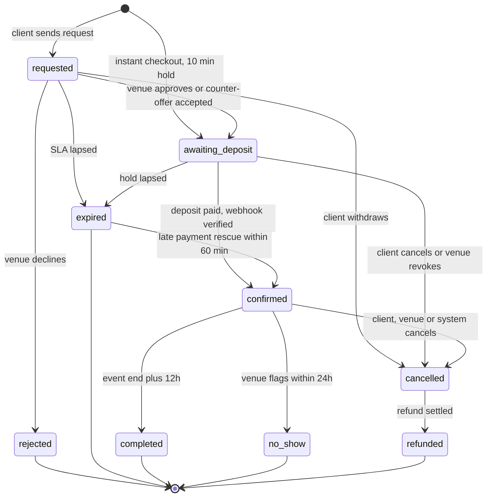

# ADR 0003: Booking status state machine: nine internal statuses under the PRD's six, child objects for changes, and a shared Booking Thread

| Field | Value |
|---|---|
| Status | accepted; partially superseded: D2 chip labels by 0013 D4; D1, D3, D5 to D8 by 0033 |
| Date | 2026-10-12 |
| Scope | API (state machine, events, notifications), Client app (Bookings), Hotel app (Bookings), web dashboards (filters and reports) |
| Owner confirmation still needed | OQ-B-21 (the labels 'Confirmed', 'Expired', 'No-show', 'Not accepted', 'Awaiting deposit'); no-show UI is P2 |
| Related ADRs | 0001 (modes and timers), 0002 (claims per hall and session), 0005 (money milestones), 0006 (cancellation, refunds, reschedule), 0008 (hotel list structure), 0013 (Arabic words for chips), 0019 (status analytics) |
| Screens | CL-BKNG-01..05, CL-BOOK-06, CL-PAYM-05, HL-BOOK-01..05, HL-DCSN-01..05 |

> Superseded by 0033 on 2026-10-14 (owner changed the business model to the KD 2 voucher marketplace): Statuses become pending, approved, declined, expired, confirmed, redeemed, completed, cancelled. See booking-state-machine.md. The body below is the historical record.

## Context

The PRD defines six statuses (Pending, Approved, Rejected, Cancelled, Completed, Refunded) but no transitions (PL-BOOK-01 notes the gap). The booking model of ADR 0001 needs finer distinctions that both sides must see: 'approved but unpaid, date held, timer running' versus 'secured'; an expired request versus a declined one; a venue-proposed reschedule that is not a status at all. Every hotel action also needs a visible client-side counterpart (the PRD gives the venue a Reschedule action but the client no counterpart, CA-STAT-10).

Constraints: keep the PRD's six as the vocabulary of filters and reports; keep one canonical Booking detail screen per app; make the machine safe against races (a venue approving at the instant a client withdraws); and give the couple and the venue the same visible timeline, which is the brief's memorable idea (غزل = love poem and spun thread).

## Decision

**D1. Internal statuses** (canonical enum for `packages/contracts`): `requested`, `awaiting_deposit`, `confirmed`, `rejected`, `expired`, `cancelled`, `refunded`, `completed`, `no_show`. Supporting fields: `cancelled_by` (client | venue | system | admin), `reason_code` (includes `authority_order`), `expired_reason` (`venue_no_response` | `client_no_payment` | `slot_taken` | `client_no_response`).

**D2. PRD family mapping and labels (EN / AR).**

| Internal status | PRD family | Client label EN / AR | Hotel-side label |
|---|---|---|---|
| `requested` | Pending | Pending / بانتظار الرد | Pending |
| `awaiting_deposit` | Approved | Approved - deposit due / تمت الموافقة · بانتظار العربون | Awaiting deposit |
| `confirmed` | Approved | Confirmed / مؤكد (headline: حجز مؤكد) | Confirmed |
| `rejected` | Rejected | Not accepted / لم يُقبل الطلب (ADR 0013 D4) | Declined |
| `expired` | Cancelled | Expired / انتهت المهلة | Expired / انتهت المهلة (venue_no_response shows as 'Missed' / انتهت مهلة الرد in Past) |
| `cancelled` | Cancelled | Cancelled / ملغي (+ by me / by venue / by Ghazal) | Cancelled |
| `refunded` | Refunded | Refunded / تم الاسترداد | Refunded |
| `completed` | Completed | Completed / مكتمل | Completed |
| `no_show` | Completed | No-show / عدم حضور | No-show |

The PRD six remain the vocabulary of filters and reports; the finer labels are chips.

**D3. Transitions** (all CAS-guarded with a `version` column; the loser of a race sees an 'already updated' sheet).

| ID | Transition | Trigger and guards |
|---|---|---|
| T01 | none > `requested` | Client sends. Verified phone; fewer than 3 open unpaid; capacity and lead time valid; slot not booked or blocked (held is allowed); snapshot stored; no claim, no money |
| T02 | none > `awaiting_deposit` | Instant checkout; 10-minute hold |
| T03 | `requested` > `awaiting_deposit` | Venue approves; hold until `pay_by`; competing requests flagged `blocked_by_hold` |
| T04 | `requested` > `rejected` | Venue declines; reason code required |
| T05 | `requested` > `awaiting_deposit` | Counter-offer accepted by the client within 48h |
| T06 | `requested` > `expired` | SLA lapsed |
| T07 | `requested` > `cancelled` | Client withdraws, free |
| T08 | `awaiting_deposit` > `confirmed` | Gateway SUCCESS re-verified server-side; amount matches; hold becomes booking |
| T08b | `expired` > `confirmed` | Late-payment rescue within 60 min if the slot is free; else auto-refund 100% and the status stays `expired` with a Refunded note |
| T09 | `awaiting_deposit` > `expired` | `pay_by` passed |
| T10 | `awaiting_deposit` > `cancelled` | Client cancels, or venue revokes with a reason |
| T11 | `confirmed` amendment (child) | Guest count, extras, package upgrade; priced delta |
| T12 | `confirmed` reschedule (child) | Booking stays `confirmed` with a 'Reschedule pending' chip |
| T13 | `confirmed` > `cancelled` (client) | Refund preview first |
| T14 | `confirmed` > `cancelled` (venue) | Admin or Manager only; reason; 100% refund; venue bears gateway fee |
| T15 | `confirmed` > `cancelled` (system) | After balance default: venue-triggered after the D+3 grace |
| T16 | `cancelled` > `refunded` | Refund fully settled; if nothing to refund it stays `cancelled` |
| T17 | `confirmed` > `completed` | Event end + 12h automatically, or venue manual |
| T18 | `confirmed` > `no_show` | Venue flags within 24h; client has 72h to contest |
| T19 | admin override | Audited; reason required |

Every transition appends an immutable `booking_events` row that feeds the timeline and the audit log.

**D4. Overlays, not statuses:** `counter_offer` (on `requested`), `reschedule_request` and `amendment` (on `confirmed`), `blocked_by_hold`, `payout_hold`, `dispute_open`, `deposit_verifying` (payment attempt in flight). Sub-machines: `payment_milestone`, `payment_attempt`, `refund`, `slot_claim`, `counter_offer` / `reschedule_request`.

**D5. Who sees and does what.**

| Status | Client sees | Venue sees |
|---|---|---|
| `requested` | Pending, 'Expected reply by {time}', price breakdown, edit/withdraw, Message/Call | SLA bar, Accept / Propose another date / Decline, payout preview, '+N other requests for this date' |
| `awaiting_deposit` | 'Approved - Pay the deposit by 7:30 PM to secure 21 Jan', Pay button, price locked, no cancel fee | Hatched Held with timer, Call, Chat, Revoke |
| `confirmed` | Money panel, policy dates (free cancel until, guest lock), invoice, add to calendar, Reschedule / Amend / Cancel with refund preview | Booked cell, money panel (deposit received, balance due, Record cash), Reschedule / Amend / Cancel with consequence preview |
| `completed` | Review prompt next morning, Report an issue for 72h | Payout date, reply to review |
| `rejected` | Gentle reason category and 3 alternatives free on the date | Archived |
| `expired` | Reason and 'Send to similar venues' | 'Missed' (`venue_no_response`) in Past |
| `cancelled` | Refund tracker (amount, destination, arrival estimate) | Retained amount; recovery if venue-caused |
| `refunded` | Amount, method, credit note | Ledger note |
| `no_show` | Contest link for 72h | Flag; payout hold |

**D6. The Booking Thread.** One timeline component, identical on both apps and reused as flow progress: nodes Request > Approval > Deposit > Balance > Day (+ Completed), each 'knotting' gold when done, timestamps on past nodes, at most two faint future nodes, absolute times only (ADR 0001 D7). Instant bookings show Request and Approval as auto-completed.

**D7. Status chip styling** (always icon + label; brand colours plus the tiny functional set).

| Status | Treatment |
|---|---|
| `requested` | gold tint + clock |
| `awaiting_deposit` | gold outline + hourglass |
| `confirmed` | functional success + check |
| `completed` | ink tint + double check |
| `rejected` | functional danger + x |
| `expired` | neutral + clock-off |
| `cancelled` | neutral ink + x |
| `refunded` | rose tint + return arrow |
| `no_show` | danger outline + user-minus |

**D8. Venue lists use three segments** (Pending / Upcoming / Past); Upcoming is sectioned Awaiting deposit then Confirmed; Past carries a status chip row (All, Completed, Cancelled, Declined, Expired, Refunded) so all six PRD statuses are reachable in two taps (HA-BOOK-01).

**D9. Notifications mirror transitions** (push default; WhatsApp for time-critical money events; email for receipts) per ADR 0001 D6 and ADR 0005.

## Consequences

- One canonical Booking detail screen per app with status variants, not one screen per status.
- The backend enum, filters and the venue-web tabs must use the nine internal statuses mapped to the PRD six.
- 'Expired', 'No-show' and 'Confirmed' are labels the PRD does not contain and need owner acknowledgement (OQ-B-21); `no_show` UI is P2 in the prototype.
- Money by state: nothing at `requested` or `awaiting_deposit`; deposit in the gateway at `confirmed`; refund payable at `cancelled` until `refunded`.
- The prototype must seed one shared booking visible identically in both apps (same reference and Thread).
- `docs/research/flutter-tech-handoff.md` status names (`pending_payment`, `pending_approval`, `approved`) must be replaced by these.
- Reschedule is never a status (ADR 0006 D6); the client sees the same 'Venue proposed another date' card for counter-offers and reschedules.
- **Implementation notes:** CAS update `UPDATE bookings SET status=:to, version=version+1 WHERE id=:id AND status=:from AND version=:v`; partial indexes `bookings (venue_id, status, respond_by) WHERE status='requested'` and `bookings (status, pay_by) WHERE status='awaiting_deposit'` drive the sweepers (ADR 0020).

## Alternatives considered

| Alternative | Why rejected |
|---|---|
| Exactly the PRD's six statuses with presentation-only sub-states (journeys-ia) | Hides operationally different states (held vs secured; missed vs declined) from backend filters, sweepers and analytics |
| Add `awaiting_cash_deposit` | Cash is balance-only (ADR 0005 D6); the deposit is always online |
| Reschedule and counter-offer as statuses | They overlay `requested` and `confirmed`; making them statuses would multiply states and lose the original booking |
| `expired` as a plain `cancelled` reason (matrix note on CA-STAT-03) | The venue needs 'Missed' and response-rate effects; the client needs a distinct 'Expired' explanation. It still maps to the PRD Cancelled family |
| `no_show` as a flag on `completed` | The payout hold and the 72-hour contest window need a first-class state |
| One screen per status | Duplicates layout; D5 uses status variants of one screen |
| Optimistic last-write-wins updates | Races (approve versus withdraw) must have a defined loser and an 'already updated' sheet |

## Related requirement IDs

| ID | Effect |
|---|---|
| CA-STAT-01..10 | List, detail, the six PRD statuses, client cancel with refund preview, venue-proposed reschedule |
| CA-REV-01 | Review prompt only after `completed` |
| CA-NOTI-02, CA-NOTI-07 | Notifications mirror transitions |
| HA-BOOK-01..05, HA-BOOK-09..11 | Lists and tabs, detail, accept, reject with reason, reschedule, payment status, venue cancel, completion |
| HA-DASH-03, HA-DASH-04 | Pending queue and SLA display |
| PL-BOOK-01, PL-BOOK-03 | State machine with valid transitions only; automatic expiry |
| CF-08 | The deposit rule feeds T01-T09 |

## Notes on conflicting inputs

- Resolved 2026-10-12: ADR 0013 D4 owns the chip words and this ADR's D2 quotes them: `requested` is 'Pending' / بانتظار الرد and `rejected` is 'Not accepted' / لم يُقبل الطلب. 'Awaiting reply', 'Venue unable to host', `غير مقبول` and `اعتذرت القاعة` are retired. OQ-B-21 still asks the owner to confirm the vocabulary.
- **Amendment 2026-10-12 (architecture README #8).** ADR 0008 D6 (Undo returns an approval to `requested`) is realised as transition T03u with `bookings.undo_until = now + 8 s` (booking-state-machine section 4); the client-facing representation stays `requested` during the window.
