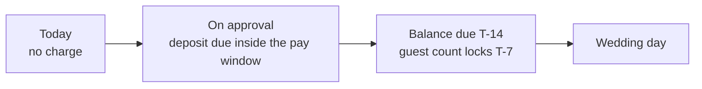

# ADR 0005: Deposit, balance and payment schedule: 30% default deposit, balance at T-14, cash for the balance only, KNET-safe payment flow

| Field | Value |
|---|---|
| Status | superseded by 0033 (was proposed-needs-owner) |
| Date | 2026-10-12 |
| Scope | Client app (Review, Pay, Booking detail), Hotel app (money panel, record cash), API (milestones, reminders, ledger inputs) |
| Owner must confirm | OQ-B-03 (deposit rules), OQ-B-04 (balance, guest-count lock, cash), OQ-B-06 (invoice issuer, funds held), OQ-B-15 ('No booking fee'), OQ-B-02 (MyFatoorah facts) |
| If the owner sets different numbers | Only configuration changes, not the design (percentages as basis points, all amounts in fils) |
| Related ADRs | 0001 (when the deposit is paid), 0004 (client total), 0006 (what is refundable), 0008 (hotel money panel), 0010 (money display), 0027 (gateway boundary) |
| Screens | CL-BOOK-05, CL-PAYM-01..05, CL-BKNG-02, CL-BKNG-05, HL-BOOK-03, HL-DCSN-05, HL-GROW-05 |

> Superseded by 0033 on 2026-10-14 (owner changed the business model to the KD 2 voucher marketplace): There is no deposit, balance, cash or payment schedule any more; the only client payment is the KD 2 voucher. The body below is the historical record.

## Context

The PRD says only "deposit payment" (CA-PAY-07: amount rule undefined; percentage versus fixed, per venue or platform-wide; forfeiture and refund rules undefined) and "pay the remaining balance in the app before the event" (CA-PAY-11: due date, reminders and non-payment unspecified). Research found:

- Kuwaiti hotels bill buffets per head and settle the final count late, so the balance and a guest-count true-up are real venue contract terms.
- Cash and bank transfer persist with halls. Cash is the biggest commission-leak and dispute risk, so it may cover only the balance.
- Commission is front-loaded from the deposit through the MyFatoorah supplier split (venue share = deposit minus commission). A deposit of at least 20% of the total with a commission cap of 10% guarantees the venue nets at least half of the deposit and that commission is always covered by online money, even if the balance is paid in cash at the venue.
- KNET is a full-page redirect (opened in the system authentication session, an ASWebAuthenticationSession or Android Custom Tab, with deep-link return: ADR 0027 D2) and is bounded by bank-set daily online limits that may sit below a large deposit (a KWD 5,460 deposit is plausible; limits are unverified). Apple Pay launched in Kuwait on 6 Dec 2022 and iOS is about 43% of Kuwaiti mobile.
- Instalments are deferred (CA-PAY-09).
- Legal issuer wording, supplier-fund holding and refund liability are open legal questions (OQ-B-06).

## Decision

**D1. Deposit** = `min(client_total, roundUp to the next KWD 5 of max(venue % x client_total, 20% x client_total))`. Default 30%; venue-configurable 20-50% (or a fixed amount inside the same bounds); 100% is charged immediately when the event is 14 days away or less. The 20% floor with a 10% commission cap guarantees the venue nets at least half of the deposit and that commission is always covered by online money.

**D2. Balance** due T-14 (venue 7-30 days). Reminders at T-21, T-14 (due), D+1 and D+2 (WhatsApp for due and overdue). An overdue balance shows on the hotel Today as 'at risk'. The venue decides the consequence; there is no auto-cancel; cancelling for non-payment is a venue action after a D+3 grace (ADR 0003 T15). In this ADR and in ADR 0003, D means the balance due date and T means the event date.

**D3. Guest-count lock at T-7** (venue 3-14 days): the balance paid at T-14 is on the booked count; at lock a true-up amendment settles the difference (extra guests: delta payable, up to hall capacity; fewer guests: credited, never below the package minimum and floored at -10% of the booked count). Review states the lock date in plain words. Flagged (OQ-B-04) because it is a venue contract term.

**D4. Options at the pay step:** Deposit (default) or Pay in full (toggle). No instalments UI (deferred, CA-PAY-09). The balance can be paid online any time from Booking detail or the T-21 push (CA-PAY-11).

**D5. Method order by platform.**

| Platform | Order |
|---|---|
| iOS | Apple Pay, KNET, Visa/Mastercard |
| Android | KNET, Google Pay (only if the gateway enables it), Visa/Mastercard |

Wallets use the gateway-hosted flow so card data never touches Ghazal (NF-PAYS-01). KNET is a full-page redirect opened in the system authentication session (ASWebAuthenticationSession on iOS, Custom Tab on Android) with deep-link return (ADR 0027 D2).

**D6. Cash: balance only,** only where the venue enables it, never the deposit. It appears as 'Pay at the venue' on the balance screen. The venue records 'Cash received KWD X' (Admin, Manager, Reception, Accountant); the client gets a one-tap acknowledgement; a mismatch opens a support case; Ghazal does not enforce cash collection. This overrides the journeys-ia cash-deposit variant (the deposit funds commission and proves commitment).

**D7. Outcome states.**

| Outcome | Behaviour |
|---|---|
| Success | Receipt, confirmation, calendar file |
| Failed | Retry or switch method; after the first KNET failure recommend Apple Pay or card because bank daily limits may sit below a large deposit |
| Pending bank confirmation | 'Confirming with your bank', poll up to 30 s, then 'You can leave; we will notify you' |
| Hold expired | Re-hold if the slot is still free, else alternatives (ADR 0001 D11) |

**D8. Documents.** A receipt per payment at once; the booking invoice available from confirmation and updated as payments land; a credit note on refund; bilingual PDFs. Legal issuer wording is pending (OQ-B-06).

**D9. Clients pay no Ghazal fee and no processing fee** at payment or refund. The copy 'No booking fee' ships only after OQ-B-15. Commission is invisible to clients; it is front-loaded from the deposit through the gateway supplier split so cash balances leak nothing; the hotel app shows 'You receive KWD X' only when a commission rule exists (ADR 0008).

**D10. Money by state:** none while `requested` or `awaiting_deposit`; deposit in the gateway at `confirmed`; balance later; retained and refunded amounts follow ADR 0006.

**Worked example (the shared prototype story).** Reem Al-Dosari, Aurelia Gulf Hotel, ladies' reception, Thu 14 Jan 2027, 350 guests x KWD 52 = KWD 18,200.000. Deposit 30% = 5,460.000 (already a multiple of KWD 5). Balance 12,740.000 due Thu 31 Dec 2026 (T-14). Guest-count lock Thu 7 Jan 2027 (T-7). Reminders: 24 Dec (T-21), 31 Dec (due), 1 Jan and 2 Jan (overdue). Under the Standard policy (ADR 0006) free cancellation runs until 15 Nov 2026.

## Consequences

- The Review step and Booking detail carry a four-node payment schedule (Today, On approval, Balance due date, Wedding day) and a 'Deposit card' answering how much, when, and what if plans change in 12 words each.
- Hotel Booking detail needs a money panel (deposit received, balance due, cash-received action, payout date).
- The engine must treat percentages as basis points and all amounts as fils.
- Needs MyFatoorah confirmations: supplier split with onDemand deposits, KNET limits and error codes, saved-card tokenisation (cards only, never auto-debit) (OQ-B-02, ADR 0027 item 8).
- Reminder jobs: T-21, T-14, D+1, D+2 balance reminders plus the pay-window reminders from ADR 0001 D6; WhatsApp for due and overdue (templates need Meta approval, OQ-T-08).
- Risks: venue push-back on the 20% floor and the guest-count true-up; large KNET deposits failing; cash-balance disputes (mitigated by acknowledgement and support cases, not by enforcement).

## Alternatives considered

| Alternative | Why rejected |
|---|---|
| Fixed platform-wide deposit percentage | Venues differ; D1 keeps a 30% default inside a 20-50% venue band |
| Deposit of 10% or less | A deposit under 20% cannot guarantee commission is covered by online money |
| Cash allowed for the deposit (journeys-ia cash variant, localization 'awaiting cash deposit') | The deposit funds commission and proves commitment; CF-27 working call is balance-only cash |
| Authorise now, capture later | KNET has no hold; one capture or release per invoice (ADR 0001 D4) |
| Instalments in the MVP | Deferred feature (CA-PAY-09) |
| Balance due T-28 with reminders at 28, 21, 14, 7 (journeys-ia) | Replaced by T-14 default (venue 7-30) with reminders T-21, T-14, D+1, D+2 |
| Auto-cancel on balance default | Venue decides; a D+3 grace and a venue-triggered cancel keep a human in the loop |
| No guest-count lock | Per-head billing needs a final count; the lock plus true-up is how venues bill |
| Show a 'No booking fee' trust line now | Only if true and legally safe (OQ-B-15) |
| Saved-card auto-debit of the balance | Tokens are card-only and KNET always needs a PIN; never auto-debit in the MVP |

## Related requirement IDs

| ID | Effect |
|---|---|
| CA-PAY-01..05 | Methods and platform order (D5) |
| CA-PAY-06 | Cash only for the balance (D6, CF-27) |
| CA-PAY-07, CA-PAY-08, CA-PAY-09 | Deposit rule, pay in full, instalments deferred |
| CA-PAY-10, CA-PAY-11 | Outcome states; balance payable in app, reminders, non-payment handling |
| CA-BOOK-09, CA-BOOK-11, CA-BOOK-13 | Review schedule; deposit step; receipt, invoice and credit note |
| CA-NOTI-07 | Payment notifications: receipt, failure, balance due |
| HA-BOOK-09, HA-DASH-02 | Payment status on booking; revenue summary |
| PL-PAY-01, PL-PAY-02, PL-CORE-07 | Gateway methods, idempotent callbacks, bilingual PDFs |
| MK-COM-01, PL-BOOK-05 | Commission front-loaded from the deposit |
| NF-PAYS-01 | No card data on the platform |
| CF-27, CF-34 | Cash resolution; tax treatment (none today) |

## Follow-ups

- Owner answers on OQ-B-03, OQ-B-04, OQ-B-06 and OQ-B-15 flip this ADR to `accepted` or amend the numbers.
- MyFatoorah written answers (OQ-B-02, OQ-T-04) before arrival-time and KNET-limit copy is final.

## Notes on conflicting inputs

- **Amendment 2026-10-12 (architecture README #13, #19).** (a) Cash is for the balance only (D6), narrowing CA-PAY-06 and the cash-deposit variants in two research files (OQ-B-04). (b) A guest-lock credit that arrives after the balance is settled is applied to the unpaid balance first, then refunded as a partial refund (derived in pricing-and-payments).
