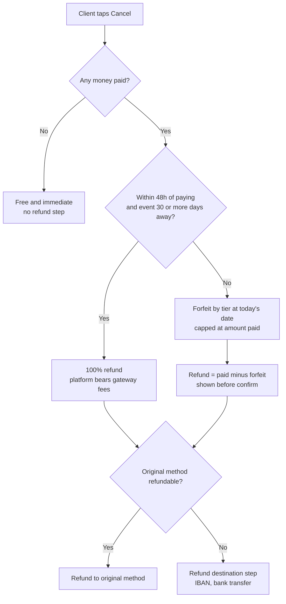

# ADR 0006: Cancellation, refund and reschedule model: policy templates by days-before-event, a 48h cooling-off, absolute dates and a live refund calculator

| Field | Value |
|---|---|
| Status | superseded by 0033 (was proposed-needs-owner) |
| Date | 2026-10-12 |
| Scope | Client app (Booking detail, cancel, proposed-date response), Hotel app (cancel, reschedule, propose date, policies), API (policy snapshot, refund service, ledger) |
| Owner must confirm | OQ-B-05 (templates and cooling-off, legal review), OQ-B-18 (venue cancellation consequences), OQ-B-23 (authority orders), OQ-B-06 (refund liability after payout), OQ-B-02 (KNET refund window and timings) |
| If the owner changes the numbers | Only configuration changes (templates are data); the UI promises absolute dates and a live number, so wrong rules become broken promises |
| Related ADRs | 0001 (nothing to refund before payment), 0003 (T07, T10, T12-T16), 0005 (what was paid), 0008 (hotel roles), 0027 (refund execution) |
| Screens | CL-BKNG-02, CL-BKNG-03, CL-BKNG-04, CL-VENU-05, HL-DCSN-03, HL-DCSN-04, HL-VENU-05 |

> Superseded by 0033 on 2026-10-14 (owner changed the business model to the KD 2 voucher marketplace): There is no event cancellation refund calculator; voucher refund and reuse rules are in 0033 D6 A-03. The body below is the historical record.

## Context

The PRD gives clients 'cancel per the venue's policy with refund outcome shown first' (CA-STAT-09) and venues a Reschedule action with no client counterpart (HA-BOOK-05, CA-STAT-10), but defines no policy structure, no refund ownership (CF-26) and no venue-initiated cancellation rules (HA-BOOK-10). Research found:

- A regional hotel publishes a tiered schedule (more than 2 months 0%, 1-2 months 25%, 15 days to 1 month 50%, 7-15 days 75%, under 7 days 100%); it became the Standard template.
- Kuwait's Ministry of Social Affairs halls allow no date changes, which informs the reschedule rules.
- Weddings are booked 6-18 months ahead, so any gateway refund-age limit (a KNET 90-day limit was seen in one unverified snippet) would block refunds to the original method; a bank-transfer fallback with IBAN capture is a required flow, not an edge case.
- MyFatoorah refunds are asynchronous, need available refund balance, can be partial, and are queued to MyFatoorah finance unless Auto Refund is enabled. Peer-gateway timings (KNET about 1 working day, cards about 10 working days) are unverified for our account.
- A real regulatory shock exists: Kuwait's Interior Ministry banned weddings, parties and concerts from about 13 March to 24 April 2026. One event can strand hundreds of deposits without a defined path.
- Trust in a new marketplace depends on legibility: the refund number is deterministic, so it must be shown before the user commits.

## Decision

**D1. Policy** = a template of days-before-event tiers, each a forfeit % of `client_total` capped at the amount paid; venue default plus optional per-package override; a snapshot is stored on every booking at request time. Templates:

| Template | Tiers (days before event > forfeit) |
|---|---|
| Flexible | 45 or more: 0%; 30-44: 25%; 14-29: 50%; under 14: 100% |
| **Standard (default)** | 60 or more: 0%; 30-59: 25%; 15-29: 50%; 7-14: 75%; under 7: 100% |
| Strict | 60 or more: deposit non-refundable only; 30-59: 50%; 15-29: 75%; under 15: 100% |

Guardrails for custom tiers: forfeit never decreases as the date approaches; at 90 days or more, forfeit is at most the deposit %.

**D2. Platform-wide cooling-off, not removable by venues:** 100% refund within 48h of paying when the event is 30 days or more away (a venue may offer longer, not shorter). Inside 30 days the venue policy applies from the first minute.

**D3. Before any payment** (`requested`, `awaiting_deposit`) cancelling is free, immediate and has no refund step. After confirmation the cancel flow shows, before the final confirm, 'You will get back KD X' with the arrival estimate for the original payment method, then a reason picker.

**D4. Who pays.**

| Scenario | Client gets | Retained | Gateway fees |
|---|---|---|---|
| Rejected / expired / slot taken | nothing moved | n/a | n/a |
| Late payment, slot gone | 100% | none | platform |
| Client cancels inside cooling-off | 100% | none | platform |
| Client cancels under a tier | paid minus forfeit | split venue/Ghazal by commission rate | platform |
| Venue cancels a confirmed booking | 100% | none; reliability strike; support offers rebooking help | **venue** (netted by the ledger) |
| System or Ghazal error | 100% | none | platform |
| Balance default | tier at the cancel date | per tier | platform |
| No-show | none | all paid retained | platform |

The client never pays a processing fee, on payment or on refund.

**D5. Refund execution.** Calculated instantly at cancel, submitted to the gateway within 1 business day, one request at a time per invoice, returned to the original method only (no wallet in the MVP). States: `calculated > approved > submitted > processing > completed | failed | manual_bank_transfer`. Arrival copy until the gateway confirms: KNET '1-3 working days', cards and wallets 'up to 10 working days'. A 'Refund destination' step (IBAN and holder name, stored encrypted, deleted after payout) appears only when the original method cannot be refunded; weddings are booked 6-18 months ahead so this fallback is a required flow, not an edge case.

**D6. Reschedule is a child object, never a status.**

- *Client-initiated:* one free reschedule when requested 60 or more days before the original date (venue-configurable); the new slot must be free; the old slot stays claimed until the new one is accepted; a higher-tier date adds the difference to the balance, a lower tier lowers the balance (the deposit is not refunded); otherwise treat as cancel-and-rebook under the policy.
- *Venue-initiated* ('Propose another date', 1-3 options, 72h validity): the original price is held even if the new tier is higher, and declining gives the client a no-penalty 100% refund exit (copy 'No penalty if you decline').
- The client sees one card type, 'Venue proposed another date', for both counter-offers (on `requested`) and reschedules (on `confirmed`).

**D7. Authority-order / force-majeure.** A Super Admin flag on a date range (`reason_code authority_order`) opens a no-fee choice for every affected booking: free reschedule or 100% refund, with a venue-side bulk 'propose new dates' path (P2). (Kuwait's Interior Ministry banned weddings for about six weeks in 2026.)

**D8. No-show and issues.** The venue may flag `no_show` within 24h after the event; the client has 72h to contest (payout held, support decides). The client has 72h after completion to 'Report an issue' (payout held).

**D9. Legibility rules.** Always show absolute dates ('Free cancellation until 22 Nov 2026'), a tier bar, and a live 'If you cancel today you get back X' calculator on Booking detail; the policy summary is always visible on Venue detail (CA-VDET-16) and consented to on Review (CA-BOOK-17). If the event is inside the free window at booking time, say so plainly: 'No free cancellation (event within 60 days)'.

**D10. Hotel app.** Cancel on a confirmed booking and Reschedule are Admin/Manager only; the sheet shows the consequence first (refund borne, strike, fees) and needs a reason. Reception can only Propose another date on a `requested` booking. Refund issuing and goodwill refunds are web-only.

**Worked example (from the booking-payment research).** Event Thu 21 Jan 2027, Standard policy, client total 7,793.000, deposit 2,340.000 paid, balance unpaid. Client cancels on 7 Dec 2026 (45 days out; tier 30-59 days = 25% of the client total): retained R = 1,948.250; refund = 2,340.000 - 1,948.250 = **391.750**. At the placeholder 8% commission: commission on R = 155.860; venue entitlement = 1,792.390. Check: 391.750 + 155.860 + 1,792.390 = 2,340.000. The venue's earlier front-loaded deposit share of 1,762.560 is adjusted by +29.830 in the ledger.

## Consequences

- Booking detail needs the calculator, tier bar and refund tracker; Cancel is a sheet flow (reason chips, refund preview, confirm, optional refund-destination step).
- The policy editor in the hotel app is a template picker with a live timeline example (HA-VMGT-08); tier-level editing is web.
- The ledger must front refunds to clients when a venue-caused refund occurs after payout and recover by netting (owner risk, OQ-B-06). New venues carry a 20% rolling reserve for their first 90 days (ledger rule in the research, not yet an ADR).
- KNET refund window and per-method timings are unverified, so arrival copy stays soft until MyFatoorah confirms (OQ-B-02).
- The cooling-off legality must be checked by a lawyer (OQ-B-05).
- Venue-initiated cancellation needs owner-set strike and fee rules (OQ-B-18): ranking effect, suspension after repeated default.
- A refund service is single-owner in the backend (CF-26): the venue initiates within policy, Super Admin overrides, every action is audited.

## Alternatives considered

| Alternative | Why rejected |
|---|---|
| One flat platform policy | Venues' contracts differ; templates keep three understandable shapes |
| Free-form venue tiers | Allows tiers that punish early cancellation; guardrails in D1 apply to custom tiers |
| No platform cooling-off | Trust in a new marketplace needs a safe first 48 hours (consumer-protection check pending, OQ-B-05) |
| Refund to a Ghazal wallet or credit | No wallet in the MVP; original method only, with a bank-transfer fallback |
| Date changes not allowed (government rule) | Government halls are outside Ghazal checkout; for Ghazal venues one free client reschedule at 60 or more days is allowed |
| Venue-initiated reschedule that re-prices to the new tier | Original price is held; declining gives a 100% no-penalty exit |
| Reschedule as a booking status | Child object; the booking stays `confirmed` with a 'Reschedule pending' chip |
| Client pays gateway fees on refund | Clients never pay a processing fee |
| Refunds issued from the hotel app | Refund issuing and goodwill refunds are web-only |
| Venue-controlled approval of refunds | One backend refund service (CF-26) |

## Related requirement IDs

| ID | Effect |
|---|---|
| CA-STAT-05, CA-STAT-06, CA-STAT-08 | Rejected and Cancelled paths; Refunded shows amount, method, expected date |
| CA-STAT-09, CA-STAT-10 | Client cancel with refund preview; venue-proposed reschedule response |
| CA-VDET-16, CA-BOOK-17 | Policy summary on detail; consent on Review |
| HA-BOOK-04, HA-BOOK-05, HA-BOOK-10 | Decline with reason, reschedule, venue cancel with consequence preview |
| HA-VMGT-08 | Policy editor (template picker) |
| PL-PAY-03 | Refunds executed through the gateway and recorded against the booking |
| VD-BOOK-05, SA-FIN-03, SA-SUP-04 | Refund authority on web, finance and support |
| CF-26 | Refund ownership resolved here and in ADR 0027 item 6 |

## Follow-ups

- Owner decisions on OQ-B-05, OQ-B-18 and OQ-B-23 flip this ADR to `accepted` or amend it.
- Venue-side bulk 'propose new dates' for authority orders is P2.

## Notes on conflicting inputs

- **Amendment 2026-10-12 (architecture README #21).** The 48 h cooling-off is evaluated at payment time (the event must be 30 or more days away at that moment) and 'D+3' means three days after the balance due date (D is the balance due date).
