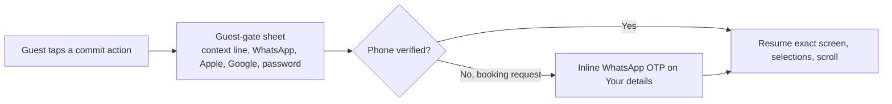

# ADR 0007: Client app navigation: Discover, Saved, My Wedding, Messages, Profile; the Brief as global context; guest gating at commit moments

| Field | Value |
|---|---|
| Status | accepted |
| Date | 2026-10-12 |
| Scope | Client app information architecture, auth entry, deep links and notification landings |
| Owner confirmation still needed | OQ-B-12 (Share), OQ-B-20 (account deletion with a future booking), OQ-B-24 (cap of 3 open unpaid bookings, payer who is not the booker), OQ-L-14 (fixed +965, non-WhatsApp users) |
| Replaces | Brief section 5 hypothesis (Discover, Compare/Planner, Plan, Messages, Profile) |
| Related ADRs | 0001 (booking flow, gate position), 0002 (Brief fields), 0003 (booking states on the home card), 0009 (Compare tray), 0012 (phone and area formats), 0014 (RTL back and stacks), 0028 (identity and sessions) |
| Screens | CL-DISC-01..05, CL-SAVD-01..04, CL-WEDD-01..05, CL-MSGS-01..04, CL-PROF-01..06, CL-AUTH-01..05 |

## Context

The design brief hypothesised five tabs (Discover, Compare/Planner, Plan, Messages, Profile). Research found three problems and several Kuwait facts.

- **'Planner' and 'Plan' are near-identical labels** in English and in Arabic, and Compare is a transient task rather than a destination. Tab space should go to places couples return to repeatedly.
- **The decider is not the user.** The bride owns the file; her mother holds the veto and often arrives through a WhatsApp link or is handed the phone. Families decide in WhatsApp groups, so Saved, Compare and Share must work for someone who never creates an account.
- **A single number on a venue card misleads.** Real cost depends on date and guest count, so the Brief must be global context that makes every card show a date-aware and guest-aware price and availability.
- **Bookings need one home** but several shortcuts, because a couple buys 2-4 bookings and the status changes over weeks.
- The PRD allows guest browsing (CA-AUTH-09) and requires identity for booking, payment and chat (CA-AUTH-10); App Review expects login only where account-based functionality requires it. Hearts are the strongest sign-up hook.
- WhatsApp OTP is the primary identity channel (CA-AUTH-05, no SMS gateway), but Apple and Google sign-in and the password path remain (email is optional and never an identifier).

## Decision

**D1. Five tabs, labels always visible, order mirrors in RTL:** Discover / استكشف; Saved / المفضلة; My Wedding / زفافكم; Messages / الرسائل; Profile / حسابكم. No tab for Compare or the human planner. The tab order never changes. Replaces the brief section 5 hypothesis.

**D2. Content per tab.**

| Tab | Contains |
|---|---|
| Discover | Home with the Brief card, search, results (list and map), filters, Venues \| Services switch, venue detail, calendar |
| Saved | Wishlist segments (Venues, Services, Packages) and the Compare entry ('Compare (n/3)') |
| My Wedding | Phase-aware home (countdown hero, Next up max 3, Bookings as the top card, planner offer or assigned planner, tools row: Checklist, Budget, Saved, Services) |
| Messages | Inbox and threads (venue, planner, vendor, support) |
| Profile | Personal and wedding info, Bookings row, Payments, Rewards, Notification preferences, Language, Settings, Delete account |

**D3. The Brief** (date, guests, area, budget; 'Not decided' and 'Flexible month' allowed) is global context: prefilled from onboarding, shown as an editable pill on Discover and Results, and drives date- and guest-aware price and availability on every card, Saved row and Compare column. **Amended 2026-10-12 (OQ-P-17):** the onboarding and Brief budget is the venue and catering budget (label 'Venue and catering budget' / «ميزانية القاعة والضيافة», ADR 0012 item 9, ADR 0018 item 10); the total wedding budget is asked separately in the Budget Manager (CL-WEDD-03/05) and is not prefilled from onboarding; the search budget filter is the venue price.

**D4. Bookings are canonical in My Wedding > Bookings.** Shortcuts: the Home status card (one at a time, by urgency), the Profile row (same screen) and every booking notification. My Wedding gets a dot only when an action is due (deposit or balance).

| Home status card state | Content |
|---|---|
| No date | 'Set date' |
| Brief set | 'N venues free on {date}' |
| Pending | 'Waiting for {venue} - reply expected by {time}' |
| Approved | '{venue} approved - pay {amount} by {time}' |
| Confirmed | 'N days to go - balance {amount} due {date}' |
| Day-of | Directions |
| Post-event | 'How was {venue}?' |

**D5. Launch tab** is Discover, except My Wedding when any booking is `awaiting_deposit`, has a balance due, or is `confirmed`. Per-tab stacks persist across tab switches; re-tapping the active tab pops to root then scrolls to top.

**D6. Tab bar hidden in:** onboarding, booking flow, gallery viewer, chat composer, comparison table, full-screen map, payment web view. Visible everywhere else including pushed detail screens. Sheets: Brief, filters, sort, calendar, package detail, auth, cancel, reschedule response, add expense, planner scheduler. Pushes: venue detail, booking detail, comparison, chat thread, checklist, budget.

**D7. Three-tap rule.** Every PRD requirement group is at most 3 taps from a tab root (booking-flow steps excluded). Reference depths: free-on-my-date 0-1; compare two venues 3; booking status 1-2; pay balance 1 from push or 3 in-app; message a venue 2; change language 3; delete account 3.

**D8. Guest levels.**

| Level | Capabilities |
|---|---|
| **Open (no account)** | Language, intro, the Brief (stored locally), Home, search, filters, results, venue detail including calendar and price estimates, gallery and video, reviews (read), similar venues, Share, services browse and vendor profiles, planner package info, legal pages; heart and Compare work locally |
| **Soft gate** (progress allowed, account requested at the commit moment) | Booking steps 1-3 are open and the account is requested before step 4 (personal data) with the selection preserved; Budget, Checklist and Countdown are viewable with a sample structure and 'Sign in to save' appears at the first write |
| **Hard gate** (sheet, then resume the exact intent) | Send booking request, pay, send a chat message, write a review, request a planner consultation, request a vendor quote, rewards and coupons |

This refines the brief's 'guests everywhere except booking, payment and chat'.

**D9. One identity entry** (no separate Sign up and Login): phone-first 'Continue with WhatsApp' OTP, Apple, Google, 'Use a password' (the CL-AUTH-04 path) as a tertiary link, never an email identifier (ADR 0028 item 2); +965 default with a loose 8-digit shape check; Terms and Privacy acceptance on first account creation (CA-AUTH-11). A reusable guest-gate sheet carries a context line ('to send your request') and resumes screen, selections and scroll after auth. A verified phone number is required to send a request; if the identity has none (Apple, Google, email) the Details step verifies it inline by WhatsApp OTP.

**D10. Local-to-account merge.** Hearts, Compare set and Brief merge on sign-in (CA-CMP-12, CA-ONB-08); if the account already holds a different Brief, one sheet shows both and asks which to keep. Sign-up nudge once after the 3rd heart. OS notification permission is requested after the first save or first booking request, never at launch.

**D11. Notification landings** (transactional always delivered; stack rebuilt tab root > parent > target so Back makes sense; edge-swipe back flips in RTL).

| Trigger | Lands on |
|---|---|
| Approved | Booking detail scrolled to Pay with the pay-by time |
| Rejected | Booking detail with alternatives rail |
| Expired | Booking detail with alternatives |
| Reschedule proposed | Booking detail with the response sheet open |
| Payment confirmed | Receipt |
| Payment failed | Pay sheet |
| Balance due | Pay balance |
| Message | Thread at last unread |
| Offer or price drop | Venue detail with the Brief date applied |
| Countdown milestone | My Wedding hero |

Marketing is opt-in, quiet hours 22:00-09:00, at most 2 per week, none in the final 7 days before the wedding. Universal links: `/v/{venue}?date=&guests=`, `/compare?ids=a,b,c`, `/b/{booking}`; a dead link shows 'This venue is no longer listed' with similar venues.

**D12. Account deletion** is always initiated in-app. It is blocked while an `awaiting_deposit` or `confirmed` future booking exists, with a never-dead-end screen: 'Cancel under the policy, or request deletion after {event date}' and a Support link. Completion anonymises personal data and keeps ledger and invoice records.

## Consequences

- My Wedding hosts the planner offer (shown once after request-sent or confirmed, then only here) and the services hub stays reachable from Discover and My Wedding (CA-PLAN-02, CA-PLAN-09).
- Saved needs live availability on the Brief date ('Still free on 25 Mar') and price-drop badges. The tray rules for Compare live in ADR 0009.
- Share is an OS share sheet carrying a universal link, flagged OQ-B-12.
- Sign-in must never lose a draft; QA must test every gate with resume.
- Home 'Available this week' and 'Last-minute deals' are one shelf. Amended 2026-10-12: it is named 'Coming up' / «قريبًا», covers free dates in the next 30 days, and never says last-minute (the offer type is 14 days or less, ADR 0004 D4; OQ-P-16).
- Prototype P0 spine for the client: onboarding Brief, Home, Results, Filters, Venue detail, Calendar, Gallery, Compare, full booking flow in both modes, Booking detail variants, My Wedding, Saved, Messages thread.
- Implementation: client routes use `StatefulShellRoute.indexedStack` with these five tabs (ADR 0022 D); the guest-gate `redirect` stores a `GuestIntent` and resumes after auth; server codes `AUTH_REQUIRED` and `PHONE_VERIFICATION_REQUIRED` trigger the same path (ADR 0028 item 1).
- Risks: the cap of 3 open unpaid bookings can block legitimate multi-event purchases (OQ-B-24); a parent paying with their own Apple Pay has no pay-link flow (the pay-by WhatsApp link goes to the booker, who can forward it).

## Alternatives considered

| Alternative | Why rejected |
|---|---|
| Brief hypothesis: Discover, Compare/Planner, Plan, Messages, Profile | 'Planner' and 'Plan' collide; Compare is a task, not a place; the wishlist had no home |
| A Compare tab | Compare is a tray plus a pushed table reachable from Discover, Saved and Venue detail (ADR 0009) |
| A planner tab | The planner is a module of My Wedding and Services (CF-17: planners are Ghazal-managed supply) |
| A Bookings tab | Bookings are the top card of My Wedding with three shortcuts; a sixth surface would crowd the bar |
| Mandatory account at launch | Violates CA-AUTH-09 and App Review expectations; kills the research phase and the WhatsApp-link audience |
| Gate at 'Book' (before step 1) | Throws away the strongest commitment signal; steps 1-3 are open and the gate sits before personal data |
| Separate Sign up and Login screens | One phone-first entry; the identity decides new or returning |
| Requesting notification permission at launch | Asked after the first save or booking request (moment of value) |
| SMS or email as the primary identity | WhatsApp OTP is the PRD's channel (CF-05, no SMS gateway); the password path is a tertiary link |

## Related requirement IDs

| ID | Effect |
|---|---|
| CA-AUTH-05, CA-AUTH-09, CA-AUTH-10, CA-AUTH-11 | Identity entry, guest browsing, gate at commit moments, Terms on first creation |
| CA-ONB-01..09 | Onboarding feeds the Brief; stored locally for guests (CA-ONB-08) |
| CA-HOME-01..08 | Home hero is the Brief card (ADR 0018) |
| CA-CMP-03, CA-CMP-12 | Compare indicator and persistence (ADR 0009) |
| CA-STAT-01, CA-STAT-02 | Bookings list and detail canonical in My Wedding |
| CA-TOOL-01, CA-TOOL-04, CA-TOOL-05 | Saved and budget entry points |
| CA-PLAN-01, CA-PLAN-02, CA-PLAN-09 | Planner offer, no-penalty dismissal, request outside the booking flow |
| CA-CHAT-01, CA-CHAT-10 | Messages tab, unread badge |
| CA-NOTI-01, CA-NOTI-02, CA-NOTI-07 | Notification centre and landings |
| CA-PROF-04, CA-PROF-07, CA-PROF-09 | Bookings row, language switch, account deletion |
| NF-LOC-06, NF-PRIV-01 | Runtime language switch; in-app deletion |

## Notes on conflicting inputs

- Resolved 2026-10-12: D3 originally said the onboarding 'budget' is the total wedding budget, against ADR 0012 item 9, ADR 0018 item 10, the seed content and every screen. D3 was amended to the venue-and-catering reading; CA-ONB-04 and CA-TOOL-05 were reworded (the Budget Manager total is asked in CL-WEDD-05, not prefilled); the owner confirms in OQ-P-17.
- ADR 0022 D lists client tabs as 'Discover, Compare/Planner, Plan, Messages, Profile'. This ADR owns navigation; the tabs above are binding.
- ADR 0028 item 2 includes a password sign-in path (CA-AUTH-01/02, screen CL-AUTH-04 'Password'). Where it sits inside the single identity entry is not specified here: Resolved 2026-10-12: 'Use a password' is the tertiary link to CL-AUTH-04; there is no email identifier.
- **Amendment 2026-10-12 (architecture README #5).** Quiet hours are two windows: marketing is blocked 22:00-09:00 (this ADR D11) and transactional pushes are silent 23:00-08:00 (ADR 0015 D8, OQ-L-15); both are configuration until OQ-L-15 is answered.
