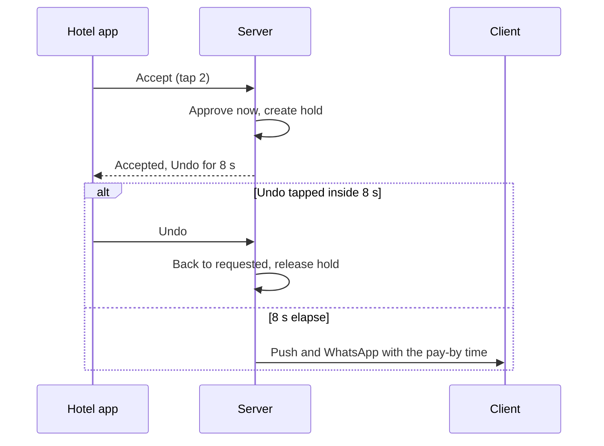

# ADR 0008: Hotel app navigation and request triage: Today, Bookings, Calendar, Messages, More; badge plus Needs-you inbox; Accept in two taps with Undo

| Field | Value |
|---|---|
| Status | accepted; amended by 0033 (Today money tiles, Bookings segments, More menu, roles, Calendar for providers) |
| Date | 2026-10-12 |
| Scope | Hotel (venue) mobile app: navigation, Today, Bookings, Calendar, More, offline behaviour, roles |
| Owner confirmation still needed | OQ-B-16 (commission and payout visibility), OQ-B-17 (hotel login, roles, multi-venue), OQ-B-18 (venue cancellation consequences), OQ-B-22 (calendar truthfulness nudge), OQ-B-25 (reviews: reply and report only), OQ-B-12 (WhatsApp row) |
| Related ADRs | 0001 (SLA and timers), 0002 (calendar claims and lanes), 0003 (lists and detail), 0005 (money panel), 0006 (cancel and reschedule roles), 0014 (RTL gestures), 0019 (analytics definitions), 0028 (hotel auth) |
| Screens | HL-TODY-01..05, HL-BOOK-01..05, HL-DCSN-01..05, HL-CALN-01..04, HL-VENU-01..06, HL-GROW-01..06, HL-SETT-01..05 |

> Superseded by 0033 on 2026-10-14 (owner changed the business model to the KD 2 voucher marketplace): Navigation, triage, Undo and offline rules stand. The body below is the historical record.

## Context

The hotel app's job is 'manage the venue without opening a laptop' (PRD section 7): a manager, reception or accountant standing in a corridor or ballroom, often with poor signal, in bursts. The jobs are glance, decide, block, answer. The PRD gives the roles Manager, Reception, Accountant and Marketing (web section 8.7) but no hotel login, no payout visibility and no definition of 'Reschedule' or 'Revenue' (CF-25).

Research findings:

- Host-side apps win on triage, not dashboards: Airbnb's Today tab leads with time-sensitive alerts; its request card is earnings + guest rating + Accept/Decline + 24-hour countdown. Peerspace's 48-hour expiry, 'decline rather than ignore' and custom offer map to Accept / Decline / Propose another date. Booking.com's host app shows the failure modes to avoid: bugs, missing functions, repeated 2FA, no payout predictability.
- Accept must be fast and reversible; Decline needs a reason because it powers the client's recovery path.
- The most frequent time-critical action after Accept is 'block a date I just sold by phone or WhatsApp' (3 taps, range select, Ramadan and Eid shortcuts).
- Ballrooms have poor connectivity; queuing irreversible state changes offline risks double booking.
- In independent halls one person holds all roles, so the role model must degrade to 'everything visible'.
- Swipe actions are ambiguous when the layout mirrors in RTL.

## Decision

**D1. Five tabs, same for every role, never reordered:** Today / اليوم; Bookings / الحجوزات; Calendar / التقويم; Messages / الرسائل; More / المزيد. Content is role-aware, navigation is not (hide what a role cannot use; no lock icons; a deep link to a forbidden object shows 'You do not have access. Ask your manager.').

**D2. Persistent pending indicator** = the Bookings tab badge (count, capped 9+) plus the Needs-you block at the top of Today plus a 6-second non-modal banner with a light haptic when a request arrives in the foreground. No app-bar pill: the tab bar stays visible on all pushed screens except the chat composer and full-screen flows, so the badge is always one tap away, and a second indicator would only add clutter. The badge turns danger-tinted (always with text) when any request is in the danger SLA state. Bookings opens on Pending when count > 0, otherwise on Upcoming.

**D3. SLA state** (one rule shared by the bar, the badge and notification escalation, so what you see matches what the system does):

| State | Condition | Treatment |
|---|---|---|
| Neutral | below 50% of the SLA elapsed | ink tint |
| Gold | from 50% elapsed | gold |
| Danger | from 80% elapsed or under 1 hour left, whichever comes first | danger tint, always with text such as '2h 10m left' |

The 'Urgent' tag is separate and means the event is 14 days away or less.

**D4. Today order for Admin/Manager.**

1. One-sentence status ('3 requests need your reply - first in 5h 20m' or 'All clear').
2. Needs-you cards (two expanded, 'See all N').
3. 14-day availability strip with 'N open weekend dates in 60 days' opening Calendar in soft-date mode.
4. At most three money tiles with no charts: hero 'Booked this month' with a 'KWD X received' sub-line, 'Payable - next payout {date}', 'Open dates, next 30 days'.
5. Messages preview.

Needs-you ranks by nearest deadline across: pending requests, unanswered messages older than 30 min, balances overdue or at risk (event within 14 days), reviews awaiting reply older than 7 days, and a weekly 'Confirm your calendar is up to date' nudge (flagged OQ-B-22). Quick actions: Block a date, New offer. Reception sees Needs-you, events, messages; Accountant sees money first, payments due, events; Marketing sees offers, analytics glance, Needs-you.

**D5. Request triage card** (pending only; compact 96px rows for everything else):

- time-left line with a 2px depleting hairline;
- headline date as weekday + date; hall, session and audience icon;
- three facts (guests, package, total) with 'You receive KWD X' when a commission rule exists (hidden from Reception);
- client line with monogram, name, verified-phone and first-booking markers; Chat always and Call when the contact number has been shared (ADR 0003, OQ-B-19);
- a conditional row '+N other requests for this date' (count only, never identities);
- special requests (2 lines, More);
- then one primary Accept (gold, 48px) and two secondary text buttons, Propose another date and Decline. No swipe actions (ambiguous when mirrored).

**D6. Accept = 2 taps** from a push or Needs-you row (open, Accept). The server applies the approval immediately (the hold is created, so a date conflict returns at once as an inline 'Date held for another couple' state with Accept disabled), shows a toast 'Accepted - Undo' with an 8-second depleting bar, and dispatches client push and WhatsApp only after those 8 seconds. Undo returns the booking to `requested` and releases the hold. Because dispatch is server-side, killing the app inside the window loses nothing. If competing requests exist, the event is 14 days away or less, or the pay window is non-default, Accept first opens a compact confirm sheet ('This holds 21 Jan for {name} for 24h. 2 other requests will wait.'), then the same Undo toast (3 taps). 'Offer a discount' and pay-window changes live in that sheet, optional.

**D7. Decline = 3 taps:** reason sheet (Date unavailable / Capacity does not fit / Package not offered / Other + note), required, with 'Suggest other dates' on by default which hands off to Propose another date. Propose another date = a sheet with the hall's open dates, pick 1-3, optional price note, sent as a counter-offer card the client answers within 48h. Undo applies to Accept only.

**D8. Bookings:** three segments (Pending / Upcoming / Past); Upcoming is sectioned Awaiting deposit (hold timer) then Confirmed; Past has a status chip row (ADR 0003 D8); search by client name, reference or date. Booking detail is one screen with status variants: special requests prominent, client card (name, 'Booking for', contact), event and sections, package and extras, price and payments, audit trail, sticky Accept/Decline bar when pending, icon row Call / Chat / Invoice, Contact sheet with Call, in-app Chat and a WhatsApp row (flagged OQ-B-12).

**D9. Block a date in 3 taps or fewer from anywhere:** Calendar > date > Block (default reason 'Booked offline'), or Today quick action > date > Block; range via long-press and drag with a tick haptic per day plus an accessible 'Select dates' tap mode; a bottom action bar 'N dates - Block / Open / Offer'; confirmation 'Hidden from couples now' with Undo; scope by hall and session. Ramadan/Eid range shortcuts are adjustable ranges, not fixed dates (flagged). Calendar: Month grid with the selected day's agenda strip below, Week as a vertical list of 7 day rows, Day as a prep-event-teardown timeline per hall; hall filter chips only when more than one hall; claim styles per ADR 0002 D9; Fri/Sat marks; Sunday-start, mirrored in RTL.

**D10. Offline.** The app shell and last-known data are cached with a stamp ('Offline - updated 09:12'). Accept, Decline, Propose, Block and Cancel are never queued: they are disabled in place and say 'Offline. Reconnect to accept.' Chat messages may queue. This prevents double-booking from stale state.

**D11. More, two levels at most.**

| Group | Items |
|---|---|
| My venue | Photos and videos, Packages and prices, Capacity and halls, Amenities, Policies, Booking rules, Preview as couples see it |
| Grow | Offers, Analytics including Revenue detail, Reviews (reply once and report abuse; no approve or hide) |
| Notifications | in-app list and preferences |
| Business | Staff, Bank info (masked, re-authentication), Business hours, Languages per user |
| Account | Biometric lock, Support, Switch venue (only if the account has more than one), Log out |

A dot on More only for setup or account issues (payout KYC state: Pending review / Action needed / Verified).

**D12. Role matrix** (Admin is the owner and includes Manager).

| Action | Admin | Manager | Reception | Accountant | Marketing |
|---|---|---|---|---|---|
| Accept / Decline / Propose another date | yes | yes | yes (Admin can switch off) | no | no |
| Block and unblock | yes | yes | yes | no | no |
| Reschedule or cancel a confirmed booking | yes | yes | no | no | no |
| Record cash received | yes | yes | yes | yes | no |
| Messages | yes | yes | yes | read-only | no |
| Offers | yes | yes | no | no | yes |
| Analytics and Revenue | yes | yes | no | revenue only | analytics only |
| Packages, policies, media | yes | yes | no | no | media only |
| Staff and Bank info | yes (Admin only) | no | no | may view bank, masked | no |

**D13. Notification landings.** New request > Booking detail (Pending) with the sticky bar; SLA 50% and 80% > same; cancelled by client > Booking detail with 'Date is free again. Create an offer?'; payment received > Booking detail > Payments; balance overdue > Booking detail with a 'Nudge client' quick reply; new review > review with Reply; new message > thread with the booking context bar; account-status change > status screen (invited, under review, suspended, deactivated). New request has a distinct alert sound.

## Consequences

- Prototype P0 hotel spine: sign-in, Today, Bookings list and detail with Accept (Undo) and Decline, Contact sheet, Calendar with Block, Create offer, Messages with the booking context bar.
- Needs server support for deferred notification dispatch and undo (a short-lived outbox keyed by booking and version, ADR 0020).
- Reception-limited and Accountant Today variants are P1.
- The 'You receive' preview and the Payable tile depend on commission and payout rules the owner has not set (OQ-B-16): they render only when a commission rule exists and never for Reception.
- Auth method and multi-venue switching are unspecified in the PRD (OQ-B-17); ADR 0028 item 5 states the working design.
- In-app cancel of a confirmed booking follows ADR 0006 and needs owner-set strike and fee rules (OQ-B-18).
- Reviews 'approve' from PRD web 8.9 is not built in the app (OQ-B-25).
- The 14-day strip, month grid and day timeline need hall lanes (ADR 0002 D9) and Sunday-first layout with the Thu-Sat band at the inline-end (ADR 0011).
- Push: the new-request push is iOS time-sensitive with the badge set to the pending count and follows the venue's business-hours setting (ADR 0022 H, ADR 0015 item 8); Critical Alerts are not planned.

## Alternatives considered

| Alternative | Why rejected |
|---|---|
| An app-bar pill ('3 to reply') on non-Today screens (competitive-ux) | The tab bar stays visible on pushed screens, so the badge is always one tap away; a second indicator adds clutter |
| SLA danger below 2 hours and warnings at 50% and 90% (journeys-ia) | Replaced by one shared rule: gold at 50%, danger at 80% or under 1 hour, matching escalation at 50% and 80% |
| 5-second Undo (competitive-ux) | 8 seconds, with dispatch deferred server-side so killing the app loses nothing |
| Confirm modal before Accept | Undo instead of confirm; a compact sheet appears only for competing requests, urgent events or non-default windows |
| Swipe-to-accept or swipe-to-decline | Ambiguous when mirrored, hidden, inaccessible (ADR 0014 item 4) |
| Queue Accept, Decline and Block offline | Double-booking from stale state; they are disabled in place |
| Different tab sets per role | Navigation stays constant; content adapts; forbidden deep links get an explicit screen |
| Insights as a tab | Managers act, not analyse, in a corridor; Analytics lives under More > Grow |
| Venue-controlled review approval | Reply and report only (OQ-B-25) |
| Tier-grid and holiday price editing on the phone | Web only; the app edits base prices (ADR 0004 D8) |

## Related requirement IDs

| ID | Effect |
|---|---|
| HA-DASH-01..07 | Today: events, revenue, pending with inline accept, SLA display, notifications, messages, availability strip |
| HA-BOOK-01..11 | Lists, detail, accept, reject with reason, reschedule, call, chat, invoice, payment status, cancel, completion |
| HA-CAL-01..09 | Month, week, day, block and open, claim styles, day agenda, several halls |
| HA-AUTH-01..04 | Login, role-aware modules, venue switcher, sign-out and revoke |
| HA-NOTI-01..08 | New request, cancelled, payment, review, message; landings and preferences |
| HA-MSG-01..05 | Messages list, real-time, media, booking link, support |
| HA-VMGT-01..10, HA-OFFR-01..06, HA-ANLY-01..07, HA-SET-01..05 | More: venue management, offers, analytics, settings |
| NF-LOC-02 | Mirrored calendar and charts |
| CF-25 | Hotel app gaps: login, switcher, base-price editing only on mobile |

## Notes on conflicting inputs

- The OQ-B-17 working assumption says 'WhatsApp OTP for invited staff plus biometric lock'. ADR 0028 item 5 and OQ-T-09 say 'phone + password via WhatsApp invite, OTP on new devices, biometric as convenience'. The hotel sign-in screens (HL-ACCS-01..03: sign in, verify with WhatsApp, set your password) follow ADR 0028.
- **Amendment 2026-10-12 (architecture README #12).** SLA escalation tones follow ADR 0001 and this ADR: neutral below 50% elapsed, gold from 50%, danger from 80% (not 90%, as in the journeys research) or under 1 hour left.
