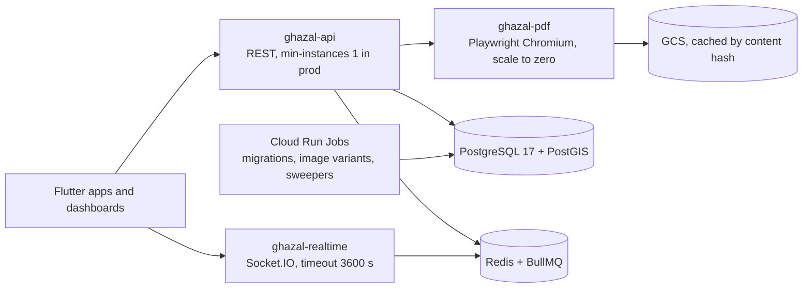

# ADR 0020: Backend framework: NestJS 12 on Node 24 (recommendation; owner confirms in Week 0)

| Field | Value |
|---|---|
| Status | accepted (NestJS confirmed by the owner 2026-10-20); Updated by ADR 0035 |
| Confirmed by the owner | 2026-10-20 (OQ-T-01), see ADR 0035 D10 |
| Date | 2026-10-12 |
| Scope | `apps/api`, `packages/contracts`, deployables on Cloud Run, backend conventions for Kuwait and Arabic |
| Owner must confirm | OQ-T-01 (who maintains the backend after handover; strong Laravel/PHP experience that should flip the call) before the first commit under `apps/api`. After confirmation it is locked and not re-litigated |
| The only flip condition | The owner has shipped Laravel in production and will write most backend code personally without agent help, or the dashboards are changed to Filament. Anything else stays NestJS |
| Resolves | PRD conflict CF-02 (Laravel or NestJS), CF-04 (backend JWT, see ADR 0028) |
| Related ADRs | 0001 and 0003 (claims, state machine), 0004 (pricing engine), 0010 and 0011 (fils, dates), 0012 (digit normalisation, search), 0021 (monorepo), 0025 (backend tests), 0026 (deploys), 0027 (payments), 0028 (auth), 0029 (rules) |

## Context

The PRD fixes REST, PostgreSQL, Redis, GCS and Cloud Run but leaves the backend framework open (CF-02, 'NestJS or Laravel'). Owner transfer of all source code and a training session (NF-DEL-07, NF-DEL-09) mean maintainability by the owner's future developers matters; PHP talent is common in Kuwait and the GCC, TypeScript talent less so. Research (flutter-tech-handoff section 1):

- One language (TypeScript) covers the API, both React dashboards, the design prototype and the token tooling, so the permission matrix, Zod schemas, money helpers and fixtures are written once. Laravel would add PHP as a third language with nothing shareable except JSON.
- Cloud Run suits stateless Node HTTP and WebSocket services; Laravel's Reverb and Horizon assume always-on processes.
- `tsc` + Vitest + Biome give agents a deterministic loop in tens of seconds, and Nest modules are natural file-ownership boundaries for parallel agents.
- Laravel's advantages (spatie RBAC and audit packages, mPDF Arabic PDFs, Filament) are cheap to replace or void because the PRD fixes React dashboards.

| Criterion | NestJS 12 | Laravel 13 | Edge |
|---|---|---|---|
| Language footprint | TS everywhere except Flutter | PHP + TS + Dart | Nest |
| Real-time chat on Cloud Run | Gateways + Redis adapter, websocket-only | Reverb needs an always-on host | Nest |
| RBAC | Guard + permission matrix in a shared package (~150 lines) | spatie/laravel-permission | Laravel |
| Audit log | DB trigger + interceptor (~200 lines) | spatie/laravel-activitylog | Laravel |
| OpenAPI | Zod to OpenAPI 3.0.3 (custom glue, ~1 day) | Scramble | Laravel (slight) |
| Queues and scheduling | BullMQ + `@nestjs/schedule` | Horizon and Scheduler | Laravel |
| Arabic invoice PDF | Needs a Chromium renderer service | mPDF handles Arabic shaping | Laravel |
| Ecosystem maturity now | Nest 12 is about 3 months old, ESM-only | Very stable | Laravel |
| Verification loop | strict TS | PHPStan/Larastan | Nest |

Constraints that shape the stack: Nest 12 ecosystem lag (nestjs-zod peers only Nest 10/11; `@nestjs/swagger` 12 peers TypeScript ^5.5 or ^6, typescript-eslint peers below 6.1, so TypeScript 7 is avoided); dart-dio documents no OpenAPI 3.1; Cloud Run WebSocket streams have request timeouts (up to 60 minutes) and best-effort session affinity.

## Decision

**Recommendation: NestJS 12.x on Node 24 LTS.** The owner confirms or flips it in Week 0, before the first commit under `apps/api`. After that it is locked and not re-litigated.

**Stack** (pins are starting points as of 2026-10-10; re-check at scaffold): NestJS 12 with the Fastify adapter; TypeScript ~6.0.3 (not 7: swagger and typescript-eslint peer ranges); Zod 4 through Nest 12's native Standard Schema `schema` option on `@Body/@Query/@Param` (no nestjs-zod); Drizzle ORM 0.45 with hand-written SQL migrations for constraints and PostGIS; PostgreSQL 17 on Cloud SQL with PostGIS, pg_trgm and btree_gist (same major in docker compose); BullMQ on Redis; Socket.IO 4.8 websocket-only with the Redis adapter; `jose` for JWT/JWKS; Pino JSON logs; Vitest 5 + Testcontainers; Biome.

**Shape.** One modular monolith in `apps/api`. One Nest module per domain (auth, venues, halls, pricing, availability, bookings, payments, ledger, chat, notifications, reviews, planner, content, admin); a module is the unit of agent ownership. One Docker image, several Cloud Run deployables:

- `ghazal-api` (REST; min-instances=1 and startup CPU boost in prod to protect the 2 s home budget);
- `ghazal-realtime` (Socket.IO, ships with PL-CORE-01 in MVP-P2, timeout 3600 s; reconnect, resume-from-seq and idempotent `clientMsgId` are mandatory because session affinity is best-effort);
- `ghazal-pdf` (Playwright Chromium renderer for bilingual invoices and receipts, PL-CORE-07; scale-to-zero, cached by content hash in GCS; pdfmake and pdf-lib are banned for Arabic);
- Cloud Run Jobs (migrations, image variants, sweepers).

**Contract kernel (agents must not improvise it).** `packages/contracts/src/**` exports Zod schemas with `.meta({ id })`, error codes, permission keys, enums and fixtures. One `@Api({ summary, auth, permissions, params, query, body, responses, errors })` decorator registers the operation in the zod-to-openapi registry, stores permission metadata for the guard and, in dev/test, validates responses. `pnpm -F @ghazal/api openapi:emit` writes `packages/contracts/openapi.json` as OpenAPI 3.0.3 (dart-dio documents no 3.1). CI fails on drift, runs Spectral and an oasdiff breaking-change check against main. WebSocket events live outside OpenAPI as JSON Schemas plus shared fixtures in `packages/contracts`.

**The seam that keeps this reversible.** The Flutter apps and the dashboards depend only on `openapi.json` (through generated clients) and on `packages/contracts/fixtures`. If the owner flips to Laravel in Week 0 (note: accepted ADRs 0027, 0028 and 0029 carry framework notes saying which of their names are Nest-specific and must be re-expressed, so a flip changes more than the contract tooling), the contract becomes hand-authored OpenAPI plus Scramble and the permission matrix becomes generated JSON; the design, token, i18n and Flutter work is untouched.

**Kuwait/Arabic backend rules** (copied into `.claude/rules/api-nestjs.md`):

- *Money:* integer fils (`*_fils BIGINT`), wire shape `{ fils: 1250000, currency: 'KWD' }`, never floats. Commission in basis points, round-half-up to the fils, one shared function with fixtures. The server never formats money.
- *Dates:* `event_date` is a DATE interpreted in Asia/Kuwait (UTC+3, no DST); sessions are venue-local TIME ranges; everything else is timestamptz UTC (PL-CORE-11). An event date is never converted through the device time zone.
- *Availability:* bookable unit is hall x session. `slot_claims` with `EXCLUDE USING gist (hall_id WITH =, during WITH &&) WHERE status = 'active'`, created in a transaction with an idempotency key; holds expire by a 30 s sweeper plus lazy release inside the claiming transaction (PL-BOOK-02). Men's and women's sections and multiple halls are separate halls, not flags.
- *Errors:* RFC 9457 problem+json with a stable `code`; clients map code to an ARB key, so API error bodies carry no user-facing prose. Server-originated channels (push, WhatsApp, email, invoice PDF) are rendered server-side in the user's saved locale from `packages/i18n/messages/server` (NF-LOC-07).
- *Digits and search:* normalise Arabic-Indic (U+0660-0669) and Persian (U+06F0-06F9) digits to ASCII on every numeric, phone, OTP and amount input. `name_norm` columns (strip tashkeel and tatweel, unify alef forms, ya/alef-maqsura, ta-marbuta/ha, lowercase Latin) with pg_trgm GIN indexes; area aliases (Salmiya/Salmiyah/السالمية, Mishref/Mishrif/مشرف); nearby search via PostGIS geography + GiST.
- *Conventions:* `/v1` prefix, cursor pagination, `Idempotency-Key` on every POST that moves money or slots, ETag/Cache-Control on public GETs, `@nestjs/throttler` on Redis, terminus health, audit through a Postgres trigger writing `audit.log` with the actor passed via `SET LOCAL app.actor_id` (INSERT-only role, PL-CORE-03), a tenant guard (venue scoping) plus a tenant-isolation test generated from the route list.
- *Fallback trigger:* if the Zod/OpenAPI glue costs more than one day, drop to Nest 11 + nestjs-zod + `@nestjs/swagger` (or class-validator DTOs). Nothing else in this ADR changes.

## Consequences

- One language and one contract package across API, dashboards, prototype and tooling; permission matrix, money helpers and fixtures are written once.
- Cheap to run on Cloud Run and a fast, deterministic agent loop.
- The OpenAPI seam means the backend choice cannot leak into Flutter or design work.
- We write about 400 lines that Laravel provides as packages (RBAC guard, audit trigger) and run a separate Chromium service for Arabic PDFs.
- NestJS 12 ecosystem lag: pin versions, time-box the Zod/OpenAPI glue to one day, keep the Nest 11 fallback.
- Handover risk: the owner's future developers must know TypeScript (they get Dart as well). Mitigation: strict module structure, ADRs, a README per module. OQ-T-01 asks the owner directly.
- If the owner flips, budget about one extra week for contract tooling; nothing else moves.
- Row-level security on `bookings`, `calendar_blocks`, `offers` and `conversations` is a second tenant layer to consider after the first two weeks.
- A Prism mock of `openapi.json` lets Flutter start Week 3 against a mock while the API is built (port slot offset 4, ADR 0021).

## Alternatives considered

| Alternative | Why rejected |
|---|---|
| Laravel 13 (with Filament) | Wins only under the flip condition; adds PHP as a third language; the PRD fixes React dashboards, voiding Filament |
| NestJS 11 + nestjs-zod + `@nestjs/swagger` | Kept as the fallback if the Nest 12 Zod/OpenAPI glue costs more than a day |
| class-validator DTOs | Fallback only; Zod schemas are shareable with dashboards and tests |
| TypeScript 7 | Swagger and typescript-eslint peer ranges require 6.0 |
| pdfmake or pdf-lib for invoices | Poor Arabic shaping; Chromium renderer service instead |
| Firebase Auth | Replaced by backend JWT (ADR 0028, CF-04) |
| Server-formatted money or prose errors | Clients format through the shared formatter; error bodies carry codes only |

## Related requirement IDs

| ID | Effect |
|---|---|
| PL-ARCH-03, PL-ARCH-04, PL-ARCH-05, PL-ARCH-06, PL-ARCH-08 | React dashboards, REST API, PostgreSQL, Redis, Google Cloud |
| NF-SCAL-01, NF-AVL-01, NF-AVL-02 | Stateless horizontal scaling, managed hosting, daily backups |
| PL-BOOK-02, PL-BOOK-03 | Claims and holds; expiry sweepers |
| PL-CORE-01, PL-CORE-02, PL-CORE-03, PL-CORE-07, PL-CORE-11 | Realtime, RBAC, audit, PDFs, UTC and Asia/Kuwait |
| NF-SEC-01..05 | Transport, hashing, roles, admin 2FA, audit |
| NF-LOC-07 | Server-originated content in both languages |
| CF-02 | Resolved as a recommendation pending owner confirmation |

## Notes on conflicting inputs

- **Amendment 2026-10-12 (architecture README #17).** The module list omits media, analytics and the wedding file, and vendor leads have no module: these are added as proposed modules in architecture overview section 5; they follow this ADR's status (proposed).
