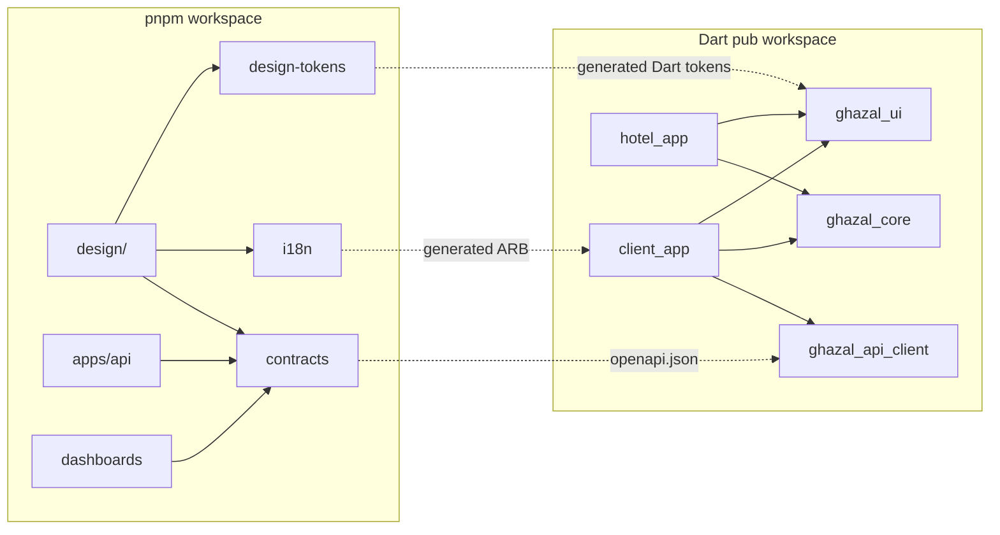

# ADR 0021: Monorepo layout, toolchain pins and reserved dev-server ports

| Field | Value |
|---|---|
| Status | accepted |
| Date | 2026-10-12 |
| Scope | Repository layout, dependency direction, single sources of truth, generated files, requirement-ID notation, birth criteria for workspace members, local ports and server identity, toolchain pins |
| Owner confirmation still needed | OQ-T-02 (iOS 15 floor, CF-35, see ADR 0022), OQ-T-07 (baseline commit and repository owner), OQ-T-06 (domain and bundle prefix) |
| Supersedes | The AGENTS.md rules that name `design/tokens/` as the token home and `npm run ...` inside `design/` as the command surface (the integrator edits AGENTS.md, ADR 0029) |
| Related ADRs | 0020 (`apps/api`), 0022 (Flutter workspace), 0023 (token package), 0024 (prototype specs), 0025 (shots and QA tools), 0026 (CI and environments), 0029 (agent tooling and ownership) |

## Context

The repository today holds the PRD sources, the docs, `design/` (a `package.json` with one script and `scripts/snap.mjs`; no dev server yet) and empty `apps/` and `.claude/` directories. It is a git repository with no commits (as of 2026-10-12; the baseline commit needs the owner's go-ahead, OQ-T-07). Research (flutter-tech-handoff section 2) and the owner's own report shape this ADR:

- **The URL problem.** The owner reported that the URL given for the design prototype was wrong: something else was running there. The owner has another project that uses the usual Vite port (5173) when it runs, and this machine hosts several unrelated local servers. A wrong or stolen URL must become a loud failure with the culprit's name, not a silent screenshot of someone else's page. Facts checked on 2026-10-12: a local Postgres owns 5432, MongoDB 27017, a Redis 6379, Docker containers 5433, 6380 and others, and nothing listens in 4700-4799, 54320-54329 or 63790-63799.
- **Two toolchains** (pnpm for TypeScript, a Dart pub workspace for Flutter) that never need to know about each other. Pub workspaces were verified to work with Flutter 3.47.5 (shared lockfile, intra-workspace dependencies by name, shared lints package).
- **One source of truth per thing** keeps parallel agents from drifting: tokens, copy, API contract, fonts, fixtures.
- **Parallel agents** collide on ports, Docker project names, emulators, lockfiles and migration numbers unless each worktree has its own slot (ADR 0029).
- The research notation `CL-6.5` / `HT-7.2` clashes with the feature-matrix IDs (`CA-BOOK-11`, `HA-CAL-03`).
- The local toolchain has drifted: Node 23.7.0 (odd, non-LTS) while Node 24 is LTS; pnpm 10.10 while 12.10 is current; Android licences not accepted and two adb binaries; gh and gitleaks missing.

## Decision

**1. One repository, two native workspaces, no meta-build tool.** A pnpm 12 workspace for TypeScript and a Dart pub workspace for Flutter; neither needs to know about the other. No Melos, Nx or Turborepo at the start (add Melos only if Dart packages pass about 10). Cross-toolchain commands are root `package.json` scripts plus `tools/*.sh`, so an agent finds everything with one look at `package.json`.

**2. Layout** (TS dirs are kebab-case, Dart packages snake_case; TS scope `@ghazal/*`, Dart prefix `ghazal_*`):

```
ghzal/
  AGENTS.md CLAUDE.md README.md  package.json(scripts only, packageManager pnpm@12.x, engines node ^24)
  pnpm-workspace.yaml(explicit list + catalog)  pubspec.yaml(Dart workspace root)
  .node-version .editorconfig .gitattributes biome.json stylelint.config.mjs lefthook.yml commitlint.config.mjs .env.example .mcp.json
  .claude/{settings.json,rules,skills,agents,hooks}   .github/workflows/
  docs/{product,design,architecture,engineering,decisions,research}
  design/    web prototype 'Ghazal Design Studio' (Vite + React + TS): src/{system,screens/{client,hotel}/<feature>,shell,mock}, specs/, scripts/
  apps/      client_app/ hotel_app/ (Flutter) | api/ (NestJS) | venue-dashboard/ admin-dashboard/ (React, later)
  packages/  TS: design-tokens contracts api-client-ts i18n config-tsconfig
             Dart: ghazal_ui ghazal_core ghazal_auth ghazal_chat ghazal_api_client ghazal_testing ghazal_lints
  infra/     Terraform foundations, docker-compose.yml, well-known/ (apple-app-site-association, assetlinks.json)
  tools/     verify.sh check-env.sh check-dart-rules.sh ports.mjs new-adr.mjs fonts/ i18n tooling
```

**3. Dependency direction.** `apps/*` import `packages/*`, never the reverse. `design/` imports `@ghazal/design-tokens`, `@ghazal/i18n` and `@ghazal/contracts` (types and fixtures only) and never `apps/*`. `ghazal_ui` knows nothing about the API or auth. A Flutter feature never imports another feature's `presentation/` or `data/` (grep gate in `tools/check-dart-rules.sh`).



**4. One source of truth per thing.** Tokens: `packages/design-tokens/src` (this supersedes the AGENTS.md rule naming `design/tokens/`; no `design/tokens/` directory may exist). Copy: `packages/i18n/messages`. API contract: `packages/contracts`. Fonts and icon font: `packages/ghazal_ui/assets` (the prototype loads the same files). Fixtures: `packages/contracts/fixtures` (prototype mocks and Flutter tests read the same venue JSON, so both show identical content).

**5. Generated and committed** (never hand-edited, marked `linguist-generated`, CI regenerates and fails on diff): `packages/design-tokens/dist/**`, `packages/ghazal_ui/lib/src/tokens/generated/**`, `apps/*/lib/l10n/{app_*.arb,generated/**}`, `packages/contracts/openapi.json`, `packages/api-client-ts/src/generated/**`, `packages/ghazal_api_client/**`, icon font + `GzIcons`, lockfiles. The list lives in `docs/engineering/generated-files.md`.

**6. Requirement IDs** use the feature-matrix scheme (`CA-BOOK-11`, `HA-CAL-03`, `PL-PAY-02`, `NF-LOC-04`). The `CL-6.5` / `HT-7.2` notation in `docs/research/*` is void.

**7. Birth criteria, not empty scaffolds.** A workspace member is created in the PR where its first consumer lands.

| When | What is created |
|---|---|
| Now (design phase) | root `package.json` + `pnpm-workspace.yaml` (members: design, packages/design-tokens, packages/i18n, packages/contracts with fixtures and format cases first, packages/config-tsconfig), Biome, Stylelint, lefthook, `tools/`, `.claude/*`, `.github/workflows/design.yml`; `design/package-lock.json` is deleted and `design/node_modules` reinstalled by pnpm in that same PR (integrator only) |
| Design freeze (end of Week 1) | baseline commit + tag `design-v1`, then the Dart workspace with `ghazal_lints`, `ghazal_ui`, `ghazal_core`, `ghazal_testing` and both app shells |
| Week 2 | `apps/api`, openapi emit, `ghazal_api_client`, `api-client-ts`, `ghazal_auth`, `infra/` |
| Later | `ghazal_chat`, dashboards |

**8. Ports and server identity (the fix for 'the URL is wrong, something else is running there').** Ghazal never uses a tool's default port.

- **Reserved block 4700-4799:** port = 4700 + 10 x slot + offset. Slot 0 is the main checkout; slots 1-9 are agent worktrees (ADR 0029). Offsets: 0 design studio, 1 api, 2 venue-dashboard, 3 admin-dashboard, 4 Prism mock, 5 realtime, 6 Flutter web / widget-preview, 7 pdf renderer, 8-9 spare. **The design studio's port is computed, not quoted: its URL is whatever `node tools/ports.mjs url design` prints once that tool exists (it does not exist yet, so nothing in this repository may claim a local URL is correct).** The whole block, 54320-54329 and 63790-63799 were free on 2026-10-12.
- **Docker host ports** avoid services the machine already runs (a local Postgres owns 5432, MongoDB 27017): Postgres 54320 + slot, Redis 63790 + slot, `COMPOSE_PROJECT_NAME=ghazal_slot<N>`.
- **Every dev server starts with strictPort** (Vite `server.strictPort: true`, Nest exits on EADDRINUSE): no auto-increment, no kill-port. We never stop a process we did not start (the owner's other project keeps 5173).
- **Bind to 127.0.0.1.** A phone on the same Wi-Fi needs the explicit `pnpm dev:lan` (0.0.0.0, prints the LAN URL).
- **Identity handshake:** every dev server answers `GET /__gz` with `{ app, slot, rootHash, startedAt }` (a 15-line Vite plugin in `design/`, a dev-only route in Nest); the prototype also carries `<meta name='gz-app' content='design'>`. `tools/ports.mjs url|check|who <service> [--slot N]` is the only way to produce or verify a URL: it computes the port, fetches `/__gz` and, on mismatch, prints the PID and command line of whatever owns the port and exits non-zero.
- `snap.mjs`, `shots.mjs`, `redlines.mjs`, `a11y.mjs` and the Playwright MCP run the same check before navigating to a local http URL and abort on mismatch (`--no-identity` only for third-party pages). Docs and agents never hand-type localhost URLs; they quote `node tools/ports.mjs url design`. The SessionStart banner prints each URL and whether it is up and ours.

| Service | Offset | Slot 0 port | Slot 1 port |
|---|---|---|---|
| design studio (prototype) | 0 | 4700 | 4710 |
| api | 1 | 4701 | 4711 |
| venue-dashboard | 2 | 4702 | 4712 |
| admin-dashboard | 3 | 4703 | 4713 |
| Prism mock | 4 | 4704 | 4714 |
| realtime | 5 | 4705 | 4715 |
| Flutter web / widget-preview | 6 | 4706 | 4716 |
| pdf renderer | 7 | 4707 | 4717 |
| Postgres (docker) | n/a | 54320 | 54321 |
| Redis (docker) | n/a | 63790 | 63791 |

**9. Toolchain pins.** Node 24 LTS (`.node-version`; the machine's 23.7 is replaced via nvm), pnpm 12.x through the `packageManager` field (pnpm 10 auto-switches), TypeScript ~6.0, Flutter 3.47.5 / Dart 3.13, Xcode 26.6, Android SDK 36.1 (accept licences, remove the duplicate adb). `brew install gitleaks gh`. Dev screenshots use the system Chrome through playwright-core `channel: 'chrome'` (as `snap.mjs` does; no browser download); CI uses `playwright install chromium`. Screenshots are for looking at, never pixel-diffed across engines.

## Consequences

- Atomic changes across tokens, copy, contracts and both toolchains; one place for agents to look; no empty scaffolding to maintain.
- A wrong or stolen URL becomes a loud failure with the culprit's PID instead of a silent screenshot of someone else's page.
- Two lockfiles (`pnpm-lock.yaml`, `pubspec.lock`), both single-writer (integrator).
- Reserved ports are a convention enforced by tooling, not by the OS; a non-Ghazal tool can still occupy 4700, in which case `strictPort` fails fast and `ports.mjs who` names it.
- The `design/` npm to pnpm migration is a one-time disruption: nobody else may run `npm install` in `design/` meanwhile.
- CF-35 (iOS floor, see ADR 0022) is the only PRD deviation touching the repo layout.
- Current state: the design dev server, `tools/ports.mjs` and the `/__gz` plugin do not exist yet, so no URL can be verified today. Until they land, nobody should hand-type or quote a localhost URL for the prototype; the first scaffold PR ships the Vite plugin and `ports.mjs` together with the dev server.
- AGENTS.md still carries the old token path and npm commands until the integrator edits it (ADR 0029 item 1).

## Alternatives considered

| Alternative | Why rejected |
|---|---|
| Separate repositories per app | Atomic changes across tokens, copy, contracts and both toolchains would be lost |
| Melos, Nx or Turborepo from day one | Two native workspaces plus scripts are enough; Melos only past about 10 Dart packages |
| npm in `design/` | Replaced by pnpm 12 in the same PR that creates the workspace |
| Default Vite port 5173 (or any tool default) | Collides with the owner's other project and caused the wrong-URL report |
| Vite auto-increment ports or kill-port scripts | A silent wrong URL, or stopping a process we did not start |
| `design/tokens/` as the token home | One home: `packages/design-tokens/src`, which also feeds Dart |
| Empty scaffolds for every package | Birth criteria: created with the first consumer |
| Hand-typed localhost URLs in docs | Quote `node tools/ports.mjs url <service>` instead |
| Binding dev servers to 0.0.0.0 by default | 127.0.0.1 by default; explicit `pnpm dev:lan` |
| Research requirement notation (`CL-6.5`) | Feature-matrix IDs are the scheme |

## Related requirement IDs

| ID | Effect |
|---|---|
| PL-ARCH-01, PL-ARCH-02, PL-ARCH-03 | Four products on one backend; Flutter apps; React dashboards |
| NF-DEL-06, NF-DEL-07 | Backend and docs delivered; full source code transferred |
| NF-PRJ-09 | Accounts and repository in the owner's name (ADR 0026) |
| NF-DSN-09 | One consistent component library (tokens and `ghazal_ui` single sources) |
| NF-COMP-01, NF-COMP-02 | iOS floor and Android minSdk (CF-35, ADR 0022) |
| CF-35 | New conflicts-register entry: iOS 15 floor |
