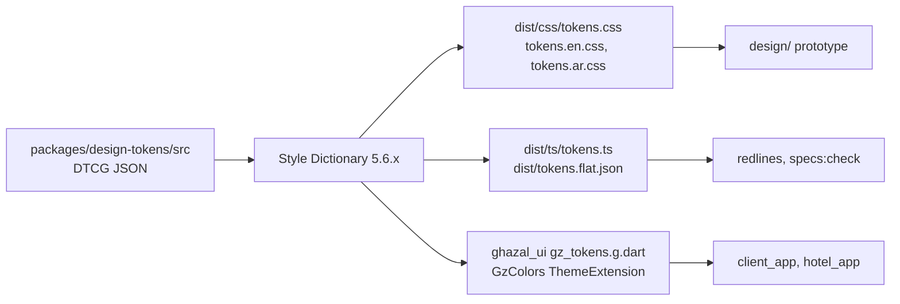

# ADR 0023: Design-token pipeline: DTCG JSON -> Style Dictionary -> CSS variables, TypeScript and Dart

| Field | Value |
|---|---|
| Status | accepted |
| Date | 2026-10-12 |
| Scope | `packages/design-tokens` source, generators, outputs for CSS, TypeScript and Dart, contrast gate, usage rules for the prototype and Flutter |
| Owner confirmation still needed | None. Palette values are pinned by the PRD (NF-DSN-06); Gold-ink and label ink are derived and open to the design-system owner within the gates below |
| Related ADRs | 0016 (type scale and figures role), 0017 (motion tokens), 0021 (package location, generated files), 0022 (Flutter theme from tokens), 0024 (spec files reference token paths), 0029 (single writer after freeze) |

## Context

NF-DSN-06 fixes the palette (Soft Rose #F8E7EC, Warm Off White #FFF9F5, Matte Gold #D8B26E, Dark Rose Gray #5A4B4F) and NF-DSN-08 demands accessible contrast; the brief allows three core colours plus warm neutrals and a tiny functional set, forbids raw hex outside tokens, and requires 4-pt spacing, a small radius system and token-driven motion. Verified facts (computed with WCAG 2.x relative luminance):

| Pair | Ratio | Verdict |
|---|---|---|
| Ink #5A4B4F on canvas #FFF9F5 | 7.88 | pass |
| Ink on Soft Rose #F8E7EC | 6.90 | pass |
| Matte Gold #D8B26E on canvas | 1.91 | fails text and small icons; hairline or fill only |
| Matte Gold on Soft Rose | 1.68 | fails |
| **Ink #5A4B4F on Matte Gold** | **4.12** | **fails 4.5:1 for normal text** (large text and UI only) |
| #4A3C40 on Gold | 5.23 | pass (recommended minimum for gold-button labels) |
| #3B3033 on Gold | 6.35 | pass |
| #896525 on canvas / on rose | 5.09 / 4.46 | canvas pass, rose fails |
| #845F20 on canvas / on rose | 5.53 / 4.85 | passes both (candidate Gold-ink) |

The PRD palette unmodified would ship failing labels on gold buttons and failing gold text; a gate must catch it by build, not by review. Further facts:

- The DTCG 2025.10 token format is the first stable version. Style Dictionary 5.6.1 handles 2025.10 colour objects and `{value,unit}` dimensions and ships a `flutter/class.dart` format, but its documentation still calls 2025.10 support work in progress, and the built-in Dart output is plain constants, not `ThemeExtension`s.
- CSS `opacity` on a parent becomes `saveLayer` in Flutter, so alpha must be explicit tokens.
- Web and Flutter must share spring parameters as numbers (mass, stiffness, damping) and exact cubic-bezier values.
- Parallel agents must not edit token files concurrently.

## Decision

**1. Source of truth.** DTCG 2025.10 JSON in `packages/design-tokens/src/` (never `design/tokens/`): `color.ref.tokens.json`, `color.sys.tokens.json`, `space.tokens.json`, `radius.tokens.json`, `size.tokens.json`, `border.tokens.json`, `elevation.tokens.json`, `motion.tokens.json`, `layout.tokens.json` (frame 390x844, safe areas, gutter, named aspect ratios `aspect.4x3`, `aspect.16x9`, `aspect.1x1`, `aspect.3x4`, `aspect.4x5` per ADR 0024 item 8), `typography.en.tokens.json`, `typography.ar.tokens.json` (identical key sets). Allowed `$type`s: color, dimension, duration, cubicBezier, fontFamily, fontWeight, number, shadow, typography. Not used until generator tests prove them: `$extends`, `$ref`, `$root`, gradient and transition composites. Value shapes: colour `{ colorSpace: 'srgb', components: [r,g,b], hex }` (authors write only `hex`; `pnpm -F @ghazal/design-tokens fmt` fills `components`), dimension `{ value, unit: 'px' }` (px only, because 1 px = 1 dp), duration `{ value, unit: 'ms' }`, cubicBezier `[x1,y1,x2,y2]`. Notes live in `$extensions.ghazal` (reason, owner) and are never consumed by generators.

**2. Tiers.** `ref` (raw ramps; hex lives only here; components may never use them), `sys` (semantic roles: text, surface, border, action, status, scrim), `comp` (rare overrides). Alpha is always an explicit token (`color.sys.scrim.photo-bottom`), never parent opacity. Light theme only for MVP; `sys` is the only layer a future dark mode would branch.

```json
{ "color": { "$type": "color",
  "ref": { "ink": { "700": { "$value": { "colorSpace": "srgb", "components": [0.3529,0.2941,0.3098], "hex": "#5a4b4f" } } } },
  "sys": { "text": { "primary": { "$value": "{color.ref.ink.700}" } } } } }
```

produces `--gz-color-sys-text-primary: var(--gz-color-ref-ink-700);` in CSS and `GzColors.textPrimary` (a `const Color(0xFF5A4B4F)`) in Dart.

**3. Naming.** Token path: dot path, kebab-case segments (`color.sys.action.primary.bg`). CSS: `--gz-` + path with dashes. Dart: camelCase with the `color.sys.` prefix dropped (`GzColors.actionPrimaryBg`, `GzSpace.s4`, `GzRadius.lg`, `GzSize.touchMin`, `GzMotion.durationBase`, `GzType.forLocale(locale).bodyMd`). Spacing `space.N` where N x 4 = px (N = 1,2,3,4,5,6,8,10,12,16 for 4..64) plus aliases `space.gutter`, `space.section`; radius `radius.{xs,sm,md,lg,pill}` = 4/8/12/20/9999; `size.control.{sm,md,lg}`, `size.touch-min` = 44, `size.icon.{sm,md,lg}`; `border.hairline` = 1 (not 0.5: un-crisp on 3x iOS). Typography `type.<role>.<size>` with roles `display`, `title`, `body`, `label`, `numeric`; one file per script; Arabic composites set `letterSpacing: 0` and are never italic; line height is a unitless multiplier and a check asserts round(fontSize x lineHeight) lands on the 2/4-pt grid. Motion: durations 120/200/320/480 ms, cubic-bezier easings (exact `Cubic(a,b,c,d)` in Flutter), springs as numbers `motion.spring.<name>.{mass,stiffness,damping}` used identically by the `motion` library and Flutter's `SpringDescription` (never duration/bounce parameters), plus `motion.reduced.*`.

**4. What this ADR pins and what it leaves open.** Pinned: Ink #5A4B4F, Gold #D8B26E, Rose #F8E7EC, canvas #FFF9F5 (NF-DSN-06); the three-core-colour rule; spacing in multiples of 4; radius scale; 120/200/320/480 ms; touch minimum 44; weights limited to 400/500/600/700 so both families have every weight; `numeric` role in Cairo digits for aligned figures (prices, calendar, counters, tables), because Poppins cannot do tabular figures; running text keeps Poppins digits. Open for the design-system owner, within the gates below: Gold-ink (start from #845F20), label ink on Gold fills (start from #4A3C40; the PRD's Ink fails), ramps, type-scale ratio, control heights, spring values.

**5. Generator.** Style Dictionary 5.6.x (version pinned, `sd.config.mjs`) with `source: ['src/**/*.tokens.json']` and three platforms: (a) CSS to `dist/css/tokens.css` with `outputReferences: true` plus `tokens.en.css` / `tokens.ar.css` scoped by `:lang(en)` / `:lang(ar)` for typography; (b) TypeScript to `dist/ts/tokens.ts` (`as const` plus a `TokenPath` union) and `dist/tokens.flat.json` (consumed by the redline and spec checkers); (c) a custom `gz/dart-tokens` format writing `packages/ghazal_ui/lib/src/tokens/generated/gz_tokens.g.dart` with references resolved to literals (`Color(0xFFD8B26E)`, `Duration(milliseconds: 320)`, `Cubic(0.2, 0, 0, 1)`, `SpringDescription(...)`), `GzColors extends ThemeExtension<GzColors>` with `copyWith`, `lerp`, `static const light`, then `dart format`. Ref-tier Dart constants sit in a separate generated file that is not exported from the package barrel. All outputs carry a GENERATED header and are committed. If composite types misbehave on day one, the fallback is an in-house generator of about 150 lines; the JSON format does not change.



**6. Gates** (`pnpm tokens:check`, also in the Stop hook and CI). Rebuild and `git diff --exit-code` on generated files; JSON schema validation; unused-token and duplicate-value reports; AR/EN typography key parity; line-height grid; snapshot tests of all three outputs; and the contrast gate: `packages/design-tokens/a11y-pairs.json` lists every allowed foreground/background token pair with a minimum ratio (4.5 text, 3.0 large text and UI boundaries) and the build fails when a pair drops below it. Policy encoded as pairs: gold is never the only boundary of an input or a selected state (WCAG 1.4.11 needs 3:1; selected = ink-tinted border or filled ink plus a gold accent); gold text and icons use Gold-ink; functional success/danger pass 4.5:1 on canvas and rose and always ship with icon plus label.

**7. Usage rules** (Stylelint and the Dart guardrail). Components may reference only sys/comp, space, radius, size, type, motion, elevation and border variables; no `--gz-color-ref-*` outside the tokens package; no hex, raw px (except 0 and 1) or ad-hoc easing anywhere outside `ref`. A new token needs a reason in `$extensions.ghazal.reason` and goes through the `add-token` skill. After design freeze, token changes need an ADR and a STATUS.md broadcast (the token-freeze flag).

## Consequences

- The contrast failure of the PRD palette is caught by the build instead of by review.
- CSS, TypeScript and Dart cannot drift: all three are generated from one JSON and diff-checked.
- Redline and spec tooling consume `tokens.flat.json`, so spec files can reference tokens by path and be validated (ADR 0024).
- Style Dictionary DTCG support is partial; we own a custom Dart format and snapshot tests, with a documented fallback generator.
- A mandatory numeric role in Cairo digits adds a third visual voice in English; the design-system owner must confirm it looks right or choose a display face with `tnum` (at most 150 KB per script, ADR 0016).
- Only one agent writes tokens; everyone else files requests (ADR 0029).
- Motion token additions from ADR 0017 (`motion.duration.success` 640 ms, `motion.distance.push`, `motion.spring.settle`) extend the pinned 120/200/320/480 set; the token file must carry them.
- Semantic tokens are the only colour surface for Flutter (`GzColors`), so widgets never read ramps (ADR 0022 F).

## Alternatives considered

| Alternative | Why rejected |
|---|---|
| Hand-maintained CSS variables plus a hand-written Dart theme | Drift between web and Flutter; no contrast gate |
| Style Dictionary's built-in `flutter/class.dart` | Plain constants, not `ThemeExtension`s; custom format |
| Shipping the PRD palette unmodified | Labels on gold fail 4.5:1; gold text fails; Gold-ink and a darker label ink are required |
| Parent opacity for overlays and disabled states | Becomes `saveLayer` in Flutter; explicit alpha tokens |
| Hex values in component tier | Hex lives only in `ref`; components read semantic tokens |
| 0.5px hairlines | Un-crisp on 3x iOS; 1px |
| `rem`, `em` or percent units | No Flutter equivalent; px (= dp) only |
| Gradient, `$extends` and `$ref` composites now | Not proven in the generator; not used |
| Duration or bounce spring parameters | Not portable; mass, stiffness, damping only |
| Dark mode in the MVP | Light theme only; `sys` is the branching layer later |

## Related requirement IDs

| ID | Effect |
|---|---|
| NF-DSN-06 | Palette values pinned as ref tokens |
| NF-DSN-07 | Typography tokens per script |
| NF-DSN-08 | Contrast gate with `a11y-pairs.json` |
| NF-DSN-05 | Gold as a restrained accent (fills, hairlines, large marks) |
| NF-DSN-09 | One consistent component library built from tokens |
| NF-LOC-01 | AR/EN typography key parity |
| CF-19 | Palette versus contrast resolved by Gold-ink and a deeper label ink |

## Notes on conflicting inputs

- **Amendment 2026-10-12 (architecture README #15).** Motion duration tokens are 120 / 200 / 320 / 480 ms plus the 640 ms `success` token of ADR 0017; the token file includes 640.
