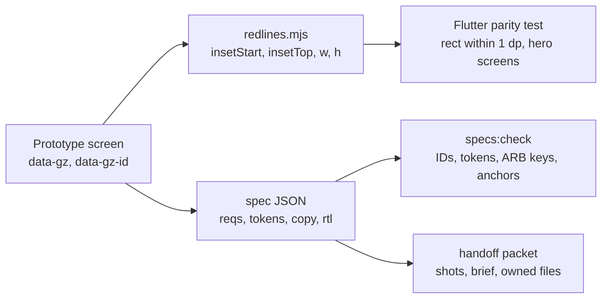

# ADR 0024: Component spec and prototype-to-Flutter handoff format

| Field | Value |
|---|---|
| Status | accepted |
| Date | 2026-10-12 |
| Scope | How the web prototype ('Ghazal Design Studio') is authored so that Flutter agents get measurable geometry, token paths and copy keys: CSS subset, measurement contract, markers, component and screen specs, naming, assets, motion mapping, redlines and parity |
| Owner confirmation still needed | None. Building the Stylelint config, redline export and spec checks is about a day of front-loaded work in the design phase |
| Related ADRs | 0014 (RTL mirror lists), 0017 (motion mapping), 0019 (`analytics:` in screen specs), 0021 (layout and generated files), 0022 (Flutter side), 0023 (token paths), 0025 (parity tests and QA loop), 0029 (skills `add-screen`, `handoff-screen` and subagent `handoff-checker`) |

## Context

The prototype is the design deliverable (NF-DEL-01) and the Flutter apps must reproduce it (NF-PRJ-01 gives design one week and development eight, with a 2-week client app). Screenshots alone leave the Flutter agent to eyeball geometry. Prose rules do not survive parallel agents; a linter and a geometry check do. Research (flutter-tech-handoff section 4):

- Many web effects have no cheap Flutter equivalent: `backdrop-filter` is an offscreen pass per instance (jank on mid Android and banned by the brief), `mix-blend-mode` and CSS `filter` need `saveLayer` or `ImageFiltered`, container `opacity` becomes `saveLayer`, `clip-path` and `mask` need custom clippers, CSS `grid` has no equivalent, `position: sticky` and `fixed` follow a different model, `%`, `vh`, `vw`, `calc()`, `em` and `rem` have no Flutter equivalent.
- Cubic-bezier curves and the damped-spring model are mathematically identical on web and Flutter; everything else (View Transitions, scroll-linked CSS) is not.
- Logical (start-based) measurement makes Arabic and English layouts comparable without special-casing mirroring.
- Pixel equality between web and Flutter is impossible (font rasterisation differs); geometry and tokens are what can be checked.
- Requirement traceability must be checked, not promised: a screen without requirement IDs is invented scope.
- Icons must render identical glyph geometry in both (one SVG set compiled to an icon font); fonts must be the same static files.

## Decision

**1. Principle.** The prototype is a specification that happens to run. Anything with a Flutter meaning is expressed in tokens, a constrained CSS subset and machine-readable specs; anything that cannot be expressed that way does not ship in the prototype.

**2. Flutter-subset CSS, enforced by Stylelint** (`stylelint-use-logical`, `stylelint-declaration-strict-value`, property and unit deny-lists).

| Allowed | Forbidden |
|---|---|
| `display:flex` and `gap` | `grid`, `backdrop-filter`, `mix-blend-mode`, `filter`, `clip-path`, `mask*` |
| `position:absolute` only for named overlay anchors with `inset-inline-*` / `inset-block-*` | `position: sticky/fixed` |
| global `box-sizing: border-box` | `%` (except flex), `vh/vw/dvh/svh/em/rem/ch`, `calc()` |
| integer px on the 4-pt grid (hairline 1) | sibling margins and negative margins |
| `aspect-ratio` with named tokens, `object-fit: cover` | `left/right` and physical margin/padding/text-align |
| | `italic`/`oblique`, letter-spacing on Arabic, `text-transform` |
| | container `opacity` (use alpha tokens), inset shadows and more than two shadow layers |
| | native `select`/`input[type=date]`/`dialog`, `:hover`, scroll-snap |

A waiver needs `/* flutter-ok: <reason> */`. TypeScript rule: screens never branch on `window.innerWidth`; carousels and pagers use a formula (item width = viewport - 2 x gutter - peek; peek = `space.6`) shared by CSS and `PageController(viewportFraction)`.

**3. Measurement contract.** 1 px = 1 dp. Canvas 390x844 with fluid verification at 360 and 430; safe areas are named variables (`--gz-safe-top: 47px`, `--gz-safe-bottom: 34px`), and Flutter uses real `MediaQuery` insets. Every container declares direction, alignment, gap token, logical padding `{start,end,top,bottom}`, per-axis size mode `fixed(px) | fill | hug | flex(n)` with min/max, and overflow (`clip`, `scroll`, or `ellipsis` + max lines). Mappings: flex row/column -> `Row`/`Column(spacing:)`, `flex:1` -> `Expanded`, wrap -> `Wrap`, logical padding -> `EdgeInsetsDirectional`, anchors -> `PositionedDirectional`, aspect-ratio -> `AspectRatio`, scroll-linked header -> pinned `SliverPersistentHeader` specified as f(scrollOffset dp), calendar = seven equal flex columns, gesture sheet -> custom with spring fling.

**4. Markers.** Every component root carries `data-gz='<Component>'`; every measured node carries `data-gz-id='<anatomy.id>'`. Flutter mirrors it with `ValueKey('gz:<id>')`.

**5. Component spec** (`design/specs/components/<Name>.spec.json`, validated by `design/specs/component.schema.json` with ajv): `component`, `reqs` (feature-matrix IDs, each must exist with designScope true), `variants`, `frame`, `layout` (tree of `{id, dir, gap, pad, size, bg, border, radius, clip, text:{style, color, lines, overflow}, image:{fit, aspect, scrim}, overlays:[{id, anchor, inset, size}], children}`; every value is a token path), `states` (pressed, loading = skeleton, disabled, unavailable), `motion` (`{on, prop, to, dur, ease | spring, haptic}`), `a11y` (`role`, `labelKey`, `minTarget`), `rtl` (`mirror[]`, `noMirror[]`), `copy` (ARB keys) and `flutter` (`widget: 'Gz<Name>'`, `file`). Example: `VenueCard` has `reqs: ['CA-CARD-05']`, overlays `media.fav` (top-end, space.3, 44) and `media.badge` (bottom-start), title `type.title.md` one line ellipsis, price `type.numeric.lg` aligned to the end, press scale 0.98 over `motion.duration.fast` with a light haptic.

**6. Screen spec** (`design/specs/screens/<app>/<feature>/<screen>.spec.json`): `id` = `<app>.<feature>.<screen>` (`client.booking.review`), `reqs`, `route`, `components`, `fixture` (a file under `packages/contracts/fixtures`), `states` (loading, empty, error, offline), `scroll` (pinned headers, collapse ranges in dp), `safeArea`, `copy` keys, `analytics` events (NF-ANL), `permission` key for hotel gating (HA-AUTH-02), and `qa` (last shots run, status).

**7. Naming.**

| Thing | Convention | Example |
|---|---|---|
| Component | PascalCase; Flutter widget = `Gz` + name | `VenueCard` -> `GzVenueCard` |
| Anatomy id | lowerCamel path | `media.fav` |
| Screen id | `<app>.<feature>.<screen>` | `client.booking.review` |
| ARB key | camelCase `<feature><Screen><Element>` | `bookingReviewConfirmCta` |
| Requirement ID | feature-matrix scheme | `CA-BOOK-11` |
| Hero tag | `hero:<entity>:<id>:<part>` | `hero:venue:42:cover` |
| Artefact | `<screen>.<locale>.<width>.<ext>` | `client.home.ar.390.png` |

**8. Assets.** One SVG icon set on a 24 px grid and a single stroke weight, compiled with fantasticon into a TTF icon font plus codepoint JSON, generating `GzIcons` and CSS classes; directional icons are listed in the spec's `rtl.mirror` and use `matchTextDirection` in Flutter. Fonts: the same static TTFs in `@font-face` and in Flutter, never `@fontsource`. Images use the production variant sizes and aspect tokens (4:3, 16:9, 1:1, 3:4 and 4:5, token `aspect.4x5` for the venue card, compare header and compact thumbnail of ADR 0018 and ADR 0009; the 106 x 80 compare photo strips are about 4:3); no identifiable faces. Copy comes from the ARB parts through intl-messageformat with locale `ar` + `-u-nu-latn`, `timeZone: 'Asia/Kuwait'` and the Sunday-first calendar config. Mock content is read from `packages/contracts/fixtures` so prototype and Flutter tests show identical venues, prices (in fils) and booking states.

**9. Motion mapping.**

| Web | Flutter |
|---|---|
| `cubic-bezier(a,b,c,d)` | `Cubic(a,b,c,d)` |
| `200ms` | `Duration(milliseconds: 200)` |
| spring `{stiffness, damping, mass}` (motion library) | `SpringDescription(mass, stiffness, damping)` |
| stagger (capped at five items) | `Interval` |
| shared element | `Hero` + `flightShuttleBuilder` |
| `prefers-reduced-motion` | `MediaQuery.disableAnimationsOf` |
| stroke-dashoffset draw-on (the thread motif) | `PathMetric.extractPath` |
| Lottie (only without expressions, effects, blend modes or mattes) | `lottie` |
| haptic column (selection, light, medium, success) | mobile only |

**10. Handoff packet and parity.** Per screen the `handoff-screen` skill produces a brief: spec JSON, six screenshots, redlines, tokens used, ARB keys, fixture, owned Flutter files, tests to add. `pnpm -F design redlines --screen <id>` exports per `data-gz-id` node, per locale and width: `insetStart`, `insetTop`, `w`, `h`, text-style token and line count (start-relative, so AR and EN compare directly). Redline parity (rect within 1 dp) is required for eight hero screens only: `client.home`, `client.venue.details`, `client.compare.table`, `client.booking.review`, `client.payment.outcome`, `client.bookings.detail`, `hotel.today.dashboard`, `hotel.bookings.detail` (plus `hotel.calendar.month` once frozen); every other screen is covered by component parity plus goldens. Pixel equality is never a gate. `pnpm specs:check` verifies: schema validity, every `reqs` ID exists in `docs/product/feature-matrix.json`, every token path resolves in `tokens.flat.json`, every ARB key exists in en and ar, and every spec anchor exists in the rendered DOM. `pnpm specs:coverage` writes requirement -> screen coverage for the `prd-tracer` subagent; a screen without requirement IDs fails review.

## Consequences

- Flutter agents get measurable geometry, token paths and copy keys instead of screenshots to eyeball; Arabic and English compare without special-casing mirroring.
- Banned effects are caught by a linter at write time.
- Requirement traceability is checked, not promised.
- The prototype looks plainer than unconstrained web design (no blur, no grid art); that is intended and in line with the brief's anti-patterns.
- Every new component costs a spec file; the schema and the `add-screen` skill keep it cheap.
- Redline tooling and the Stylelint config are real work to build now (about a day) but are what makes parallel handoff safe.
- The system-owner role writes component specs; screen owners write screen specs for their feature folder only (ADR 0029 item 7).
- Two screen identifier schemes now exist: spec ids of the form `<app>.<feature>.<screen>` (this ADR) and the inventory ids in `docs/product/screens/` (`CL-BOOK-05`, `HL-TODY-01`). No ADR defines the mapping between them; the integrator should add it to the screen schema (flagged in the workflow report).

## Alternatives considered

| Alternative | Why rejected |
|---|---|
| Screenshots only as the handoff | Geometry is eyeballed; no token or copy traceability |
| Unconstrained web CSS (grid, sticky, blur, blend modes, `calc()`) | No cheap Flutter equivalent; jank on mid Android; banned by the brief |
| Pixel-equality gates between web and Flutter | Font rasterisation differs; geometry and tokens are the gate |
| Redline parity for every screen | Eight hero screens plus component parity and goldens cover the risk at a fraction of the cost |
| `@fontsource` fonts in the prototype | Subsets and metrics would differ from Flutter's static TTFs |
| Native `select`, `input[type=date]`, `dialog` in the prototype | Meaningless in Flutter and reintroduce Eastern digits |
| Hand-typed copy in components | ARB parts rendered through intl-messageformat keep AR/EN and Flutter in sync |
| Storybook or Widgetbook as the spec | `flutter widget-preview` with `@Preview` covers the human side-by-side until a hosted catalogue is needed (ADR 0025) |
| Spring parameters as duration and bounce | Not portable; mass, stiffness, damping |
| Mock data invented inside the prototype | Shared fixtures in `packages/contracts/fixtures` |

## Related requirement IDs

| ID | Effect |
|---|---|
| NF-DEL-01 | Complete UI/UX design files for all four applications in Arabic and English |
| NF-DSN-09 | All screens from one consistent component library (component specs and `Gz*` widgets) |
| NF-DSN-08 | Contrast and target sizes carried in specs (`a11y.minTarget`) |
| NF-LOC-01, NF-LOC-02 | `rtl.mirror[]` and `rtl.noMirror[]`; start-based redlines |
| NF-ANL-01..05 | `analytics:` array per screen spec (ADR 0019) |
| HA-AUTH-02 | `permission` key on hotel screen specs |
| NF-PRJ-01, NF-PRJ-02 | Design phase deliverables and revision rounds |

## Notes on conflicting inputs

- **Amendment 2026-10-12 (architecture README #16).** Hero spec ids such as `client.home` do not follow `<app>.<feature>.<screen>`: the mapping table in design-to-code section 7 is authoritative, and screen specs carry an optional `inventory` field naming the CL- or HL- id.
