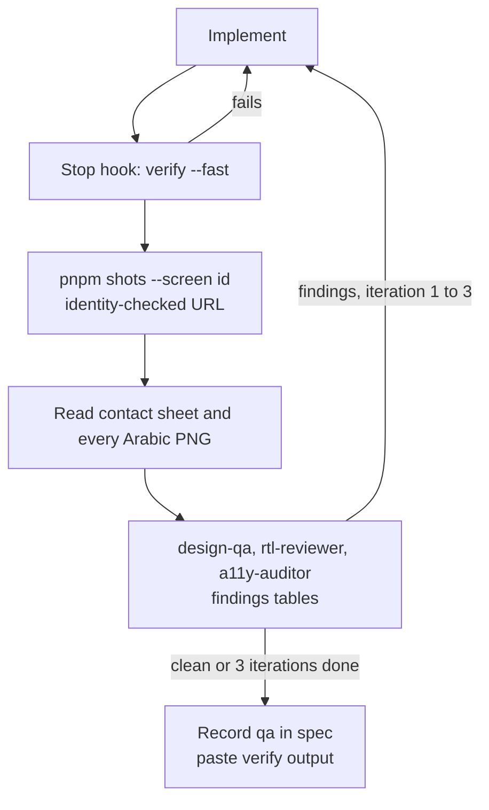

# ADR 0025: Testing strategy: bilingual goldens, parity checks and the visual QA loop

| Field | Value |
|---|---|
| Status | accepted |
| Date | 2026-10-12 |
| Scope | Test pyramid and cadence, golden matrix, Kuwait stress fixtures, parity and contract tests, backend tests, prototype tests, the visual QA loop that defines done for UI work |
| Owner confirmation still needed | None. Building shots, redlines and axe tooling is front-loaded work in the design phase |
| Related ADRs | 0009 (QA at 360 in Arabic), 0010 (format cases), 0014 (RTL checklist), 0017 (reduced motion in shots), 0021 (ports and identity checks before screenshots), 0022 (Flutter layering), 0024 (redlines and specs), 0026 (CI), 0027 (webhook tests), 0029 (verify command, Stop hook, subagents) |

## Context

The brief's quality bar is 'would a senior product designer sign this?' with both languages checked on every screen at 360, 390 and 430. Agents will build most of the code, so 'done' must be verifiable. Research (flutter-tech-handoff section 3.15 and 6.7) found:

- **Alchemist CI goldens** replace text with coloured squares in the Ahem font: platform-agnostic, good for geometry, useless for Arabic shaping. Platform goldens render real text but are OS-specific. So Ahem goldens on Linux are the layout gate and a small macOS real-font set exists for human review.
- Agents can open golden and failure PNGs with the Read tool, so goldens double as a screenshot channel without a simulator.
- Per-PR device suites cost minutes a solo owner cannot afford; emulator or simulator suites belong nightly and before release. Patrol is only needed for native dialogs.
- Riskiest backend logic: double booking under concurrency, payment webhooks (duplicate, out of order, forged, late), tenant isolation, idempotency, money rounding and Arabic search normalisation.
- Kuwait-specific content stresses layout: very long Arabic names mixed with Latin, KWD amounts of 12,500.000 and 0.500, 1,500-guest capacities, three compare items with different price units, every booking status including expired holds, men's and women's halls, long invoice numbers.
- Wrong URLs and stolen ports silently produce screenshots of someone else's page (ADR 0021).
- Quality: 'Type-checking is not design QA' (AGENTS.md): looking at the screenshots in both languages is part of done.
- NF-PERF-01 needs a measured budget, not a feeling.

## Decision

**1. Pyramid and cadence.**

| Layer | When | Content |
|---|---|---|
| Static gates (seconds) | every save via the Stop hook | Biome, Stylelint, `tsc`, `dart analyze --fatal-infos`, `tools/check-dart-rules.sh`, `tokens:check`, `i18n:check`, `specs:check` |
| Unit | every PR | Money, `GzFormat` cases, digit normaliser, `PhoneKw`, retry policy, DTO-to-entity mappers (fixtures from `packages/contracts/fixtures`), pricing and commission fixtures (server) |
| Widget and golden | every PR, Linux | Alchemist 0.14 through one helper, `ghazalGoldenTest(name, builder, {locales, widths, textScales})` in `ghazal_testing` |
| Integration | nightly and before release, not per PR | `integration_test` against the Prism mock or a fake server for the core flows (guest -> WhatsApp OTP -> booking request -> deposit with a fake gateway -> status; hotel: approve a request); Patrol 4.10 only for native dialogs (permissions, notifications, biometrics). One emulator or simulator at a time (`flock tools/.locks/emulator`) |
| Performance | nightly | `flutter drive --profile` for `home_ttfmc` and a scroll-jank test (frame build and raster p90 < 8 ms on a mid device) |

**2. Golden matrix.** Components: locales {ar, en} x width 390 x text scale {1.0, 2.0} per state. Hero screens (the eight in ADR 0024): locales x widths {360, 390, 430} x scales {1.0, 2.0}. All other screens: 390 at 1.0 in both locales plus 360 at 2.0 in Arabic. Every screen golden runs with the `default` and the `stress` fixture. File names `<screen>.<locale>.<width>.ts<scale>.png`. CI Ahem goldens are the layout and geometry gate; the budget is <= 1,200 PNGs and <= 40 MB in the repo (checked by script). A curated set of <= 24 real-font platform goldens is generated on macOS for human and agent review (hero screens in both languages plus a shaping-and-bidi sheet) and is not a CI gate.

**3. Kuwait-specific stress fixtures** (`packages/contracts/fixtures/stress/`): a 45+ character Arabic venue name mixing Latin brand text (فندق ريجنسي Regency Hotel style); a venue with no photos; prices KWD 12,500.000 and KWD 0.500; capacity 1,500; zero reviews; three compare items with different price units (per guest, flat per night, ministry fee); a booking in every status including expired holds; separate men's and women's halls; a seven-digit invoice number; empty, error and offline variants. The shaping-and-bidi sheet covers lam-alef ligatures, tashkeel, amounts such as 1,250.000 د.ك inside RTL text, phone numbers +965 5123 4567 staying LTR in RTL, and Western digits next to Arabic words.

**4. Parity and contract tests.** Layout parity (hero screens): load `design/.redlines/*.json`, pump the screen at the same size, locale and fixture, find nodes by `ValueKey('gz:<id>')`, compare `tester.getRect` as start-based insets within 1.0 dp (tag `parity`). Shared JSON fixtures (format cases, chat events, problem codes) are loaded by both the TS and Dart suites; the OpenAPI document is drift-checked and oasdiff-checked; Prism must serve the fixtures. `flutter widget-preview` with `@Preview` per component state and locale is the human side-by-side against the prototype; Widgetbook is not added until a hosted catalogue is needed.

**5. Backend tests.** Vitest unit plus Testcontainers integration (Postgres + PostGIS, Redis). Mandatory suites: a double-booking concurrency test (50 parallel claims on one hall and slot -> exactly one active claim, the rest `SLOT_UNAVAILABLE`); tenant isolation generated from the route list (venue A staff cannot read venue B); payment webhook scenarios against a scripted fake gateway (duplicate, out-of-order, forged signature, late SUCCESS after hold expiry, KNET pending); idempotency replays; money rounding fixtures; Arabic search normalisation cases; a nightly contract test against the MyFatoorah sandbox once it exists. Coverage gate 70% for `ghazal_core`, `ghazal_auth` and the domain/data layers, none for pure UI.

**6. Prototype tests.** Vitest for formatters and mock data; Playwright shots at {ar, en} x {360, 390, 430} with reduced motion, network blocked and a wait for `document.fonts.ready` and a `data-ready` attribute; axe per route and locale (fail on serious/critical); redlines; the Playwright locale for Arabic is `ar` (never `ar-KW`).

**7. The visual QA loop (definition of done for UI work).**

1. Implement; the Stop hook runs `pnpm verify design --fast` and blocks on failure.
2. `pnpm shots --screen <id>` (URL resolved and identity-checked by `tools/ports.mjs`, ADR 0021) writes six PNGs and one contact sheet to `design/.shots/<run>/`.
3. The author Reads the contact sheet and every Arabic PNG at full size; Arabic is judged on its own, not as a mirror of English (sizes, leading, icon mirroring, bidi, baseline clash with Latin).
4. Read-only subagents `design-qa`, `rtl-reviewer` and `a11y-auditor` return findings tables (issue, `data-gz-id`, severity, fix).
5. Fix and re-run. Maximum three iterations, then escalate the remaining items to the integrator or owner.
6. Record the run in the screen spec's `qa` field and paste the tail of `pnpm verify <area>` into the final message.

Flutter equivalent: Ahem goldens + widget-preview + `flutter run -d <id> --dart-define=GZ_LOCALE=ar`, then `xcrun simctl io booted screenshot` or `adb exec-out screencap -p`; `handoff-checker` lists deltas > 1 dp against the redlines.

**8. Golden hygiene.** Never run `--update-goldens` without Reading the diff PNGs under `failures/`. Only the golden's owner updates it, in a commit whose message says why. CI uploads failure PNGs and shots as artefacts. Pixel equality between web and Flutter is never a gate; geometry and tokens are.

## Consequences

- Layout regressions in either language fail CI on Linux without simulators; goldens double as a screenshot channel agents can Read.
- The riskiest backend logic (double booking, webhooks, tenancy) has named tests before it is written.
- Ahem goldens say nothing about glyph shaping, so the small real-font macOS set is a manual review burden and must be regenerated deliberately.
- A full matrix on eight hero screens is hundreds of PNGs; the budget script and the reduced matrix for other screens keep the repo small.
- Nightly-only device tests mean a native-dialog regression can sit for a day.
- Building shots, redlines and axe tooling is front-loaded work in the design phase.
- Current repo state: `design/scripts/snap.mjs` launches Playwright with locale `ar-KW` and has no identity check; both must change (`ar`, and the `tools/ports.mjs` check) before it is used for QA (ADR 0010, ADR 0021 item 8).
- The home budget (NF-PERF-01) is measured by the nightly profile-mode drive, not by hand (ADR 0022 G).

## Alternatives considered

| Alternative | Why rejected |
|---|---|
| Pixel-diff goldens across web and Flutter | Font rasterisation differs; geometry and tokens instead |
| Real-font platform goldens as the CI gate | OS-specific; would fail on Linux CI; kept as a small manual review set |
| Per-PR emulator or simulator suites | Minutes a solo owner cannot afford; nightly and before release |
| Widgetbook as a hosted catalogue now | `flutter widget-preview` with `@Preview` first; add Widgetbook only if stakeholder review needs a hosted catalogue |
| Type-checking and lint as 'done' for UI | Design QA means looking at both languages at three widths |
| Screenshots of whatever answers on a port | Identity handshake and `ports.mjs` check before every local navigation |
| Full golden matrix for every screen | Hero screens get the full matrix; others a reduced one; repo budget enforced |
| Testing only the happy path of payments | Duplicate, out-of-order, forged, late and pending webhooks are mandatory suites |
| Coverage gates on UI code | Gates only on logic packages (70%) |

## Related requirement IDs

| ID | Effect |
|---|---|
| NF-PERF-01, NF-PERF-02 | Nightly profile-mode timing and jank tests |
| NF-DSN-08, NF-LOC-01, NF-LOC-02 | axe per route and locale; bilingual goldens; RTL checklist |
| NF-MET-01 | A booking request completes in under 10 minutes (integration flow timing) |
| NF-COMP-01, NF-COMP-02 | Device matrix for nightly suites |
| PL-BOOK-02, PL-PAY-02 | Concurrency and webhook suites |
| NF-SEC-03 | Tenant isolation test generated from the route list |
| NF-DEL-06 | Documentation and test evidence delivered with the backend |
