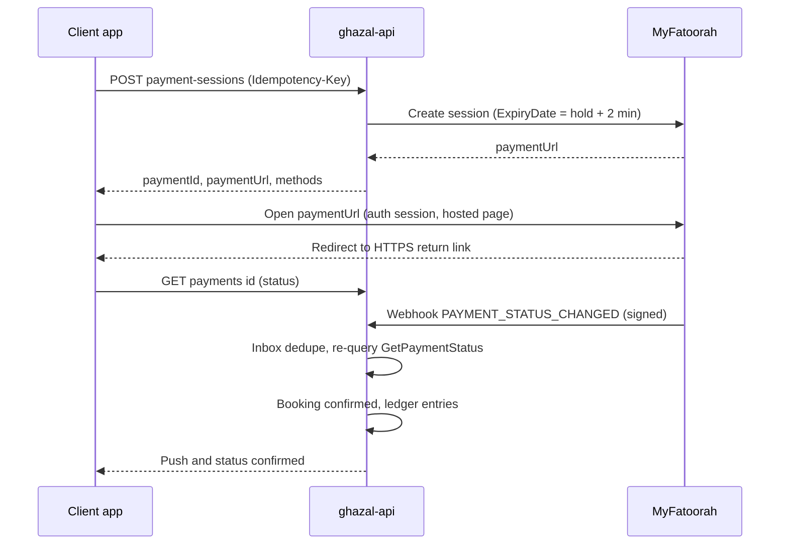

# ADR 0027: Payments integration boundary: server-side MyFatoorah, hosted pages, webhook plus re-query, ledger

| Field | Value |
|---|---|
| Status | accepted; partially superseded: supplier split, payouts, KYC and event ledger items by 0033 (gateway boundary stands); Updated by ADR 0035 (refund parts moot) |
| Date | 2026-10-12 |
| Scope | `apps/api/src/payments`, the client payment screens, the hotel app's payout state, refunds, ledger and the Week-1 spike |
| Owner confirmation still needed | OQ-T-04 and OQ-B-02 (MyFatoorah written answers; Week-1 spike gates in item 8), OQ-B-06 (merchant of record, invoice issuer, funds held, refund liability), OQ-T-12 (invoice issuer and PDF service) |
| Related ADRs | 0001 (hold, late payment), 0003 (T08, T08b, T16), 0005 (deposit and cash), 0006 (refund rules), 0010 (money), 0020 (Nest module), 0022 (launcher, retry), 0025 (webhook tests), 0026 (secrets), 0028 (step-up) |
| Screens | CL-PAYM-01..05, CL-BKNG-02, CL-BKNG-03, CL-BKNG-05, HL-BOOK-03, HL-SETT-04 |

> Superseded by 0033 on 2026-10-14 (owner changed the business model to the KD 2 voucher marketplace): Webhook plus re-query, hosted pages, idempotency and refund execution stand. The body below is the historical record.

> **Framework note (2026-10-12).** This ADR is accepted but ADR 0020 (NestJS) is `proposed-needs-owner`. Binding and framework-neutral: the `PaymentGateway` port, the webhook-plus-re-query rule, the idempotency keys, the ledger, the rate limits and the module boundary (everything payment-related lives behind one payments module). Nest-specific names (`apps/api/src/payments`, `@nestjs/throttler`, Nest modules) hold only if ADR 0020 is confirmed (OQ-T-01); a flip to Laravel re-expresses the same port, guard and limiter in that framework.
## Context

The PRD names KNET via MyFatoorah plus Visa, Mastercard, Apple Pay and Google Pay (PL-PAY-01), idempotent callbacks (PL-PAY-02), gateway refunds (PL-PAY-03) and 'no card data stored' (NF-PAYS-01). Research (booking-payment section 1.1, flutter-tech-handoff section 3.13) found:

- **Marketplace.** MyFatoorah Suppliers lets the platform add venues (`CreateSupplier`, `UploadSupplierDocument`, KYC approve or reject by webhook), and pass `SupplierCode` + `InvoiceShare` (+ optional `ProposedShare` / `ProposedDepositShare`) in the payment call; shares must sum to the order amount. Deposit interval options are Daily/Weekly/Monthly/onDemand; semantics of `TransferBalance` and onDemand are unverified. v2 and v3 field names differ; build on v3.
- **Authorise/capture.** v3 supports AUTHORIZE, CAPTURE, RELEASE, PAY, but only one capture or release per invoice; examples are card only; KNET is an immediate-debit scheme with no documented authorise (ADR 0001 D4).
- **Refunds.** `MakeRefund` (Key, KeyType, Amount, `ServiceChargeOnCustomer`, `ExternalIdentifier`); partial refunds repeatedly; one request at a time; need available refund balance; executed by MyFatoorah finance unless Auto Refund is enabled; statuses REFUNDED and CANCELED arrive by webhook.
- **Webhooks v2.** Events PAYMENT_STATUS_CHANGED, REFUND_STATUS_CHANGED, BALANCE_TRANSFERRED, SUPPLIER_STATUS_CHANGED, DISPUTE_STATUS_CHANGED; secret key mandatory, signature in `myfatoorah-signature`; up to 5 retries, duplicates occur; no webhook for authorize transactions. Payloads carry `ServiceCharge` and `ReceivableAmount`.
- **Tokenisation** is card-only and by account-manager enablement (KNET always needs the PIN); at most one-tap balance payment, never auto-debit.
- **Apple Pay 'direct integration'** means decrypting the token yourself, which brings PCI scope; use the hosted or embedded option so NF-PAYS-01 holds.
- **`myfatoorah_flutter` 3.3.2** initialises with the API key inside the app, which is the main reason not to embed it.
- Weddings are booked 6-18 months ahead, so a gateway refund-age limit (unverified KNET 90-day claim) would break original-method refunds.
- Large KNET deposits may exceed bank-set daily online limits.

## Decision

**1. The boundary.** All gateway interaction is server-side, inside `apps/api/src/payments`, behind one port, `PaymentGateway { createSession, getStatus, refund, createSupplier, uploadSupplierDocument, listMethods }`, with one adapter `MyFatoorahV3Gateway` (v3 API: Create Session / Create Payment; v2 field names are not used). The port exists for testing (a scripted fake gateway) and isolation, not for multi-gateway support. The mobile apps and dashboards never hold the MyFatoorah API token and never call MyFatoorah directly. `myfatoorah_flutter` is not used unless MyFatoorah confirms a session-scoped token flow for Apple Pay and Google Pay (OQ-T-04).

**2. Client contract.** `POST /v1/bookings/{id}/payment-sessions` (requires `Idempotency-Key`; allowed only while the booking is `awaiting_deposit`, or for a balance milestone) returns `{ paymentId, paymentUrl, expiresAt, amount: { fils, currency: 'KWD' }, methods: [...] }`. `methods` is computed by the server (MyFatoorah's enabled methods cached about 10 minutes, filtered by an `X-Platform` header and ordered iOS: Apple Pay, KNET, card; Android: KNET, Google Pay when enabled, card), so the apps hardcode no payment-method list. `GET /v1/payments/{id}` returns the state. The app opens `paymentUrl` through a `PaymentLauncher` interface whose default implementation is `flutter_web_auth_2` (ASWebAuthenticationSession / Custom Tabs) with an HTTPS return link `https://link.<domain>/c/pay/return?p=<paymentId>`; a Week-1 spike must confirm that Apple Pay works on the hosted page and that return links are reliable, with SFSafariViewController plus a 'Return to Ghazal' button as the fallback. Whatever the launcher reports, the app then fetches the status from the API. The return URL is never trusted. CA-PAY-10 states map directly: success, failed (retry or switch method, reusing the same Idempotency-Key for the same attempt), and pending bank confirmation (poll with backoff for 90 s, then rely on push, CA-NOTI-07). No card form exists in our UI (SAQ-A posture). After a failed KNET payment (bank daily limit) the screen offers Visa/Mastercard/Apple Pay first.

**3. Server is the source of truth.** Webhook endpoint `POST /webhooks/myfatoorah` is public, reads the raw body, verifies `myfatoorah-signature` against the webhook secret, writes the event to an inbox keyed (gateway, event, transaction id) so duplicates are no-ops, then re-queries `GetPaymentStatus` before changing any state; only the re-queried status counts. Handlers are idempotent (PL-PAY-02). Every gateway fact is appended to an append-only `payment_events` table; money movements are recorded in an internal double-entry ledger (the source of truth that survives MyFatoorah semantics changing). Invoice `ExternalIdentifier` and `UserDefinedField` carry our payment and booking ids. The gateway invoice `ExpiryDate` is set to the slot-hold expiry plus 2 minutes. A SUCCESS arriving after hold expiry re-acquires the slot if it is free, otherwise triggers an automatic 100% refund and a notification (platform bears the fees).

**4. Money rules.** Integer fils end to end (`Money` in Dart, `*_fils BIGINT` in SQL, `{ fils, currency }` on the wire); clients never compute totals, they display the server's price snapshot through `GzFormat.money`. Gateway fees are recorded per payment from the webhook (`ServiceCharge`, `ReceivableAmount`), never constants. Clients never pay a processing fee. Cash is not a gateway concern: a venue records cash received for the balance only, the client acknowledges it, and the deposit is always online (CF-27).

**5. Marketplace split.** Supports the booking-domain design: commission is collected up front from the deposit through the supplier split (venue share = deposit minus commission), venues become MyFatoorah suppliers through `createSupplier` plus KYC document upload with approval by webhook (`SUPPLIER_STATUS_CHANGED`); a venue without approved KYC cannot take paid bookings or instant booking, and the hotel app shows 'Payouts: action needed'. Payout timing is driven from the internal ledger, not from MyFatoorah's interval.

**6. Refunds (CF-26).** One backend refund service owns every refund, whoever triggers it (venue, support, Super Admin finance, automatic). `MakeRefund` is always called with `ServiceChargeOnCustomer=false`, one request per invoice at a time, partial refunds allowed, `ExternalIdentifier` set. If the original method cannot be refunded or the refund balance is short, the flow falls back to a bank transfer with IBAN capture (a required flow, because weddings are booked 6-18 months ahead). Refund state changes arrive by `REFUND_STATUS_CHANGED` and are re-confirmed the same way.

**7. Retry and safety.** Payment, OTP and booking-creation calls are never auto-retried by the client's global retry policy (ADR 0022). Rate limits on session creation per user and booking. Secrets (API token, webhook secret) live only in Secret Manager (ADR 0026). Dispute events set a payout hold on the booking. The `payments-security.md` path rule applies to `apps/api/src/{auth,payments,webhooks}/**` and `packages/ghazal_auth/**`.

**8. Week-1 spike gates** (written answers or sandbox proof before UI copy about timings is final): KNET and card refund windows and timings; Auto Refund enablement; whether KNET or Apple Pay support authorise (design never depends on it); supplier onDemand deposits and `TransferBalance` semantics; KYC document list and turnaround for Kuwaiti hotels and halls; Apple Pay and Google Pay merchant setup and hosted-page behaviour inside the launcher; tokenisation (cards only) enablement; per-method fees; KNET daily-limit error codes.

## Consequences

- No card data and no gateway secret ever touch an app, so NF-PAYS-01 holds by construction and app-store review is simpler.
- Duplicate, forged or late webhooks have defined outcomes and tests (ADR 0025 item 5).
- The ledger and the port let us change gateway behaviour without touching UI.
- Every payment adds one server hop and a status poll; the pending-bank-confirmation state must be designed as a first-class screen (CL-PAYM-03).
- Hosted pages limit visual control of the payment step; the launcher choice (ASWebAuthenticationSession versus SFSafariViewController) may need to change after the spike.
- Several UX promises (refund timing, KNET limits) wait on MyFatoorah's written answers; copy about arrival times must stay generic until then.
- Supplier KYC can block paid bookings per venue, so request-mode usability while KYC is pending must be designed (ADR 0001 consequences, ADR 0008 D11).
- The ledger accounts and the release rules (venue share of deposit about 7 days after payment, balance after the event, a 20% rolling reserve for new venues, Ghazal fronting venue-caused refunds) come from the booking-payment research and need owner decisions (OQ-B-06, OQ-B-16) before they become an ADR of their own.
- Dispute events (DISPUTE_STATUS_CHANGED) set `payout_hold` on the booking and open a support case.

## Alternatives considered

| Alternative | Why rejected |
|---|---|
| `myfatoorah_flutter` SDK embedded in the app | Needs the account API key in the app; allowed only if MyFatoorah confirms a session-scoped token flow |
| Apple Pay direct integration (decrypting the token ourselves) | Brings PCI scope; hosted or embedded option keeps SAQ-A |
| Trusting the app's return URL or redirect | Webhook signature plus `GetPaymentStatus` re-query only |
| Authorise-then-capture, or pay-then-refund | KNET has no hold; ADR 0001 D4 |
| MyFatoorah's supplier interval as the payout driver | Payouts are driven from the internal ledger (onDemand), so refunds and disputes can be netted |
| Card form inside the app | Never; hosted pages only |
| Client-computed totals or fees | The server price snapshot is displayed; clients never compute |
| Multiple gateway adapters now | One adapter; the port exists for testing and isolation |
| Auto-retry on payment calls | Never auto-retried; a user retry reuses the Idempotency-Key |
| Refunds issued by the venue directly | One backend refund service owns every refund (CF-26) |
| MyFatoorah v2 API | v3 only (Create Session / Create Payment) |

## Related requirement IDs

| ID | Effect |
|---|---|
| PL-PAY-01, PL-PAY-02, PL-PAY-03 | Gateway methods, idempotent callbacks, refunds recorded |
| NF-PAYS-01 | No card data stored; hosted pages |
| CA-PAY-01..05, CA-PAY-10, CA-PAY-11 | Methods per platform, outcome states, balance payment |
| CA-PAY-06, CF-27 | Cash balance only, never the deposit |
| CA-BOOK-11, CA-BOOK-13 | Deposit step; receipts and invoices |
| CA-STAT-08, VD-BOOK-05, SA-FIN-03, SA-SUP-04, CF-26 | Single refund service |
| HA-SET-03 | Bank info and supplier KYC state in the hotel app |
| PL-BOOK-05, MK-COM-01 | Commission front-loaded from the deposit |
| CA-NOTI-07 | Payment notifications |

## Notes on conflicting inputs

- **Polling window.** Item 2 says 'poll with backoff for 90 s, then rely on push'. ADR 0001 D11 and ADR 0005 D7 say the app polls up to about 30 seconds and then shows 'We are confirming. You can leave; we will notify you.' The two are compatible only if the user-visible message switches at about 30 s while status polling may continue up to 90 s; this is not stated anywhere. Treat 30 s as the UI threshold (ADR 0001 owns the copy) and 90 s as the maximum polling window until confirmed.
- **Late-payment window.** Item 3 omits the 60-minute limit on re-acquiring a slot after a late SUCCESS; ADR 0001 D11 and ADR 0003 T08b state it, and the 60-minute rule applies.
- **Amendment 2026-10-12 (architecture README #4).** Polling: the client shows 'We are confirming. You can leave; we will notify you.' at about 30 s (ADR 0001 D11, ADR 0005 D7) and keeps polling silently until 90 s (this ADR); both numbers are configuration.
