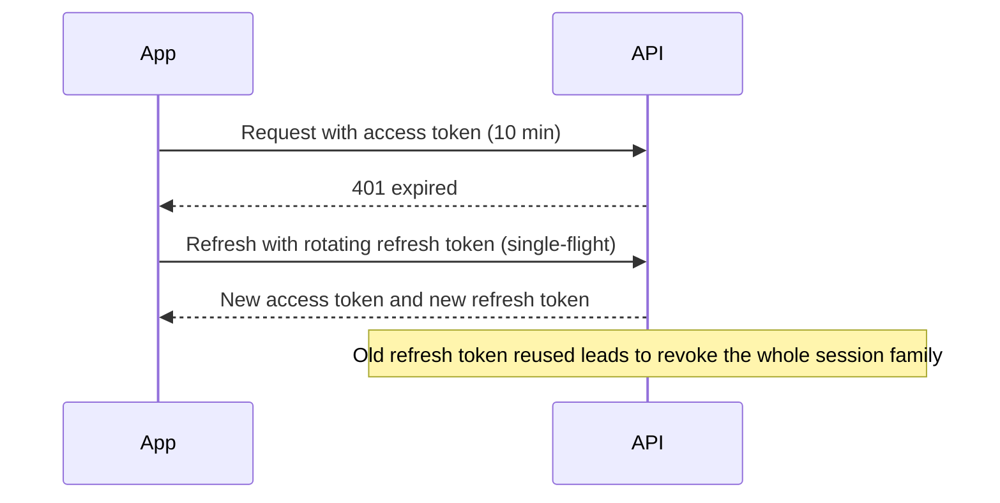

# ADR 0028: Authentication: backend JWT sessions, Apple/Google/WhatsApp OTP, guests, hotel staff, step-up

| Field | Value |
|---|---|
| Status | accepted |
| Date | 2026-10-12 |
| Scope | Identity model, client sign-in, sessions and tokens, client-side storage and biometrics, hotel staff access, two-factor and step-up, account deletion, store review account, transport |
| Owner confirmation still needed | OQ-T-08 (WhatsApp OTP provider, Meta verification, template approval, failure fallback), OQ-T-09 (hotel login and two-factor scope), OQ-B-17 (hotel roles and multi-venue), OQ-B-20 (account deletion with a future booking), OQ-L-14 (non-WhatsApp and foreign-number users) |
| Resolves | CF-04 (Firebase Auth versus backend JWT), CF-05 (OTP channel), CF-25 (hotel app gaps, login), CF-32 (admin two-factor scope) |
| Related ADRs | 0007 (single identity entry, guest gating, merge, deletion), 0008 (role matrix, step-up in the hotel app), 0012 (phone and OTP formats), 0020 (backend), 0022 (secure storage, router redirect), 0026 (key rotation) |
| Screens | CL-AUTH-01..05, HL-ACCS-01..04, CL-PROF-06, HL-SETT-03, HL-SETT-04 |

> **Framework note (2026-10-12).** This ADR is accepted but ADR 0020 (NestJS) is `proposed-needs-owner`. Binding and framework-neutral: the identity model, JWT and refresh-token rules, the roles and the step-up (`acr=step_up`) contract, the OTP limits, and a guard plus a rate limiter in front of the auth endpoints. Nest names (guards as Nest providers, `@nestjs/throttler`, `@Api`) hold only if ADR 0020 is confirmed (OQ-T-01).
## Context

The PRD lists sign-up and login with identifier and password, Apple, Google, WhatsApp OTP, forgot password, biometric unlock and guest browsing (CA-AUTH-01..11); project.md says Firebase Auth while the PDF says backend JWT plus OAuth (CF-04); there is no SMS gateway (CF-05). The PRD defines no hotel login (CF-25). Research found:

- Identity is the phone number (WhatsApp-capable); email is optional. About 6% of social users are not on WhatsApp and some expatriates use foreign SIMs, so fallback paths matter.
- Apple requires Sign in with Apple when Google sign-in is offered, requires in-app account deletion, and for Sign in with Apple requires token revocation on deletion. App Review expects a demo login.
- Wedding planning spans 6-18 months, so long client sessions matter; hotel staff and web admins need shorter sessions and immediate revocation when staff leave (HA-AUTH-04).
- Bank-info changes and refunds from a phone are payout-fraud vectors (HA-SET-03).
- Apple Private Relay emails and email-takeover risk make merging accounts by email unsafe.
- `flutter_secure_storage` on Android needs Auto Backup disabled for its preference file (a restored backup is undecryptable); on iOS the Keychain survives uninstall and creates ghost sessions.
- Riverpod 3 auto-retries; token refresh needs single-flight handling.
- `local_auth` is a UX convenience, never a server credential.

## Decision

**1. Identity model.** One `users` table; identities in `user_identities(provider, subject)` where provider is `phone`, `password`, `apple` or `google`. Never merge accounts by email (Apple private relay and takeover risk); link identities only through a verified phone number. A verified phone is mandatory before the first booking request, payment or chat; the API answers `PHONE_VERIFICATION_REQUIRED` and the app resumes the stored `GuestIntent` afterwards (ADR 0022).

**2. Client sign-in.**

- *Password account (CA-AUTH-01/02):* *Decided 2026-10-12 (one rule, shared with ADR 0012 D1):* the identifier is the Kuwait mobile number behind the fixed non-interactive +965 chip (ADR 0012 D1); other country codes are not accepted in the MVP, and people with a foreign number continue with Apple or Google (OQ-L-14); email is an optional profile field, never a sign-in identifier; passwords hashed with argon2id; forgot-password through a WhatsApp OTP to the verified number (email OTP only as a recovery channel for users with a verified email, OQ-T-08).
- *WhatsApp OTP (CA-AUTH-05/06; PL-AUTH-02):* Meta Cloud API authentication template in Arabic and English; 6 digits; 5-minute TTL; HMAC-hashed at rest; 5 attempts; rate limits per phone, device and IP; resend after a 60 s countdown. There is no SMS fallback; on delivery failure the screen offers resend, Apple/Google sign-in and support. Phone normalisation to E.164 `+965` with the loose shape check from ADR 0022; Arabic-Indic and Persian digits are normalised client and server side.
- *Apple and Google (CA-AUTH-03/04):* the app obtains the identity token (`sign_in_with_apple`, `google_sign_in` with `serverClientId`) and the API verifies it against the provider's JWKS with `jose`. Sign-up requires explicit acceptance of Terms and Privacy (CA-AUTH-11).
- *Guests (CA-AUTH-09/10):* no token. Public GETs are rate-limited by IP and an anonymous `X-Device-Id`. Favourites and the compare tray live in `shared_preferences` and merge into the account after login.

**3. Sessions.** The backend issues ES256-signed JWT access tokens (10 minutes; claims `sub`, `sid`, `typ`, `ver`; keys in Secret Manager with `kid` rotation; ES256 for broad interoperability) and opaque rotating refresh tokens stored hashed in the DB and bound to a `device_id`. Reuse of an old refresh token revokes the whole session family. Refresh lifetime: client 90 days sliding with a 12-month absolute cap (wedding planning spans 6-18 months); hotel staff 14 days sliding, 60 days absolute; web admins 8 h idle. Permissions are not stored in the token: the API resolves membership and permission keys per request from a Redis-cached lookup and checks `sid` against a revocation set, so an admin revoking a staff session (HA-AUTH-04) takes effect immediately. Logout and refresh failure clear Riverpod caches, the HTTP cache and the FCM token registration.

**4. Client-side storage and biometrics (CA-AUTH-08).** `flutter_secure_storage` holds the refresh token and device id only. Disable Android Auto Backup for its preference file; on iOS, clear the Keychain on the first launch after install (flag in `shared_preferences`) to avoid ghost sessions. Refresh uses a single-flight interceptor (one refresh at a time). `local_auth` only unlocks the locally stored session or gates high-risk screens; biometrics are never a server credential. Android needs `FlutterFragmentActivity`; `NSFaceIDUsageDescription` is localised.

**5. Hotel app auth (CF-25 working call).** Staff are invited by a venue admin or by Ghazal through a WhatsApp link, set a password, and log in with phone + password; a new device additionally needs a WhatsApp OTP. A user with several venues or halls switches the active venue (HA-AUTH-03); the app sends `X-Venue-Id` on every request and the API validates membership on each call, never trusting the header alone. Roles map to permission keys defined in `packages/contracts` (for example `booking:approve`, `pricing:write`, `refund:create`, `bank:write`); the app hides what the role lacks (HA-AUTH-02) from the permission list in `/v1/me`, while the server remains the authority.

**6. Two-factor and step-up.** TOTP (RFC 6238) is mandatory for Super Admin and venue admins on web and on first login from a new device in the hotel app (device then trusted 30 days); optional for other staff (CF-32). High-risk actions (changing bank info HA-SET-03, refunds, inviting or removing staff) require server-enforced step-up: a fresh WhatsApp OTP or password re-entry issues a short-lived `acr=step_up` token (5 minutes). A biometric prompt in the hotel app is a UX convenience in front of this, not a replacement. Bank-info changes also notify the venue admin and Ghazal finance and delay payouts to the new IBAN by 24 hours.

**7. Account deletion (NF-PRIV-01, PL-CORE-10).** In-app deletion calls the API, which is blocked while a confirmed future booking exists (cancel under policy first), revokes Apple tokens with the server-side Sign in with Apple client secret, anonymises personal data and keeps ledger and invoice rows. Google Play's web deletion URL is a minimal public page on the owner's domain that verifies the account by WhatsApp OTP and calls the same endpoint.

**8. Store review.** A reviewer demo account (a fixed phone with a fixed OTP) is enabled only by a production secret flag, scoped to a sandbox user with fixture data; nothing is hardcoded in the binary or the repo.

**9. Transport.** `Authorization: Bearer` over TLS; Socket.IO sends the token in the handshake `auth`, never in the query string; throttling with `@nestjs/throttler` on Redis; audit-log entries for logins, step-ups, role changes and session revocations (PL-CORE-03).

## Consequences

- No dependency on Firebase Auth or SMS; one session model for client, hotel and web.
- Immediate revocation for staff and a server-enforced guard on payout-fraud actions.
- Kuwait-fit onboarding: phone-first, WhatsApp-native, no email dependence.
- We own OTP delivery quality; WhatsApp template approval and Meta business verification are on the critical path (OQ-T-08).
- A per-request membership lookup adds a Redis read; acceptable and cached.
- Long client sessions (90 days sliding) trade some security for planning-app stickiness; biometric unlock and refresh rotation with reuse detection compensate.
- The hotel app needs a step-up UI (OTP sheet) on a few actions, adding one screen to the design scope.
- The account-deletion block while a future booking exists matches ADR 0007 D12 and OQ-B-20; the Google Play deletion URL needs a minimal public site (CF-31).
- Fixed-OTP review accounts are a production risk if the flag leaks; the flag lives in Secret Manager and the sandbox user is isolated.

## Alternatives considered

| Alternative | Why rejected |
|---|---|
| Firebase Auth (project.md) | The PDF fixes backend JWT plus OAuth (CF-04); one session model for client, hotel and web |
| SMS OTP | No SMS gateway budgeted (CF-05); WhatsApp is the channel |
| Email and password only | Phone is the identity in Kuwait; email optional |
| Merging accounts by email | Apple private relay and takeover risk; link only through a verified phone |
| Permissions embedded in the JWT | Staff revocation would lag; per-request lookup with a revocation set |
| Long-lived non-rotating refresh tokens | Reuse detection requires rotation |
| Biometrics as a server credential | Biometrics only unlock the local session or sit in front of step-up |
| Storing tokens in `shared_preferences` | `flutter_secure_storage` for the refresh token and device id only |
| EdDSA signing | ES256 for broad interoperability |
| Trusting `X-Venue-Id` alone | Membership validated on every call |
| Hardcoded review account in the binary | Production secret flag, sandbox user |
| Mandatory TOTP for all staff | Mandatory for Super Admin and venue admins; optional for others (CF-32) |

## Related requirement IDs

| ID | Effect |
|---|---|
| CA-AUTH-01..11 | Password, Apple, Google, WhatsApp OTP, OTP states, reset, biometric, guest browsing and gate, Terms acceptance |
| HA-AUTH-01..04 | Staff login by invitation, role-aware modules, venue switch, sign-out and revoke |
| PL-AUTH-01, PL-AUTH-02 | Backend JWT with Apple and Google validation; WhatsApp OTP service |
| NF-SEC-02, NF-SEC-03, NF-SEC-04, NF-SEC-05 | Hashed credentials, roles, admin two-factor, audit logs |
| NF-PRIV-01, PL-CORE-10 | In-app account deletion pipeline |
| HA-SET-01, HA-SET-02, HA-SET-03 | Invite staff, assign roles, bank info under step-up |
| CF-04, CF-05, CF-25, CF-32 | Resolved here |

## Notes on conflicting inputs

- **Hotel sign-in method.** Item 5 and OQ-T-09 say phone + password via WhatsApp invite with OTP on new devices. The working assumption in OQ-B-17 says 'WhatsApp OTP for invited staff plus biometric lock'. The hotel screens (HL-ACCS-01..03) follow this ADR.
- **Where the password path sits (resolved 2026-10-12).** ADR 0007 D9 now says the single phone-first entry carries 'Use a password' as the tertiary link to CL-AUTH-04; the password account's identifier is the mobile number behind the fixed +965 chip; there is no email identifier.
- **Amendment 2026-10-12 (architecture README #10).** OQ-B-17's assumption of WhatsApp OTP for invited hotel staff is superseded by the Venue staff row of the roles table here: phone plus password after a WhatsApp invite, with an OTP on a new device (HL-ACCS-01..03).
