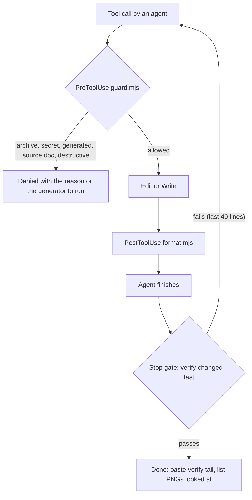

# ADR 0029: Agentic-development setup: AGENTS.md, rules, skills, subagents, hooks and file ownership

| Field | Value |
|---|---|
| Status | accepted |
| Date | 2026-10-12 |
| Scope | Instruction files, path-scoped rules, skills, subagents, hooks and permissions, the single verification command, file ownership for parallel agents, preconditions that need the owner |
| Owner confirmation still needed | OQ-T-07 (one baseline commit, branch renamed to `main`, who creates it, GitHub organisation; deleting or moving the pirated archive) |
| Related ADRs | 0021 (ports, slots, generated files, birth criteria), 0023 (single-writer tokens), 0024 (skills for specs and handoff), 0025 (verify, Stop gate, QA subagents), 0026 (CI mirrors verify, secrets hooks) |

> **Framework note (2026-10-12).** Ownership by module (`apps/api/src/<module>/**`), `apps/api/drizzle/**` and the `api-<module>` role assume ADR 0020 (NestJS, `proposed-needs-owner`). The roles, single-writer rules, hooks and verify command are framework-neutral; the `apps/api` paths and the Drizzle migration folder are placeholders until OQ-T-01 is answered.
## Context

This project is built mostly by autonomous coding agents under one human owner, so rules must be enforced, not remembered. Research (flutter-tech-handoff section 6) assessed the current setup:

- **Good:** `AGENTS.md` is short (46 lines), concrete, and carries the hard rules; `CLAUDE.md` imports it with `@AGENTS.md` (the right pattern; docs recommend under 200 lines).
- **Gaps:** commands point at `npm run` inside `design/` and a README that does not exist; no stack pins; no definition of done or verification command; the token path will change to `packages/design-tokens`; no ownership or generated-file rules beyond one line; no ADR numbering protocol for parallel writers; the nulled-archive rule is prose only; `.claude/{agents,rules,skills}` are empty; the repo has zero commits, which blocks worktree isolation and diff-based gates.
- **Enforcement:** `CLAUDE.md` is advisory; hooks are the enforcement layer. `PreToolUse` can deny (exit 2 or `permissionDecision: deny`), `Stop` can block (with a `stop_hook_active` flag to prevent loops), `SessionStart` can print a banner; `paths` is the only rule-frontmatter field Claude Code reads.
- **Parallel agents** cause lost updates when `Write` overwrites a shared file, and collide on ports, Docker project names, emulators, lockfiles, migration numbers and `build_runner`. Registries must be split per feature so additions never touch a shared file.
- **Cost:** concurrent writers are capped at 4-5; reviewers are read-only and unlimited; the strongest model is reserved for architecture and integration. Subagent descriptions share a combined 15,000-token limit.
- The hard rule in AGENTS.md: never open, extract, run or reference the pirated ('nulled') script archive in the repo root (named in AGENTS.md); it is not part of this project.

## Decision

**1. Instruction files.** `AGENTS.md` stays the single source (under 120 lines, hard limit 200); `CLAUDE.md` keeps only `@AGENTS.md` plus Claude-specific notes. Edits to AGENTS.md (integrator only): replace the Commands section with root commands (`pnpm install`, `pnpm -F design dev`, `pnpm verify design|flutter|api|all`, `pnpm tokens`, `pnpm tokens:check`, `pnpm i18n:check`, `pnpm shots --screen <id>`, `pnpm a11y`, `flutter analyze --fatal-infos`, `flutter test`); change the tokens hard rule to `packages/design-tokens/src/` (no `design/tokens/`); add Stack (pinned versions), Definition of done, Ownership and shared files, Generated files, Decisions (`node tools/new-adr.mjs '<title>'` allocates a number under a lock; accepted ADRs are not re-litigated), Scope (requirement IDs per feature matrix; new ideas go to `docs/product/open-questions.md`), and a ports rule: never hand-type a localhost URL, use `node tools/ports.mjs url <service>`; dev servers run with strictPort and answer `/__gz`; never stop a process you did not start. Flutter, API, DB, payments and docs detail moves into path-scoped rules, not AGENTS.md.

**2. Path-scoped rules** (`.claude/rules/*.md`; `paths` is the only frontmatter field Claude Code reads; each file under 40 lines): `i18n-rtl.md`, `design-tokens.md`, `prototype-handoff.md`, `flutter.md`, `flutter-tests.md`, `api-nestjs.md`, `db-migrations.md`, `payments-security.md`, `docs-adr.md`. Their content is the binding summary of ADRs 0020-0028 (for example `flutter.md`: material_ui only, Riverpod without codegen, features do not import features, tokens only, Directionality-aware widgets, no google_fonts, retry policy, no print; `prototype-handoff.md`: the CSS subset, `data-gz` markers, spec JSON per component and screen).

**3. Skills** (`.claude/skills/<name>/SKILL.md`, under 500 lines): `verify`, `add-screen` (requirement IDs -> screen spec -> route -> ARB parts en+ar with plurals -> states loading/empty/error/offline -> `data-gz-id` anchors -> shots -> redlines -> axe), `add-token`, `add-flutter-component`, `shots`, `handoff-screen`, `i18n-add-string`, `adr`, and `release-mobile` (`disable-model-invocation: true`, manual only).

**4. Subagents** (`.claude/agents/*.md`; they inherit AGENTS.md and rules, not conversation history): read-only reviewers `design-qa`, `a11y-auditor`, `rtl-reviewer`, `prd-tracer`, `handoff-checker` (`permissionMode: plan`, `model: sonnet`, tools limited to Read, Glob, Grep, Bash); once code exists, `flutter-implementer` and `api-implementer` with `isolation: worktree` and a fixed owned-path list. Reviewers are unlimited and read-only; concurrent writers are capped at 4-5. The strongest model is reserved for architecture and integration. Combined subagent descriptions stay under the 15,000-token limit.

**5. Hooks and permissions (enforcement layer).** `.claude/settings.json` allows `pnpm *`, `dart *`, `flutter *`, `tools/*`, read-only git, `rg`, `jq`, `xcrun simctl *`, `adb *`; it denies reading `.env`, any `*.rar`, archives named like nulled software, editing `project.md` and `Ghazal_PRD_EN.pdf`, and Bash commands that unpack or touch such archives. Hooks (Node, no jq dependency):

- **PreToolUse `guard.mjs`** (Bash, Read, Edit, Write, Glob, Grep, NotebookEdit): denies by `permissionDecision: deny` (or exit 2). The archive and secret rules inspect only path-like fields (`file_path`, `path`, `pattern`) and the Bash `command`, never `content`, `old_string` or `new_string`, so documents can still mention the archive's name; secrets are `.env*` (except `.env.example`), `*.pem`, `*.p12`, `*.keystore`, `service-account*.json`; generated files (`**/generated/**`, `*.g.dart`, lockfiles, `openapi.json`) are denied with the name of the generator to run; `git commit|push|reset --hard|clean -f` asks unless the user requested it; destructive recursive deletes are denied; `Write` on an existing file in the shared single-writer list is denied (use Edit or append). With `--role <name>` (passed from a subagent's frontmatter hook) it also denies writes outside that role's globs in `docs/engineering/ownership.json`.
- **PostToolUse `format.mjs`** (Write, Edit): Biome for ts/tsx/json/css, `dart format` for dart; failures ignored.
- **Stop `tools/stop-gate.sh`:** exits at once if `stop_hook_active`; otherwise runs `tools/verify.sh changed --fast` (60 s or less) and returns `{decision: 'block', reason}` with the last 40 lines on failure.
- **SessionStart `session.mjs`:** prints Node, pnpm and Flutter versions against the pins, the current phase and token-freeze flag from `docs/engineering/STATUS.md`, the open-question count, and the identity-checked dev URLs from `tools/ports.mjs`.

`.mcp.json`: `dart mcp-server --disable create_project` and a pinned Playwright MCP.

**6. `tools/verify.sh <design|flutter|api|all|changed> [--fast]`** is the single definition of done: design = Biome, tokens:check, i18n:check, specs:check, `tsc`, Stylelint, Vitest, then (full) `vite build`, shots, axe; flutter = `dart format --set-exit-if-changed`, `flutter analyze --fatal-infos`, `check-dart-rules.sh`, `flutter test`, then (full) golden and parity tags; api = Biome, `tsc`, Vitest, then (full) Testcontainers integration and `openapi:emit` drift. An agent's final message pastes the tail of the verify output and, for UI work, states which PNGs it looked at (ADR 0025).

**7. File ownership.** `docs/engineering/ownership.json` (role -> write globs) is authoritative; `ownership.md` is a short pointer.

| Role | May write | Notes |
|---|---|---|
| integrator (1) | root configs, `package.json`, `pnpm-workspace.yaml`, lockfiles, `.github/**`, `.claude/**`, `tools/**`, `AGENTS.md`, `docs/engineering/**`, `infra/**` | the only role that adds dependencies, runs shared generators and edits single-writer registries |
| tokens-owner (1) | `packages/design-tokens/src/**` | after design freeze, changes need an ADR and a STATUS broadcast |
| system-owner (1) | `design/src/system/**`, `design/src/shell/**`, `design/specs/components/**`, `design/specs/*.schema.json` | shared components |
| screens-<app>-<feature> (N) | `design/src/screens/<app>/<feature>/**`, `design/specs/screens/<app>/<feature>/**`, `packages/i18n/messages/<app>/<feature>.{en,ar}.json` | cannot touch system, tokens or other features |
| copy-owner | `packages/i18n/messages/{common,server}/**` | |
| fixtures-owner | `packages/contracts/fixtures/**`, `design/src/mock/**` | |
| docs-author | its assigned ADR range, append-only lines in `docs/product/open-questions.md` | ADR ranges are pre-assigned to parallel authors |
| flutter-<feature> (later) | `apps/<app>/lib/features/<feature>/**`, matching tests and goldens | worktree-isolated |
| api-<module> (later) | `apps/api/src/<module>/**` | migrations single-writer |

Single-writer files: token JSON, `design/src/system/**`, lockfiles, generated outputs, `openapi.json`, `apps/api/drizzle/**`, `AGENTS.md`, `.claude/**`, `.github/**`, `lib/app/router/app_router.dart`. Registries are split so additions never touch a shared file: the prototype discovers routes with `import.meta.glob('../screens/**/routes.ts')`, ARB parts are per feature, Flutter's `app_router.dart` has one pre-created line per feature. A role that needs a token, component or dependency appends one line to `docs/engineering/requests.md` with shell append (`>>`), never Write; the integrator resolves it.

**8. Parallel-run protocol.** Never Write over an existing shared file. Each worktree slot N has its own ports (ADR 0021), `COMPOSE_PROJECT_NAME=ghazal_slot<N>`, database `ghazal_<slot>`, and screenshot directory `design/.shots/<agent-id>/`. One emulator or simulator at a time and one `build_runner` at a time (flock under `tools/.locks/`). Only one agent runs `drizzle-kit generate`; migrations get timestamp names. For orchestrated general agents (no per-agent hooks) the task text lists owned paths and the integrator diffs afterwards. `docs/engineering/STATUS.md` holds phase, active owners and the token-freeze flag. A `prd-tracer` pass runs per milestone and any screen without requirement IDs fails review.

**9. Preconditions that need the owner.** `isolation: worktree`, diff-based gates and the ownership diff require a baseline commit, but AGENTS.md says not to commit unless asked: one baseline commit (branch renamed to `main`) needs the owner's explicit go-ahead (OQ-T-07). The pirated archive should be deleted or moved out of the repo by the owner; agents never open it.

## Consequences

- Hard rules (the archive, secrets, generated files, source documents) are enforced, not remembered.
- Parallel agents cannot lose each other's edits, collide on ports, or invent registries; ownership is machine-readable and checkable.
- One verify command and one Stop gate keep 'done' honest and cheap.
- About a day of foundation work (hooks, verify, rules, skills) before feature agents start; it is the cheapest day in the project.
- Role-scoped denial works only for subagents with frontmatter hooks; general orchestrated agents rely on task text plus integrator diffs.
- Rules and AGENTS.md can drift; the `adr` skill, STATUS.md and the SessionStart banner are the countermeasures.
- Until the baseline commit exists, worktree isolation and diff gates are unavailable.
- Current state (as of 2026-10-12, updated after the review pass): `.claude/{agents,rules,skills}` are empty and `tools/` does not exist; `docs/engineering/` exists (conventions, testing, git workflow, definition of done, agentic workflow, environments, STATUS, requests, generated-files, ownership.json); `AGENTS.md` and `CLAUDE.md` were corrected to this ADR's token path, ports rule and target pnpm commands (each tagged as landing in the foundation PR). The ADR index (`docs/decisions/README.md`) documents the manual ADR numbering until `tools/new-adr.mjs` lands.

## Alternatives considered

| Alternative | Why rejected |
|---|---|
| Rules only in `CLAUDE.md` or AGENTS.md prose | Advisory; hooks are the enforcement layer |
| One long AGENTS.md with Flutter, API, DB and payments detail | Context cost; path-scoped rules instead; AGENTS.md stays under 120 lines |
| Letting agents add dependencies and run shared generators | Lockfiles and generated outputs are single-writer (integrator) |
| `Write` over shared registries | Lost updates; registries are split per feature and shared files change by `Edit` or append |
| Many concurrent writers | Capped at 4-5; reviewers read-only |
| Prose-only ban on the nulled archive | A PreToolUse hook plus `permissions.deny` |
| Worktrees without a baseline commit | Not possible; owner's go-ahead for one baseline commit (OQ-T-07) |
| A global shared dev port, Docker project and DB | Per-slot ports, project names, databases and screenshot directories |
| Free-form ADR numbering | `tools/new-adr.mjs` allocates under a lock; ranges pre-assigned to parallel authors |
| Skipping verification at the end of a task | Stop-gate blocks completion if the fast gate fails |

## Related requirement IDs

| ID | Effect |
|---|---|
| NF-DEL-01, NF-DEL-06, NF-DEL-07 | Design files, backend documentation and full source transfer need a clean, documented repository |
| NF-PRJ-10 | Changes to scope are quoted separately: new ideas go to `docs/product/open-questions.md`, not into the design |
| NF-PRJ-11 | MVP scope is exactly PDF sections 6 to 9: `prd-tracer` flags invented scope |
| NF-DSN-09 | One consistent component library: system-owner role and single-writer `design/src/system/**` |

This ADR adds no product requirement; it governs how requirements are built. The traceability tool `prd-tracer` and the rule 'every screen declares requirement IDs' enforce the IDs listed in the other ADRs.
