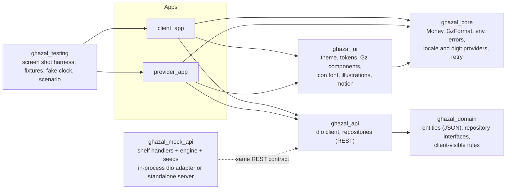

# Flutter build plan: the two apps, a contract-first mock API, and a measured parity loop

Status: accepted 2026-10-20 (ADR 0036). Living document: the ledger at the end (and `docs/engineering/flutter-status.md`) is updated at every gate.
Inputs: the web prototype in `design/` (the specification), ADR 0021-0025 (layout, Flutter architecture, tokens, handoff, testing), ADR 0033/0035 (voucher model and owner round 1), `docs/product/screens/**` (the 140-screen inventory, 135 live), `packages/contracts` (fixtures and the TypeScript engine, the executable spec of pricing, availability and booking transitions).

## 1. Outcome and acceptance criteria

Two Flutter apps, Arabic (RTL) and English (LTR), iOS 15+ and Android 8+ (minSdk 26), built from the prototype:

| App | Directory | Bundle id | Users | Screens (inventory prefix) |
|---|---|---|---|---|
| Client | `apps/client_app` | `com.ghazal.client` | couples and families | `CL-*` |
| Provider (Partner) | `apps/provider_app` | `com.ghazal.provider` | hotels, halls and service providers | `HL-*` |

They are done when ALL of these hold (each is checked by a tool, not by opinion):

1. **Coverage.** Every live inventory screen exists as a Flutter widget, is reachable by navigation from the app start (BFS over the inventory `navigatesTo` graph and the router), and every exported state (loading, empty, error, offline, success...) is reachable through the scenario switch.
2. **Proportion parity.** At 390x844 (and checked at 360 and 430) every screen matches the prototype render: pixel-difference ratio below the threshold in section 6, then looked at by a reviewer in both languages. Same tokens, same px, same fonts, same icons, same illustrations.
3. **Motion parity.** The motion list in section 7 behaves as in the prototype: same durations and curves from tokens, direction-aware in RTL, reduced motion honoured, no dropped frames in the profile run on the simulator and none of the banned patterns (layer-heavy opacity, backdrop filters).
4. **Zero runtime errors.** The route sweep (all screens x {ar, en} x {360, 390, 430} x {default, stress fixtures} x declared states) finishes with no exceptions, no RenderFlex overflow, no failed asset or image load, no missing localisation key (compile time), and no blank screens (a pixel-variance and semantics-count check fails any screen that renders as background only or skeleton only after settling).
5. **Flows.** One scripted journey per app runs against the in-process mock without a manual step (headless during the build; on the iOS simulator ONLY at the very end, F4): client (guest, onboarding, search, venue, voucher purchase, request, approval, confirm, wallet, visit chat, services) and provider (sign in by email, today, accept, redeem, visit chat, listing and review status).
6. **Contract-first mock.** The apps talk REST+JSON to a mock that implements `packages/contracts/openapi/ghazal.v1.yaml`. Switching to the real NestJS backend changes only `API_BASE_URL` and `USE_MOCK=false`; no screen, provider or repository changes.

## 2. Architecture (decisions: ADR 0022 as amended by ADR 0036)

- **Workspace.** Dart pub workspace at the repo root (`pubspec.yaml` with `workspace:`), one `pubspec.lock`. The dependency list is frozen at scaffold (agents never run `pub add`; they ask through `docs/engineering/requests.md`).
- **Layering per app** (ADR 0022 B): `lib/{main,bootstrap}.dart`, `lib/app/{app,router,theme}`, `lib/features/<flow>/{presentation,application,<flow>_routes.dart}`. State: Riverpod 3 hand-written `Notifier`/`AsyncNotifier` (no codegen in apps). Routing: go_router 18, one `<flow>_routes.dart` per inventory flow, tabs with `StatefulShellRoute.indexedStack`, route paths mapped from inventory ids by a generated table.
- **Only `ghazal_ui` imports `material_ui`/`cupertino_ui`.** Apps import `ghazal_ui` and `flutter/widgets.dart`. This keeps Material out of the product look and makes a future framework-split migration a one-package change. `GzApp` wraps the app host.
- **Naming.** React component `Foo` becomes `GzFoo`; anatomy keys `ValueKey('gz:<screenId>.<part>')`; ids stay the inventory ids.
- **Icons.** A generated icon font (fantasticon) from `packages/design-tokens/icons/*.svg` with a `GzIcons` codepoint class and the mirror-in-RTL flags (`phosphor_flutter` does not compile on Flutter 3.47.5: probe 2026-10-20).
- **Illustrations.** The 39 spots and 21 compositions are exported once from the React components to static SVG (token colours resolved) and rendered by `flutter_svg`; directional ones flip in RTL.
- **Fonts.** El Messiri, Manrope, Almarai TTFs bundled in `ghazal_ui` (static files, no `google_fonts`).
- **Strings.** `packages/i18n/messages/*` is the single source. A script merges them into per-app ARB files and `gen_l10n` produces typed `AppL10n` (a missing key is a compile error, never a runtime blank). `ghazal_ui` has its own `GzL10n` for component-owned words.
- **Money and dates.** `Money(fils)`, `GzFormat` (ADR 0010/0011), Western digits, Sunday-first calendar, Asia/Kuwait fixed offset, shared golden cases with the TypeScript package.
- **Images.** Mock mode bundles 480/960 px variants of the 199 curated photos; the API returns image descriptors (`id`, `aspect`, `baseUrl`), resolved to asset or network by one `GzImage`.

## 3. The mock API (what makes the backend easy)

1. **Contract first.** `packages/contracts/openapi/ghazal.v1.yaml` (OpenAPI 3.1) is written before any client or mock code, from `docs/architecture/api-conventions.md` section 9 (endpoint catalogue), the 75 TypeScript selectors (reads), the screen inventory interactions (writes) and the booking/voucher transitions. Errors are RFC 9457 problem+json with the stable codes of api-conventions section 5; lists are cursor-paginated; money is integer fils; every mutating POST takes an `Idempotency-Key`.
2. **Models.** Immutable, JSON-serialisable Dart models in `ghazal_domain`, generated from the OpenAPI schemas by a script (no build_runner in the apps), with copyWith and value equality.
3. **Client.** `ghazal_api`: one `dio` client, interceptors (auth/refresh, locale header, idempotency, global retry policy of ADR 0022 C, problem+json to `ApiProblem`), and repository implementations of the interfaces in `ghazal_domain`.
4. **Mock server.** `ghazal_mock_api`: a `shelf` router with handlers over an in-memory database seeded from the same fixtures as the prototype (exported by a script from `packages/contracts`, including the engine-derived availability and prices). The pricing engine, availability, voucher lifecycle and the booking transitions (R01-R14 in `docs/architecture/booking-state-machine.md`) are ported to pure Dart and proven equal to the TypeScript engine by shared case files. Two hosting modes with the same code: **in-process** (a dio adapter calls the shelf handler directly; zero setup, runs on device and simulator) and **standalone** (`dart run ghazal_mock_api:serve` on a reserved port so both apps share state and the client-to-partner story propagates).
5. **Scenarios and clock.** Request headers `X-Mock-Latency`, `X-Mock-Scenario` (`slow`, `error`, `offline`, `empty`, `expired`) and a controllable clock (default: the prototype's fixed `2026-11-12T16:00+03:00` so countdowns match the design). A dev-only **Demo tools** sheet resets data, switches persona (guest, new client, Reem, hotel manager, provider), forces error/offline/empty and jumps to story points. Tests use the same switches.
6. **Backend handoff.** `docs/architecture/backend-handoff.md` maps OpenAPI tags to NestJS modules, lists which rules the mock implements (the Dart handlers are the readable executable spec), and what is deliberately faked (OTP, payment gateway, push, media upload, support staffing).

## 4. Phases, workstreams and gates

| Phase | Work (owner agent) | Output | Gate (checked by me, with commands) |
|---|---|---|---|
| F0 Scaffold | workspace, packages, both apps, tooling, frozen dependencies, route stubs for all inventory screens, reference shots of the prototype | `flutter analyze` clean; the headless shot harness renders a stub per route; `pnpm parity:ref` produced 270 reference PNGs | `pnpm flutter:verify`; one harness PNG of each app read by me |
| F1a UI foundation | theme from tokens, motion constants, fonts, icon font, illustration export + `GzIllustration`, base primitives | a smoke screen in AR and EN rendering fonts, icons and an illustration correctly | token-to-theme tests; screenshot read |
| F1b Core + l10n | Money, GzFormat, digit style, locale, env, errors, retry; ARB merge + gen_l10n for both apps and `GzL10n` | Dart ports of the golden format cases; l10n parity script | `flutter test packages/ghazal_core`; `pnpm i18n:check` equivalent for ARB |
| F1c API + mock | OpenAPI, models, client, repositories, mock server, engine port, seeds, contract tests | the mock serves every operation; engine equals TypeScript on shared cases; both hosting modes run | contract and engine tests; `curl` against standalone mode |
| F2 Components | port `design/src/system/*` to `ghazal_ui` by group (core, inputs and calendar, navigation and overlays and motion, client domain, voucher/visits/filters, hotel and provider domain, charts), plus a gallery app mirroring the React galleries | every component with states, in AR and EN; gallery screenshots vs React gallery | gallery parity montages reviewed; widget tests for press, sheet drag, calendar, thread |
| F3 Screens | one agent per inventory flow (26): screens, providers, routes, states, one flow test each | all 135 screens implemented | per flow: shot + parity metric + flow test; then the full route sweep |
| F4 Integrate | route sweep, navigation reachability, fix passes, docs, commit, and ONLY THEN the simulator: iOS build, journeys, spot screenshots; Android analyze/compile check | acceptance criteria 1-6 all green | the criteria in section 1 |

Each phase ends with my own verification run (commands above), a spot-look at screenshots, an update of the ledger, and a commit. Nothing starts the next phase on a red gate.

## 5. Parallelism and safety rules for agents

- **Ownership.** A flow agent edits only `apps/<app>/lib/features/<flow>/**`, its tests, and its ARB inputs under `packages/i18n/messages/**/<app>-<flow>.json` (strings can change only to fix a Flutter-only need; the prototype stays the source). Shared packages and `lib/app/**` are single-writer (the package owners and the integrator). Needs go to `docs/engineering/requests.md`.
- **Frozen at scaffold:** dependencies, route table, the `app_router.dart` composition, feature folder skeletons, l10n generation config.
- **Test and shot concurrency.** `flutter test` and the shot harness run through `tools/with-slot.mjs` (a counting semaphore, 4 concurrent), never directly in parallel. One simulator at a time (lock).
- **No codegen in apps.** No freezed, json_serializable or build_runner in apps. Generated code lives only in `ghazal_domain` models, ARB output and the icon/illustration/token generators, and is committed.
- **Guardrails** (`tools/check-dart-rules.sh`): banned `flutter/material.dart` and `flutter/cupertino.dart` outside `ghazal_ui` internals; no `Color(0x`/`Colors.` outside generated tokens; no physical `left/right` (`EdgeInsets.only(left`, `Alignment.centerLeft`, `Positioned(left`, `TextAlign.left`); no string literals in `Text(`; no `letterSpacing` on Arabic styles; no `Opacity`/`BackdropFilter`/`ImageFiltered` on large subtrees; no cross-feature imports.

## 6. The parity loop (how proportions are proven)

1. `pnpm parity:ref` renders every live screen of the prototype with the shots tool (390x844, scale 2, `ar` and `en`, default state, reduced motion) into `design/.shots/ref/<id>.<lang>.png`.
2. `pnpm fshot --app client --screen CL-DISC-01 --lang ar [--state loading] [--w 360]` runs a `flutter test` harness in `ghazal_testing` that loads the real fonts, sets a 390x844 logical size at DPR 2 with the prototype's safe areas (47 top, 34 bottom) and a fake status bar and home indicator identical to the prototype's device chrome, plugs the in-process mock with zero latency and a fixed clock, pumps to settle, and writes `apps/<app>/build/shots/<id>.<lang>.png`.
3. `tools/parity/parity.mjs` (ImageMagick) composes `reference | flutter | difference` into one PNG and prints a normalised difference score for the area between the safe areas. The author Reads the composite for Arabic and English and fixes until the score is under **0.06** (text anti-aliasing differences are expected) and no visible geometry delta remains.
4. A flow agent runs the flow in one invocation (`--flow booking`), reviews the composites, and records the scores in the ledger.
5. **No simulator during the build (owner instruction 2026-10-20).** Phases F0 to F3 and the fix passes verify only with `flutter analyze`, `flutter test` and the headless shot harness (it also renders at 360 and 430 to prove fluid layouts). The iOS simulator is used once, at the end of F4, after everything else is green: build both apps, run the journeys, take spot screenshots on the iPhone 17e (390x844) and iPhone 17 (402x874).

## 7. Motion list (must match; tokens 120/200/320/480 ms, curves from `packages/design-tokens`)

Press feedback (scale .985 + tone step), segmented and tab thread sliding (direction follows RTL), bottom sheet rise 320 (emphasised) with drag-to-dismiss and spring settle, dialog and toast enter/exit, direction-aware page push/pop (24% travel + fade; flips in RTL; iOS interactive back swipe kept), shared-element image expansion (card to gallery), image reveal (opacity + 3.5% settle), skeleton shimmer to content, Booking Thread line draw-on (480) and knot pop (0.6 to 1.4 to 1), countdown ring and hourglass states, success draw, calendar range selection with thread, favourite toggle, compare tray insertion, chart draw/grow once. Reduced motion removes transforms/draws and keeps 120 ms opacity cross-fades. Performance rules: `const` widgets, `RepaintBoundary` around cards and list items, builder slivers, fixed-aspect image boxes with `cacheWidth`, no `Opacity` on subtrees (alpha colours instead), no `BackdropFilter`.

## 8. Risks and mitigations

| Risk | Mitigation |
|---|---|
| `phosphor_flutter` fails on Flutter 3.47.5 (verified) | own icon font from the SVG set |
| `material_ui`/`cupertino_ui` are new standalone packages | probe built and ran on the simulator; imports confined to `ghazal_ui`; fallback is a one-package switch to the framework libraries |
| Flutter text vs browser text differ by sub-pixel | parity by pixel ratio + visual review, not equality |
| 26 agents touching one workspace | frozen deps and route table, per-flow folders, semaphore on test runs |
| Usage limits cut runs | every phase is resumable: scaffolds are idempotent, the ledger lists done work, agents are told to finish partial files |
| Android licences not accepted on this Mac | owner runs `flutter doctor --android-licenses`; until then Android is checked with `flutter analyze` only |
| Image weight in the bundle | 480/960 variants only (about 30 MB), originals never bundled |
| Debug-mode simulator is not a performance proxy (and is deferred to the end) | code-level rules above, harness frame-count checks, and a profile run on a real device before release |

## 9. Ledger

See `docs/engineering/flutter-status.md` (kept current by the integrator at every gate).
