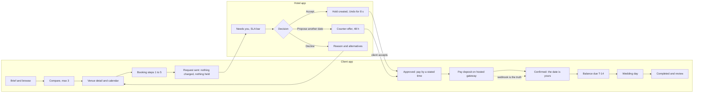
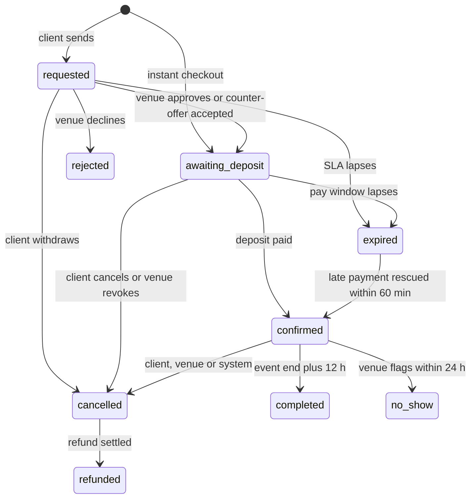
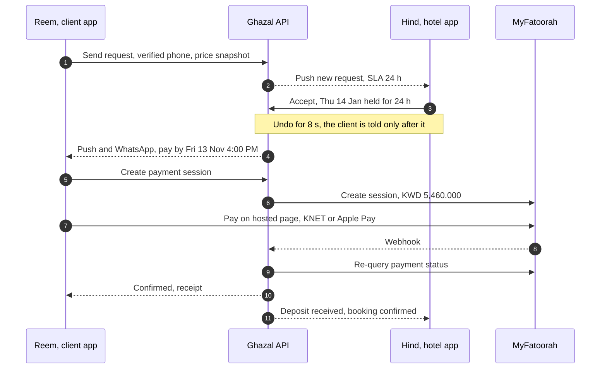

# Ghazal — Journeys

> **Business model changed 2026-10-14 (ADR 0033, [`voucher-model.md`](voucher-model.md)).** Ghazal now sells only a KD 2 voucher; venues, halls and service providers sell and collect everything else. Anything in this file about deposits, balances, commission, payouts, cash, instant booking, cancellation tiers or the nine booking statuses is superseded; the screen inventory JSON and the architecture docs are already rewritten.

> End-to-end journeys for the shared seed story, traced to screen IDs (`screen-inventory.md`), requirement IDs (`feature-matrix.json`) and ADRs. NOW = **Thu 12 Nov 2026, 4:00 PM, Asia/Kuwait** in both apps. Times are shown the way the apps show them: absolute, 12-hour, Kuwait time (ADR 0011).
> Money values follow the placeholder rules in ADR 0004-0006 (deposit 30%, balance 14 days before, Standard cancellation policy); the owner has not signed them off (OQ-B-03, OQ-B-05).
> Emotion scale: -2 anxious, -1 uneasy, 0 neutral, +1 reassured, +2 delighted.

## 1. The lifecycle in one picture

Status path under it (nine internal statuses, ADR 0003; PRD six in the glossary):

## 2. J1 — Reem: from Brief to a confirmed date (client app)

| # | When | Screens | What Reem does and sees | Feel | Rules that make it work |
|---|---|---|---|---|---|
| 1 | First launch | `CL-ONBD-01..06` | Picks Arabic; "Who is planning?" (Bride); wedding date Thu 14 Jan 2027; 350 guests; venue-and-catering budget band KD 20,000-35,000; areas Salmiya and Sharq. Every answer is skippable. | +1 | Brief stored locally for a guest, merged on sign-in (ADR 0007 D10). Budget is labelled `ميزانية القاعة والضيافة`, never "wedding budget" (ADR 0012 D9). |
| 2 | Earlier that week, evenings | `CL-DISC-01`, `CL-DISC-03`, `CL-DISC-04` | Home greets once (`أهلاً وسهلاً، ريم`), shows her Brief as an editable card and the lead shelf "Free on Thu 14 Jan". Results carry "KD 18,200 for 350 guests · Thu 14 Jan · Free". | 0 to +1 | Date-aware, guest-aware prices (ADR 0004 D6); no empty availability promise when no date is set. CTA "Show 38 halls" style live count. |
| 3 | Same evenings | `CL-SAVD-01`, `CL-SAVD-02`, `CL-SAVD-04` | Saves five halls and adds three to Compare: Aurelia (KD 18,200), Lumi Marina (KD 13,300), Jawharat Al-Salmiya (KD 11,550, on hold). Differences-only is on. | +1 | Tray appears only after the first add; fourth add asks "Replace which one?" (ADR 0009). Sign-up nudge once after the third heart. |
| 4 | Wed 11 Nov, evening | `CL-VENU-01`, `CL-VENU-03`, `CL-VENU-05` | Opens Aurelia: gallery of empty rooms, "Your date" strip, packages, per-section policy facts, cancellation summary. Calendar shows Thu-Sat peak band at the inline-end edge. | +1 | Price view shows whole KWD per day with tier glyphs (ADR 0004 D7); Hijri only as a muted line in Arabic summaries (ADR 0011). |
| 5 | Thu 12 Nov, about 12:30 PM | `CL-BOOK-01..04`, `CL-AUTH-01..02` | Steps 1-3 as a guest (Danah Ballroom, ladies, weekend package, no extras). Before step 4 the account sheet appears; she continues with a WhatsApp code and lands on the same step. Verifies phone inline. | -1 (form fatigue) | Guest gate before personal data, exact resume (ADR 0007 D8-D9). Hall and session pickers are hidden because Danah is exclusive-day and single-session; the 'What are you hosting?' audience chips stay visible because Aurelia sells ladies and men (ADR 0002 D5). |
| 6 | 12:40 PM | `CL-BOOK-05` | Review shows 350 × KD 52 = **KD 18,200.000**; schedule Today / On approval / Balance due Thu 31 Dec 2026 / Free cancellation until Sun 15 Nov 2026; consent line; CTA **Send request**. | +1 | One screen states how much, when and what if plans change; no fee after Review (ADR 0001 D13, 0005). |
| 7 | 12:40 PM onward | `CL-BOOK-06`, `CL-BKNG-02` (pending) | "Request sent. Nothing is charged and nothing is held yet." Expected reply by **Fri 13 Nov, 12:40 PM**; Booking Thread shows Request done, Approval waiting; Message venue; planner offer shown once. | -1 (silent wait) | The most important screen nobody screenshots (ADR 0001 D5, D7). No ticking timer while Pending. |
| 8 | 3:12 PM | `CL-MSGS-02` | Asks the hotel in chat: "is Thursday 14 January free for the ladies' reception, about 350 guests?" | 0 | Chat is hard-gated; requires the real-time service (PL-CORE-01, MVP Phase 2). |
| 9 | 4:00 PM (demo) | push, `CL-BKNG-02` (approved) | Hind accepts. After 8 seconds Reem gets push and WhatsApp: "Approved. Pay the deposit by **Fri 13 Nov, 4:00 PM**." Detail says the date is **held**, not secured. | +1, then -1 (clock) | Approval creates the hold and pay window; wording follows ADR 0003 (held until the deposit lands). Reminders at -12 h and -3 h (WhatsApp) and -1 h; live countdown only in the last 60 minutes. |
| 10 | Before 4:00 PM Fri | `CL-PAYM-01..03` | Pays KD **5,460.000** with Apple Pay or KNET on the hosted page; app shows "Confirming with your bank" and polls up to 30 s. | -1 to +2 | Webhook plus re-query is the truth; return URL is never trusted; "No need to pay again" (ADR 0027 D2-D3). |
| 11 | Confirmation | `CL-PAYM-05` | One celebratory line: `مبروك مقدمًا، تم تأكيد حجزكم.` Receipt, add to calendar, directions; the checklist "Venue" item ticks; My Wedding becomes the launch tab with the countdown hero. | +2 | Success moment 640 ms, one per flow, no confetti (ADR 0017 D5). The 48h cooling-off window starts (ADR 0006 D2). |
| 12 | Nov to Jan | `CL-WEDD-01..03`, `CL-BKNG-02` | Next up: balance KD **12,740.000** by Thu 31 Dec 2026; update guest count before the lock on Thu 7 Jan 2027. Reminders T-21 (Thu 24 Dec), T-14 (due), D+1, D+2. Countdown milestones at 30 days (Tue 15 Dec), 7 days, tomorrow, today. | +1 | Marketing is silent in the final 7 days (ADR 0007 D11). Planner offer lives only in My Wedding after the first showing. |
| 13 | Thu 14 Jan, 9:00 PM | `CL-WEDD-01` (day-of) | Hero becomes Directions, Call venue, Message planner. | +2 / stress | "Call venue" shows only when the venue has shared its number; Chat is always available (`CL-BKNG-02`). |
| 14 | Sat 16 Jan morning | `CL-RVRW-02` | "How was Aurelia Gulf Hotel?" Event ends Fri 15 Jan, 2:00 AM; booking completes at end + 12 h; "Report an issue" open for 72 h. | +2 | Reviews: booking owner, completed, one per booking; photos of venue, decor and food only, never people (ADR 0015 D7; OQ-B-25). |

Reem also has a second request: Lumi Marina Hotel, Thu 14 Jan, 300 guests, KD 11,400.000, which **expired** because the venue did not reply (`CL-BKNG-01`, E4 below). Nothing was charged. Open unpaid bookings are capped at 3 per wedding file (ADR 0001 D6, OQ-B-24).

## 3. J2 — Umm Reem opens a WhatsApp link (guest-first)

| # | Step | Screens | Design response |
|---|---|---|---|
| 1 | Reem shares the comparison to the family group (OS share sheet, universal link `/compare?ids=a,b,c` plus preview image; Share is flagged OQ-B-12). | `CL-SAVD-04` | Share text carries Arabic name, area, "From" price with basis, link; no emoji (ADR 0012 D10). |
| 2 | Umm Reem opens it as a guest, Arabic only, text scaled to 150%. | `CL-SAVD-04` | Three fluid columns, label above value, no horizontal scroll; a cell is at most 12 Arabic characters (ADR 0009 D4, D7). |
| 3 | Taps Aurelia and reads facility rows and the ladies' hall facts: female photographers only, abaya cloakroom, separate entrance, valet. | `CL-VENU-01`, `CL-VENU-05` | Plain Included / Extra / Not offered; per-section policy facts, no moralising wording (ADR 0015 D6). |
| 4 | Says yes and tells Reem. She never creates an account. | none | Nothing in the product asks her to. |
| 5 | Wants to pay from her own card. | `CL-BKNG-02` | Not designed: a dedicated payer link (OQ-B-24). Working assumption: the booker forwards the pay-by link. What a non-account holder can do with it is unresolved. |

## 4. J3 — Hind's Thursday at Aurelia (hotel app)

Today's requests arrive through the day; at 4:00 PM Hind opens the app and Today is already the inbox (`HL-TODY-01`).

| When | Event | Screens | What Hind sees or does |
|---|---|---|---|
| Wed 11 Nov, 7:00 PM | Dana Al-Shammari: ladies, Sun 17 Jan, 250 guests, KD 11,500.000 | `HL-TODY-02` | Deadline Thu 7:00 PM: **3h left, danger state with text** (ranked first). |
| Thu 7:00 AM | Abdullah Al-Hajri: full night Fri 5 Feb (ladies + men), KD 34,160.000 | `HL-BOOK-01` | 15h left. |
| Thu 9:00 AM | Maryam Al-Kandari: ladies, Thu 28 Jan, 300 guests, KD 15,600.000 | `HL-BOOK-01` | 17h left. |
| Thu 10:20 AM | Huda Al-Shaya cancels her booking for Fri 20 Nov | `HL-TODY-03`, `HL-BOOK-03` | "Date is free again. Create an offer?" |
| Thu 11:00 AM | Faisal Al-Rasheedi: men, Fri 22 Jan, 400 guests, KD 12,800.000 | `HL-BOOK-01` | 19h left. |
| Thu 12:40 PM | **Reem Al-Dosari**: ladies, Thu 14 Jan, 350 guests, KD 18,200.000 | `HL-TODY-03` | New-request alert with its own sound; 20h 40m left; no competing request in the base seed. |
| Thu 3:12 PM | Reem messages | `HL-TODY-04..05` | Unanswered over 30 minutes: enters Needs-you. |
| **4:00 PM (NOW)** | Hind opens Today | `HL-TODY-01` | "5 requests need your reply, first in 3h"; two Needs-you cards expanded, "See all 9"; tonight's events; 14-day strip; money tiles only if a commission rule exists. |
| First, by deadline | Dana's request | `HL-DCSN-03` | Seed example for **Propose another date**: Sun 17 Jan at KD 11,500.000; Thu 21 Jan would re-quote KD 13,000.000 and the venue may hold the old price. |
| Then | Accept Reem (2 taps; 3 only in the `simulateCompeting` variant, where a competing request exists) | `HL-DCSN-01` | Open the card, Accept; in the base seed there is no sheet. Variant sheet: "This holds Thu 14 Jan for Reem for 24h. 1 other request will wait." Toast "Accepted - Undo" with an 8-second bar; the client hears only after it. Payout verification must be approved or the sheet says "Payout setup needed before approving". |
| Then | Reply in chat | `HL-TODY-05` | Context bar pinned (ladies, Thu 14 Jan, 350 guests, status, time left); quick reply. |
| Later | Sell an open weekend date | `HL-CALN-01`, `HL-CALN-04`, `HL-GROW-02..03` | Block a phone sale in 3 taps ("Hidden from couples now - Undo"); or turn soft dates into a quick flash offer (-15%, 24 h) with a live preview of the client card. |
| 8:30 and 9:00 PM | Majlis Hall men's reception (Salman Al-Harbi, 310) and Danah Ballroom ladies' reception (Najla Al-Badr, 420 × 52 = KD 21,840.000), both paid in full | `HL-TODY-01`, `HL-CALN-03` | Event cards; Day view shows setup, event, teardown per hall. |

Also at risk today: **Munira Al-Khaled**, ladies, Sat 21 Nov, balance KD 12,010.000 overdue 5 days, event in 9 days (D+3 grace passed, so the venue decides: E12).

## 5. One booking, two screens: state pairs

Every venue action has a visible client counterpart (ADR 0003 D5, ADR 0001). Chips always carry an icon and a label.

| Status | Client chip (EN / AR) | Hotel chip (EN / AR) | Client can | Hotel can | Money |
|---|---|---|---|---|---|
| `requested` | Pending / بانتظار الرد | Pending / بانتظار الرد | Edit, withdraw (free), message, call if shared | Accept, Propose another date, Decline | none |
| `awaiting_deposit` | Approved - deposit due / تمت الموافقة · بانتظار العربون | same | Pay, cancel (no fee), message | Call, chat, revoke with reason | none |
| `confirmed` | Confirmed / مؤكد | Confirmed / مؤكد | Pay balance, reschedule, amend, cancel with refund preview, invoice | Record cash on balance, reschedule or cancel (Admin, Manager), invoice | deposit in gateway |
| `rejected` | Not accepted / لم يُقبل الطلب | Declined / تم الاعتذار | See reason category and 3 free alternatives | read-only | none |
| `expired` | Expired / انتهت المهلة | Missed / انتهت مهلة الرد (venue silence) or Expired / انتهت المهلة † (client did not pay) | "Send to similar venues" | none | none (late payment: auto-refund) |
| `cancelled` | Cancelled by me / venue / Ghazal / ملغي | Cancelled / ملغي | Refund tracker | "Date is free again. Create an offer?" | refund payable |
| `refunded` | Refunded / تم الاسترداد | Refunded / تم الاسترداد | Refund details, credit note | read-only | refunded |
| `completed` | Completed / مكتمل | Completed / مكتمل | Review prompt, report an issue for 72 h | Reply to review, payout date | settled |
| `no_show` (P2) | No-show / عدم حضور | No-show / عدم حضور | Contest for 72 h | Flag within 24 h | payout held |

## 6. Edge journeys

| ID | Trigger | Client sees | Venue sees | Money | Screens | Source |
|---|---|---|---|---|---|---|
| E1 | Date taken during checkout | Sheet: "Thu 14 Jan is no longer available at Aurelia Gulf Hotel. Nothing was charged." plus Thu 21, Fri 22, Sat 23 Jan and similar halls free that day | nothing | none | `CL-BOOK-07`, `CL-VENU-03` | ADR 0001 D4, D8 |
| E2 | Venue declines | Not accepted, a gentle reason, 3 alternatives free on the date | Declined in Past | none | `HL-DCSN-02`, `CL-BKNG-02` | ADR 0003 T04, 0008 D7 |
| E3 | Venue proposes another date | One card "Venue proposed another date", reply within 48 h (counter-offer) or 72 h (reschedule), "No penalty if you decline" | Awaiting client response | none; reschedule decline = 100% refund | `HL-DCSN-03`, `CL-BKNG-04` | ADR 0001 D9, 0006 D6 |
| E4 | Venue silent, SLA lapses (24 h; 4 h when the event is 14 days away or less) | Expired, nothing charged, "Send to similar venues" | Missed in Past; escalation at 50% (push) and 80% (WhatsApp) | none | `CL-BKNG-01..02`, `HL-BOOK-02` | ADR 0001 D6, 0003 T06 |
| E5 | Approved, deposit not paid in window (24 h; 6 h when 14 days away or less) | Reminders at -12 h and -3 h (WhatsApp), -1 h; countdown only in the last 60 minutes; then Expired | Hatched hold releases | none | `CL-BKNG-02`, `HL-CALN-01` | ADR 0001 D6-D7, 0003 T09 |
| E6 | Two couples ask for Thu 14 Jan | Second request stays pending with chip "Date held by another couple", no counts; if the holder pays, it expires (slot_taken) with an alternatives push | "+1 other request for this date" (appears only when a second request exists; not in the base seed), count only, never identities | none | `CL-BOOK-06`, `HL-BOOK-03` | ADR 0001 D8 |
| E7 | KNET declined or over the bank's daily limit | "The payment could not be completed. No amount was charged." After the first KNET failure the list recommends Apple Pay or a card | nothing | none | `CL-PAYM-04` | ADR 0005 D7 |
| E8 | Pending bank confirmation | "Confirming with your bank", poll up to 30 s, then "You can leave; we will notify you" | nothing | in flight | `CL-PAYM-03` | ADR 0027 D2 |
| E9 | Payment arrives after the hold lapsed | Slot free within 60 min: confirmed. Otherwise "We are refunding KD 5,460.000 in full, with no fees to you" and alternatives | Booking or nothing | 100% auto-refund, platform bears fees | `CL-PAYM-04` | ADR 0001 D11, 0003 T08b |
| E10 | Client cancels after paying | Cooling-off (48 h, event 30 days or more away): 100% back. Mon 16 Nov: "You will get back KD 910.000; the venue keeps KD 4,550.000 (25%)". IBAN step only if the original method cannot refund | Cancelled by client; "Date is free again. Create an offer?" | refund per policy, within 1 business day to gateway | `CL-BKNG-03` | ADR 0006 D2-D5 |
| E11 | Venue cancels a confirmed booking | Full refund, rebooking help from Support | Admin or Manager only; consequence first (client refunded 100%, venue bears gateway fee, reliability strike) | 100% refund | `HL-DCSN-04` | ADR 0006 D4, D10; OQ-B-18 |
| E12 | Balance overdue | Reminders T-21, T-14, D+1, D+2 | Today "at risk"; venue decides after the D+3 grace; no auto-cancel | tier at cancel date | `HL-TODY-02`, `HL-DCSN-04` | ADR 0005 D2 |
| E13 | Instant booking (Wasl Convention and Wedding Centre) | CTA "Pay deposit KD 3,255.000", 10-minute hold, straight to payment; under 30 days away it silently becomes a request | "New booking"; cannot decline, may cancel under policy | deposit at once | `CL-BOOK-05`, `CL-PAYM-01` | ADR 0001 D3 |
| E14 | "Both" rooms | One booking, two sections (Danah ladies 350 × 52, Majlis men 400 × 32), total KD 31,000.000; approval, payment and cancellation are atomic | Whole-booking accept, counter or decline | one schedule | `CL-BOOK-01..05` | ADR 0002 D6 |
| E15 | Government hall | Fee guide (about KD 100 rental, venue only), "Book via official channel"; no checkout, no instant, no reviews; optional "I booked this hall" | none | none | `CL-VENU-06` | ADR 0002 D10 |
| E16 | No signal in a ballroom | Browse cached with "Updated {time}"; send, pay, cancel disabled in place | Accept, Decline, Propose, Block, Cancel disabled: "Offline. Reconnect to accept."; chat queues | none | all send actions | ADR 0008 D10 |
| E17 | Guest hits a commit moment | Account sheet with a context line; WhatsApp code; exact resume; hearts and Compare merge | n/a | none | `CL-AUTH-01..02` | ADR 0007 D8-D10 |
| E18 | Delete account with a future booking | Blocked, never a dead end: "Cancel under the policy, or request deletion after {event date}", Support link | n/a | ledger kept, PII anonymised | `CL-PROF-06` | ADR 0007 D12 |
| E19 | Authority order (P2) | Free reschedule or 100% refund, no fee | bulk "propose new dates" (P2) | 100% refund option | not designed in this pass | ADR 0006 D7; OQ-B-23 |

## 7. Moments that matter (design these first)

1. **Pending** (`CL-BOOK-06`, `CL-BKNG-02`): the valley of the client journey. 2. **Confirming with your bank** (`CL-PAYM-03`). 3. **Date unavailable, never a dead end** (`CL-BOOK-07`). 4. **Needs you, then Accept with Undo** (`HL-TODY-01`, `HL-DCSN-01`). 5. **Block a date in 3 taps** (`HL-CALN-04`). 6. **Compare at 390 px** (`CL-SAVD-04`). 7. **The Booking Thread**, identical in `CL-BKNG-02` and `HL-BOOK-03`. 8. **Wedding week and day-of** (`CL-WEDD-01`).

## 8. Tap budgets

| Client task | Taps | Hotel task | Taps |
|---|---|---|---|
| Is it free on my date | 0-1 | Morning glance | 0 |
| Compare two venues | 3 | Accept a request | 2 from push or Needs-you row (3 with the confirm sheet) |
| Check booking status | 1-2 | Decline with reason | 3 |
| Pay the balance | 1 from push, 3 in-app | Block a date | 3 or fewer |
| Message a venue | 2 | Publish a quick flash offer | 3-4 |
| Change language | 3 (ADR 0007 D7; the index and CL-PROF-01 now say 3) | Answer a chat | 3 |
| Delete account | 3 | Review revenue / open analytics | 1 / 2 |
| Request a booking (Brief prefilled) | about 8 | Edit a package price | 4 |

## 9. Notification landings (stack rebuilt: tab root, parent, target; ADR 0007 D11, ADR 0008 D13)

| Client trigger | Lands on | Hotel trigger | Lands on |
|---|---|---|---|
| Approved | `CL-BKNG-02` scrolled to Pay with the pay-by time | New request | `HL-BOOK-03` (Pending) with the sticky Accept / Decline bar |
| Rejected or expired | `CL-BKNG-02` with the alternatives rail | SLA at 50% and 80% | same |
| Venue proposed another date | `CL-BKNG-02` with `CL-BKNG-04` open | Cancelled by client | `HL-BOOK-03`: "Date is free again. Create an offer?" |
| Payment confirmed or failed | receipt or the pay sheet | Payment received | `HL-BOOK-03` payments |
| Balance due | pay balance | Balance overdue | `HL-BOOK-03` with "Nudge client" |
| Message | thread at last unread | New message | thread with the booking context bar |
| Offer or price drop on a saved venue | `CL-VENU-01` with the Brief date applied | New review | `HL-GROW-06` with Reply |
| Countdown milestone | `CL-WEDD-01` hero | Account status change | `HL-ACCS-04` |

Transactional notifications always deliver. Marketing is opt-in, at most 2 a week, none in the final 7 days before the wedding. Two quiet-hour windows are specified: marketing 22:00-09:00 (ADR 0007 D11) and silent push for all notifications 23:00-08:00 with no marketing push on Fridays 11:30-13:00 and marketing after Maghrib in Ramadan (ADR 0015 D8). They only coexist if read as two layers; to be stated once and confirmed (OQ-L-15).

† Inferred from the client chip; the hotel inventory lists only "Missed" for expiry.
