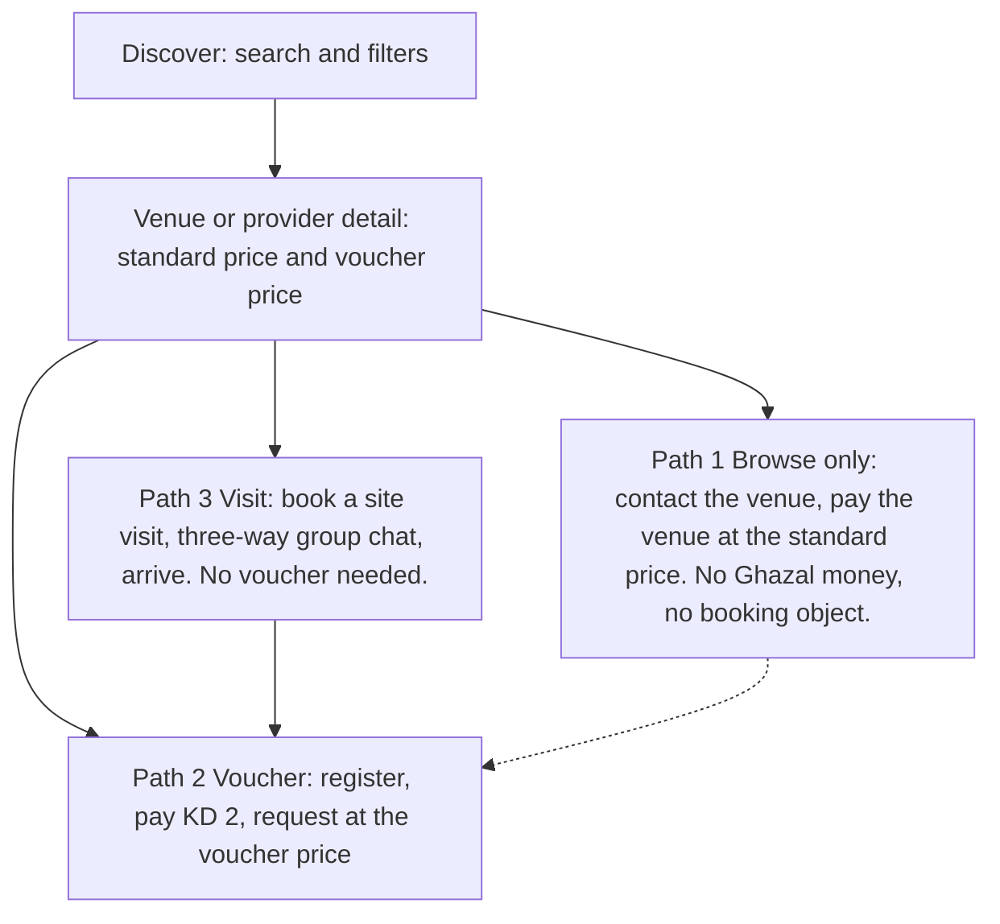
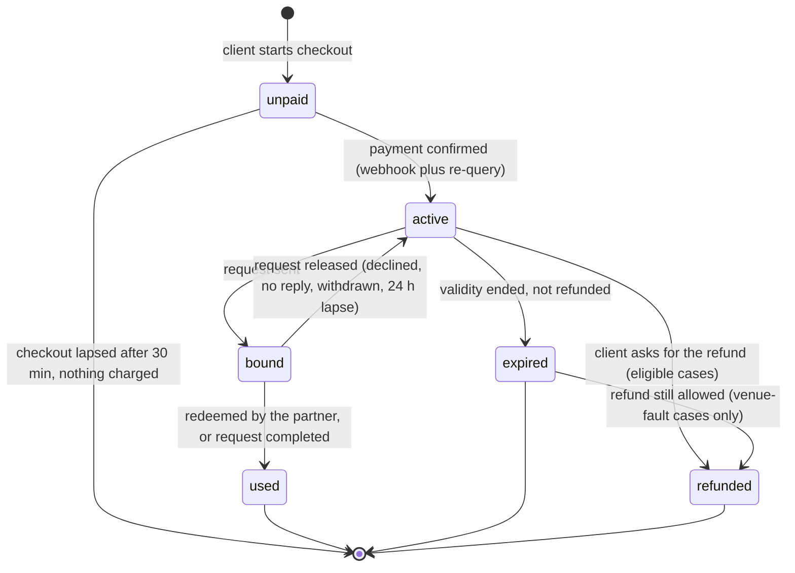
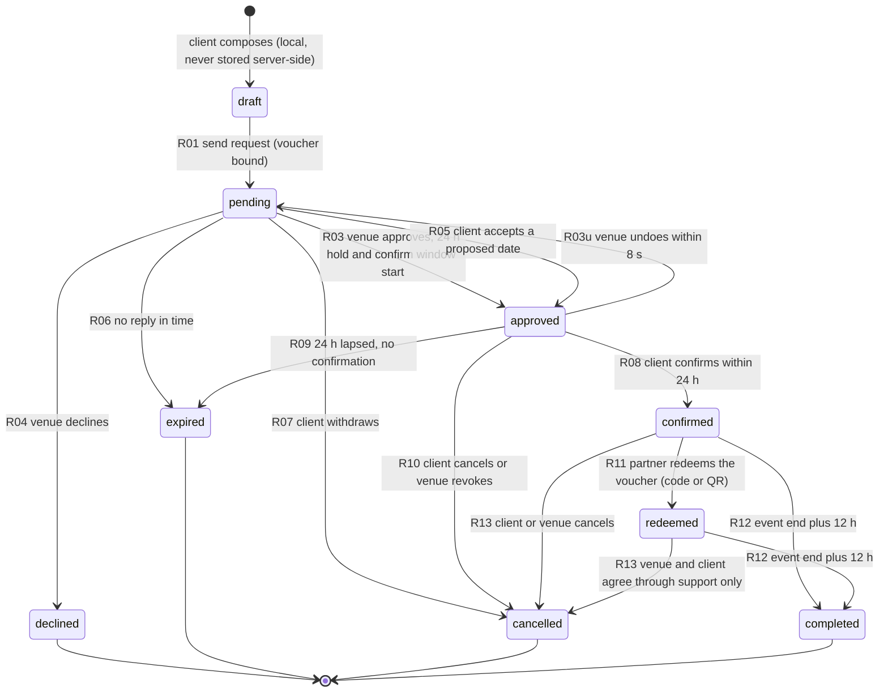
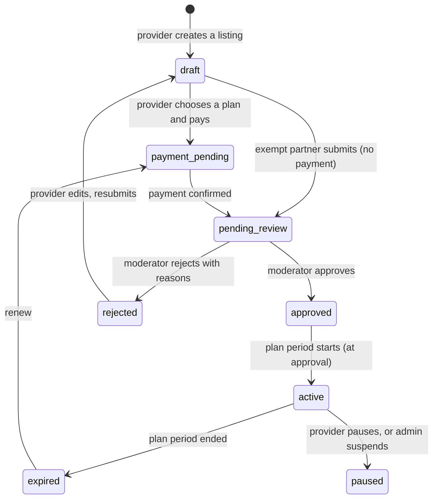

# The voucher marketplace model

> Status: **accepted as the model; proposed-needs-owner for every working assumption marked (A-nn)** (ADR 0033). It replaces the earlier in-app booking-payment model (deposit, balance, commission, payouts, refund calculator) everywhere the two disagree. Machine-readable twin of the screen impact: [`voucher-model-changes.json`](voucher-model-changes.json). Architecture: [booking-state-machine](../architecture/booking-state-machine.md), [pricing-and-payments](../architecture/pricing-and-payments.md), [data-model](../architecture/data-model.md). Owner questions: `open-questions.md` section 2b (OQ-V-01 onwards).

## 1. The model in one paragraph

Ghazal does not run the wedding operation. Halls, hotels and service providers sell, contract and get paid by their clients **directly**, exactly as they do today. Ghazal sells one thing to couples: a **voucher** (coupon), KD 2.000, paid online through the payment gateway. A voucher makes the couple **eligible to request a hall or a service at Ghazal's lower price** (the "voucher price"). Providers use the same Partner app (the current hotel app) with a Hotel or Service-provider account type. A couple who does not want a voucher can still search, compare, visit and contact the venue, then pay the venue normally at the standard price with no reduction.

Three consequences shape everything below.

1. **Only two kinds of money move through Ghazal:** the KD 2 voucher (client to Ghazal) and listing or advertising fees (service providers, and any partner that is not exempt, to Ghazal). Nothing else: no deposits, no balances, no commission, no payouts, no bank details for venues, no cash recording, no refund calculator.
2. **The booking is a request for a price, not a purchase.** The venue approves or declines; the couple confirms within 24 hours; the couple then settles with the venue off-app and shows the voucher code or QR; the venue marks the voucher redeemed.
3. **The venue's price list now has two columns:** standard price and voucher price, per package.

## 2. Actors

| Actor | App or surface | What they do in this model |
|---|---|---|
| Client (registered) | Client app | Browses, buys a voucher bound to one venue or provider, sends the request at the voucher price, confirms within 24 h, books a site visit, chats |
| Guest (not signed in) | Client app | Browses everything, sees the standard price and the voucher price, sees that a voucher exists; must register (WhatsApp code) to buy one or send a request |
| Venue partner (account type **Hotel or hall**, internal `venue`) | Partner app (the current hotel app) | Lists the venue with two prices per package, approves or declines requests, redeems vouchers by code or QR, handles visit requests, buys a listing plan unless exempt |
| Service-provider partner (account type **Service provider**, internal `service_provider`) | Partner app | Lists services (five primary categories), pays for an advertising plan (weekly, monthly or annual), waits for admin approval, receives requests and redeems vouchers |
| Major hotel (a venue partner with `fee_exempt = true`) | Partner app | Same as a venue partner but exempt from listing fees (section 10); still reviewed |
| Hotel or venue representative | Partner app | Staff member (role per ADR 0008) who is a member of visit group chats |
| Ghazal support representative (call center) | Web Super Admin (context only) | Third member of every visit group chat; handles voucher refunds and disputes |
| App Admin or Moderator | Web Super Admin (context only) | Reviews every listing and advertisement before activation, sets the major-hotel flag and plan rates |

## 3. The three client paths

| Path | Needs an account | Pays Ghazal | Pays the venue | Price the client gets | Ghazal objects created |
|---|---|---|---|---|---|
| 1 Browse only | no (guests can contact through the venue's published channels; chat needs an account) | nothing | everything, per the venue's terms | standard price | none (an analytics event only) |
| 2 Voucher | yes (verified phone) | KD 2.000 per voucher | everything, off-app, after approval and confirmation | voucher price | voucher, request |
| 3 Visit | yes | nothing | nothing | not applicable | visit, group chat |

A visit and a voucher are independent: a couple may visit first, buy a voucher afterwards (the visit chat shows a "Get your voucher" card), or never visit.

## 4. Vouchers

### 4.1 What a voucher is

- One voucher = one **single-use code** (`GV-YYMM-XXXX`, four Crockford base32 characters, LTR isolate) plus the same value as a **QR** the partner scans.
- **Bound at purchase to ONE target (a venue or a service provider) and to that target's quote** (hall or listing, package, date, session, guest count, standard total, voucher total). Binding is why a voucher cannot be sold on or used elsewhere (A-01).
- One voucher per request. A couple who wants two venues buys two vouchers.
- The price is KD 2.000 (`voucher_fee_fils = 2000`), a Super Admin configuration value with currency `KWD`; the client sees `KD 2` in English and `2 د.ك` in Arabic, three decimals only on the receipt (ADR 0010).
- **Arabic name:** the UI says «كوبون» (Gulf-familiar and already in the glossary). «قسيمة» is avoided because in Kuwait it also means a land plot in addresses (glossary section on addresses); OQ-V-15.
- A voucher is offered only when the saving beats the fee: `savings_fils > voucher_fee_fils` for the chosen quote. Otherwise the CTA is not shown (the screen says nothing about vouchers rather than selling a loss).

### 4.2 Voucher states

| State | Meaning | Client sees (chip) | Money position |
|---|---|---|---|
| `unpaid` | A checkout exists, the gateway has not confirmed. Never shown in the wallet except as "Payment in progress" | Payment in progress | an attempt may be in flight |
| `active` | Paid, bound to its target and quote, not attached to a request | Ready to use | KD 2 held by Ghazal as revenue; refundable per section 4.4 |
| `bound` | Attached to a live request (pending, approved, confirmed) | In a request | as above, locked |
| `used` | The partner redeemed it, or the request completed | Used | final |
| `expired` | Validity ran out without a redemption | Expired | final, unless a refund is still allowed (venue-fault release) |
| `refunded` | KD 2 returned to the original payment method | Refunded | returned |

### 4.3 Validity and reuse (A-02)

- A new voucher is valid for **60 days** from payment (`voucher_validity_days`, configuration). It never outlives the end of the bound event date plus 12 hours.
- While `bound` it does not expire.
- When a request is **released**, the voucher returns to `active` with a fresh **60-day reuse window for a new request to the same target** (any date, any package that the voucher's saving test still passes; the quote is re-bound, the code stays).

### 4.4 Refund and reuse proposal (A-03)

| What happened to the request | Voucher outcome | Refund |
|---|---|---|
| Declined by the venue | Released: reusable at the same venue for 60 days | Refundable on request (one tap, original method) |
| Venue did not reply in time (`expired: venue_no_response`) | Released: same | Refundable on request |
| Venue cancels a confirmed request | Released: same | Refundable on request |
| Client withdraws before approval | Released: reusable at the same venue for 60 days | Not refundable |
| Client lets the 24 h confirm window lapse (`expired: client_no_confirmation`) | Released: same | Not refundable |
| Client cancels after confirming | Consumed (`used`, reason `cancelled_after_confirm`) | Not refundable |
| Request completed, voucher redeemed | `used` | Not refundable |
| Voucher never used inside 60 days | `expired` | Not refundable, except when the last release was a venue-fault case (then refundable for 30 more days) |
| Payment taken twice, system error, venue suspended by Ghazal | n/a | Refunded in full by support (reason `system_error` or `admin_override`) |

Refunds are executed through the payment gateway to the original method (ADR 0027 refund path, no manual wallet). Arrival copy stays soft ("1 to 3 working days for KNET, up to 10 for cards") until the gateway confirms. Gateway fees on a refund are borne by Ghazal.

### 4.5 Registered-only voucher pricing

Guests (not signed in) **see both prices**, because the saving is the product's pitch. A guest cannot buy a voucher, save a quote to a voucher, or send a request: the gate sheet (CL-AUTH-01) opens with the context line "to get your voucher" and, after sign-in, restores the exact quote and scroll (ADR 0007 D8). Voucher prices are labelled "Voucher price" with a lock glyph for guests and a check for registered users. Whether the guest should see the voucher number at all is OQ-V-09 (alternative: show only the saving bracket).

## 5. Requests

### 5.1 Request states

A **request** is the booking object (table `bookings`, reference `GZ-YYMM-XXXX` kept). Nine states plus the voucher link.

| State | Meaning | Client chip EN / AR | Partner label | Voucher is |
|---|---|---|---|---|
| `draft` | Not a server object | n/a | n/a | `active` |
| `pending` | Sent at the voucher price, waiting for the venue | Pending / بانتظار الرد | Pending | `bound` |
| `approved` | Venue said yes at the voucher price; date held 24 h; **client must confirm** | Approved, confirm within 24 h / تمت الموافقة · أكدوا خلال 24 ساعة | Awaiting client | `bound` |
| `declined` | Venue said no, with a reason | Not accepted / لم يُقبل الطلب | Declined | released (`active`) |
| `expired` | Reason `venue_no_response` (no reply in time) or `client_no_confirmation` (24 h lapsed) | Expired / انتهت المهلة | Missed, or Lapsed | released (`active`) |
| `confirmed` | Client confirmed in time; the date is booked at the voucher price; the client settles with the venue off-app | Confirmed / مؤكد | Confirmed | `bound` |
| `redeemed` | Partner scanned or entered the code and applied the price | Voucher redeemed / تم استخدام الكوبون | Redeemed | `used` |
| `completed` | Event end plus 12 h | Completed / مكتمل | Completed | `used` |
| `cancelled` | By client, by venue, by Ghazal (reason shown) | Cancelled / ملغي | Cancelled | per section 4.4 |

`refunded` and `no_show` are no longer request statuses (the refund belongs to the voucher; a missed visit belongs to the visit). PRD filter families map: Pending = `pending`; Approved = `approved`, `confirmed`, `redeemed`; Rejected = `declined`; Cancelled = `cancelled`, `expired`; Completed = `completed`.

### 5.2 Step-by-step flow, voucher path

1. **Find.** Discover filters (section 7) lead to a venue or provider with two price rows per package.
2. **Quote.** On the detail the client picks date, session, hall, guests and package. The engine returns the standard total and the voucher total ("Est." until a package is chosen; exact on review).
3. **Get voucher.** Primary action "Get voucher · KD 2". Guests are gated (registration, verified phone). A short explainer sheet states: what the voucher is, that it is bound to this venue and quote, that the 2 KD is paid to Ghazal and the rest is paid to the venue directly, and the refund and reuse rules in plain words.
4. **Pay KD 2.** Method list in platform order (iOS: Apple Pay, KNET, Visa or Mastercard; Android: KNET, Google Pay when the gateway enables it, Visa or Mastercard), gateway-hosted page, outcomes: success (voucher with code and QR), confirming with the bank, failed ("No amount was charged"), as in ADR 0027.
5. **Request.** From the success screen or My vouchers: "Send request at the voucher price". The summary shows what the venue will receive (date, hall, package, guests, contact), standard price struck through, voucher price, savings, the voucher chip, the response time, and "Nothing more to pay Ghazal. You settle with {venue} directly after you confirm."
6. **Wait.** The venue has 24 h (12 / 24 / 48 configurable by the partner; 4 h forced and flagged Urgent when the event is 14 days or less away, as before). The client sees an absolute "Expected reply by" time.
7. **Approved.** The venue approves; the date is held for **24 hours** from the approval (an 8 s Undo window applies on the partner side, exactly as ADR 0008). The client gets push plus WhatsApp with the absolute deadline "Confirm by Fri 13 Nov, 4:00 PM". The booking detail shows the 24 h countdown (live mm:ss only in the final 60 minutes, as the old pay window).
8. **Confirm.** The client taps "Confirm booking" inside the window. This is the official confirmation required by the rule. The hold becomes a booking claim; the voucher code and QR become prominent on Booking detail.
9. **Lapse.** If 24 h pass without confirmation the approval lapses (`expired: client_no_confirmation`), the hold is released, the voucher is released (not refundable), and the venue is nudged to approve the next competing request.
10. **Settle off-app.** The client pays the venue directly, per the venue's terms, at the voucher price. Ghazal has no part in that payment and shows no payment fields.
11. **Redeem.** At the venue the client shows the code or QR. The partner scans it or enters the code in the Partner app, sees the bound quote, taps "Redeem voucher". The request becomes `redeemed`, the voucher `used`. A code can be redeemed once; a second attempt reads "Already used on {date}".
12. **Complete.** At event end plus 12 h the request completes automatically; the client gets the review prompt next morning. If the voucher was never redeemed, the request still completes and the client sees "Report an issue" for 72 h (A-04).

### 5.3 Rules

| Rule | Value | Notes |
|---|---|---|
| Open requests per wedding file | 3 (`pending` plus `approved`) | each needs its own voucher |
| Venue response time | 24 h default, 12 / 24 / 48 | forced 4 h and Urgent when the event is 14 days or less away |
| Confirm window after approval | **24 h, fixed** (the owner's rule) | not partner-configurable |
| Hold | none while `pending`; one per section from approval; converts on confirm | the database arbitrates (exclusion constraint), unchanged |
| Counter-offer | Venue may propose 1 to 3 other dates (48 h), at the same voucher price | unchanged mechanics; the client accepting an option goes straight to `approved` and the 24 h window restarts |
| Price after approval | frozen at the voucher price; the venue may approve at a lower price, never higher | unchanged (ADR 0004 D3) |
| Edit | only while `pending`; re-snapshot; SLA keeps running; the voucher binding follows the new quote only if the saving test still passes | |
| Instant booking | **removed** (no deposit exists to hold the date) | CA-SRCH-15 and CA-BOOK-15 are superseded |
| Reschedule after confirm | by agreement through chat; a new request needs a new voucher unless the venue cancelled | no in-app reschedule objects in the MVP (A-05) |
| Government facilities | listing only, no voucher, no request | official fees and channel, as before (ADR 0002) |

## 6. Price display: standard versus voucher

Each package (and each extra a venue prices) carries **two prices**: `standard` and `voucher`, each on the same basis (per person, or bundled package), each with weekday and weekend values (the tier engine of ADR 0004 is kept; each rule stores both columns).

| Surface | Standard | Voucher | Savings |
|---|---|---|---|
| Venue card (browse) | small, struck-through-free secondary line "Standard KD X" | headline voucher price with the unit | "Save KD Y" chip when Y is more than the voucher fee |
| Venue detail, package sheet | two rows: "Standard price", "Voucher price" | both with the same unit and guest basis | "You save KD Y with a KD 2 voucher" (net saving is shown as the headline: Y minus 2) |
| Compare | both rows | both rows | savings row |
| Request summary, booking detail | struck-through standard | exact voucher total, three decimals | exact saving |
| Venue with no voucher price on a package | one price only | none | none |

- Never a bare "From KD X": the unit and guest basis always appear (ADR 0004 D6 is unchanged apart from the second price).
- **Per-person versus package.** `pricing_structure` is `per_person` (price per guest with a minimum), `package` (a bundled price for a defined guest range, flat or flat plus per guest as in ADR 0004) or both on one venue. The card names the structure ("per person" or "package"); filters expose it (section 7).
- Savings are always computed from two real prices in force for the same quote. A struck-through "was" price shows only the venue's standard price, never an invented anchor.
- The voucher price is set by the partner in the Partner app (HL-VENU-02, HL-VENU-03), validated `voucher <= standard`; a package where they are equal is simply not voucher-eligible.
- Hotel-funded "offers", flash sales and coupon codes are folded into voucher-price settings: a time-boxed voucher price (an `ends_at` on the voucher column) replaces the flash sale; venue coupon codes are removed.

## 7. Venue specifications and search filters

| Filter or field | Values | Notes |
|---|---|---|
| Region / governorate / location | Kuwait's six governorates (Capital, Hawalli, Farwaniya, Ahmadi, Jahra, Mubarak Al-Kabeer) with areas under each; a free-text search matches governorate, area and venue name (Arabic-normalised) | The Brief's "area" becomes governorate plus area; distance stays |
| Venue type | **Private Hall**, **Governmental Facility**, **Hotel** (multi-select) | Governmental Facility is browse-only (no voucher) |
| Capacity range | minimum and maximum guest count (a two-handle range, steps of 50) | A venue matches when its hall range overlaps the chosen range |
| Pricing structure | Per person, Packages, Either | |
| Date and availability | filterable calendar: a date or range; results show only venues with an available hall on that date | unchanged engine; the calendar sheet is filter-capable |
| Voucher price | "Voucher price available" toggle; sort by voucher price | new |
| Existing filters | price range, setting, parking, valet, bridal room, buffet, decoration, photography, attendance policy, rating, newest, luxury level, hotel brand | kept; "Instant booking" removed |

Search displays venues matching the selected region and preferences with the number of results, active-filter chips (removable, clearable in one action) and the sort control.

## 8. Partner side

### 8.1 Account types

At first sign-in the partner chooses (or Ghazal pre-assigns on invitation) the account type:

| Type | For | What it manages | Fees |
|---|---|---|---|
| **Hotel or wedding hall** (`venue`) | hotels, private halls (governmental facilities are listed by Ghazal, not self-served) | halls, packages with two prices, calendar, requests, visits, voucher redemption | listing plan unless `fee_exempt` |
| **Service provider** (`service_provider`) | caterers, buffet services, florists, stylists, planners and the secondary categories | listings (services and packages with two prices), requests, voucher redemption | advertising plan (weekly, monthly, annual) |

One login can hold both types of membership (A-06). The Today, Bookings and More tabs adapt to the type: a provider has no halls or calendar of halls, no visits, and sees "Listings" in More.

### 8.2 Redemption

1. Client opens the voucher (Booking detail or My vouchers) showing the code and QR.
2. Partner opens Bookings > Redeem (or the scan button on Today), scans the QR or types the code.
3. The app shows the bound target and quote and checks: the code belongs to this partner, state is `confirmed`, not already redeemed, date in the future or today.
4. "Redeem voucher" is a single confirmation. It writes `redeemed_by` (staff user), `redeemed_at`, flips voucher `used` and request `redeemed`.
5. Errors are specific and calm: "This voucher belongs to another venue", "Not confirmed yet" (the client is still `approved`), "Already used on {date}".

Roles: redemption is allowed for Admin, Manager, Reception (ADR 0008 roles); not Accountant or Marketing.

### 8.3 Visit requests

See section 11 (visits and chat). The partner sees visit requests in Today (Needs you) and in More > Visits.

## 9. Provider module (additional services)

### 9.1 Categories

Primary categories in the client's **Additional services** section (post-venue needs), in this order, each with a clear icon from the registry (no emoji):

1. Hospitality and catering
2. Buffet services
3. Floral arrangements
4. Event styling and decor
5. Event planning and coordination

Secondary categories (kept, shown after the five, "More services"): photography and videography, cake, DJ, MC and live music, henna and bridal makeup, wedding dress and suit rental, luxury cars, invitations, travel and honeymoon. Categories render from data (the Super Admin manages the list, SA-VNDR-04); adding one needs no new screen.

### 9.2 Listing lifecycle

- **Not published on payment.** Payment moves the listing to `pending_review` only. Publication happens at approval.
- **Plan period starts at approval**, not at payment, so review time is never charged against the plan (A-07).
- **Rejection** carries one or more reason codes and a note (content not compliant, wrong category, missing details, unclear pricing, other). The provider edits and resubmits. The paid plan is kept for 14 days for a resubmission; after that it is refunded in full (A-08).
- **Expiry** hides the listing from search; reminders go out at -7 and -1 days; renewal is a new payment (no auto-debit in the MVP, no saved cards).
- A material edit to an `active` listing (category, price, photos, description) returns it to `pending_review` while the previous approved version stays live until the new one is approved (A-09).

### 9.3 Plans and rates

Three billing cycles: **Weekly, Monthly, Annual**. **Rates are not decided.** Every price surface reads `ad_plan_rates` (configuration, one row per cycle, nullable). While a rate is null the UI shows "Rates announced soon" and the pay step is disabled with a plain reason; the prototype never shows a price number here. An illustrative figure in any fixture is labelled "sample" and never shipped.

Paid placement is labelled to clients ("Sponsored") where the placement is paid (MK-SUB-04); the base listing is not labelled.

### 9.4 Major-hotel exemption

`partner.fee_exempt = true` is set only by the Super Admin (web). It means: no listing fee, no advertising fee, no payment step; the Partner app shows a "Major hotel · no listing fees" badge in Settings > Billing and replaces the plan chooser with an explanation. **Exempt partners are still reviewed** (content compliance and category) before activation. The flag is never visible to clients.

## 10. Money map

| Money | Payer | Payee | Through | When | Refund |
|---|---|---|---|---|---|
| Voucher KD 2 (configurable) | Client | Ghazal | Gateway (KNET, Visa, Mastercard, Apple Pay, Google Pay) | at "Get voucher" | per section 4.4, to the original method |
| Event price (voucher price) | Client | Venue or provider | **Off-app**, per their terms | after the client confirms | between client and partner; Ghazal is not a party |
| Listing or advertising plan | Service provider, or a non-exempt hotel or hall | Ghazal | Gateway | draft to payment | full refund if rejected and not resubmitted within 14 days |
| Gateway fees | Ghazal | Gateway | | per transaction | Ghazal bears fees on its own refunds |

Not in the system any more: deposits, balances, cash records, commission, supplier split, payout cycles, KYC for payouts, bank information, invoices for events, loyalty credit, venue coupons. Ghazal's invoices are the voucher receipt and the listing-plan invoice, both from the shared bilingual PDF service (issuer wording still OQ-B-06 and OQ-T-12; amounts say KWD).

## 11. Site visits and the three-way group chat

### 11.1 Visit flow

1. On a venue detail (hotel or hall, not governmental, not providers in the MVP: A-10) the secondary action is **Book a visit**. A voucher is not required.
2. The sheet shows the partner's visit slots (from business hours and the partner's visit availability): date, 30-minute arrival window, optional note and number of visitors.
3. The client sends the visit request. The screen "Visit requested" explains: a chat is open with the hotel and Ghazal support to confirm your arrival, and redirects there.
4. A **dedicated group chat** is created at that moment, one per visit.
5. The hotel representative confirms, suggests another time, or declines in the chat (quick actions on the partner's visit detail). The client confirms arrival in the chat on the day ("I am on my way", then "I have arrived"); the representative taps "Mark arrived".
6. After the slot the visit becomes `completed` (or `missed` if the client did not arrive and the representative flags it within 24 h).

Visit states: `requested`, `confirmed`, `reschedule_proposed`, `arrived`, `completed`, `declined`, `cancelled`, `missed`.

### 11.2 Group chat

| Aspect | Rule |
|---|---|
| Members | exactly three roles: the **client**, a **hotel representative** (partner staff with the `visit:manage` permission; the assigned representative plus Admin and Manager can read), a **Ghazal support representative** (platform role `support`, auto-added at creation) |
| Creation | automatically with the visit; the system message states the three roles and the slot; the client cannot create a group chat on their own |
| Visibility | members only. Other staff of the partner see it only if they hold the permission. Support sees it from the support console. The client sees the support member labelled "Ghazal support" with a role chip, the hotel member with the venue name and a role chip |
| Content | text, photos, documents; voice optional (shared chat component); a pinned header card carries the slot, venue, status and the arrival buttons |
| Closing | the chat becomes read-only 24 h after the visit slot, or at once on cancel or decline; it stays readable for 30 days then is archived (A-11). Support can close early with a reason |
| Notifications | each member gets push for new messages; reminders to the client -24 h and -2 h before the slot |
| Safety | report message and block are limited to non-support members; abusive content goes to support |

Visit group chat is a new conversation kind (`visit_group`); client-to-venue chats (pre-request questions) stay two-party and client-to-support stays two-party.

## 12. What the web Super Admin must do (context only, out of design scope)

- **Review queue** (SA-REV): every listing and advertisement, with category check, content-compliance checklist, approve, reject with reason codes, request changes; SLA display; audit trail.
- **Major-hotel flag**: set or clear `fee_exempt` per partner; list of exempt partners.
- **Rates and configuration**: voucher fee, voucher validity and reuse window, ad plan rates for weekly, monthly and annual, listing-fee requirement per partner type, category list, venue-type verification.
- **Voucher operations**: search a voucher by code, view the bound quote and history, issue a refund, release or void a voucher.
- **Visits support console**: join visit group chats as the support representative, close them.
- **Refunds and finance**: voucher payments, listing payments, refunds, gateway reconciliation. (Commission and payout screens are retired.)
- **Venue and provider onboarding**: approval and document verification stay as SA-VAPP and SA-VNDR.

## 13. Open questions and working assumptions

Each (A-nn) is a working assumption recorded as `proposed-needs-owner` in ADR 0033 and as an `OQ-V-nn` row in `open-questions.md`. They are built as configuration.

| A | Assumption | Question for the owner |
|---|---|---|
| A-01 | Voucher is bound at purchase to one target and its quote; code is single-use | May a voucher be re-bound to another venue before first use? (OQ-V-01) |
| A-02 | Validity 60 days; 60-day reuse window at the same venue after a release | Confirm the numbers (OQ-V-02) |
| A-03 | Refund and reuse table in section 4.4 | Confirm who is refunded and when (OQ-V-03) |
| A-04 | A completed request without a redemption still closes the voucher as `used`, with a 72 h issue report | What if the venue refuses to honour the price? Penalty for the venue? (OQ-V-04) |
| A-05 | No in-app reschedule after confirmation | Reschedules by chat; new voucher only after a venue cancellation (OQ-V-05) |
| A-06 | One login may hold both account types | (OQ-V-06) |
| A-07 | Ad plan period starts at approval | (OQ-V-07) |
| A-08 | Rejected listing keeps its paid plan for 14 days, then refunded | (OQ-V-08) |
| A-09 | Material edits to an active listing re-enter review; old version stays live | (OQ-V-10) |
| A-10 | Visits for hotels and halls only; providers use a quote chat | Do providers need visits (tastings, floral consultations)? (OQ-V-11) |
| A-11 | Visit chat read-only after 24 h, archived at 30 days | (OQ-V-12) |
| A-12 | Hotels and halls (non-major) also pay a listing plan to be live | The spec only says major hotels are exempt; do ordinary hotels and halls pay? (OQ-V-13) |
| A-13 | Governmental facilities: browse-only, no voucher | (OQ-V-14) |
| A-14 | Guests see the voucher price number | Or only a saving bracket (OQ-V-09) |
| A-15 | The voucher fee is KD 2.000, configurable; no VAT | Confirm gateway fee treatment (OQ-V-15) |
