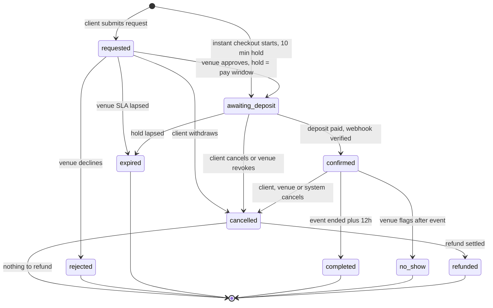
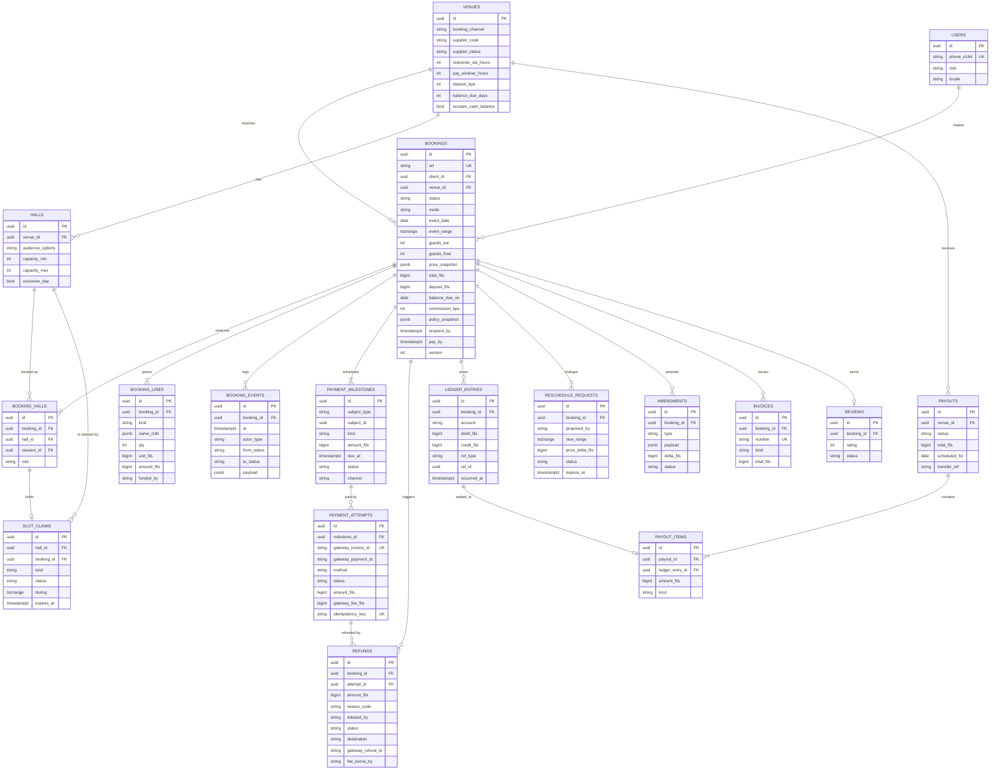
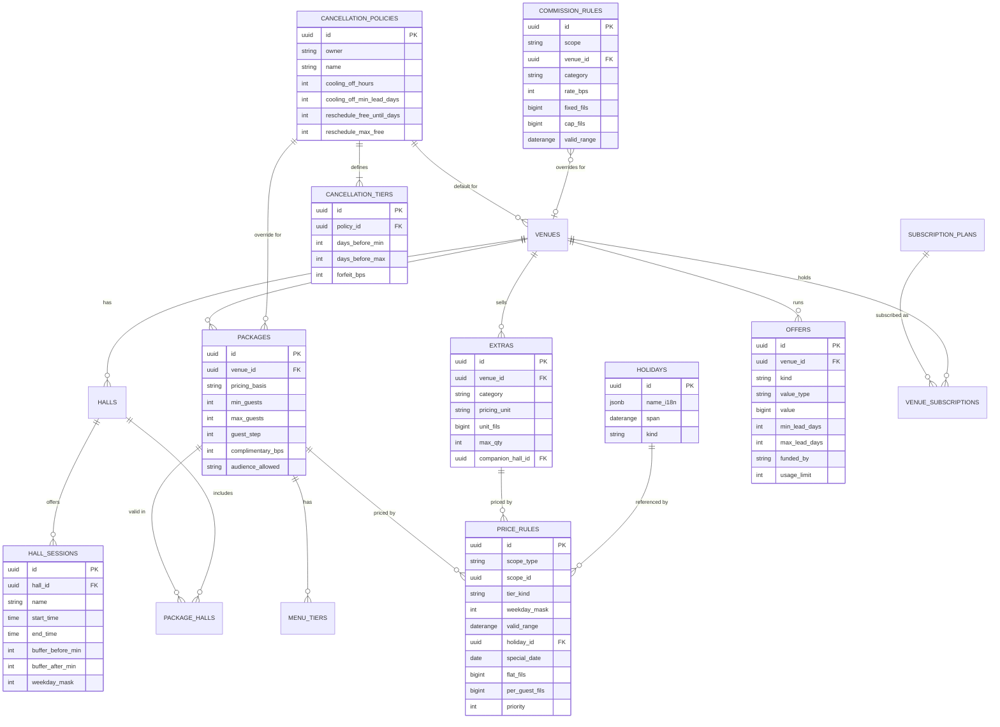
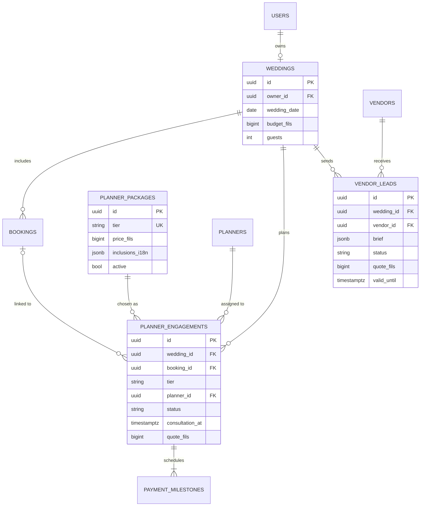

# Research: Booking, pricing & payments domain logic

> Produced by an independent analyst agent during the Understand phase (Oct 2026). Inputs to ADRs in `docs/decisions/`; where this file and an ADR disagree, **the ADR wins**.

## Key insights

- Recommended default is REQUEST, THEN PAY: no money moves until a human at the venue says yes; the deposit is charged within a 24h hold after approval. Instant-book is an opt-in, per-hall, earned privilege (deposit charged at checkout, 10 min hold). This is forced by reality: KNET is an immediate-debit scheme (no authorise-then-capture found in any source), MyFatoorah refunds are queued for MyFatoorah finance to execute unless Auto Refund is enabled and need available balance, and in a market where several couples want the same Thursday, pay-first would create a refund for every losing couple.
- The PRD's own words support this: 'online booking request backed by a deposit payment' (Exec Summary) and the flow 'Confirm -> Deposit Payment -> Booking Confirmation'. We keep both, but the deposit step arrives in a second session (push/WhatsApp deep link) for request-mode venues. The client-visible label for deposit-paid is 'Confirmed', a seventh label inside the PRD family 'Approved'.
- Requests do not claim the calendar; approvals and instant checkouts do. A slot_claims table with a Postgres exclusion constraint (hall_id =, time range &&, WHERE status = active) makes double-booking impossible at the database level; holds expire via sweeper plus lazy release. Competing requests for a held slot become an honest waitlist ('date held by another couple') instead of being refunded or rejected.
- Unit of booking = hall x session (date is implied). Venue is a container of halls; a package is bound to halls; men's/women's/mixed is the booking's audience attribute plus an optional companion men's reception hall as an extra, approved and paid atomically with the main booking. Same-day multiple events work wherever session ranges plus buffers do not overlap; ballrooms default to exclusive_day.
- Pricing is a deterministic rule engine, not a free-form number: tier precedence special_date > holiday > season > weekend|weekday; flat + per-guest on billable guests (minimum guests, complimentary-guest percentage); one best venue offer; service charge shown all-in; Kuwait has no VAT in 2026 (tax table exists at 0%); platform-funded coupons never reduce venue payout. The quote is frozen into an immutable price_snapshot at request time, so late Eid announcements or edits never silently reprice a booking.
- Commission is front-loaded from the deposit via MyFatoorah supplier split (venue share = deposit minus commission), so cash balances paid at the venue cause zero commission leakage. Rule: deposit >= 20% of total and commission capped at 10%, so the venue always nets at least half of the deposit. Cash is allowed for the balance only, never for the deposit.
- Cancellation is modelled as templates (Flexible/Standard/Strict) of days-before-event tiers plus a mandatory platform-wide 48h cooling-off (events >= 30 days away). The UI must show absolute dates ('Free cancellation until 22 Nov 2026') and a live 'if you cancel today you get back X' calculator, because the number is deterministic and trust depends on it. Clients never pay a processing fee at payment or on refund; gateway cost is the platform's, except venue-caused cancellations where the venue bears it.
- Government halls are already served by an official ministry channel (Sahel / Dar Al-Munasbat app, paid by KNET, fixed small fees, e.g. 100 KD rent + 100 KD refundable security deposit, dates cannot be changed, payment within 3 days or auto-cancel). Ghazal should list them as booking_channel = external_link: discovery, fee guide, deep link out; no Ghazal checkout, deposit, commission or reviews. They are excluded from Instant filter and show 'Book via official channel' in Compare.
- Planner = Ghazal-delivered service (admin assigns planners; Silver/Gold/Royal set by super admin), a separate planner_engagement with its own invoice and milestones, not a line in the venue booking and not part of the venue supplier split. Consultation is free and gated by intent, not payment. Vendor marketplace in MVP = directory + request-quote leads only, no in-app payments; but no vendor-facing product exists in the four-product PRD, so a minimal vendor responder page is a flagged gap.
- Reviews: only the booking owner, only after status = completed, one per booking, venue can reply and report but cannot approve or hide (PRD 8.9 'approve and reply' is challenged: venue-controlled approval destroys trust). Review photos must be face-filtered, a Gulf privacy requirement that matches the brief's no-faces rule.
- Real constraints found in research that change the design: MyFatoorah Authorize/Capture permits only one capture-or-release per invoice and documents card examples only; refunds need available MyFatoorah refund balance and are executed by MyFatoorah finance unless Auto Refund is enabled; webhooks v2 can duplicate and retry up to 5 times; multi-supplier split needs per-venue KYC (CreateSupplier + documents), which gates paid bookings per venue.

## Recommendations

### Booking mode and deposit timing (PRD gap 8)  _(confidence: high)_

Default = request-to-book with pay-after-approval. Venue approves within an SLA (24h default, 4h for events <= 14 days); approval creates a slot hold and a payment window (24h default, 6h for <= 14 days); deposit paid -> Confirmed. Instant-book is opt-in per hall (needs approved supplier KYC, lead time >= 30 days, trust threshold), charges deposit at checkout under a 10 min hold (+5 min grace while the gateway session is open). Do not use authorise-then-capture anywhere.

*Why:* KNET is an immediate debit scheme with no documented auth/capture; MyFatoorah allows one capture/release per invoice and refunds are asynchronous, finance-executed and need available balance. Pay-first would refund every losing couple for a contested date. Approve-then-pay needs zero refunds for rejections, expiries and lost slots, and mirrors the existing Kuwaiti 'tentative hold, then arboon' habit.

### Deposit rules and balance  _(confidence: high)_

Deposit default 30% of client total (venue-configurable 20-50%), rounded up to the next KWD 5, never below 20%; 100% charged immediately when the event is <= 14 days away. Balance due 14 days before the event (7-30 configurable), reminders T-21/T-14/D+1/D+2, venue decides what to do on default (no auto-cancel). Guest count locks at T-7 and the balance is recomputed then. Deposit is digital only; cash is allowed for the balance only where the venue enables it and is recorded by the venue and acknowledged by the client.

*Why:* A 20% floor with a 10% commission cap guarantees the venue nets >= 50% of the deposit and that commission is fully covered by online money, so cash balances cannot leak commission. Guest-count lock matches how Kuwaiti venues bill buffets per head.

### Double-booking prevention and holds  _(confidence: high)_

Introduce a slot_claims table (kind hold|booking|block, tstzrange incl. setup/teardown buffers, status active|released|expired) with EXCLUDE USING gist (hall_id WITH =, during WITH &&) WHERE status = 'active'. Requests do not claim; approvals/instant checkouts/confirmations/blocks do. Expire holds by a 30s sweeper plus lazy release inside the claiming transaction; set the gateway invoice ExpiryDate to hold expiry + 2 min. Late-payment rule: payment SUCCESS after hold expiry re-acquires the slot if free, otherwise auto-refunds 100% and notifies. Webhooks are verified (myfatoorah-signature), deduplicated and re-confirmed via server-side payment status.

*Why:* The only safe place to enforce exclusivity is the database; timers and Redis are UX conveniences. The late-payment race is the single most likely real-world failure and must have a defined outcome.

### Booking granularity (PRD gap 9)  _(confidence: medium)_

Bookable unit = hall x session. Venue contains halls; halls have session templates (name, start/end, buffers, weekdays) and an exclusive_day flag (default true for ballrooms with kosha setup); packages are bound to halls via package_halls; audience (women/men/mixed) is an attribute of the booking, allowed per hall and package. A companion men's reception hall is an optional extra that creates a second booking_halls row and claim, approved and paid with the main booking. Custom hours are handled in chat, not as a bookable option.

*Why:* Matches how Kuwaiti hotels and halls sell (separate ladies and men's packages, one wedding per ballroom per night, kosha/bridal suite bundled) while keeping the UI to progressive disclosure: sessions, hall and audience chips appear only when there is a real choice.

### Pricing engine  _(confidence: high)_

Tier precedence special_date > holiday > season > weekend|weekday (first match by priority, no multiplicative stacking); each tier stores absolute flat_fils and per_guest_fils; billable_guests = max(guests, min_guests) less complimentary %; one best venue-funded offer; optional venue service charge shown inside the headline price; tax table at 0% (Kuwait has no VAT in 2026; none expected before 2028); platform-funded coupons/loyalty credit reduce what the client pays and the commission, never the venue payout; all amounts as integer fils with half-up rounding at line level; immutable price_snapshot at request time; venue may approve with an extra discount but never at a higher price.

*Why:* Deterministic, explainable pricing is the brief's 'certainty before beauty'. Absolute tier prices keep per-day calendar prices stable; snapshots protect against Eid date shifts and mid-flight price edits; venue-only price decreases at approval allow the Kuwaiti bargaining reality without bait-and-switch.

### Cancellation, refunds, reschedule, no-show  _(confidence: medium)_

Policy templates by days-before-event: Flexible, Standard (default: >=60d 0%, 30-59d 25%, 15-29d 50%, 7-14d 75%, <7d 100% of booking total, capped at amount paid), Strict (deposit non-refundable after cooling-off). Mandatory 48h cooling-off with full refund when the event is >= 30 days away. Refunds go to the original method; MakeRefund with ServiceChargeOnCustomer=false always; serialise one refund request per invoice; if the original method cannot be refunded (KNET age limit, unverified) fall back to bank transfer with IBAN capture. Clients never pay processing fees; platform bears gateway cost except venue-caused cancellations (venue bears). Reschedule: one free client reschedule if requested >= 60 days out (price difference due if the new date is in a higher tier); venue-initiated reschedule keeps the original price and gives the client a no-penalty 100% refund exit; counter-offer (venue proposes another date) is the preferred alternative to rejection. No-show: venue flags within 24h after the event, client has 72h to contest, all paid amounts retained.

*Why:* Mirrors a real Kuwait-area tiered schedule (0/25/50/75/100) and the government rule that dates cannot be changed; cooling-off protects trust in a new marketplace; absolute-date display and a live refund calculator make the policy legible.

### Commission, ledger, settlement and payouts  _(confidence: medium)_

Commission rule engine (global, per category, per venue; rate_bps, fixed, cap, base = what the venue bills incl. service charge, excl. tax); default placeholder 8%, hard cap 10% in the engine. Collect commission up-front from the deposit through the MyFatoorah supplier split (venue ProposedDepositShare = deposit minus platform net commission). Use supplier deposit interval onDemand and drive payouts from an internal double-entry ledger: venue deposit share released 7 days after payment (next Sunday cycle), balance share released on the first cycle >= 24h after the event; 20% rolling reserve for venues in their first 90 days; venue-owed refunds are fronted by Ghazal (client made whole first) and recovered by netting. Monthly commission statement/invoice per venue. KYC-approved supplier status gates paid bookings and instant-book.

*Why:* Keeps client money inside the licensed gateway (never in Ghazal's own bank account), avoids leakage on cash balances, and gives the owner control of timing for refunds and disputes. The ledger is the source of truth so the model survives MyFatoorah semantics changing.

### Government halls (PRD gap 10)  _(confidence: high)_

booking_channel = external_link for government halls: show official fee schedule, availability as informational, 'How booking works' sheet and a deep link to the official Sahel / Dar Al-Munasbat flow; no Ghazal checkout, deposit, commission or reviews; excluded from Instant filter; Compare shows 'Book via official channel'. Allow a self-reported 'I booked this hall' marker that feeds Budget/Checklist/Countdown only.

*Why:* The Ministry of Social Affairs already runs electronic booking with KNET, fixed fees, no date changes and short payment deadlines; competing with it adds no value and creates compliance risk, while listing them keeps the 'Government Halls' category useful.

### Wedding planner engagement  _(confidence: medium)_

Model planner_engagement as a separate commerce object: tiers Silver/Gold/Royal as Ghazal-defined packages (price and inclusions set in Super Admin), free 30-min consultation (one per wedding) requested from Plan tab any time and promoted after a booking request/confirmation, admin or auto assignment by availability, consultation scheduled (call/video/in person), planner issues proposal, client pays planning deposit then milestone balance, all in Ghazal's own invoices (100% Ghazal revenue, no supplier split). Planner sees the venue booking read-only with client consent.

*Why:* PRD gives admin 'Packages, Pricing, Availability, Assignments', which implies platform-managed planners in MVP; separating it from the venue invoice avoids mixed payees and keeps venue commission clean.

### Vendor services marketplace in MVP  _(confidence: medium)_

Directory + 'Request a quote' leads only; quote cards in chat; 'Mark as hired' pushes the amount into the Budget manager; no in-app payment or vendor booking state machine in MVP; vendors monetise via subscription/featured/lead fee. Flag the missing vendor-facing surface and recommend a minimal magic-link vendor responder page (WhatsApp-notified) as the smallest addition that makes 'Vendor Chat' work.

*Why:* The PDF says vendor categories arrive after MVP yet Phase 2 includes the services marketplace; request-quote is the smallest honest version, and avoids a second settlement system. Without a vendor surface nothing can answer a quote request.

### Reviews eligibility  _(confidence: high)_

Only the booking owner, only when status = completed (never no_show, cancelled, external/government), one per booking, opens at event end + 24h, closes at +60 days, editable 14 days, 'Verified booking' badge. Venues can reply once (editable) and report abuse; they cannot approve or hide. Auto-checks plus admin moderation; review media face-filtered.

*Why:* Trust and the PRD's 'only after Completed' requirement; venue-controlled approval invites manipulation and would devalue the marketplace's core signal.

### Booking status model and PRD mapping  _(confidence: high)_

Adopt booking statuses requested, awaiting_deposit, confirmed, rejected, expired, cancelled, refunded, completed, no_show, with reschedule/counter-offer/amendment as child objects and payment, refund and claim as separate sub-machines. Map to PRD: Pending=requested; Approved=awaiting_deposit+confirmed; Rejected=rejected; Cancelled=cancelled+expired; Refunded=refunded; Completed=completed. Venue filters: Pending, Awaiting deposit, Confirmed, Past, Cancelled.

*Why:* Keeps the PRD's six as the top-level vocabulary while giving both sides the operational distinction between 'approved but unpaid, date held, timer running' and 'secured'.

### Settle MyFatoorah unknowns before build  _(confidence: high)_

Put a short written confirmation request to the MyFatoorah account manager covering: Auto Refund enablement; refund balance requirements; KNET refund window and per-method refund timings; whether KNET/Apple Pay support authorise; supplier deposit interval onDemand and TransferBalance semantics; KYC document list and turnaround for Kuwaiti hotels/halls; rate card per method; tokenisation (cards only) enablement; KNET daily-limit behaviour and error codes.

*Why:* Several design decisions (payout timing, bank-transfer refund fallback, saved-card balance payment) hinge on facts that public docs do not state.

## Risks & gaps

- MyFatoorah facts not stated in public docs (marked UNVERIFIED below): KNET refund window (a search snippet claimed 90 days from KNET guidelines but the page fetched did not contain it), refund timings (1 working day KNET / ~10 working days cards come from peer Kuwaiti gateway UPayments help centre, not MyFatoorah), authorise support per method, semantics of the TransferBalance endpoint, deposit interval options in practice, and fees per method. Confirm in writing before committing UI copy about arrival times.
- Refund liability after payout release: venue-caused or policy refunds after the deposit share was paid out must be fronted by Ghazal (client made whole first) and recovered by netting or invoicing. MyFatoorah refunds need sufficient available refund balance, so Ghazal must keep a refund reserve inside MyFatoorah. Working capital and venue default are the main financial risks; mitigations are the 20% rolling reserve for new venues, KYC, and contractual netting.
- Weddings are booked 6-18 months ahead, so any gateway refund-age limit would block refunds to the original method; the bank-transfer fallback with IBAN capture is therefore a required flow, not an edge case.
- KNET is bounded by the customer's bank daily limit; large deposits (KWD 1,000+) may fail. UI must offer Visa/Mastercard/Apple Pay after the first failure. Limits per bank are not documented here.
- No vendor-facing product exists among the four PRD products, so 'Vendor Chat' and quote replies have no responder; also the PDF contradicts itself (vendor categories 'introduced after the MVP' vs Phase 2 marketplace 'included in this MVP').
- PRD 8.9 gives venues 'approve' on reviews; this conflicts with review integrity. PRD 'Reschedule' for venues, 'Call client', 'Cash (optional)' and 'Revenue' are under-specified; this write-up defines them, but the owner must confirm.
- Venue calendar staleness is the biggest operational risk to 'live availability': if venues do not keep blocks current, requests will be declined and trust erodes. Needs a calendar-confirmed stamp, weekly nudge, and reliability metrics (response time, acceptance rate) feeding search rank.
- Legal and licensing not validated: merchant-of-record/agent status of Ghazal when collecting for venues, invoice issuer (venue on behalf of via Ghazal vs Ghazal), whether holding supplier funds inside MyFatoorah balances needs any licence, consumer-protection requirements for cooling-off, and data retention vs in-app account deletion (financial records must be retained; deletion must anonymise PII and be blocked while a confirmed future booking exists).
- Moon-sighting makes Eid and Ramadan dates move; holiday pricing must be admin-maintained date ranges updated on announcement, with existing bookings protected by price snapshots.
- Venue KYC through MyFatoorah (CreateSupplier + document upload + KYC webhooks) happens in real time and could threaten the PRD's 8-week plan if venues are slow; the design must make the 'Payouts: action needed' state visible and keep request-mode usable while KYC is pending (paid bookings blocked, so effectively request-only until approved).
- Commission %, subscription fees, planner package prices, deposit bounds and cancellation templates in this document are design placeholders for realistic prototype content; the owner must set real values.

## Open questions for the owner

- Do you accept request-then-pay as the default (no money until the venue approves) with instant-book as an earned opt-in? If you insist on pay-at-request, we must disable KNET for that path or accept refund handling for every rejection and lost-slot case.
- What are the real commission rate(s), per-category overrides, and subscription fees (Free/Premium/Featured/Sponsored), and is commission charged on the whole bill including hotel service charge? Is a 10% engine cap acceptable?
- May Ghazal hold venue money until 7 days after payment (and until event completion for new venues' reserve), or must venues be paid immediately by MyFatoorah supplier split on a fixed interval? Who funds client refunds after payout?
- Will MyFatoorah enable Auto Refund, onDemand supplier deposits and tokenisation for your account, and what are the KNET refund window, refund timings, and rate card?
- Who is the merchant of record and invoice issuer for venue bookings (venue via Ghazal, or Ghazal), and has a lawyer confirmed cooling-off, escrow/licence and e-invoicing obligations in Kuwait?
- Are planners Ghazal employees/contractors (platform-managed supply, as the admin 'Assignments' implies), what are Silver/Gold/Royal prices and inclusions, and is the first consultation free?
- Is the vendor marketplace really in MVP? If yes, approve a minimal vendor responder page (magic link + WhatsApp) so quote requests can be answered; if no, hide Vendor Chat and show a directory only.
- Government halls: confirm the 'list and deep-link out' approach; is there any appetite to partner with the Ministry/cooperative societies later (API or onboarding as normal venues)?
- Confirm review governance: venues can reply and report only, with admin moderation; no venue approval step. Also confirm face-filtering of review media.
- Confirm the status vocabulary: add the label 'Confirmed' (and 'Expired', 'No-show') under the PRD's six, and the 'Awaiting deposit' venue filter.
- Should venues be able to record offline bookings as labelled calendar blocks (no commission) to keep the calendar truthful, and may clients choose a 'contact person' (family member) instead of sharing the bride's own number?
- Western vs Eastern Arabic-Indic digits remain open (gap 11); this model is formatter-agnostic, but amounts in invoices and deadlines in countdowns must use one consistent numeral system.

---

## Full findings

# Ghazal booking, pricing and payments domain model

Scope: resolves PRD gaps 8 (deposit timing), 9 (granularity), 10 (government halls) and the pricing, refund, commission, planner, vendor and review ambiguities. Everything here is a design decision with a stated rationale, built on facts gathered from MyFatoorah documentation, Kuwait sources, and the PRD. Placeholder numbers (rates, prices, thresholds) are marked as such; the engine must make them configurable.

Fact labels used below: [V] verified in vendor/government source, [P] peer-gateway or press source, [U] unverified or assumption (confirm before build).

Suggested homes once accepted: `docs/architecture/booking-state-machine.md`, `docs/architecture/payments.md`, `docs/architecture/data-model.md`, ADRs `0001` (booking mode and deposit), `0002` (slot claims), `0003` (pricing engine), `0004` (cancellation and refunds), `0005` (commission and payouts), `0006` (government halls), `0007` (planner and vendor scope). Open items go into `docs/product/open-questions.md`.

---

## 0. Decisions at a glance

| # | Question | Decision |
|---|---|---|
| 1 | Request vs instant | Default request-to-book. Instant is opt-in per hall, earned. |
| 2 | When is the deposit charged | After venue approval (request mode) or at checkout (instant). Never held/authorised. |
| 3 | Slot protection | Requests do not claim. Approval / instant checkout / confirmation / block create claims. DB exclusion constraint. |
| 4 | Hold timers | Instant 10 min (+5 grace). Approved-unpaid 24h (12-72h; 6h if event <= 14 days). Venue SLA 24h (4-48h; 4h if event <= 14 days). |
| 5 | Unit of booking | Hall x session. Venue is a container. Companion men's hall = extra. |
| 6 | Price | Rule engine: tier precedence, flat + per-guest, billable guests, one offer, all-in display, frozen snapshot. |
| 7 | Deposit | 30% default (20-50%), round up to KWD 5, 100% if event <= 14 days, digital only. |
| 8 | Balance | Due T-14 (7-30). Cash only for balance, only where venue enables. Guest count locks T-7. |
| 9 | Cancellation | Templates + mandatory 48h cooling-off. Absolute dates in UI. |
| 10 | Refund | Original method, async, serialised per invoice, bank-transfer fallback. Client never pays a fee. |
| 11 | Commission | % of venue bill, front-loaded from deposit via supplier split. Platform-funded credits never reduce venue payout. |
| 12 | Payout | Internal ledger drives MyFatoorah onDemand payouts. Deposit share +7 days, balance share after event. New-venue reserve. |
| 13 | Government halls | External link channel. No checkout, commission or reviews. |
| 14 | Planner | Ghazal-delivered service, separate engagement and invoice. Free consultation. |
| 15 | Vendors | Directory + request-quote. No payments. Flag: no vendor-side surface. |
| 16 | Reviews | Booking owner, status completed, one per booking, venue cannot approve. |

### How each choice shapes the UI (the point of the exercise)

| Choice | Client app must show | Hotel app must show |
|---|---|---|
| Request-then-pay | CTA reads "Request to book", not "Book now". Stepper ends "Send request". A Pending screen with SLA copy. A second payment session reached from push/WhatsApp ("Approved: pay by 7:30 PM"). | Pending inbox with SLA countdown; Approve / Suggest another date / Decline; approving warns "holds the date for 24h and queues N other requests". |
| Instant-book opt-in | "Book now" and an Instant tag only on eligible halls; stepper ends "Pay deposit"; 10-min hold chip on the pay sheet. | Hall setting "Instant booking" with eligibility checklist; live "Held" cells in calendar. |
| Slot claims and waitlist | Calendar states: Available, Held (request allowed), Unavailable. Honest "date held by another couple" chip on competing requests. | Calendar claim styles: hold (hatched with timer), booked, blocked. "+2 other requests for this date" chip on a request. |
| Hall x session x audience | Sessions, hall and audience chips appear only when there is a real choice. Optional "Add a men's reception" extra. | Calendar lanes per hall; booking rows show hall, session, women/men/mixed icon. |
| Price rule engine | Per-day "from" price in the calendar for the chosen guests; all-in price; breakdown with billable guests explained; price frozen after request. | Tier grid editor (weekday / weekend / holiday / season / special date) with a live "client sees" preview; offer editor with funding. |
| Deposit + balance + dates | Review step shows Deposit now, Balance due date, Guest-count lock date, Free-cancellation-until date. | Money panel: deposit received, balance due, cash recorded, commission, payout date. |
| Cooling-off + tiers | Absolute free-cancel date, tier bar, and "if you cancel today you get back X" with arrival time by payment method. | Policy picker with a live timeline example; cancellation consequences preview before the venue cancels. |
| Commission front-loading | Nothing (client pays the venue price, no fee). | "You receive KWD X after Ghazal's 8%" on each request and booking; payouts screen. |
| KYC gating | Instant badge absent until verified. | Settings > Payouts banner: Verified / Action needed; paid bookings blocked until approved. |
| Government channel | "Book via official channel" with fee guide, deep link, how-it-works sheet. | Not applicable (no venue app). |
| Reviews gate | Prompt appears the day after a completed event; no review box otherwise. | Reply once, report abuse; no approve/hide. |

---

## 1. Research findings and constraints

### 1.1 Payments (MyFatoorah, KNET)

- PRD stack is KNET via MyFatoorah plus Visa, Mastercard, Apple Pay, Google Pay; accounts are in the owner's name; no card data stored; gateway fee is a percentage per booking (PDF section 16). No SMS gateway: OTP and notifications go over WhatsApp.
- **Multi-vendor [V]**: MyFatoorah "Suppliers" lets the platform add venues with CreateSupplier (SupplierName, Mobile, Email), upload KYC documents (UploadSupplierDocument), receive KYC approve/reject by webhook, and pass `SupplierCode` + `InvoiceShare` (+ optional `ProposedShare` / `ProposedDepositShare`) in the payment call. The sum of shares must equal the order amount. MyFatoorah deposits to the supplier's bank on an interval (Daily / Weekly / Monthly / onDemand), deducting MyFatoorah's fee and then the platform's commission. Balance and deposit queries exist (GetSupplierDashboard, GetSupplierDeposits, TransferBalance). Field names differ between v2 (ExecutePayment/SendPayment) and v3 (Create Session/Create Payment). Build on v3. Semantics of TransferBalance and onDemand are [U].
- **Authorize and capture [V/U]**: v3 supports `OperationType` AUTHORIZE, CAPTURE, RELEASE, PAY; partial capture is possible but **only one capture or release per invoice**; examples are card (VISA/MASTER) only; per-method support is not stated. No source found showing KNET supports authorise-only. KNET is an immediate-debit scheme. Design must not depend on holds.
- **Refunds [V]**: `MakeRefund` (KeyType InvoiceId|PaymentId, Key, Amount, ServiceChargeOnCustomer, optional Comment, ExternalIdentifier, AmountDeductedFromSupplier). Partial refunds are allowed, repeatedly until the full amount is refunded; send one refund request at a time to avoid duplicates; refunds need sufficient available refund balance; by default a refund request goes to MyFatoorah's finance operations team to be executed by them, unless **Auto Refund** is enabled (ask the account manager). Refund webhook statuses: REFUNDED, CANCELED; payload carries RemainingValueInBaseCurrency and ExternalIdentifier.
- **Refund timing [P]**: peer Kuwaiti gateway UPayments states KNET refunds reach the customer's bank in about 1 working day and Visa/Master/Apple Pay/Google Pay/Samsung Pay in about 10 working days. A search snippet also claimed a KNET 90-day refund limit; the page fetched did not contain it, so treat as [U]. If true it is critical because weddings are booked 6-18 months ahead (see section 6.4).
- **Webhooks v2 [V]**: events PAYMENT_STATUS_CHANGED, REFUND_STATUS_CHANGED, BALANCE_TRANSFERRED, SUPPLIER_STATUS_CHANGED, RECURRING_UPDATES, DISPUTE_STATUS_CHANGED, SUPPLIER_UPDATE_REQUEST_CHANGED; secret key mandatory, signature in header `myfatoorah-signature`; up to 5 retries, max 180s delay; duplicate events can occur (prefer SUCCESS); transaction statuses SUCCESS, FAILED, AUTHORIZE, CANCELED; invoice `ExternalIdentifier` (from CustomerIdentifier) and `UserDefinedField` (<= 500 chars) carry our ids. Payload includes ServiceCharge and ReceivableAmount.
- **Tokenisation [V]**: saving cards is available by account-manager enablement and tokens are card-only (KNET always needs the customer's PIN). Use at most for one-tap balance payment, never auto-debit in MVP.
- **Apple Pay [V]**: "Direct integration" means you decrypt the token yourself; avoid (PCI scope). Use the embedded/hosted option so the NFR "no card data stored" holds.
- **Invoice expiry**: ExecutePayment has an optional `ExpiryDate` (defaults to account profile). Use it to expire the payment page with the slot hold.
- Fees: public sites only say "from about 2.5%". Per-method rates [U]; model gateway fee as an input per payment, not a constant.

### 1.2 Kuwait market facts

- **No VAT in 2026** and none expected before 2028 (fiscal plan 2026-2030 omits it) [P]. Tax lines exist in the schema at 0%.
- **Government halls** [V/P]: Ministry of Social Affairs runs electronic booking via the Sahel / Dar Al-Munasbat app, paid by KNET, 24 halls growing to 34; fees reported as 200 KD total = 100 KD rent + 100 KD security deposit (refunded on cancellation or after the event if no damage); rent is non-refundable if cancelled within one week of booking; **dates cannot be changed**; payment due within 3 days of confirmation or the booking auto-cancels. Awqaf facilities: full-day 150 KD with refundable 100 KD deposit. Eligibility is aimed at citizens [U exact rule]. App store reviews say the official app is unreliable, an opening for Ghazal's discovery layer.
- **Hotel wedding packages** [P]: kosha with ballroom lighting, complimentary 3-layer cake, 10% of attendees complimentary, complimentary bridal suite, private bride entrance, VIP valet for 100 cars. Separate "men's reception" and "ladies' wedding" packages exist. This is why the pricing model needs complimentary-guest percentage, per-guest pricing, companion halls and inclusions.
- **Cancellation tiers seen in a regional hotel policy** [P]: >2 months 0%, 1-2 months 25%, 15 days-1 month 50%, 7-15 days 75%, <7 days 100%. Used as the "Standard" template.
- Kuwait weekend is Friday-Saturday; weeks start Sunday; Thursday night is the wedding peak; timezone Asia/Kuwait (UTC+3, no DST). Eid/Ramadan dates move with moon sighting.

---

## 2. Request-to-book vs instant-book and where the deposit is charged

### 2.1 Options considered

| Option | Money at request | Fit with KNET | Refund load | Venue behaviour fit | Verdict |
|---|---|---|---|---|---|
| A. Pay-then-approve | Charged | Works (debit) but takes money for an unconfirmed thing | Every rejection, expiry and lost contested slot needs an async, finance-reviewed refund | Venues like seeing paid requests | Rejected as default. Reputational and operational cost. |
| B. Approve-then-pay | None | Perfect | Zero for rejection/expiry/lost slot | Matches Kuwaiti "tentative hold then arboon" | **Chosen default** |
| C. Authorise-then-capture | Hold | Not available for KNET; one capture/release per invoice; method support unclear | Low | Inconsistent across methods | Rejected. Revisit for cards only later. |
| D. Instant-book | Charged at checkout | Works | Low (slot is held before payment) | Needs venue trust | **Chosen as opt-in** |

Decisive arguments for B: (1) in a contested market the losing couples would each need a refund under A; under B they are just told the date is taken, no money touched; (2) KNET has no hold, so A means real money out of a debit account before a human says yes; (3) MyFatoorah refunds are queued, need balance, and may take days; (4) PRD wording ("online booking request backed by a deposit payment", Confirm -> Deposit Payment -> Confirmation) is honoured: the deposit step simply arrives after approval for request-mode venues.

Mitigating B's weakness (low commitment at request time): phone-verified account (WhatsApp OTP) required to send a request; **at most 3 open unpaid bookings per client** (requested + awaiting_deposit), which aligns with the compare-3 behaviour; per-venue response SLA; the approval hold is short (24h).

### 2.2 Instant-book eligibility (per hall)

All of: venue supplier KYC approved; hall flag `booking_mode = instant`; event >= 30 days away; guests within package min/max; a package with fixed price (no custom quote); venue trust threshold (>= 5 completed Ghazal bookings and >= 90% response rate, or Super Admin override). Instant is excluded for government halls and `enquiry_only` venues.

### 2.3 Flows

Request mode: Review -> **Send request** (status requested; no money, no claim) -> venue Approve (with optional extra discount) -> status awaiting_deposit (claim hold for the pay window; payment link) -> client pays deposit within the window -> **confirmed**.

Instant mode: Review -> **Continue to payment** -> status awaiting_deposit (claim hold 10 min) -> pay -> **confirmed**.

Payment option at the pay step: Deposit (default) or Pay in full (milestone kind `full`). Methods: KNET first, Apple Pay (iOS) or Google Pay (Android), Visa/Mastercard. Cash is never offered for the deposit.

### 2.4 Venue alternatives to Reject

- **Suggest another date** (counter-offer): venue proposes 1-3 alternatives (same hall/package; price re-quoted per new date; venue may hold the original price). Client has 48h. Accept -> awaiting_deposit on the new slot. Decline -> cancelled (client). No reply -> expired. This is the most natural Kuwaiti response ("that Thursday is taken, how about the 14th?") and must be a first-class action.
- **Approve with a discount**: venue adds a venue-funded discount line (never a higher price).

---

## 3. Slot holds, timers and double-booking prevention

### 3.1 Timer constants (single source for UI countdowns)

| Constant | Default | Bounds | Set by |
|---|---|---|---|
| instant_hold | 10 min, +5 min grace while gateway session open | fixed | platform |
| venue_response_sla | 24h | 4-48h; forced 4h if event <= 14 days (flagged Urgent) | venue within bounds |
| pay_window (after approval) | 24h | 12-72h; forced 6h if event <= 14 days | venue within bounds |
| counter_offer_validity | 48h | fixed | platform |
| reschedule_proposal_validity | 72h | fixed | platform |
| cooling_off | 48h after deposit paid, only if event >= 30 days away | venue may offer longer, not shorter | platform |
| balance_due | T-14 days | 7-30 | venue |
| guest_count_lock | T-7 days | 3-14 | venue |
| deposit payout release | 7 days after payment (next Sunday cycle) | per trust level | platform |
| auto_complete | event end + 12h | fixed | platform |
| client issue window | 72h after completion; 72h to contest a no-show | fixed | platform |
| review window | opens event end + 24h, closes + 60 days | fixed | platform |
| max open unpaid bookings per client | 3 | fixed | platform |
| SLA escalations | push at 50%, WhatsApp to manager+reception at 80%, expire at 100% | fixed | platform |

All timestamps stored in UTC, displayed in Asia/Kuwait. Client-facing deadlines are absolute ("by 7:30 PM today"), with a live countdown only inside the last hour.

### 3.2 Claims, not flags

A **slot claim** is one row per hall per time range: kind `hold` | `booking` | `block`, status `active` | `released` | `expired`. Requests do not create claims. Approval creates a `hold` until pay_by; instant checkout creates a `hold` for 10 min; deposit paid converts it to `booking`; venue blocks (maintenance, private event, offline booking) are `block`.

```sql
CREATE EXTENSION IF NOT EXISTS btree_gist;
ALTER TABLE slot_claims
  ADD CONSTRAINT no_overlap
  EXCLUDE USING gist (hall_id WITH =, during WITH &&)
  WHERE (status = 'active');
```

`during` is a `tstzrange` including setup/teardown buffers. For exclusive_day halls it spans the venue's business day (06:00 to 06:00 next day, configurable) so a 19:30-01:00 wedding still belongs to its date. Multi-hall bundles insert all claims in one transaction (all-or-nothing). Violations return `409 SLOT_UNAVAILABLE`.

Hold expiry: a 30s sweeper marks expired holds plus **lazy release** inside the claiming transaction (`UPDATE ... SET status='expired' WHERE kind='hold' AND expires_at < now() AND during && :new`) because an exclusion constraint cannot reference now(). Redis TTL keys power UI countdowns only; the database is the truth.

State changes use compare-and-swap (`UPDATE bookings SET status=:to, version=version+1 WHERE id=:id AND status=:from AND version=:v`). A venue approving at the same instant a client withdraws is resolved by whichever commits first; the loser sees a friendly "already updated" sheet.

### 3.3 Races and edge cases with defined outcomes

| Case | Outcome |
|---|---|
| Payment SUCCESS arrives after the hold expired | If slot is re-acquirable: re-acquire, confirm (T08b). Else auto-refund 100% (platform bears fees), notify with alternatives. Set gateway ExpiryDate = hold expiry + 2 min to make this rare. |
| Duplicate/retried webhook | Inbox table keyed by (gateway, event, transaction id); idempotent handler; confirm only after server-side payment status check. |
| Two requests for the same held slot | Both stay `requested`; second shows "Date held by another couple" (blocked_by_hold). If holder pays: second -> expired(slot_taken) with alternatives push. If hold lapses: venue nudged to approve next. |
| Venue blocks a date with pending requests | Warn; pending requests auto-flag unavailable; confirmed bookings cannot be blocked without a cancellation flow. |
| Client edits a request | Allowed only in `requested`; creates a new version, re-snapshots price, notifies venue, keeps remaining SLA. After approval the price is locked; after confirmation changes are amendments. |
| Venue suspended by admin | Bookings preserved; payouts held; support re-homes; clients notified. |
| Client deletes account | Blocked while a confirmed future booking exists (cancel under policy first). Otherwise anonymise PII, retain ledger/invoice rows. |
| Chargeback (DISPUTE_STATUS_CHANGED) | Set payout_hold on the booking; support case. |
| Large KNET deposit fails (bank daily limit) | After first failure offer Visa/Mastercard/Apple Pay; hold timer is extended once by the +5 min grace only. |

---

## 4. Booking granularity (gap 9)

- **Venue** (brand/hotel/complex; location, policies, supplier) contains **halls**. A **hall** is the bookable unit and has capacity bounds (optionally per audience), indoor/outdoor, `exclusive_day`, and **session templates** (e.g. Evening 19:30-01:00, Afternoon 12:00-17:00, Full day) with buffers and weekdays. Overlap is decided by time ranges, not by enumerating sessions (a Full day naturally conflicts with both).
- **Package** = commercial offer bound to one or more halls (package_halls); defines pricing basis, min/max guests, complimentary-guest %, inclusions, allowed audiences, optional cancellation policy override.
- **Audience** (women only / men only / mixed) is a booking attribute chosen from what the hall and package allow. Pricing can differ per package, so use separate packages for women's vs men's offers when prices differ.
- **Companion hall**: an Extra of category `companion_hall` (e.g. "Men's reception, Diwaniya Hall") adds a second booking_halls row with its own claim. Approval, payment and cancellation are atomic for the whole booking. If the venue lacks a suitable hall the extra is not shown. Data model supports it from day one; UI may ship it in v1.1 if time-boxed.
- **Same-day multiple events**: allowed across halls always; within a hall only if `exclusive_day = false` and session ranges plus buffers do not overlap.
- **Custom hours**: not bookable in MVP; discussed in chat or special requests.
- **Client calendar** (availability endpoint returns per day: state, from_price_fils, tier): Available / Held (requests allowed, waitlist) / Unavailable / Past or inside minimum lead time. A day is Available if at least one hall x session matches the chosen guests and audience.
- **Venue calendar**: per-hall lanes, stacked dots in month view, session timeline in day view. Blocks carry a reason (offline_booking, maintenance, private_event, other) and a note. An offline booking recorded as a block carries no payment or commission and keeps the calendar truthful. Venue stamp `calendar_confirmed_at` drives a weekly nudge.

---

## 5. Pricing model

### 5.1 Components (what Kuwaiti venues actually sell)

Hall/package flat fee + per-guest catering (buffet/menu tier uplift) + extras (kosha decoration, flowers, lighting, sound, valet, cake, bridal suite, companion hall) + optional venue service charge. Packages may include complimentary guests and inclusions (cake, valet cars).

### 5.2 Engine (deterministic, in this order)

1. **Tier resolution** per package (and per extra): first match by priority of `special_date` (single date, e.g. National Day) > `holiday` (platform holiday calendar maintained by Super Admin as date ranges, includes Ramadan/Eid windows) > `season` (venue date range, e.g. winter peak) > `weekend` (default Thu, Fri, Sat; venue-editable weekday mask) > `weekday`. No multiplicative stacking: each tier stores **absolute** `flat_fils` and `per_guest_fils` (the editor may offer "+20% of weekday" as a shortcut that writes absolutes). Stable per-day prices make the per-day calendar price display trivial.
2. **Billable guests** = max(guests, package.min_guests), then reduced by complimentary guests (`complimentary_bps`, e.g. 10% -> 400 guests bills 360). Guests step by `guest_step` (e.g. 50). Menu tier adds `per_guest` uplift on billable guests.
3. **Lines**: package flat, per-guest food, menu uplift, extras (pricing_unit flat | per_guest | per_unit).
4. **Offers**: one best applicable venue-funded offer (percent or fixed; scoped by package/line; booking-window such as last-minute <= 14 days or early-bird >= 120 days; usage limits). Offers do not stack with each other. Flash sales are offers with an end time.
5. **Service charge**: venue percentage on lines after venue discounts. Headline prices are always shown **all-in** (service charge included); the breakdown shows it as a line.
6. **Tax**: tax table, 0% in Kuwait today; invoices show no tax line until a rate is configured.
7. **venue_bill** = lines - venue offers + service charge + tax.
8. **Platform credit** (coupon, loyalty redemption, referral): platform-funded, reduces **client total** and platform commission, never the venue's entitlement; capped so platform net commission >= 0.
9. **client_total** = venue_bill - platform credit. Clients pay no Ghazal fee and no processing fee, ever.
10. **Deposit** = clamp(roundUp5KWD(max(venue deposit % x client_total, 20% x client_total)), <= client_total); 100% when event <= 14 days. Venue may set a fixed deposit instead of a percent, still subject to the 20% floor and 50% ceiling.
11. **Balance** = client_total - deposit, due T-14. At **guest lock (T-7)** the engine recomputes with guests_final and posts an amendment line; balance moves accordingly (reductions floor at an allowed percentage of the original count, e.g. -10%; increases are allowed up to capacity).
12. **Rounding**: integer fils (1/1000 KWD), half-up at line level; any 1-fil remainder goes to the venue share.
13. **Price snapshot**: at request, store an immutable snapshot (lines, applied rule ids, offers, policy, commission rate, deposit rule). Approval may only apply an additional venue discount (new quote version). Price edits, new holidays or Eid date changes never reprice an existing booking. Booking amendments (guest count, extras, package upgrade, reschedule to a higher tier) create priced deltas.

Packages: pricing_basis in `flat`, `per_guest`, `flat_plus_per_guest`. "Starting price" on cards must state its basis ("From KWD 1,200 - weekday") and switch to the exact date price once a date and guests are known.

### 5.3 Worked example (verified arithmetic)

Lulu Grand Ballroom (fictional), Thursday 21 Jan 2027, Evening session, Gold Reception package, booked Sat 10 Oct 2026 (103 days out). Weekend/peak-season tier: hall fee 1,800.000; per-guest 12.500; 10% complimentary; 400 guests.

| Line | KWD |
|---|---|
| Hall fee | 1,800.000 |
| Food: 360 billable x 12.500 | 4,500.000 |
| Extras: Kosha 650.000 + Valet 150.000 + Cake 120.000 | 920.000 |
| Subtotal | 7,220.000 |
| Early-bird offer (-5% of hall fee, venue-funded) | -90.000 |
| After venue discount | 7,130.000 |
| Service charge 10% | 713.000 |
| **Venue bill** | **7,843.000** |
| Ghazal welcome credit (platform-funded) | -50.000 |
| **Client total** | **7,793.000** |

Deposit: 30% = 2,337.900 -> rounded up to **2,340.000**. Balance **5,453.000** due Thu 7 Jan 2027 (T-14). Guest lock 14 Jan. Free cancellation until 22 Nov 2026 (Standard, 60 days). Cooling-off ends 48h after payment.

Commission 8% of venue bill = 627.440. Platform net after its own credit = 577.440. Front-loaded from the deposit: venue deposit share = 2,340.000 - 577.440 = **1,762.560**; venue balance share = 5,453.000 (all of it, even if paid in cash at the venue). Venue total = 7,215.560 (= 7,843.000 - 627.440). Check: 1,762.560 + 5,453.000 = 7,215.560.

Cancellation on 7 Dec 2026 (45 days out; tier 30-59 days = 25% of client total, balance not yet paid): retained R = 1,948.250; refund = 2,340.000 - 1,948.250 = **391.750**; commission on R = 155.860; venue entitlement = 1,792.390. Check: 391.750 + 155.860 + 1,792.390 = 2,340.000. The venue's earlier front-loaded 1,762.560 is adjusted by +29.830 in the ledger.

---

## 6. Cancellation, refund, reschedule, no-show

### 6.1 Policy model

`cancellation_policies` (platform templates or venue-owned) with `cooling_off_hours`, tiers (`days_before_min`, `days_before_max`, `forfeit_bps` of **client total**, capped at amount paid), reschedule rules. A snapshot is stored on each booking. Venue default policy plus optional per-package override.

| Template | Rule (days before event -> forfeit of total) |
|---|---|
| Flexible | >=45d 0%; 30-44d 25%; 14-29d 50%; <14d 100% |
| **Standard (default)** | >=60d 0%; 30-59d 25%; 15-29d 50%; 7-14d 75%; <7d 100% |
| Strict | >=60d: deposit only (non-refundable); 30-59d 50%; 15-29d 75%; <15d 100% |

Guardrails for custom tiers: forfeit must not decrease as the date approaches; at >= 90 days forfeit <= deposit %; <7 days may be 100%. **Platform-wide cooling-off**: 100% refund within 48h of paying, if the event is >= 30 days away (not removable by venues). For events < 30 days away the venue policy applies from the first minute.

### 6.2 Who triggers, who pays

| Scenario | Client gets | Retained / venue | Gateway fees |
|---|---|---|---|
| Rejected / expired / slot taken (no money moved) | n/a | n/a | n/a |
| Late payment after hold lost, slot gone | 100% | none | platform |
| Client cancels in cooling-off | 100% | none | platform |
| Client cancels, policy tier > 0 | paid - retained | retained split venue / Ghazal by commission rate | platform |
| Venue cancels after confirmed | 100% | none, strike on venue reliability, support offers rebooking help | **venue** (collected by ledger netting) |
| System/Ghazal error | 100% | none | platform |
| Balance default (venue cancels for non-payment) | per policy tier on the date of cancellation | retained per tier | platform |
| No-show | 0 | all paid retained | platform |

`MakeRefund` is always called with `ServiceChargeOnCustomer = false`. The client never pays a processing fee at payment or on refund. Gateway fees are booked as platform expense except venue-caused cancellations.

### 6.3 Refund flow

States: `calculated -> approved -> submitted -> processing -> completed | failed | manual_bank_transfer`. Calculation is immediate at cancel time and shown **before** confirming. Ghazal submits to the gateway within 1 business day, serialised per invoice (one refund request at a time). On `REFUND_STATUS_CHANGED` with REFUNDED the booking moves cancelled -> refunded. Refund goes to the **original method** only (no wallet in MVP). Customer-facing arrival copy until MyFatoorah confirms: KNET "1-3 working days", cards/Apple Pay/Google Pay "up to 10 working days" [P/U]. Keep a refund reserve in the MyFatoorah account (refunds need available balance) and ask for Auto Refund.

### 6.4 Bank-transfer fallback (required)

If the original method cannot be refunded (gateway age limit [U], card expired/closed, method unsupported), the refund flow asks the client for IBAN and account-holder name (stored encrypted, deleted after payout) and Super Admin Finance pays by bank transfer. UI: a "Refund destination" step appears only in these cases.

### 6.5 Reschedule

- **Client-initiated**: 1 free reschedule if requested >= 60 days before the original date (venue-configurable: allowed, free_until_days, max_free, fee_pct). New slot must be available; the old slot stays claimed until the new one is accepted. If the new date is in a higher tier the difference is added to the balance; if lower, the balance falls (deposit is not refunded). Otherwise treat as cancel-and-rebook under the policy.
- **Venue-initiated**: venue proposes 1-3 dates with a reason; original price is held even if the new tier is higher; client can accept or decline; declining gives a **100% refund exit with no penalty** (venue-caused). Proposal valid 72h; no response -> venue may withdraw or cancel (venue-caused).
- **Government halls**: dates cannot be changed (official rule) [V]; not applicable inside Ghazal.
- Reschedule is a child object (`reschedule_requests`), not a booking status. During a pending reschedule the booking stays `confirmed` with a chip "Reschedule pending".

### 6.6 No-show and completion

Venue may flag `no_show` after the event; all paid amounts are retained under the 100% tier; client has 72h to contest (payout held, support decides). `completed` is set automatically at event end + 12h (or manually by the venue); client has 72h to "Report an issue" which sets payout_hold. Unpaid balances are the venue's responsibility to chase; Ghazal does not enforce collection of cash balances.

---

## 7. Commission, ledger, settlement and payouts

### 7.1 Commission engine

`commission_rules`: scope global | category | venue; `rate_bps`, `fixed_fils`, `min`, `cap`, `base` (default: what the venue bills including service charge, excluding tax and excluding platform credits), validity range. Resolution: venue override > category > global. Subscription plan (Free / Premium / Featured / Sponsored per PRD 9.5) adjusts the rate and adds placement and fees; plan values are placeholders (for example Free 10%, Premium 6% plus monthly fee) and the owner must set them. Engine hard cap 10% (so the deposit floor of 20% always covers it and the venue nets at least half of the deposit).

Commission on retained amounts: when a cancellation retains R, commission = rate x R.

### 7.2 Money flow (marketplace via MyFatoorah Suppliers)

1. Client pays deposit via MyFatoorah; the call carries `Suppliers: [{SupplierCode, InvoiceShare, ProposedDepositShare}]` with venue share = deposit - platform net commission. Commission is thus **taken at source from online money**; cash on balance leaks nothing.
2. Balance paid online: venue share = 100% of balance. Cash balance: no gateway movement; venue records "Cash received" and the client confirms.
3. Supplier deposit interval = **onDemand** [U semantics]; the payout service releases per the rules below and calls the transfer endpoint. If onDemand cannot hold funds, fall back to weekly intervals plus ledger clawbacks.
4. Funds stay in the gateway's supplier balances, not in Ghazal's own bank account (legal check required).

### 7.3 Internal double-entry ledger (source of truth)

Accounts: client_cash_in, gateway_fee_expense, platform_commission_revenue, platform_credit_expense, venue_payable, refund_payable, venue_receivable, payout_cleared. Each posting group (txn_id) balances. Every payment, refund, payout, reserve release and adjustment is a ledger transaction that references booking_id. Reconcile daily against MyFatoorah settlement reports and BALANCE_TRANSFERRED events.

### 7.4 Release and reserves

| Item | Release |
|---|---|
| Venue share of deposit | 7 days after payment (next Sunday cycle, Kuwait week start) |
| Venue share of online balance | first Sunday cycle at least 24h after the event ends, if not disputed |
| New venues (first 90 days) | 20% of each release held until event completion (rolling reserve) |
| Disputes / chargebacks / issue reports | payout_hold on that booking |
| Venue-caused refund after release | Ghazal fronts the client refund; ledger creates venue_receivable; netted from next payouts, else invoiced; repeated default suspends venue |

### 7.5 Documents and reports

Client: deposit receipt, booking invoice (venue-issued via Ghazal as collecting agent, [U legal]), balance receipt, refund confirmation/credit note. Venue: monthly commission statement/invoice, payout statements (Upcoming, Paid, Adjusted lines linked to bookings). Reports needed by PRD: taxes (zero today), revenue, payments, commissions, profit, exports. Hotel app "Revenue" is defined as three numbers: Booked (client total of confirmed events in period), Received online (paid milestones + recorded cash), Payable (next payout date and amount).

### 7.6 Supplier KYC gating

Venue onboarding: bank info (Settings > Bank info per PRD 7.8) maps to CreateSupplier + documents; MyFatoorah KYC result arrives via SUPPLIER_STATUS_CHANGED. Until approved: the venue can receive requests but cannot approve into paid bookings or enable instant-book; banner "Payouts: action needed" with a clear state (Pending review / Rejected with reason / Verified).

---

## 8. Government halls (gap 10)

- `venues.booking_channel`: `ghazal` | `external_link` | `enquiry_only`. Government halls = `external_link`.
- Ghazal shows: photos, location, capacity, **official fee schedule** (e.g. rent + refundable security deposit), rules that matter (dates cannot be changed, payment within 3 days or auto-cancel, KNET), and a **"Book via official channel"** button that opens the official Sahel / Dar Al-Munasbat flow or e.gov.kw page (universal link where available).
- No Ghazal checkout, deposit, commission, instant tag, Ghazal availability claims or reviews. Availability may be shown as "informational, check official app".
- Compare: row shows "Official channel" instead of the Book button. Filters: excluded from Instant booking.
- Optional "I've booked this hall" self-report (date, fee paid) feeding Budget manager, Checklist (venue done) and Countdown. Not verified, no review eligibility.
- Phase 2: if the Ministry or cooperative societies agree, switch to an API/partner channel or onboard societies as normal venues.
- `enquiry_only` is the same pattern for villas or bespoke venues that do not want online deposits yet: chat/call/request a quote; the venue can later create a booking on the client's behalf (source = venue_manual) with a payment link.

---

## 9. Wedding planner engagement

PRD: after choosing a venue, "Need a wedding planner?" -> Silver / Gold / Royal -> request consultation -> chat -> schedule meeting; admin controls packages, pricing, availability, assignments (so planners are Ghazal-managed supply in MVP).

- Entities: `planner_packages` (tier, price_fils, inclusions, active), `planners` (user, availability), `planner_engagements` (wedding_id, optional booking_id, tier, status, assigned_planner_id, consultation_at, quote_fils).
- Status: `consultation_requested -> assigned -> consultation_scheduled -> proposal_sent -> engaged (deposit paid) -> completed | cancelled`.
- Free 30-minute consultation, one per wedding, requestable any time from the Plan tab and promoted on the Request-sent / Confirmed screens. Slot picker comes from planner availability; chat opens at assignment.
- Money: separate Ghazal invoice and milestones (planning deposit on acceptance, balance at a milestone date); no supplier split; 100% Ghazal revenue. Refund rule: full refund before first work session; planning deposit non-refundable after (stated at acceptance).
- Relationship to venues: independent of the venue; planner gets read-only booking summary with client consent; no venue commission. Design placeholder tiers (owner to set prices): Silver (guidance + vendor shortlist), Gold (+ coordination + half-day coordinator), Royal (end-to-end + on-site team).

---

## 10. Vendor services marketplace in MVP

- **Conflict**: PDF section 4 says vendor categories are "introduced after the MVP"; section 14 Phase 2 includes the "wedding services marketplace". Resolution: ship the smallest honest version.
- Client: category browse -> vendor profile (portfolio without identifiable faces) -> **Request a quote** (structured brief: date, area, guests, budget, notes) -> quote card in chat (price, terms, valid-until) -> **Mark as hired** adds the amount to the Budget manager and ticks the checklist item. No in-app payment, no vendor booking state machine.
- Vendor side: no product exists. Recommend a minimal **vendor responder page** (magic link delivered by WhatsApp/email) to submit a quote; plus Super Admin approval and category management as per PRD 9.2. Leads recorded as `vendor_leads` (status sent | quoted | accepted | declined | expired).
- Monetisation: subscription / featured / sponsored / optional lead fee. No commission in MVP.
- Venue in-house services are Extras within the venue package, not marketplace vendors; venue policy chips tell clients if outside vendors are allowed, restricted or in-house only.

---

## 11. Reviews

Eligibility: booking owner only; status `completed` only; one review per booking (unique booking_id); opens event end + 24h with a prompt next morning; closes at +60 days; editable for 14 days; "Verified booking" badge. Not eligible: requested, awaiting_deposit, cancelled, refunded, no_show, external/government. Content: rating 1-5, comment, photos/videos (auto face detection: reject or require blur; reviews should show decor, hall and food). Venue: reply once (editable), report abuse; cannot approve or hide. Moderation: automated checks, admin queue for flagged items (PRD 8.9 "Approve" is reassigned to admins). Owner replies appear under the review.

---

## 12. Complete booking state machine

### 12.1 Diagram



Exceptional edge: `expired -> confirmed` (late-payment rescue) within 60 minutes if the slot is re-acquirable; otherwise `expired` receives an automatic full refund (the refund record is attached, status stays `expired`, client sees "Refunded").

Overlays (not statuses): `counter_offer` (on requested), `reschedule_request` (on confirmed), `amendment` (guest count/extras/upgrade/reschedule delta), `blocked_by_hold` (flag on requested), `payout_hold` (flag), `dispute_open` (flag).

### 12.2 PRD mapping and labels

| Internal status | PRD status | Client label EN / AR | Venue filter |
|---|---|---|---|
| requested | Pending | Pending / بانتظار الرد | Pending |
| awaiting_deposit | Approved | Approved, deposit due / تمت الموافقة - بانتظار العربون | Awaiting deposit |
| confirmed | Approved | Confirmed / حجز مؤكد | Confirmed |
| rejected | Rejected | Declined / لم تتم الموافقة | Cancelled |
| expired | Cancelled (reason shown) | Expired / انتهت المهلة | Cancelled |
| cancelled | Cancelled | Cancelled / ملغي | Cancelled |
| refunded | Refunded | Refunded / تم الاسترداد | Cancelled |
| completed | Completed | Completed / مكتمل | Past |
| no_show | Completed-family (flag) | No-show / عدم حضور | Past |

Internal fields: `cancelled_by` (client|venue|system|admin), `reason_code`, `expired_reason` (venue_no_response | client_no_payment | slot_taken | client_no_response).

### 12.3 Transitions (actors, triggers, effects, notifications)

| ID | Transition | Actor / trigger | Guards | Claims and money | Notifications |
|---|---|---|---|---|---|
| T01 | none -> requested | Client taps Send request | signed in, phone verified, < 3 open unpaid, guests/capacity/lead-time valid, slot not booked/blocked (held allowed) | booking + lines + price and policy snapshot; respond_by set; **no claim, no money** | Venue: push + badge (WhatsApp at 80% SLA). Client: in-app receipt + email summary. |
| T02 | none -> awaiting_deposit (instant) | Client taps Continue to payment | instant eligible, claim insertable | hold claim 10 min; deposit milestone + gateway session | Venue: none (calendar shows Held). |
| T03 | requested -> awaiting_deposit | Venue approves (optionally with extra discount) | role may approve, claim insertable (else 409 -> venue must suggest/decline) | hold claim until pay_by; milestone + payment link; competing requests flagged blocked_by_hold | Client: push + WhatsApp with exact pay-by time. Competing clients: in-app chip. |
| T04 | requested -> rejected | Venue declines (reason code) | role | none | Client: push + similar-venue/alternate-date CTA. |
| T05 | requested -> awaiting_deposit (via counter-offer) | Venue proposes dates; client accepts within 48h | new slot claimable | hold on new slot; re-quoted price | Client: push when proposed; Venue: push when accepted/declined. |
| T06 | requested -> expired | System, respond_by passed | none | none | Client: push "No reply, send to similar venues"; Venue: missed-request notice, response-rate hit. |
| T07 | requested -> cancelled | Client withdraws | none | none | Venue: silent removal + timeline entry. |
| T08 | awaiting_deposit -> confirmed | Gateway webhook SUCCESS, re-verified server-side | amount matches milestone; claim active or re-acquirable (T08b) | claim -> booking; milestone paid; ledger: cash-in, gateway fee, commission front-load, venue payable; invoice and receipt; schedule balance + guest-lock reminders; competing requests -> expired(slot_taken) | Client: push + email receipt + calendar file; Venue: push "Deposit received KWD x net" (PRD 7.7); planner prompt on client success screen. |
| T08b | expired -> confirmed (rescue) | webhook SUCCESS after hold lapse | slot re-acquirable within 60 min | as T08; else auto-refund | Client: confirmation or "date was taken, refunded in full" + alternatives. |
| T09 | awaiting_deposit -> expired | System, pay_by passed | no SUCCESS | claim expired; gateway invoice expired; next queued request nudged | Client: reminders at -12h, -3h, -1h (WhatsApp for -3h) then "Hold released"; Venue: in-app "Date reopened". |
| T10 | awaiting_deposit -> cancelled | Client cancels, or venue revokes approval (with reason; strike) | none | claim released | Other party notified. |
| T11 | confirmed -> confirmed (amendment) | Client or venue proposes; other accepts; or auto at guest lock | capacity; price delta computed | balance milestone changes; new invoice line | both: push. |
| T12 | confirmed -> confirmed (reschedule) | per section 6.5 | new slot free | new claim, old released on accept | both: push + WhatsApp to client for venue proposals. |
| T13 | confirmed -> cancelled (client) | Client cancels (refund quote shown first) | within policy engine | claim released; refund calculated; ledger reversal/retention | Venue: push "Cancelled booking" (PRD 7.7) with retained amount; Client: confirmation + refund tracker. |
| T14 | confirmed -> cancelled (venue) | Venue cancels (reason, strike) | role manager | 100% refund, venue bears gateway fees, venue_receivable if already paid out | Client: push + WhatsApp + support rebooking help; Venue: confirmation. |
| T15 | confirmed -> cancelled (system/balance default) | Venue taps Cancel for non-payment after grace (D+3) | balance overdue | policy tier at that date | Client: warnings D+1/D+2 before; notice at action. |
| T16 | cancelled -> refunded | REFUND_STATUS_CHANGED REFUNDED covering full expected refund | refund > 0 | refund completed; ledger | Client: push + email credit note. Venue: ledger notice. |
| T17 | confirmed -> completed | System at event end + 12h, or venue manual | event passed; balance paid or cash recorded (else flag balance_outstanding) | payout schedule armed; loyalty points credited | Client: next-morning review prompt; Venue: payout date notice. |
| T18 | confirmed -> no_show | Venue flags within 24h after event | event passed | payout_hold during 72h contest window | Client: push + contest link. |
| T19 | any -> any | Super Admin / support override | audit reason required | ledger adjustments | both. |

All transitions append a `booking_events` row (actor, from, to, payload) that feeds the client's timeline and the audit log.

### 12.4 Sub-machines

- **payment_milestone**: scheduled -> due -> processing -> paid | failed | expired | cancelled | waived; kinds deposit, balance, full (future installments are more rows). Channel online | cash (balance only).
- **payment_attempt**: created -> redirected/in_session -> success | failed | canceled | timeout. Multiple attempts per milestone inside the hold.
- **refund**: calculated -> approved -> submitted -> processing -> completed | failed | manual_bank_transfer.
- **slot_claim**: hold -> booking -> released | expired; block -> released.
- **counter_offer / reschedule_request**: proposed -> accepted | declined | expired | withdrawn.

### 12.5 Money by state

| State | Money position | Ledger |
|---|---|---|
| requested | none | none |
| awaiting_deposit | none (payment attempts may be in flight) | none |
| confirmed (deposit paid) | deposit in gateway; commission front-loaded; venue share payable after release rule | client_cash_in, gateway fee, commission, venue_payable |
| confirmed (balance paid) | balance in gateway; venue share payable after event | + venue_payable |
| cancelled (refund pending) | refund_payable to client | retained split posted; refund queued |
| refunded | refund completed | refund_payable cleared |
| completed | all shares released per cycle | payout_cleared |
| no_show | all retained | payouts per tier |
| expired / rejected | none | none |

### 12.6 What each side sees by state

| State | Client sees | Venue sees |
|---|---|---|
| requested | Chip Pending (gold, clock). Headline "Request sent. [Venue] usually replies within 24 hours." Timeline, price breakdown, edit and withdraw, chat/call. Optional chip "Date held by another couple". | In Pending inbox with SLA countdown; Urgent tag if event <= 14 days; "+N other requests for this date"; payout preview ("You receive KWD X after 8%"); actions Approve, Suggest another date, Decline; call/chat client's contact person. |
| awaiting_deposit | Chip Approved, deposit due (gold outline, hourglass). Headline "Approved. Pay the deposit by 7:30 PM to secure 21 Jan." Countdown in last hour, Pay button, price locked, no cancel fee. | Date shows hatched Held with timer; row in Awaiting deposit; actions Revoke, Extend hold (venue-side, optional), Call. |
| confirmed | Chip Confirmed (success, check). Money panel (paid, balance and due date), policy dates (free cancel until, guest lock), invoice, add to calendar, planner prompt, chat; actions Reschedule, Amend guests/extras, Cancel (with refund preview). | Booked cell; money panel (deposit received, balance due, cash received action, commission, next payout date); invoice; reschedule, amend, cancel. |
| completed | Chip Completed; Rate your experience (review prompt); report issue 72h; invoices. | Row in Past; payout date; reply to review when it arrives. |
| rejected | Chip Declined, gentle reason category, similar venues / other dates. | Archived. |
| expired | Chip Expired with reason (no reply / hold ended / date taken); resend to similar venues or re-request. | Archived with response-rate effect (venue_no_response). |
| cancelled | Chip Cancelled; refund tracker (amount, destination, arrival estimate). | Archived; retained amount and recovery (if venue-caused) shown. |
| refunded | Chip Refunded with amount; credit note. | Ledger note. |
| no_show | Chip No-show; contest link for 72h. | Flag raised; payout hold. |

### 12.7 Notification channel policy

Push (FCM) is the default for all. WhatsApp is used for time-critical money and deadline events: approval with pay-by, 3h before a hold ends, payment failed inside a hold, balance due/overdue, refund issued, venue SLA at 80%. Email carries receipts, invoices, credit notes and refund confirmations. In-app inbox keeps everything. No marketing push after 22:00 Kuwait time (transactional is not restricted).

### 12.8 Roles in the venue app

| Action | Manager | Reception | Accountant |
|---|---|---|---|
| View bookings, call, chat | yes | yes | read |
| Approve / decline / suggest date | yes | yes (configurable) | no |
| Cancel confirmed booking, reschedule | yes | no | no |
| Record cash received | yes | yes | yes |
| Prices, packages, policies, SLA, deposit % | yes | no | no |
| Bank info, payouts, statements | yes | no | yes |
| Staff management | yes | no | no |

---

## 13. Data model

### 13.1 Core booking and money



### 13.2 Catalogue, pricing and policy



### 13.3 Wedding, planner and vendors



(All four diagrams were syntax-checked with the mermaid parser. `payment_milestones` is polymorphic via `subject_type` + `subject_id`: booking or planner_engagement.)

### 13.4 Field notes and conventions

- **Money**: `bigint` fils (1 KWD = 1000 fils), never floats; CHECK constraints (>= 0); currency fixed KWD in MVP but stored per row for GCC later. Percentages in basis points.
- **bookings**: `ref` human code (e.g. GZ-2610-4F7K) unique; `mode` request|instant|manual; `price_snapshot` and `policy_snapshot` immutable jsonb; `commission_bps` snapshot; `event_range` is the effective claimed range; `contact_name`, `contact_phone`, `contact_relation` (bride, groom, mother, father, sibling, planner) so the venue can contact a family member instead of the bride; `source` app|venue_manual|external; `version` for optimistic concurrency; `blocked_by_hold`, `payout_hold`, `dispute_open` flags; `cancelled_by`, `reason_code`, `expired_reason`.
- **booking_lines**: normalized quote lines (package, extra, menu, discount, service_charge, tax, platform_credit, adjustment) with `funded_by` venue|platform; re-priced rows are new versions, never mutated after approval.
- **slot_claims**: exclusion constraint above; `booking_id` null for blocks (reason, note, created_by).
- **payment_attempts**: unique (gateway, gateway_invoice_id) and unique idempotency_key; `UserDefinedField` carries milestone_id; `CustomerReference` carries booking ref; store raw webhook in a separate `webhook_events` inbox table keyed by (gateway, event_code, transaction/refund id) with `received_at`, `processed_at`, payload.
- **refunds**: `fee_borne_by` platform|venue; `destination` original|bank_transfer; IBAN stored encrypted and purged after payout; `expected_by` computed from method.
- **ledger_entries**: grouped by `txn_id`; per group sum(debit) = sum(credit); append-only.
- **payouts**: weekly cycle per venue; items reference ledger entries; reserve rows tracked as kind `reserve_hold` / `reserve_release`.
- **venues**: `booking_channel` ghazal|external_link|enquiry_only; `external_url`; SLA, pay window, deposit %, balance days, cash flag, service charge %, `price_includes_service_charge`, `calendar_confirmed_at`, supplier_code/status, trust level.
- **Indexes of note**:
  - `bookings (venue_id, status, respond_by) WHERE status='requested'` (inbox + SLA sweeper)
  - `bookings (status, pay_by) WHERE status='awaiting_deposit'` (hold sweeper)
  - `bookings (client_id, status, event_date)`; `bookings (venue_id, event_date)`; unique `bookings (ref)`
  - `slot_claims` GiST exclusion; partial index `(expires_at) WHERE kind='hold' AND status='active'`
  - `price_rules (scope_type, scope_id, tier_kind, priority)` plus GiST on `valid_range`
  - `payment_attempts (milestone_id)`; unique gateway invoice id; unique idempotency key
  - `ledger_entries (booking_id)`, `(account, occurred_at)`
  - `reviews (booking_id)` unique
  - `booking_events (booking_id, at)` append-only (revoke UPDATE/DELETE)
- **Tenancy/RBAC**: every venue-scoped table carries venue_id; staff role permissions as in 12.8; audit log for all money-affecting actions; 2FA for admins.
- **API**: `POST /bookings` requires `Idempotency-Key`; availability endpoint `GET /venues/:id/availability?month&guests&audience` returns per-day state and from-price.

---

## 14. UI implications in detail

### 14.1 Client app

1. **Venue card and badge**: availability badge is derived for the selected date, else wedding date from onboarding, else "next free weekend". "From" price states its basis. Instant tag only on instant-eligible halls. Government cards show "Official booking".
2. **Venue detail**: sticky bar with price and CTA ("Check dates" -> "Request to book" or "Book now"). Policy cards: Deposit (30%), Free cancellation until [date], Balance due [date]. Calendar shows per-day from-price and states Available / Held / Unavailable.
3. **Booking flow** (PRD order preserved, steps adaptive): Date and session (sessions only if > 1 free that day) -> Package (filtered by hall availability, capacity, audience; shows hall and menu tiers) -> Extras (including optional "Add a men's reception") -> Guests (stepper/slider with min/max; explains "360 billable, 10% complimentary"; audience chips only if > 1) -> Your details (prefilled; verified phone; "Who should the venue contact?") + Special requests -> Review -> Send request or Pay deposit. Review shows full breakdown, Deposit now / Balance date / Guest-lock date / Free-cancel-until, and a consent line for the policy. Metric target: request in under 10 minutes.
4. **Payment sheet**: Deposit vs Pay in full toggle; methods KNET, Apple Pay or Google Pay, cards; hold timer chip; KNET redirect into an in-app webview with a "Confirming with your bank" waiting state (webhook is truth; app polls booking up to ~30s); failure sheet recommending another method after the first failure.
5. **Booking detail**: status chip + headline, timeline (booking_events), countdown for holds, money panel, policy dates, "what if I cancel today" calculator, actions per state.
6. **Cancel flow**: shows refund amount and arrival estimate per method before confirm; reason picker; bank-transfer step only when needed.
7. **Counter-offer / reschedule card**: 1-3 date options with price effect and "No penalty if you decline" when venue-initiated.
8. **Government hall detail**: fee schedule, how-it-works sheet, deep link, self-report marker.
9. **Planner**: card on Request-sent/Confirmed screens and in Plan tab; tier sheet; consultation slot picker; engagement status chips.
10. **Vendors**: category -> profile -> Request quote form -> quote card in chat -> Mark as hired (adds to Budget).
11. **Review prompt**: next-morning notification and card on completed booking; hidden otherwise.
12. **Empty/error states** required: no availability for chosen date (offer nearby dates/venues), hold expired (re-hold if still free), payment failed/KNET limit, refund pending/failed, venue unresponsive (resend), offline.

### 14.2 Hotel app

1. **Today**: Pending count with oldest SLA countdown (persistent indicator reachable in one tap from anywhere), Awaiting deposit count, today's events, money snapshot (Received this month, Payable, Next payout date), 14-day availability strip.
2. **Bookings**: filter chips Pending / Awaiting deposit / Confirmed / Past / Cancelled; row = monogram avatar, date, session, hall, audience icon, guests, value, countdown; Urgent tag; "+N requests for this date".
3. **Request detail**: summary, price breakdown, "You receive KWD X after 8%" preview, competing requests, actions Approve / Suggest another date / Decline. Approve sheet: pay window (default), optional discount, warning about holding the date and queuing others. Decline sheet with reason codes.
4. **Booking detail**: money panel, Record cash received (client acknowledges), invoice, reschedule/amend/cancel (cancel shows consequence: refund borne, strike, fees), call and chat with the contact person.
5. **Calendar**: per-hall lanes, month/week/day, claim styles (hold hatched with timer, booked, blocked), tap empty slot -> Block / Record offline booking; "Confirm calendar is up to date" nudge.
6. **More**: Packages and prices (tier grid editor with client preview), Policies (deposit %, balance days, cancellation template with a live timeline example, reschedule policy, cash toggle, SLA, pay window), Offers (venue-funded; discount, flash, coupon), Payouts (KYC banner, statements, commission invoices), Reviews (reply/report), Staff roles (12.8), Analytics.

### 14.3 Status styling (three brand colours plus functional)

| Status | Treatment (always icon + label) |
|---|---|
| requested | Gold-tint chip, clock icon; urgent variant solid Gold with timer when < 25% SLA remains |
| awaiting_deposit | Gold outline chip, hourglass, timer |
| confirmed | Functional success, check |
| completed | Ink neutral tint, double-check |
| rejected | Functional danger, x |
| expired | Neutral grey, clock-off |
| cancelled | Neutral ink, x |
| refunded | Rose tint, return arrow |
| no_show | Danger outline, user-minus |

### 14.4 Vocabulary and copy notes (Gulf Arabic)

Deposit = العربون; Balance = المبلغ المتبقي; Women's hall = القاعة النسائية; Men's hall = قاعة الرجال / الديوانية; Mixed = حفل مختلط; Kosha = الكوشة; Evening session = الفترة المسائية; Package = الباقة; Request to book = طلب حجز; Approved = تمت الموافقة; Confirmed = حجز مؤكد. Headlines (EN / AR sketches): "Approved. Pay the deposit by 7:30 PM to secure 21 Jan." / "تمت الموافقة. أكّد حجزك بدفع العربون قبل الساعة 7:30 م." ; "Your date is secured." / "موعدك محجوز."; "Free cancellation until 22 Nov 2026" / "إلغاء مجاني حتى 22 نوفمبر 2026". Currency formatter: three decimals always in invoices and breakdowns; cards may trim trailing zeros through the shared formatter (design lens decides). Numerals: Western digits default (gap 11), with deadlines and amounts using one system consistently.

---

## 15. PRD gaps resolved and new gaps raised

Resolved: gap 8 (deposit timing) by section 2; gap 9 (granularity) by section 4; gap 10 (government halls) by section 8; gap 12 (currency) partially (fils model, rounding, formatting hooks).

New gaps for `docs/product/open-questions.md`:
- G13 Vendor marketplace conflict in the PDF and no vendor-facing surface.
- G14 Venue "approve reviews" (PRD 8.9) vs integrity.
- G15 Venue "Revenue" definition (this doc defines Booked / Received / Payable).
- G16 Offline bookings as blocks and venue-manual bookings (source = venue_manual) to keep the calendar truthful.
- G17 Merchant of record, invoice issuer and licence for holding supplier funds.
- G18 KNET refund window, refund timings, Auto Refund, authorise support, daily limits.
- G19 Account deletion vs active bookings and financial record retention.
- G20 Contact-person concept for privacy (family member instead of bride).
- G21 Status vocabulary additions: Confirmed, Expired, No-show.
- G22 Cash policy: balance only, venue-enabled, never deposit.

---

## 16. Sources

- MyFatoorah multiple suppliers: https://docs.myfatoorah.com/docs/multiple-suppliers and https://docs.myfatoorah.com/docs/supplier-information
- MyFatoorah MakeRefund and refunds: https://docs.myfatoorah.com/docs/make-refund , https://docs.myfatoorah.com/docs/refunds , https://docs.myfatoorah.com/docs/refund
- MyFatoorah webhook v2 and data models: https://docs.myfatoorah.com/docs/webhook-v2 , https://docs.myfatoorah.com/docs/webhook-v2-payment-status-data-model , https://docs.myfatoorah.com/docs/webhook-v2-refund-data-model
- MyFatoorah Authorize and Capture: https://docs.myfatoorah.com/docs/v3-auth-capture ; features: https://docs.myfatoorah.com/docs/features ; ExecutePayment: https://docs.myfatoorah.com/docs/execute-payment ; tokenisation: https://docs.myfatoorah.com/docs/saving-card-options ; Apple Pay direct: https://docs.myfatoorah.com/docs/v3-apple-pay-direct-integration
- KNET refund timing (peer gateway): https://help.upayments.com/en/support/solutions/articles/150000163881-i-refunded-an-invoice-and-it-was-not-received-by-my-customer
- Kuwait VAT status: https://www.vatupdate.com/2026/07/24/kuwait-keeps-vat-off-the-table-no-adoption-in-the-2026-2030-fiscal-plan/
- Government halls: Ministry of Social Affairs hall security deposit (Al-Rai): https://www.alraimedia.com/article/878025 ; Sahel / hall expansion: https://www.alraimedia.com/article/1750787 ; Dar Al Munasbat app: https://apps.apple.com/us/app/id1274439301
- Hotel wedding package features: https://www.arabiaweddings.com/kuwait-city/vendors/venues/jumeirah-messilah-beach-hotel-spa ; tiered cancellation example and men's/ladies' packaging: Millennium/Copthorne Kuwait wedding pages.
- PRD: `Ghazal_PRD_EN.pdf` sections 1, 6.8-6.11, 7, 8.2-8.5, 9.4-9.5, 11-16; `project.md` booking flow and statuses.